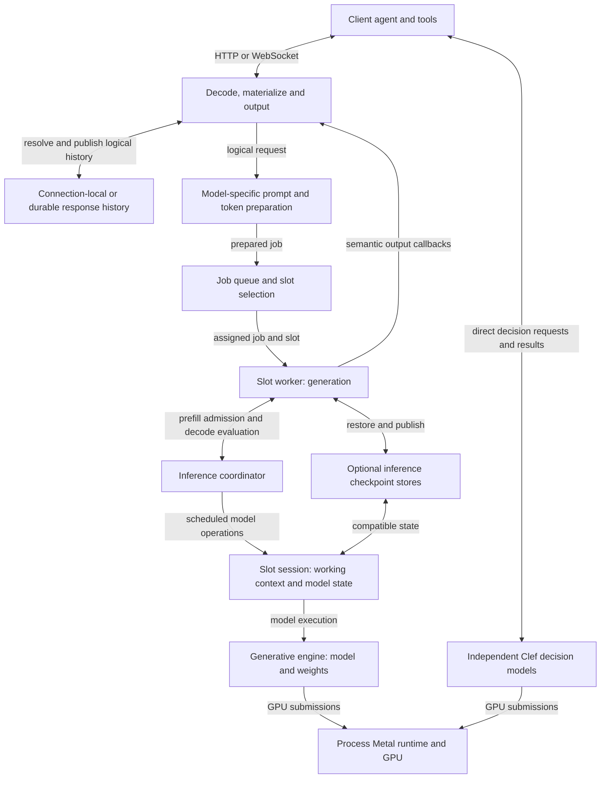

# Architecture and data flow

The server turns a logical conversation into a model-specific prompt, runs it
through one loaded generative engine, and returns structured responses. It can
keep conversation history independently of the inference state used to speed up
later turns. This overview follows the native macOS Metal serving path; model
families have different prompt formats, state layouts and execution paths, so a
shared server interface does not imply identical backend semantics.

The arrows distinguish logical history from checkpoints: history supplies what
the conversation means, while a checkpoint can accelerate rebuilding the model
state for that history. The router assigns a job to a slot; the slot's worker
orchestrates generation and uses the coordinator to schedule prefill and decode
on sessions of the single generative engine. The process GPU runtime also arbitrates work
between owners such as that engine and Clef; it is not a multi-model request
router or an aggregate memory admission policy.

## From request to response

1. The HTTP or WebSocket endpoint decodes a request into logical messages,
   tools and controls. For Responses, [materialization](../src/server/materialize.zig)
   resolves a conversation or `previous_response_id`, restores relevant tool
   history and checks continuation constraints. A canonical bridge presents
   borrowed logical values to model preparation; the source request must remain
   alive while they are used. See [canonical.zig](../src/server/canonical.zig)
   and the [serving boundary](../src/serving/README.md).
2. The model adapter renders the conversation in the selected model's format
   and tokenizes it. DeepSeek V4.1 uses its native prompt renderer; other
   families have their own adapters. Preparation includes tool schemas,
   reasoning controls and, when requested and supported, constraints on output.
   [model.zig](../src/server/model.zig) connects this boundary to the engine.
3. A job enters the server queue. In multi-slot mode the
   [router](../src/server/serving.zig) prefers an available session with a
   reusable prefix and honors required live tool state. A slot owns its session;
   it is not permanently the conversation. An idle checkpoint may be displaced
   when the slot is needed for another request.
4. Generation checks the live session and eligible configured checkpoints,
   restores or reuses compatible state, and prefills the remaining prompt.
   Prefill computes model state for input tokens; decode advances that state as
   output tokens are generated. In batched mode the
   [coordinator](../src/server/coordinator.zig) admits bounded prefill work in
   round-robin order, gives pending decode priority and can combine decode work
   across slots. Single-slot mode serializes inference. Cancellation must wait
   for an in-flight backend call to release its borrowed session and job.
5. [Generation](../src/server/generation.zig) samples from the session's
   logits with request sampling controls or an applicable output constraint,
   advances the model, and projects generated text and tool calls into semantic
   output. [output.zig](../src/server/output.zig) emits Responses events through
   WebSocket or HTTP streaming, or constructs the final response. A function
   call is returned to the client: the client executes the tool and supplies
   its result in a later request. The server does not host programmatic tool
   calling or a Model Context Protocol (MCP) service, execute generic tools, or
   run a server compactor.
6. Completed logical output may be retained for continuation, and eligible
   inference state may separately be published as a checkpoint. These are
   different operations with different configuration and lifetime rules.

For example, a client sends “Remember code=EMBER-73” and receives a response
ID. A later request can send just “What code did I ask you to remember?” with
that ID while the connection-local parent remains available, or after durable
storage has been enabled and the response stored. The server resolves the prior
logical messages, renders the combined working prompt and tries to reuse
compatible inference state. On a cache miss it
can prefill the prompt again; the cache is not the source of the remembered
code. If the model instead emits a function call, the client runs the function
and returns a `function_call_output` with its call ID. Top-level instructions
are not automatically inherited through the response ID.

## Three kinds of state

**Logical response history** is the conversation representation used to
reconstruct later requests. With `store=false`, a WebSocket retains the latest
completed text/function response and private replay on that connection; a
reconnect needs full replay unless the parent was durably stored. With
`store=true` and the response store configured, response ancestry and supported
conversation references can survive restart. Stored and connection-local
continuation currently target text and function tools; image continuation is
not qualified. An unavailable parent produces an error, rather than an
invented history. The [Responses contract](../src/serving/RESPONSES.md) details
transport and storage behavior.

**Working context** is the model-specific rendered and tokenized input, bounded
by the session's context capacity. Durable history can outlive or exceed what
is present in a working context; retaining history does not itself select,
summarize or compact it. A
session's frontier, model state and logits belong to its slot, and can be reset
or reused as requests change. See [session.zig](../src/engine/session.zig).

**Inference caches and checkpoints** are disposable acceleration state, not a
conversation database. Live session prefixes, the optional RAM/SSD state cache
and a separately configured legacy disk key/value (KV) store can avoid
recomputing eligible
work. The disk store has its own load path; DeepSeek uses a mapped canonical
prompt there, while other paths use text matching. See
[persist.zig](../src/server/persist.zig). KV state holds attention keys and
values for processed tokens. The server can capture and restore checkpoints
and, for supported DeepSeek configurations, reuse a suffix after a context
edit. Suffix relocation saves original keys before rotary position encoding
(RoPE), allowing their position-dependent encoding to be applied at the new
position. It has explicit combination restrictions; it is not a general history
editing or summarization system. Presets and model paths enable different
features; see the [checkpoint recipe](../recipes/16-semantic-context-checkpoints.md) and
[DeepSeek implementation on Apple Silicon](models/deepseek/apple-silicon.md#checkpoints-edits-and-speculation).
The model document explains physical state and relocation; this overview owns
the server handoff and storage lifetimes. Model weights and their SSD streaming
and page-in policy are another resource, distinct from conversation and KV checkpoints.

## Ownership and shared resources

[Startup](../src/server/boot.zig) opens a generative engine, creates one or more
slot sessions, and optionally opens the state cache, legacy disk KV store and
response store independently. It may also load independent Clef decision
models, or run a decision-only configuration. Clef answers bounded questions
such as choice, predicate and score with a learned decision head, rather than
generating tokens. Clients call its decision endpoints directly, separately
from the conversational generation flow; see [Clef](CLEF.md). The current server
does not route requests between two co-resident generative engines; that
composition, including shared admission
and scheduling, remains proposed.

The engine owns model configuration, weight mappings and execution resources.
The [GGUF model-file mapping owner](../src/engine/model.zig) holds metadata and
tensor views for the mapping's lifetime. A session holds its own model-specific
continuation state, while an engine resource pool can share scratch or other
resources among sessions where the implementation supports it; see
[session resources](../src/engine/session_resources.zig). The exact allocation,
cache format and continuation behavior vary by family.

The process runtime owns Metal device and queue lifetime. Its
[GPU admission](../src/runtime/gpu.zig) groups in-flight submissions by owner:
dependent work from the active owner can overlap, while another owner waits for
the group to drain. This protects cross-owner execution, but does not make the
server's slot scheduler a general scheduler for two generative models. Some
legacy and platform boundaries remain C or Objective-C, with Metal shaders
performing GPU math. For the supported protocols and their restrictions, see
[Responses](../src/serving/RESPONSES.md); for the broader code map, see
[src/README.md](../src/README.md).
