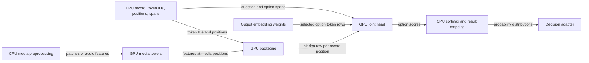

# Clef on Apple Silicon

Clef serves bounded decisions with native Zig and Metal. The CPU constructs a record and the GPU evaluates its backbone and learned joint head; a small final softmax and answer mapping run on the CPU. Serving does not require Python or an MLX runtime. The [reference manual](reference-manual.md) owns the model contract and head mathematics; the [implementation manual](implementation.md) explains request translation, lifetimes and the engine mutex. This page follows the computation and its memory costs.

For a text request, [engine.zig](../../../src/models/clef/engine.zig) encodes the record, runs the backbone once over its tokens, and selects output-embedding rows for option tokens. The learned head combines those lexical rows, the hidden rows and the recorded question and option spans. It can attend to the evidence across the record, not just the last hidden row. The normal head is a GPU graph; the result is a distribution for each question, not a generated sequence. GPU buffers and reusable scratch belong to the engine, and a request consumes borrowed hidden rows before another inference can overwrite them.

Flash and full Clef use a dense hybrid backbone: attention layers and recurrent GatedDeltaNet layers process the token rows, with projections and feed-forward work between them. GatedDeltaNet updates a recurrent state as it processes the sequence, carrying information forward without retaining attention keys and values for every preceding token in that layer. Omni instead has a separate sparse mixture-of-experts backbone: it routes token rows to experts, groups them for expert matrix products and combines their outputs. Its attention and expert execution are distinct from the dense path. Both feed the same kind of joint decision head, configured for their respective backbone widths; selecting the same API does not make their backbone state or kernels interchangeable. See [backend.zig](../../../src/models/clef/backend.zig), [backend_omni.zig](../../../src/models/clef/backend_omni.zig) and [backend_head_full.zig](../../../src/models/clef/backend_head_full.zig).

## Projection work and shape

The shipped backbones use affine INT4 weights: packed four-bit values are combined with scales and biases to reconstruct projection weights. On the ordinary dense path a quantized matrix kernel reconstructs weights as it multiplies token rows. This avoids keeping a second, expanded model in memory, but repeated token tiles can reconstruct the same weights repeatedly. Very few rows use a narrower matrix-vector path; larger batches use matrix tiles. Omni's routed experts use their own gathered kernels and, by default, group expert rows into tiles; the dense optimization below does not apply to Omni.

For dense projections processing at least 2,048 rows, automatic dispatch instead expands one projection to BF16 in a reusable GPU scratch buffer, then uses a Metal Performance Primitives (MPP) matrix multiplication with FP32 accumulation. The next projection reuses that buffer; the checkpoint and resident weights remain INT4. This trades the expansion pass and extra memory for less repeated dequantization when enough rows reuse a matrix. The lazily allocated buffer costs about 192 MiB for Flash or 340 MiB for full Clef. Below the threshold the normal quantized path avoids that fixed cost. The dense feed-forward path also accepts BF16 gate and up projections directly, avoiding a separate full FP32 widening buffer. The relevant dispatch and scratch allocation are in [backend.zig](../../../src/models/clef/backend.zig), and the expanded operation is in [dequant_gemm.metal](../../../src/metal/clef/dequant_gemm.metal).

The [kernel report](../../../speed-bench/experiments/clef-native-20261024/KERNEL-PERFORMANCE.md) records the 2026-10-25 M5 Max 128 GB screen and frozen revisions. Its long dense cases favored expansion, while forcing it at 266 tokens regressed; each case had only three measured warm calls. These observations motivate the threshold on that machine, but do not establish a general speedup or optimal threshold on other Apple Silicon. A synchronized profile identifies expensive stages but changes command boundaries, so it is not a substitute for whole-request timing. The report also records output comparisons and the additional scratch cost.

## Joint head execution

The baseline head pools contextual hidden rows over each question and option span, giving it representations of the schema in the record. It selects and averages output-embedding rows for each option's token IDs to add a lexical representation, then uses these inputs to attend to hidden memory across the record. The resulting evidence and field representations contribute to an option logit for each allowed answer; the reference manual describes the [head computation](reference-manual.md#from-a-question-to-an-answer) in more detail.

The head's work differs in size from the backbone. Wide memory projections operate on many hidden rows, while question and option projections can have only a handful of rows. The GPU head uses a matrix-vector kernel for at most eight rows or a single output column, and a tiled matrix kernel for larger projections. Pooling, attention and scoring kernels then carry the learned graph through to option scores. Head weights remain BF16 while head activations and calculations use FP32. [backend_head_full.zig](../../../src/models/clef/backend_head_full.zig) and [head_full.metal](../../../src/metal/clef/head_full.metal) show the dispatch and operations.

The full GPU head is the serving default. For numerical diagnosis, `DS4_CLEF_FULL_HEAD_GPU=0` selects the CPU head; adding `DS4_CLEF_HEAD_GPU=1` moves the wide memory projections to GPU while leaving the smaller head on CPU. These are explicitly selected alternatives, not an automatic fallback after a GPU failure. The [head report](../../../speed-bench/experiments/clef-native-20261024/HEAD.md) documents four short Flash cases and their numerical comparisons; its three warm repetitions per case are a screen, not a broad latency guarantee.

The implementation adapts MIT-licensed Cleffa leaves for wide head operations, prefix attention and other model-specific kernels. The quantized projection path also reuses Flint's MLX-derived affine dequantization leaves; MPP tensor setup follows Cleffa. Notices remain alongside the [Cleffa kernels](../../../src/metal/clef/LICENSE.cleffa) and [Flint vendor code](../../../src/metal/flint/prefill/vendor/LICENSE). These are source adaptations compiled into the native runtime, not a Python or MLX serving dependency.

## Reusing a state prefix

A long state followed by changed questions can repeat most backbone work even though the answer head must evaluate the new schema. The optional dense text prefix cache retains one causal prefix before the schema: attention keys and values, recurrent state and convolution tails, and final hidden rows. On a matching request, the backbone resumes after that prefix, appends fresh hidden rows, and the ordinary head runs over the complete retained and fresh evidence with the new questions. It caches neither an answer nor head probabilities. For example, a long support history can be reused when the caller changes its routing options; an early edit to the history changes token IDs and misses.

This is retained RAM and GPU state, not the generative SSD checkpoint cache. At one measured 2,881-token input, retained payload at capacity 3,456 was about 321 MiB for Flash and 651 MiB for full Clef, in addition to ordinary weights and scratch. The [implementation manual](implementation.md#ownership-and-repeated-state) describes activation, matching and bypass rules; the [prefix report](../../../speed-bench/experiments/clef-native-20261024/PREFIX-CACHE.md) describes the synthetic mixed replay, exact distribution checks and three-observation per-case timing limits.

## Media and shared GPU time

Media adds CPU preprocessing and GPU tower work before the backbone. Images and video become resized patches; audio becomes 16 kHz mono features for Omni's audio tower. The vision and audio towers are loaded lazily, own reusable GPU scratch and produce feature rows injected at the record's media positions. The CPU preparation can overlap other work before the engine lock, but tower execution and the decision use that engine's protected scratch. Larger image grids, more sampled frames or longer audio increase preprocessing, tower work and the number of backbone positions; media positions also consume the context budget. The [media implementation](implementation.md#media-and-failure-boundaries) gives supported modalities and limits, and the [media report](../../../speed-bench/experiments/clef-native-20261024/MEDIA.md) separates component checks from end-to-end decisions.

Clef engines share the process Metal runtime with other models. By default, dense and Omni prefill each submit a whole backbone command, so another GPU owner may wait for a long request. `DS4_CLEF_LAYER_QUANTUM` optionally ends and submits after groups of complete layers, giving waiting owners an opportunity to run; the engine retains its mutex and intermediate state across the yields. This is cooperative scheduling, not preemption of an in-flight GPU command. Extra submissions can increase Clef latency even when it runs alone. The [scheduling report](../../../speed-bench/experiments/clef-native-20261024/SCHEDULING.md) records one M5 Max co-serving workload and only two repetitions per setting; it supports an opt-in tradeoff, not a universal quantum. Shared admission is described in [runtime/gpu.zig](../../../src/runtime/gpu.zig) and the [architecture overview](../../architecture.md#ownership-and-shared-resources).

The cited performance and qualification work targets M5 Max with 128 GB. The available reports do not qualify performance on other Apple Silicon generations. The [broader quality report](../../../speed-bench/experiments/clef-native-20261024/BROAD_QUALITY.md) records text and image samples with their workload and reference limitations; neither a kernel microbenchmark nor those samples establish general model quality or media performance.
