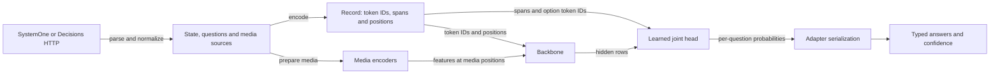

# Native Clef implementation

The server maps two decision APIs onto one native Clef inference path. A request supplies evidence and bounded questions; one backbone pass and a learned joint head produce a probability distribution for each question. There is no autoregressive answer generation or Python runtime in serving. This document follows the local mapping and state lifetimes. The [reference manual](reference-manual.md) explains the model and head mathematics; [Apple Silicon](apple-silicon.md) explains execution and kernels.



## Requests and answers

[decisions.zig](../../../src/server/decisions.zig) translates both wire formats to the same [typed request](../../../src/models/clef/types.zig). SystemOne takes `state` and a named `questions` object with `noul`, `choice` or `score` types. Decisions takes `input` and an ordered array of `predicate`, `choice` or `score` questions; names can be absent or repeated. Predicate becomes the same two-option `noul` primitive. Decisions choice values can be strings or booleans, and the adapter keeps their wire types separate from model-facing option IDs. Choice options are sorted for the record, then probabilities are mapped back to caller order.

For example, a Decisions request can route a duplicate charge:

```json
{
  "model": "clef-flash",
  "input": "The customer was charged twice and wants a refund.",
  "questions": [{
    "type": "choice", "name": "department",
    "instructions": "Who should handle this request?",
    "choices": [
      {"value": "billing", "description": "Payments and refunds"},
      {"value": "technical", "description": "Software faults"}
    ]
  }]
}
```

The adapter constructs one question with the two described options. The record renders its instruction and each option's ID and description, retaining their token spans and the option token IDs. The backbone produces contextual hidden rows for the record, and the head uses those spans and the output-embedding rows selected by the option IDs to score both options against the evidence. The adapter maps the resulting probabilities back to the original typed values and caller order.

If that distribution were 0.8 billing and 0.2 technical, Decisions would return `billing`, both probabilities, and confidence 0.8. This distribution is illustrative, not a promised prediction. The equivalent SystemOne request uses `state`, a named question and a `criteria` object; its answer is keyed by that name and its chance-corrected choice confidence would be 0.6. SystemOne score confidence instead measures probability-weighted distance from the modal level relative to a uniform distribution. Decisions reports maximum probability for choice and score. Both return the probability of true for predicates, and scores are probability-weighted mean level indices. These confidence policies are adapter transformations, not a claim of hosted calibration.

Decisions preserves ordered message and tool evidence and extracts `input_image` parts into labeled media; an `input_json` part remains JSON evidence. SystemOne accepts named image assets. Both also accept local `images`, `audio` and `videos` extensions. Media is placed as a labeled prefix before the state, with references replacing extracted image payloads; this is local source policy, not arbitrary inline asset expansion. Multipart assets and box extraction are unsupported. See the [API guide](usage.md) for request forms and limits.

## Record, backbone and head

[record.zig](../../../src/models/clef/record.zig) renders the chat-template system instruction, state, schema fields and final decision marker. Strings remain text; structured values are compact JSON with sorted keys. The [tokenizer](../../../src/models/clef/tokenizer.zig) produces token IDs, while the record retains question instruction spans, option spans, source ordering, lexical option token IDs and media positions. Those spans are essential: the head consumes evidence throughout the record as well as the questions and options, rather than merely reading the final token.

[engine.zig](../../../src/models/clef/engine.zig) obtains backbone hidden rows and output-embedding rows for the option tokens, then runs the learned head. The output-embedding rows supply lexical option vectors and are distinct from the contextual hidden rows; the [reference head description](reference-manual.md#from-a-question-to-an-answer) explains how they combine. The ordinary serving path uses the full GPU head; CPU and split paths are diagnostic alternatives. The head returns per-question probabilities, and the wire adapter constructs the answer and usage. The input token count includes media positions and schema; output token count is zero. The result is a decision over the supplied options, not a generated explanation.

Flash and full Clef use the dense Qwen3.5 hybrid backbone implemented in [backend.zig](../../../src/models/clef/backend.zig), combining attention and recurrent GatedDeltaNet layers. Omni uses the separate sparse mixture-of-experts thinker in [backend_omni.zig](../../../src/models/clef/backend_omni.zig), with routed experts and its own media path. They share the decision interface, not identical backbone state or execution. The matching tokenizer, checkpoint, output embedding and learned head must be loaded together.

## Media and failure boundaries

[media_prepare.zig](../../../src/models/clef/media_prepare.zig) fetches and decodes each request's sources and prepares patches or audio on the CPU before taking the engine mutex. The record assigns media rows and three-axis positions that locate features in time and space. The lazily loaded vision and audio towers produce features for those rows. The runtime copies these features out of reusable tower scratch before injecting them into the backbone. Flash/full accept images and silent video; Omni additionally accepts audio and synchronized audiovisual video. Encoded video is sampled at 2 frames per second and audio resampled to 16 kHz mono; explicit frames and samples are also supported. Native decoding uses the narrow FFmpeg boundary, not a Python process.

HTTP bodies and individual media sources are limited to 64 MiB; decoded geometry and media processing have further limits. The complete record, including media and questions, must fit 16,384 tokens for Flash/full or 64,000 for Omni, further capped by `--ctx`. The server rejects an oversized record rather than silently truncating its state. Invalid or unsupported input returns a client error, oversized media returns 413, fetch failures return 502, and an overlong context returns 422; other execution failures can return 500. See [clef_entry.zig](../../../src/clef_entry.zig) for the exact error mapping.

## Ownership and repeated state

Startup can load a decision-only model with `--model`, or add one or more helpers with repeated `--decision-model`. The [registry](../../../src/clef_entry.zig) selects a loaded engine by model name. Each engine owns its own mapped weights, tokenizer, selected head, tower state and reusable scratch. Request JSON, decoded media, record and result live in a per-request arena; borrowed backend hidden rows remain valid only until the next inference and are consumed while the engine mutex is held. The serialized response is copied out before that arena is destroyed. CPU media preparation can proceed concurrently, but requests for the same engine serialize record encoding, tower execution, backbone and head under its mutex.

Named `ds4-local` profiles enable one optional RAM prefix entry per dense Flash/full engine; direct server use requires `DS4_CLEF_PREFIX_CACHE=1`, and `0` disables it. [prefix.zig](../../../src/models/clef/prefix.zig) rounds the boundary before the schema down to a multiple of 64 tokens and requires at least 256 prefix tokens. A hit requires identical leading token IDs through the retained boundary. The entry keeps attention keys and values, recurrent state and convolution tails, plus final hidden prefix rows: the head needs those rows as well as continuation state. The remaining state and new schema run afresh, and the head and answer are recomputed. Thus a changed question can reuse the same long state, while an early state edit misses. One entry has room for 512 additional token rows, aligned and capped at 16,384; growth beyond capacity replaces it. Failed inference clears a partial entry. Short text, media, Omni and profiling bypass it. It is neither client-keyed nor persisted in the generative SSD checkpoint cache.

The [prefix qualification](../../../speed-bench/experiments/clef-native-20261024/PREFIX-CACHE.md) measured a synthetic 27-request replay with both dense models and found identical distributions in that run; it also records misses, retained memory and timing scope. This establishes the tested replay, not a general latency guarantee. The broader [qualification report](../../../speed-bench/experiments/clef-native-20261024/README.md) separates numerical, text, media and mixed-serving observations from model capabilities.

## Shared GPU and scheduling

Loaded engines own their model resources, but share the process Metal runtime. Its [GPU admission](../../../src/runtime/gpu.zig) admits dependent submissions from an active owner together and waits for that group to drain before another owner proceeds. Input preparation and waiting can overlap; contention can increase latency. Clef requests do not enter the generative slot scheduler, and co-hosting helpers with one generator does not implement routing between two generative models or aggregate memory admission. Automatic generative cache admission does not subtract other loaded models; use explicit per-engine budgets when co-hosting. See the [architecture overview](../../architecture.md#ownership-and-shared-resources).

Cancellation is checked while preparing media, waiting for the engine mutex, and at execution boundaries. An in-flight GPU command must finish before its borrowed resources can be released; cancellation is not instantaneous GPU preemption. By default a Clef prefill uses one command. `DS4_CLEF_LAYER_QUANTUM` optionally yields between complete layer groups while retaining the engine mutex, giving another GPU owner opportunities to run. The [scheduling experiment](../../../speed-bench/experiments/clef-native-20261024/SCHEDULING.md) documents a particular co-serving tradeoff and its limited sample; it does not establish a universal setting.
