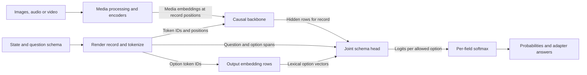

# Clef reference manual

Clef is a family of learned decision models. Given a state and a schema of questions, it assigns a probability to each allowed answer for every question in one forward pass. The state can describe a situation in text or structured data and, depending on the model, include media. The schema supplies the questions and their possible answers. This is bounded prediction: the model does not write an explanation, choose an arbitrary new label, or generate an answer token by token. Its backbone comes from a generative model, but a normal text-generation loop does not run Clef's learned decision head.

This manual describes the model contract and reference inference. The [native implementation](implementation.md) owns our adapter and runtime; [Apple Silicon](apple-silicon.md) owns execution and performance. The evidence here includes Cloudflare's pinned [Flash source](https://huggingface.co/Cloudflare/clef-flash/tree/f0b7d3cd65296abfe459e6c228b618f5d8b26d2f) and [Omni source](https://huggingface.co/Cloudflare/clef-omni/tree/df2d7c9505e62ba8a527b147513a4fa66a77dc5d), the local quantized checkpoint cards and reference loaders, and the [qualification report](../../../speed-bench/experiments/clef-native-20261024/README.md). The loaders are ports of the reference, not themselves Cloudflare's implementation.

## From a question to an answer

For example, a support request can be the state, with a choice field asking for `billing` or `technical` and a predicate asking whether service is down. The model sees the request, both questions, and descriptions of the allowed options together. It returns a separate probability distribution for each field. A caller can select the most probable department and inspect the probability of `true`; neither result is a generated sentence. Changing a description changes the model input and can change the decision.

For the `billing` option, the encoder records the token span of its rendered ID and description. The backbone produces contextual hidden rows for that span, while the same option token IDs select rows from the output embedding matrix; averaging those embedding rows gives a lexical option vector. The head combines these inputs with the question and record evidence to produce an option logit, then softmax converts the logits for this field into probabilities.

The backbone processes the record causally: a hidden row can depend on the preceding record, not later tokens. Media encoder features join the sequence at their assigned record positions and participate in that pass. The head then uses rows throughout the completed pass, including the final row, to consider evidence and questions jointly. Thus a question's own pooled row is not the entire answer: the head also attends to the record's hidden memory. Softmax is applied **within each field**, so the probabilities of different questions are not one shared distribution. Joint processing can let fields inform each other, but does not guarantee logically consistent answers.

The reference head first normalizes and projects the backbone hidden rows into memory. It averages the instruction span for each question, and each option's contextual hidden rows. It also averages output-embedding matrix rows for the option's token IDs; those lexical vectors are distinct from contextual hidden rows and are needed even though no next token is generated. Projected option, lexical and question vectors form option queries. Evidence-routing layers attend those queries to memory, gathering record evidence for each option.

The head summarizes each field's options, adds question, final-record and type features, and runs joint field layers over the memory, allowing fields to exchange context. Its final option logits combine a lexical similarity prior, field-to-option similarity and a learned residual scorer. The local [Flash loader](../../../gguf/clef-flash-int4/clef_mlx.py) makes these operations explicit; its accompanying `joint_head_config.json` specifies width 1,024, two routing layers and four field layers.

## Record representation

The reference record is a token sequence with a system instruction followed by `STATE:`, `SCHEMA FIELDS:`, and a final `JOINT SCHEMA DECISIONS:` marker in the chat template. Each field contains an ID, type, instruction and numbered allowed options; each option's rendered semantics includes its ID and optional description. Strings are rendered directly; other JSON values are compactly serialized with sorted object keys. The encoder retains token spans for instructions and option semantics, plus option IDs and types, because the head needs more than the final hidden row. See the local [record implementation](../../../src/models/clef/record.zig) and the checkpoint loader's `encode_record`.

The three model question types are `noul`, `choice` and `score`. A `noul` is a two-option true/false proposition, with default descriptions that may be supplied or overridden. Choice options are identified by their keys and sorted by key in the encoded record. Score criteria form ordered levels indexed from zero. Their wording and ordering matter: a score is a distribution over those discrete levels, rather than an unconstrained real-valued regression.

The local SystemOne adapter exposes `noul`, `choice` and `score` using named questions and `state`; its Decisions adapter maps `predicate` to the same `noul` model primitive, with an ordered question list and `input`. The model emits probabilities; response formatting is adapter policy. In the bundled MLX reference adapter, `noul` returns the probability of true, choice returns the highest-probability option, and score returns the probability-weighted mean of level indices. Its choice and score confidence is the maximum probability. Our adapter also uses maximum probability for Decisions, but SystemOne choice confidence subtracts uniform chance and rescales to [0, 1]; score confidence uses probability-weighted distance from the modal level relative to uniform distance. These are transformations of the same distribution, not evidence of hosted calibration. See [serialization](../../../src/server/decisions.zig) and [the local API guide](usage.md).

## Backbones and media

Clef-Flash and full Clef use dense Qwen3.5 backbones with a vision pathway; their checkpoint cards identify 9B and 27B bases respectively. Omni uses the Qwen3-Omni thinker, a 30B-A3B mixture of experts: a router selects a subset of experts per token. Its local configuration specifies 48 text layers, 128 experts and eight selected experts per token. Omni also has vision and audio encoders. Its speech-generation talker is not part of the decision path or the local Omni checkpoint. The backbone family and checkpoint determine hidden width; the learned joint head is a separate required component, not an interchangeable generic classifier.

Images are resized and patched for a vision tower, whose features occupy media positions in the backbone sequence. Video supplies sampled frames and temporal positions, consuming context along with text and schema. The Flash reference loader supports images or videos in a record, but does not support mixing those two in one record. Omni's reference loader supports mixing images, audio and video; it uses an audio encoder for audio features and time-aligned positions to interleave a video's soundtrack with frames when every video in the record has one. Its loader accepts explicit frame arrays and 16 kHz mono samples as well as decoded sources; the card describes video file sampling at two frames per second. These are loader and model pathways, not a claim that every HTTP API accepts every source form. See the local [Flash card](../../../gguf/clef-flash-int4/README.md) and [Omni card](../../../gguf/clef-omni-int4/README.md).

Our serving adapter inserts labeled media prefixes before the rendered state; this is a local mapping, not a claim that Cloudflare's API uses that placement. It supports images and silent video for Flash/full, and audio plus synchronized audiovisual video for Omni. Encoded video is sampled at two frames per second and audio is resampled to 16 kHz mono. Actual request forms, supported combinations and decoding limits are documented in [Clef setup and API](usage.md). Media tokens occupy context, so a short textual request can still exceed the limit.

## Checkpoints and limits

The local bundles use MLX-community affine INT4 backbone conversions, with group size 64; the learned joint head is retained in BF16. Flash's vision tower is BF16. Omni's vision and audio encoders are BF16, its expert routers use 8-bit quantization, and its output embedding is quantized even though the head reads its rows. The tokenizer, processor configuration, backbone, output embedding and matching head together define the inference contract: loading only the backbone or substituting a differently packed quantization is insufficient. The checkpoint cards describe their conversion and small parity checks; those checks do not establish full task equivalence to BF16.

The bundled Flash loader defaults to a 16,384-token record and Omni to 64,000; by default they truncate state to fit, or can reject instead. Fixed schema and media tokens must still fit. Those are reference-loader defaults, not universal model or hosted API limits. Our server instead rejects an overlong record, with model limits of 16,384 for Flash/full and 64,000 for Omni further capped by `--ctx`; request-body and other adapter limits are local policy. The local [qualification report](../../../speed-bench/experiments/clef-native-20261024/README.md) records comparisons and their scope. Exact training data, calibration guarantees and behavior of an independently hosted service are not established by these local artifacts.
