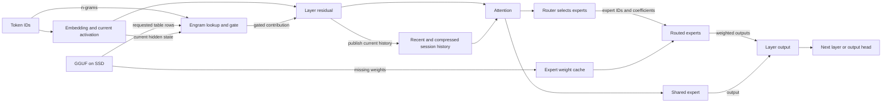
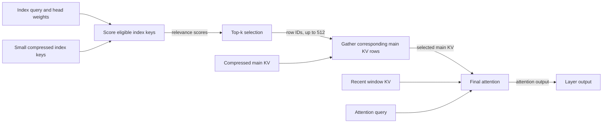

# DeepSeek V4.1 Flash on Apple Silicon

DeepSeek V4.1 Flash performs inference through attention, routed experts and
Engram lookups. On Apple Silicon, executing that path means moving both model
weights and per-session attention history through a machine whose unified memory
may be smaller than the model. This page explains those physical data paths,
Metal operations and measured tradeoffs. The [reference manual](reference-manual.md)
explains what the model computes; the [implementation](implementation.md)
explains engine and session ownership and continuation transactions.

The principal qualified configuration uses an M5 Max with 128 GiB of unified
memory and the 1017 IQ2_XXS/Q2_K imatrix GGUF. Available artifacts differ in
both checkpoint and weight representation:

- **Q2:** the qualified 1017 file is 341 GiB, comprising 152 GiB of main
  weights and 189 GiB of Engram tables.
- **Q4:** the listed file uses the earlier Flash release.
- **MXFP4:** the full 1017 file has not been run in this adaptation.

See the [model guide](../../MODELS.md) for the artifacts and qualification.
These weight formats are separate from the attention-cache formats below.

## From weights to layer output

At each layer, attention reads the session's history and transforms the current
activation. The feed-forward router then selects six experts for that activation.
Each selected expert applies gate/up projections, an activation and a down
projection. Their results are combined with routing coefficients, and the
shared expert contributes as well. The resulting activation continues through
the layer stack to the output head.

Engram supplies a different input to its trained layers. Token n-grams select
rows from large learned tables; the runtime fetches those rows, projects and
gates their contribution using the current hidden state. It is part of the
model's computation, not a checkpoint of the conversation. The
[reference manual](reference-manual.md#experts-and-engram) describes the
model-level distinction between these lookups and expert routing.

The diagram shows the movement of inputs and weights, rather than the exact
order of every operation. Engram rows and expert weights are both read from the
model file, but their access patterns differ: Engram fetches selected table
rows, while the router requests whole expert weights. Attention history belongs
to a session and is produced by inference; it is not loaded as model weights.

## Unified memory and streamed weights

Unified memory lets the CPU and GPU use shared memory resources. It does not
make the qualified Q2 model's 152 GiB main-weight set fit in a 128 GiB machine,
especially alongside the OS, session history and working buffers. The backend
therefore reads missing routed experts from SSD into a bounded expert cache.
An expert already in that cache can be reused; a miss must be supplied from the
model file. Engram rows are also read on demand, including when main weights
are resident. The cache budget is a target constrained by available memory and
prefill headroom, not a guarantee of allocation or physical SSD bandwidth.
See [SSD streaming](../../SSD_STREAMING.md), the
[expert cache](../../../src/engine/deepseek41/expert_cache.zig) and
[Metal expert I/O](../../../src/metal/expert_io.zig).

Prompt prefill processes many token rows at a time. Layer-major execution can
read expert weights for a layer, reuse them across the rows that select those
experts, and overlap reads for the next layer. Short appends may instead use
smaller selected-expert tiles and the ordinary cache, avoiding a full sweep.
The choice depends on the chunk and available cache; [prefill policy](../../../src/engine/deepseek41/prefill_policy.zig)
and [execution](../../../src/engine/deepseek41/prefill.zig) define it.

Decode advances a session one token at a time, leaving less opportunity to
amortize a weight read across its rows. A cache miss can therefore lie on the
path to the next token. The server can batch work from multiple sessions and
interleave bounded prefill with decode; its scheduling quantum is distinct
from the engine's prefill capacity. A logical read request is not itself a
measurement of physical SSD traffic. See the [serving architecture](../../architecture.md)
for scheduling and the [implementation](implementation.md) for ownership.

## Routing and Metal execution

The ordinary router selects experts from the model's scores regardless of
which weights happen to be resident. An optional resident-route approximation
can replace up to three weaker missing choices with resident candidates, subject
to affinity, rank and mass bounds. It keeps the original coefficients and
protects the three strongest choices, but a substitute expert computes a
different function. The [routing recipe](../../../recipes/01-resident-routing.md)
explains the limits and measured quality tradeoff.

Activation depends on the launcher policy:

- `resident-fast` enables substitutions during decode.
- `persistent-fast` also enables them for selected prefill, which snapshots
  residency once per call. Full sweeps and scalar prefill fallbacks retain
  native routing.
- Ordinary routing remains native without these opt-in policies.

Metal uses batched routed matrix multiplication to group rows by expert. The
kernel unpacks a quantized weight tile and multiplies it by the corresponding
activation tile, so multiple rows can reuse that weight tile before their
weighted outputs are combined. Grouping, unpacking and staging also cost work;
a single decode row does not necessarily benefit in the same way. See
[routed dispatch](../../../src/metal/routed_batch.inc.m) and the
[MoE kernels](../../../src/metal/moe.metal).

Hardware dispatch chooses among implementations for the operation and device.
The M5 path includes cooperative Metal tensor `matmul2d` operations with float
accumulation; other paths use SIMD-group matrix or scalar/vector operations.
This does not mean every operation uses tensor hardware. The intended pre-M5
fallback, including M1, has implementation and fixture coverage on an M5;
M1 performance has not been measured. The [Metal overview](../../METAL.md)
explains the shared backend paths.

## Attention history and retrieval

Attention needs both recent detail and a manageable representation of older
context. Each layer keeps a 128-row sliding window of recent keys and values.
Publishing layers also create compressed main KV rows and small index keys.
These rows extend access to long history, but can overlap positions still in
the recent window; an unfinished pair remains in carry state until complete.
The index is a retrieval aid: it identifies which main rows to read,
so final attention does not have to consume all compressed history. The first
two layers use only the recent window. The [reference manual](reference-manual.md)
explains the model's compression and selection contract.

For a query at an index refresh, the backend projects an index query and learned
head weights. It compares that query with eligible index keys, producing one
relevance score per row. Top-k turns those scores into at most 512 row IDs;
the backend gathers the corresponding main KV rows and combines them with the
visible recent window for attention. The attention query then computes its own
scores and normalization over those inputs. A retrieval score is therefore not
an attention weight: a selected row can still receive little final weight.
Causal bounds prevent a query from selecting future history.

The four physical compressed-KV owners are published at layers 2, 8, 14 and
20. These publishers also create the corresponding index keys. Selection is
refreshed at eight layers: 2, 8, 14, 20, 24, 28, 32 and 36. Later refreshes
can thus choose new rows from an existing owner's keys without publishing a
new key cache. Layer 20 also chooses candidate blocks for later refreshes;
that additional narrowing remains separate from final attention. The
[configuration](../../../src/engine/config.zig) defines these layer policies,
and [attention](../../../src/engine/deepseek41/attention.zig) implements
publication, scoring, selection and gathering.

## Representing the history

The existing publication boundary quantizes compressed rows before storing
them. In the expanded layout, their decoded values occupy F32 containers; the
container width does not mean the values retain full original precision.
Physical FP4 packing instead stores the quantizer's four-bit E2M1 codes and
scales. This is a storage choice for attention history, independent of the
GGUF weight quantization.

| Compressed row | Expanded F32 | Packed representation |
| --- | ---: | --- |
| Main KV, 512 values | 2,048 bytes | 256 code bytes and 32 E4M3 scale bytes, 288 bytes total; one scale per 16 values |
| Index key, 128 values | 512 bytes | 64 code bytes and four E8M0 scale bytes, 68 bytes total; one scale per 32 values |

E2M1, E4M3 and E8M0 describe floating-point code formats: the numbers give
exponent and mantissa widths. Main KV also has an F16 storage option. Packing
changes the actual owner arrays, not just checkpoint serialization; consumers
decode the rows they need into bounded scratch or attention tiles. Raw window
rings and other scratch remain separate allocations. The first three owners
allocate `context/2 + 1` compressed rows each and the fourth `context + 1`;
[resources](../../../src/engine/deepseek41/resources.zig) allocates the
corresponding buffers.

## Scoring on Metal

The scorer takes index queries, head weights and stored index keys and returns
relevance scores for top-k; it does not gather main KV or perform final
attention. A straightforward reader can score keys in expanded F32, while a
packed reader decodes the needed FP4 values as it scores. These readers preserve
the same retrieval role regardless of physical layout.

SIMD scoring is a separate dispatch choice from packing: it has both F32 and
FP4 readers. In decode, when SIMD is enabled and at least 1,024 **index rows**
are available, one 32-lane SIMD group handles a key, with each lane holding
four of its 128 values; four groups handle four keys. Smaller histories use
the older reader. If `DS4_V41_INDEX_SIMD` is unset, the engine enables SIMD
for packed index storage; an explicit setting controls it independently.
Wide prefill can decode packed keys into transient BF16 tiles for tensor
scoring. Multiple prefill queries reuse a decoded tile, amortizing preparation,
but decoding and staging still cost work. A causal SIMD batch path is available
when tensor operations are not. The preparation buffer is not a persistent
expanded key cache. See the
[dispatch](../../../src/engine/deepseek41/attention.zig),
[Metal index implementation](../../../src/metal/index_selection.zig) and
[index recipe](../../../recipes/14-packed-index-cache.md).

Ordinary engine defaults use expanded main and index owners. The DeepSeek fast
launcher presets select packed main and index storage and SIMD scoring, while
honoring explicit overrides; an explicit F16-only main request selects F16.
These are launcher policies rather than universal engine defaults. See the
[main KV recipe](../../../recipes/15-packed-main-kv.md) and
[index recipe](../../../recipes/14-packed-index-cache.md) for the settings.

Fresh publication keeps the scale computed by the quantizer. Importing an old
expanded main cache is different: only decoded values remain, and recomputing
the original scale is not generally idempotent. The legacy repacker preserves
the decoded F32 bytes, including signed zero, for the established quantized
alphabet. It need not reproduce the original packed code bytes and is not a
general compressor for arbitrary F32 values. The [main KV recipe](../../../recipes/15-packed-main-kv.md)
explains the conversion and the observed counterexample.

## Measured storage tradeoffs

Relative to expanded F32 owners, packed index rows use 86.72% fewer bytes and
packed main rows 85.94% fewer. These figures describe those arrays, not total
process memory or SSD traffic. Smaller state is useful for capacity and
checkpoint storage, but decoding packed values also costs work.

A [five-pair index comparison](../../../speed-bench/experiments/index-five-samples-20261027/README.md)
on M5 Max at revision `da31a6be3913` held SIMD enabled and changed only index
storage. Its favorable 32,768-token prompt used an 8,192-token prefill chunk;
mean fresh answer prefill plus generation was 48.730 s expanded and 48.362 s
packed, with an order effect and a median paired change of −0.12%. All answers
and the measured teacher distributions matched. This supports neither a
reliable speedup nor a repeatable penalty for that task.

A separate [main KV comparison](../../../speed-bench/experiments/main-fp4-20261028/README.md)
held packed index and SIMD on while changing main storage. Five alternating
pairs found neutral latency on the tested 8K cases; the favorable 32K task rose
from 47.600 s to 48.540 s on average, with packed slower in all five pairs.
Answers and measured teacher rows matched in these tests. The fast presets
accept this measured capacity/latency tradeoff; neither comparison establishes
performance on other workloads or machines.

## Continuation and reuse

The live attention history can also be serialized as a disposable checkpoint.
Packed main and index layouts reduce the state stored as well as the live owner
arrays; supported layout conversions allow a checkpoint to load into a graph
with a different configuration. This SSD checkpoint cache saves inference
state, whereas the expert cache holds model weights and Engram reads fetch
model table rows. Durable conversation history is separate from all three.
The [implementation](implementation.md#continuation-and-storage) describes
what must move together and how restoration falls back to evaluation.

After an edit, suffix reuse can import an unchanged span and recompute a fresh
tail. Position-dependent rotary lanes are reconstructed from immutable BF16
pre-RoPE originals before repacking, rather than repeatedly rotating quantized
rows. The imported activations still reflect their old left context, making the
graft approximate. Semantic grafts exclude DSpark/MTP, steering, tensor
parallelism and decoder replay; other eligibility failures fall back to
evaluation. See the [suffix recipe](../../../recipes/02-suffix-reuse.md).

Server `persistent-fast` can capture eligible semantic endpoints during an
ordinary prefill sweep, avoiding a separate sweep for each endpoint. Unsupported
collection falls back to ordinary capture. The [checkpoint recipe](../../../recipes/16-semantic-context-checkpoints.md)
describes its settings and costs; the [lab account](../../lab/journal/2026-10-28-deepseek-semantic-checkpoints.md)
explains the measured edit-workflow decisions.

DSpark is an optional resident 8.04 GiB drafter: it proposes tokens for the
target to verify, so it can advance decode by more than one token per target
pass when acceptance is favorable. It does not accelerate prefill, and
session-batched serving uses ordinary target decoding. The optional DSP1
checkpoint appendix stores target features to help rebuild draft state after
restore. Fast presets enable DSP1 when DSpark is used; ordinary engine defaults
do not. A [five-pair restored-continuation test](../../../speed-bench/experiments/draft-features-five-20261028/README.md)
supported DSP1 for its warm-file, DSpark-enabled restore workload, excluding
startup and seed requests. See [speculative decoding](../../SPECULATIVE_DECODING.md)
for activation and limits.
