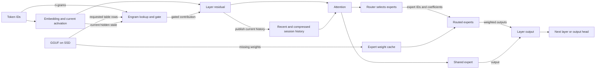
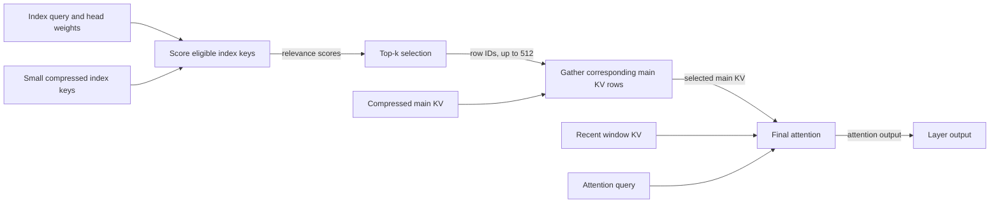

# DeepSeek V4.1 Flash on Apple Silicon

DeepSeek V4.1 Flash performs inference through attention, routed experts and
Engram lookups. On Apple Silicon, executing that path means moving both model
weights and per-session attention history through a machine whose unified memory
may be smaller than the model. This page explains those physical data paths,
Metal operations and measured tradeoffs. The [reference manual](reference-manual.md)
explains what the model computes; the [implementation](implementation.md)
explains engine and session ownership and continuation transactions.

The principal qualified configuration uses an M5 Max with 128 GiB of unified
memory and the 1017 IQ2_XXS/Q2_K imatrix GGUF. Available artifacts differ in
both checkpoint and weight representation:

- **Q2:** the qualified 1017 file is 341 GiB, comprising 152 GiB of main
  weights and 189 GiB of Engram tables.
- **Q4:** the listed file uses the earlier Flash release.
- **MXFP4:** the full 1017 file has not been run in this adaptation.

See the [model guide](../artifacts.md) for the artifacts and qualification.
These weight formats are separate from the attention-cache formats below.

## From weights to layer output

At each layer, attention reads the session's history and transforms the current
activation. The feed-forward router then selects six experts for that activation.
Each selected expert applies gate/up projections, an activation and a down
projection. Their results are combined with routing coefficients, and the
shared expert contributes as well. The resulting activation continues through
the layer stack to the output head.

Engram supplies a different input to its trained layers. Token n-grams select
rows from large learned tables; the runtime fetches those rows, projects and
gates their contribution using the current hidden state. It is part of the
model's computation, not a checkpoint of the conversation. The
[reference manual](reference-manual.md#experts-and-engram) describes the
model-level distinction between these lookups and expert routing.

The diagram shows the movement of inputs and weights, rather than the exact
order of every operation. Engram rows and expert weights are both read from the
model file, but their access patterns differ: Engram fetches selected table
rows, while the router requests whole expert weights. Attention history belongs
to a session and is produced by inference; it is not loaded as model weights.

## Unified memory and streamed weights

Unified memory lets the CPU and GPU use shared memory resources. It does not
make the qualified Q2 model's 152 GiB main-weight set fit in a 128 GiB machine,
especially alongside the OS, session history and working buffers. The backend
therefore reads missing routed experts from SSD into a bounded expert cache.
An expert already in that cache can be reused; a miss must be supplied from the
model file. Engram rows are also read on demand, including when main weights
are resident. The cache budget is a target constrained by available memory and
the headroom needed for prefill, not a guarantee of allocation or physical SSD
bandwidth.
See [SSD streaming](../../storage/expert-streaming.md), the
[expert cache](../../../src/engine/deepseek41/expert_cache.zig) and
[Metal expert I/O](../../../src/metal/expert_io.zig).

Prompt prefill processes many token rows at a time. Layer-major execution can
read expert weights for a layer, reuse them across the rows that select those
experts, and overlap reads for the next layer. Short appends may instead use
smaller selected-expert tiles and the ordinary cache, avoiding a full sweep.
The choice depends on the chunk and available cache; [prefill policy](../../../src/engine/deepseek41/prefill_policy.zig)
and [execution](../../../src/engine/deepseek41/prefill.zig) define it.

A medium SSD append on one GPU can stay in one layer sweep when it fits carry
storage, has at least 2,048 rows of prefill capacity, contains more than 2,048
and fewer than 8,192 rows, and its final tile has at least 256 rows. The runtime
still partitions arithmetic into 2,048-row tiles;
it avoids starting a second streamed-weight sweep for the remainder. On
pre-M5 Apple GPUs, selected near-power-of-two lengths can use wider encoder
tiles. These are dispatch policies ported from upstream, not newly measured
speedups on this machine.

The later decoder layers attend only to a local window. To produce the final
row, each earlier decoder layer therefore needs only the suffix that can
influence that row through the remaining layers. The prefill controller warms
the required raw window and skips older decoder work. Resident single-GPU
text sweeps can also prune inside a tile from 512 rows upward, retaining
compressor alignment and the original tile's router plan. Shorter prompts,
quality mode, image input and tensor parallelism keep their applicable broader
schedule. Semantic checkpoint collection evaluates every row because it must
also produce earlier endpoints, and approximate decoder replay has its own
policy. The dependency calculation preserves the rows needed for the result;
changing execution shapes can still change floating-point rounding. This
pruning is distinct from importing cached activations after an edit.

Decode advances a session one token at a time, leaving less opportunity to
amortize a weight read across its rows. A cache miss can therefore lie on the
path to the next token. The server can batch work from multiple sessions and
interleave bounded prefill with decode; its scheduling quantum is distinct
from the engine's prefill capacity. A logical read request is not itself a
measurement of physical SSD traffic. See the [serving architecture](../../architecture.md)
for scheduling and the [implementation](implementation.md) for ownership.

## Routing and Metal execution

The ordinary router selects experts from the model's scores regardless of
which weights happen to be resident.

### Exact copies of widened weights

Some GGUF tensors store checkpoint BF16 values as F32, or checkpoint FP8 values
as F16. At engine startup, the native
[decode-weight owner](../../../src/engine/deepseek41/decode_weights.zig) checks
whether narrower copies can reproduce every value. Every F32 router-weight
word must have zero in its low 16 bits. Engram and index-query projections must fit
eight-bit E4M3 codes, with four exponent bits and three mantissa bits, plus one
power-of-two scale per 32 by 32 block. A failed check retains the wider reader.

When the value checks succeed and quality mode is off, scalar projections read
fewer weight bytes per token by reconstructing values from the narrow copies.
Prefill can still use the existing GGUF matrices. The copies occupy additional
RAM, charged once to the engine's memory
budget; sessions borrow them. A dedicated residency set and startup warmup
prepare their Metal readers. Teardown drains GPU work before releasing the
copies. The GGUF file and quantized expert-cache entries retain their formats.
Quality mode uses the wider weights.

### Scalar work and command scheduling

For each token, Engram hashes its n-grams into two learned tables, whose rows
feed layers 1 and 14. The [executor](../../../src/engine/deepseek41/executor.zig)
starts both reads before encoding layer 0. At each consuming layer, the executor
joins the corresponding reader and uploads its output into a separate GPU input
buffer. Those distinct buffers
allow earlier work to keep running during the second upload. The ordinary
single-Mac path submits work after layer 0 and then every two layers by default;
the output head can join the final submission. In the default eligible
SSD-streaming decode path, however, each layer's router ends the current GPU
commands before the CPU reads selected IDs, applies any resident substitutions
and begins loading the selected weights. Routed expert execution follows that
host decision. Thus the general two-layer submission interval does not remove
this per-router dependency. The optional asynchronous load path has different
synchronization; see [MoE dispatch](../../../src/engine/deepseek41/moe.zig).
On failure, the executor joins
outstanding readers before their borrowed token IDs and output rows leave scope.

An opt-in scalar streaming path with resident routing can move the shared
expert's gate/up projections and activation across that host wait. They use
the same normalized input as the router but do not use its selected IDs or
coefficients. The GPU signals an event after routing and continues the shared
work while the CPU reads the selection, applies the resident policy and starts
expert loads. The routed computation still depends on that selection. The
optional `DS4_METAL_SELECTED_READBACK_SPIN_US` wait polls for a bounded period
before blocking, trading host CPU time for potentially faster event response.
The `resident-fast` and `persistent-fast` launcher presets enable overlap and
default to a 2 ms poll, with environment overrides; ordinary runtime defaults
remain off. Both waits retain the 60-second overall deadline.

Event readiness and resource retirement are distinct. Earlier routed expert
reads precede the router event, so this path can retire their expert-cache pins
after the event without waiting for independent shared work. Pending command
buffers, their static views and the newly opened batch remain live until their
usual completion. This distinction keeps cache eviction choices from changing
merely because the shared work is still running. See the
[overlap experiment](../../../speed-bench/experiments/2026-11-03-route-overlap/README.md)
for eligibility, measurements and quality limits.

The ordinary scalar path combines the Q and KV projections of one activation,
then normalizes both results together. Suitable matrix kernels round their
outputs to BF16 before writing them, saving a separate rounding pass. For
eligible small rows, another kernel computes the hyper-connection mixer and
uses the preceding sublayer's mixer weights to collapse and normalize the
residual. These fusions reduce dispatch and intermediate-memory work while
preserving the required rounding boundaries. Eligible attention output and
shared-expert down projections can also fuse
their result with residual expansion. When steering or tracing needs the
intermediate result, the applicable path falls back to separate operations.
The deferred hyper-connection mixer still requires non-streaming execution,
among its other eligibility checks.
The [upstream performance account](upstream-performance.md) explains the
bottlenecks and upstream measurements; the
[catch-up journal](../../lab/journal/2026-11-02-upstream-catchup.md) records
qualification. Our [32K profile](../../../speed-bench/experiments/2026-11-03-context32-profile/README.md)
examines these dependencies with the current streamed IQ2/Q2 model and resident
substitution, where several of those non-streaming paths are ineligible.

The per-token RoPE table also works in eligible single-device SSD streaming
when `DS4_METAL_V41_STREAMING_ROPE_TABLE=1`; `resident-fast` and `persistent-fast`
enable it with an explicit `0` override. Without the table, the low-rank attention
output projection repeats the same inverse rotation while loading heads for
different output pairs. The table lets attention reduction transform each head
once, preserving BF16 rounding before and after rotation, then use a plain
projection. It also combines index-query rotation and quantization. The
graph-owned table remains live across command submissions and is marked valid
only for the current token. Quality mode, TP and unsupported shapes retain their
existing paths; prefill arithmetic is unchanged.

The [streaming RoPE experiment](../../../speed-bench/experiments/2026-11-03-stream-rope/README.md)
records full-model numerical checks and five-pair comparisons at 8K and 32K.
The projection still performs its matrix multiplication and reads its weights.
This table reuse does not change the separate query projection and forward
RoPE; it removes only part of the previously profiled work.

During decode, the generic Q8 matrix-vector kernel expands a 1,280-element
activation into 32,768 query values for the attention heads, rounds them to
BF16, and applies forward RoPE to encode position. An experimental fixed-shape
kernel assigns each pair of adjacent output values to one SIMD group. It shares
input loads between
the two dot products, then rotates the pair without exchanging values between
groups. It preserves the generic kernel's four logical accumulation chains,
reduction order and BF16 rounding before and after RoPE. The weight layout and
number of weight bytes read do not change.

`resident-fast` and `persistent-fast` enable this kernel for the exact shape
in single-rank attention; `persistent-packed` aliases `persistent-fast`. Set
`DS4_METAL_V41_SHORT_Q8_QUERY=0` to disable it or `=1` to select it explicitly.
Ordinary runtime and `context-fast` defaults remain unchanged. An explicit
`DS4_METAL_Q8_MV_NSG` setting retains the generic path. The flag does not enable
deferred hyper-connection work or change batched prefill. The
[query experiment](../../../speed-bench/experiments/2026-11-03-short-q8-query/README.md)
finds neutral 8K timing and a possible small 32K decode benefit whose size is
uncertain; tested logits match exactly.

### Resident expert substitution

During SSD streaming, an optional resident-route approximation can replace
missing choices with resident candidates, subject to affinity, rank and mass
bounds. Its configurable selector considers the weakest one to six original
slots and preserves original resident choices and mixture coefficients. The
presets consider at most five slots, protecting the strongest, with per-slot and
total mass limits of 1. A substitute expert still computes a different function. The
[routing recipe](../../../recipes/01-resident-routing.md) explains the limits
and measured quality tradeoff.

For example, if a weak selected expert is absent, the policy can assign its
original mixture coefficient to an eligible resident expert. The current token
can then use those resident weights. "Close enough" means eligible under router
score, rank and mixture-mass bounds; it is not a guarantee of similar expert
outputs. The policy does not fetch the displaced ideal expert asynchronously
and swap it back when ready. That arrival-based behavior was a
[separate prototype that was not adopted](../../../recipes/01-resident-routing.md#what-did-not-earn-its-complexity).

Activation depends on the launcher policy:

- `resident-fast` enables substitutions during decode.
- `persistent-fast` also enables them for selected prefill, which snapshots
  residency once per call. Full sweeps and scalar prefill fallbacks retain
  native routing.
- Ordinary routing remains native without these opt-in policies.

### Executing the selected experts

Metal uses batched routed matrix multiplication to group rows by expert. The
kernel unpacks a quantized weight tile and multiplies it by the corresponding
activation tile, so multiple rows can reuse that weight tile before their
weighted outputs are combined. Grouping, unpacking and staging also cost work;
a single decode row does not necessarily benefit in the same way. See
[routed dispatch](../../../src/metal/routed_batch.inc.m) and the
[MoE kernels](../../../src/metal/moe.metal).

In the small selected-address prefill path, the host reads router results,
prepares the selected expert buffers and submits their computation. The current
[routed backend](../../../src/metal/routed_batch.zig) waits for that computation
before returning. This wait also protects cache slots: unlike the separate
cached-IQ2 path, selected-address prefill does not mark those entries in flight.
Removing the wait would require preventing those slots from being reused and
keeping the temporary address and overflow buffers valid until the consuming
command completes.
Retaining a Metal buffer alone would not stop the CPU from overwriting a slot.
The [expert-storage manual](../../storage/expert-streaming.md#how-metal-stores-cached-experts)
explains the allocation granularity, and the
[dependency profile](../../../speed-bench/experiments/2026-11-03-post-rope-profile/README.md)
distinguishes GPU computation from the delay before it starts.

Small batches take a different route from wide prefill. For two to eight
resident MXFP4 rows, the V4.1 decoder can first identify repeated expert IDs,
then reuse a gate/up weight load across rows that selected the same expert.
Its temporary plan uses context-owned mapping scratch, with GPU queue order
keeping successive layers from overwriting a live plan. Q4_K small batches
have their own compact kernels. These selectors check the weight strides,
model dimensions and expert ownership before choosing a specialized kernel;
other shapes keep the general reader.

The shared expert can run beside resident MXFP4 routed work when its Q8
projections and the device support the concurrent encoder. A barrier separates
gate/up from down projections, and both branches finish before residual
expansion. Streaming and unsupported combinations retain serial execution.
The [distributed execution guide](../../backends/distributed.md) describes the
additional ownership and synchronization needed for two Macs.

Hardware dispatch chooses among implementations for the operation and device.
The M5 path includes cooperative Metal tensor `matmul2d` operations with float
accumulation; other paths use SIMD-group matrix or scalar/vector operations.
This does not mean every operation uses tensor hardware. The intended pre-M5
fallback, including M1, has implementation and fixture coverage on an M5;
M1 performance has not been measured. The [Metal overview](../../backends/apple-silicon.md)
explains the shared backend paths.

## Attention history and retrieval

Attention needs both recent detail and a manageable representation of older
context. Each layer keeps a 128-row sliding window of recent keys and values.
Publishing layers also create compressed main KV rows and small index keys.
These rows extend access to long history, but can overlap positions still in
the recent window; an unfinished pair remains in carry state until complete.
The index is a retrieval aid: it identifies which main rows to read,
so final attention does not have to consume all compressed history. The first
two layers use only the recent window. The [reference manual](reference-manual.md)
explains the model's compression and selection contract.

For a query at an index refresh, the backend projects an index query and learned
head weights. It compares that query with eligible index keys, producing one
relevance score per row. Top-k turns those scores into at most 512 row IDs;
the backend gathers the corresponding main KV rows and combines them with the
visible recent window for attention. The attention query then computes its own
scores and normalization over those inputs. A retrieval score is therefore not
an attention weight: a selected row can still receive little final weight.
Causal bounds prevent a query from selecting future history.

The four physical compressed-KV owners are published at layers 2, 8, 14 and
20. These publishers also create the corresponding index keys. Selection is
refreshed at eight layers: 2, 8, 14, 20, 24, 28, 32 and 36. Later refreshes
can thus choose new rows from an existing owner's keys without publishing a
new key cache. Layer 20 also chooses candidate blocks for later refreshes;
that additional narrowing remains separate from final attention. The
[configuration](../../../src/engine/config.zig) defines these layer policies,
and [attention](../../../src/engine/deepseek41/attention.zig) implements
publication, scoring, selection and gathering.

## Representing the history

The existing publication boundary quantizes compressed rows before storing
them. In the expanded layout, their decoded values occupy F32 containers; the
container width does not mean the values retain full original precision.
Physical FP4 packing instead stores the quantizer's four-bit E2M1 codes and
scales. This is a storage choice for attention history, independent of the
GGUF weight quantization.

| Compressed row | Expanded F32 | Packed representation |
| --- | ---: | --- |
| Main KV, 512 values | 2,048 bytes | 256 code bytes and 32 E4M3 scale bytes, 288 bytes total; one scale per 16 values |
| Index key, 128 values | 512 bytes | 64 code bytes and four E8M0 scale bytes, 68 bytes total; one scale per 32 values |

E2M1, E4M3 and E8M0 describe floating-point code formats: the numbers give
exponent and mantissa widths. Main KV also has an F16 storage option. Packing
changes the actual owner arrays, not just checkpoint serialization; consumers
decode the rows they need into bounded scratch or attention tiles. Raw window
rings and other scratch remain separate allocations. The first three owners
allocate `context/2 + 1` compressed rows each and the fourth `context + 1`;
[resources](../../../src/engine/deepseek41/resources.zig) allocates the
corresponding buffers.

## Scoring on Metal

The scorer takes index queries, head weights and stored index keys and returns
relevance scores for top-k; it does not gather main KV or perform final
attention. A scoring implementation can read expanded F32 keys directly, while
a packed implementation decodes the needed FP4 values as it scores. Both perform
the same retrieval task, regardless of physical layout.

Expanded index storage also maintains a disposable BF16 view of its F32 keys.
Each publishing layer writes new keys to both arrays. The ordinary scalar row
scorer can read the narrower view; after restoring a checkpoint or grafting a
suffix, the runtime rebuilds it and checks that every live key is exactly
representable in BF16. A failed check keeps that scorer on F32 until reset.
Packed index storage uses its existing 68-byte rows without this extra view.
Candidate-only and explicitly selected SIMD scorers use their own readers;
the view does not determine which scoring algorithm runs.

SIMD scoring is a separate dispatch choice from packing: it has both F32 and
FP4 readers. In decode, when SIMD is enabled and at least 1,024 **index rows**
are available, one 32-lane SIMD group handles a key, with each lane holding
four of its 128 values; four groups handle four keys. Smaller histories use
the older reader. If `DS4_V41_INDEX_SIMD` is unset, the engine enables SIMD
for packed index storage; an explicit setting controls it independently.
Wide prefill can decode packed keys into transient BF16 tiles for tensor
scoring. Multiple prefill queries reuse a decoded tile, amortizing preparation,
but decoding and staging still cost work. A causal SIMD batch path is available
when tensor operations are not. The preparation buffer is not a persistent
expanded key cache. See the
[dispatch](../../../src/engine/deepseek41/attention.zig),
[Metal index implementation](../../../src/metal/index_selection.zig) and
[index recipe](../../../recipes/14-packed-index-cache.md).

Ordinary engine defaults use expanded main and index owners. The DeepSeek fast
launcher presets select packed main and index storage and SIMD scoring, while
honoring explicit overrides; an explicit F16-only main request selects F16.
These are launcher policies rather than universal engine defaults. See the
[main KV recipe](../../../recipes/15-packed-main-kv.md) and
[index recipe](../../../recipes/14-packed-index-cache.md) for the settings.

Fresh publication keeps the scale computed by the quantizer. Importing an old
expanded main cache is different: only decoded values remain, and recomputing
the original scale is not generally idempotent. The legacy repacker preserves
the decoded F32 bytes, including signed zero, for the established quantized
alphabet. It need not reproduce the original packed code bytes and is not a
general compressor for arbitrary F32 values. The [main KV recipe](../../../recipes/15-packed-main-kv.md)
explains the conversion and the observed counterexample.

## Measured storage tradeoffs

Relative to expanded F32 owners, packed index rows use 86.72% fewer bytes and
packed main rows 85.94% fewer. These figures describe those arrays, not total
process memory or SSD traffic. Smaller state is useful for capacity and
checkpoint storage, but decoding packed values also costs work.

A [five-pair index comparison](../../../speed-bench/experiments/index-five-samples-20261027/README.md)
on M5 Max at revision `da31a6be3913` held SIMD enabled and changed only index
storage. Its favorable 32,768-token prompt used an 8,192-token prefill chunk;
mean fresh answer prefill plus generation was 48.730 s expanded and 48.362 s
packed, with an order effect and a median paired change of −0.12%. All answers
and the measured teacher distributions matched. This supports neither a
reliable speedup nor a repeatable penalty for that task.

A separate [main KV comparison](../../../speed-bench/experiments/main-fp4-20261028/README.md)
held packed index and SIMD on while changing main storage. Five alternating
pairs found neutral latency on the tested 8K cases; the favorable 32K task rose
from 47.600 s to 48.540 s on average, with packed slower in all five pairs.
Answers and measured teacher rows matched in these tests. The fast presets
accept this measured capacity/latency tradeoff; neither comparison establishes
performance on other workloads or machines.

## Vision encoder execution

An image must first become rows with the language model's hidden width. The
optional vision sidecar provides that encoder and aligner; the language-model
expert cache does not supply its weights. The [vision controller](../../../src/engine/vision.zig)
allocates a per-image Metal workspace, uploads image patches and runs 32
transformer blocks at width 1,024. The aligner groups each 3-by-3 patch region
and projects it into the 5,120-wide V4.1 language representation.

The controller uses BF16 weight multiplication and explicit BF16 rounding
boundaries, while its workspace tensors use four-byte floating-point storage.
Those are different memory claims. After encoding, the
[vision runtime](../../../src/engine/vision_runtime.zig) assembles the model's
image layout and sentinel embeddings. The language graph reads those rows at
the image span instead of ordinary text embeddings. See
[image input and live continuation](implementation.md#image-input-and-live-continuation)
for sidecar matching, image identity, state ownership and reuse exclusions.

## Continuation and reuse

The live attention history can also be serialized as a disposable checkpoint.
Packed main and index layouts reduce the size of both stored state and live graph
arrays; supported layout conversions allow a checkpoint to load into a graph
with a different configuration. This SSD checkpoint cache saves inference
state, whereas the expert cache holds model weights and Engram reads fetch
model table rows. Durable conversation history is separate from all three.
The [implementation](implementation.md#continuation-and-storage) describes
what must move together and how restoration falls back to evaluation.

After an edit, suffix reuse can import an unchanged span and recompute a fresh
tail. Position-dependent rotary lanes are reconstructed from immutable BF16
pre-RoPE originals before repacking, rather than repeatedly rotating quantized
rows. The imported activations still reflect their old left context, making the
graft approximate. Semantic grafts exclude DSpark/MTP, steering, tensor
parallelism and decoder replay; other eligibility failures fall back to
evaluation. See the [suffix recipe](../../../recipes/02-suffix-reuse.md).

Server `persistent-fast` can capture eligible semantic endpoints during an
ordinary prefill sweep, avoiding a separate sweep for each endpoint. Unsupported
collection falls back to ordinary capture. The [checkpoint recipe](../../../recipes/16-semantic-context-checkpoints.md)
describes its settings and costs; the [lab account](../../lab/journal/2026-10-28-deepseek-semantic-checkpoints.md)
explains the measured edit-workflow decisions.

DSpark is an optional resident 8.04 GiB drafter: it proposes tokens for the
target to verify, so it can advance decode by more than one token per target
pass when acceptance is favorable. It does not accelerate prefill, and
session-batched serving uses ordinary target decoding. The optional DSP1
checkpoint appendix stores target features to help rebuild draft state after
restore. Fast presets enable DSP1 when DSpark is used; ordinary engine defaults
do not. A [five-pair restored-continuation test](../../../speed-bench/experiments/draft-features-five-20261028/README.md)
supported DSP1 for its warm-file, DSpark-enabled restore workload, excluding
startup and seed requests. See [speculative decoding](../../serving/sampling-and-speculation.md)
for activation and limits.
