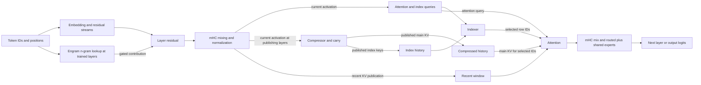

# DeepSeek V4.1 Flash reference manual

DeepSeek V4.1 Flash combines a short exact attention window with a selectively
accessed compressed history, sparse feed-forward experts and token n-gram
memory. Its inference state therefore includes more than a conventional KV
cache: an implementation must preserve the frontier of each compressor and
its position-dependent history as well as the rows already published. This
manual describes the model contract and released reference inference, not the
particular kernels in this repository. See the [implementation](implementation.md)
and [Apple Silicon backend](apple-silicon.md) for those choices.

The evidence here is the released [DeepInfer engine at
`5537415`](https://github.com/deepseek-ai/DeepInfer/tree/553741557a57df44a46fb3ab72b6aafeaf945337)
and [deepseek-recipe at `935817c`](https://github.com/deepseek-ai/deepseek-recipe/tree/935817c66f5d6e64838f419692545f06787e485f).
DeepInfer names the [1017 checkpoint](https://huggingface.co/deepseek-ai/DeepSeek-V4.1-Flash-1017)
as its default. The numerical profile below is the one validated by our
[configuration](../../../src/engine/config.zig) for the installed converted
checkpoint. The released engine derives its topology from checkpoint metadata;
its general code alone does not establish that every V4.1 release or conversion
has identical metadata. In particular, this audit does not establish a complete
weight or behavioral equivalence between original Flash and 1017. A conversion's
quantization and tensor layout are also separate from the original weights.

## From tokens to logits

The validated Flash profile has 40 layers, hidden width 5,120, vocabulary
129,280, 64 attention heads and four residual streams. It uses 384 routed
experts, selects six per token and also evaluates one shared expert. The
attention head dimension is 512, of which 64 dimensions use rotary position
encoding. The profile has a 128-token recent window and an indexer with 32
heads of dimension 128, selecting up to 512 compressed rows.

The diagram shows the logical dependencies, not a literal kernel schedule.
The model carries multiple residual streams through the stack. Manifold
hyper-connections (mHC) mix these streams around attention and feed-forward
sublayers, using normalized learned mixing coefficients; they are not four
independent models. The released [mHC implementation](https://github.com/deepseek-ai/DeepInfer/blob/553741557a57df44a46fb3ab72b6aafeaf945337/deepinfer/model_executor/models/v4_modules/hc.py)
shows the pre- and post-mixing operations. At the output, the streams are
combined for the language-model head, yielding logits for the next token.

## Recent and compressed attention

Each query can attend to recent, individually represented positions in its
causal window. Compressed rows provide a second view of the history, so a query
need not attend to every historical token individually. The views can overlap:
a completed compressed row may represent positions still in the recent window.
A compressor accumulates its inputs until a row is ready, then publishes it.
An unfinished ratio-two pair remains in carry state until the second input
arrives. The reference [compressor](https://github.com/deepseek-ai/DeepInfer/blob/553741557a57df44a46fb3ab72b6aafeaf945337/deepinfer/model_executor/models/v4_modules/compress.py)
shows the learned projection and stateful publication.

In the validated profile, layers 0 and 1 are recent-window only; layers 2–19
consume ratio-two compressed history, while layers 20–39 use ratio one. Only
layers 2, 8, 14 and 20 publish main KV and index keys for their owner groups.
Ratio one does not mean ordinary full attention: selection and sharing still
determine which rows are read.

The indexer is a retrieval stage. It scores eligible compressed keys using
its own query, index keys and learned per-head weights: the reference describes
its score as a weighted sum of `relu(q @ k)` across index heads. It chooses row
IDs by top-k. Those scores are **not** the final attention probabilities. The
attention operation subsequently computes its own query/key scores and
normalization over the selected compressed rows and the visible recent window,
then combines their values. Causal limits apply to both stages. See the
[reference indexer](https://github.com/deepseek-ai/DeepInfer/blob/553741557a57df44a46fb3ab72b6aafeaf945337/deepinfer/model_executor/models/v4_modules/index_attn.py)
and [attention](https://github.com/deepseek-ai/DeepInfer/blob/553741557a57df44a46fb3ab72b6aafeaf945337/deepinfer/model_executor/models/v4_modules/attn.py).

For example, with more than 512 eligible compressed rows, an index refresh
selects at most 512 IDs. A row with a high retrieval score becomes eligible for
attention, but its eventual attention weight is determined by the separate
attention computation alongside the recent rows. A selected row can therefore
receive a small final weight; an unselected historical row receives none in
that operation.

## Sharing and candidate selection

Compressed rows are shared across groups of layers rather than independently
published by every consumer. In the locally validated profile, compressed KV
owners are layers 2, 8, 14 and 20, numbered from zero. Index selection is
refreshed at layers 2, 8, 14, 20, 24, 28, 32 and 36. The eight refresh points
are not eight main compressed-KV owners: for example, layer 24 can refresh
selection while consuming the compressed history owned by layer 20. Consumers
between refreshes reuse the appropriate selection. The engine's
[sharing topology](https://github.com/deepseek-ai/DeepInfer/blob/553741557a57df44a46fb3ab72b6aafeaf945337/deepinfer/model_executor/models/v4_modules/cross_layer.py)
distinguishes KV, index-key and top-k sharing maps, and requires each finer
segment to fit inside its coarser segment.

There is another selection level in the validated decoder: layer 20 supplies
up to 2,048 candidate blocks of eight compressed rows, and later refreshes
select their top rows within those candidates. The block score is a maximum
reduction in the reference configuration. This narrows subsequent retrieval;
it does not turn the candidate block score into an attention weight. These
specific layer numbers and limits are a deduction from the local profile and
its source audit, not a general claim about all checkpoints. The released
engine accepts a metadata-defined topology and validates its relationships.

## Experts and Engram

The feed-forward sublayer routes each token to a small subset of learned
experts and combines their outputs with routing weights; a shared expert also
contributes for every token. In the validated profile this means six selected
out of 384 plus one shared expert. The [reference MoE](https://github.com/deepseek-ai/DeepInfer/blob/553741557a57df44a46fb3ab72b6aafeaf945337/deepinfer/model_executor/models/v4_modules/moe.py)
normalizes selected routing weights. Expert selection is distinct from the
attention indexer: one selects feed-forward functions for a token, the other
selects historical rows for a query.

Engram supplies another input-dependent path before attention mixing and normalization. It hashes token n-grams into
large learned embedding tables, retrieves sparse rows, projects them and gates
the result with the current hidden state. This is learned model memory, not a
retrieval database of conversation facts. The local profile places Engram at
layers 1 and 14; the released [Engram runtime](https://github.com/deepseek-ai/DeepInfer/blob/553741557a57df44a46fb3ab72b6aafeaf945337/deepinfer/model_executor/models/v4_modules/engram.py)
shows the hash, gather, projection and gate. Continuation needs the relevant
preceding token history for n-gram hashes as well as attention state.

## Position and continuation state

RoPE makes keys dependent on position; the validated profile uses a separate
frequency base for compressed rows and long-context scaling. A stored row
cannot generally be moved to another position as opaque bytes and still have
the same meaning. A continuation must preserve the processed token frontier,
recent-window rows, published compressed and index rows, and any incomplete
compressor inputs or carries. At a two-to-one compression boundary, for
example, stopping after the first input of a pair leaves state that must be
combined with the next input; merely saving the completed rows loses it.
Speculative execution adds another requirement: rejected tokens must not leave
visible rows or overwritten frontier state behind.

DeepInfer's [cache engine](https://github.com/deepseek-ai/DeepInfer/blob/553741557a57df44a46fb3ab72b6aafeaf945337/deepinfer/worker/cache_engine.py)
separates paged cache blocks from state slots. Its public code includes
metadata for a valid sliding-window start; the deployment description discusses
rebuilding a bounded recent window after a compressed-cache hit. The complete
production cache-hit controller is not established by that metadata alone.
Likewise, optional decoder suffix truncation is an approximation with a
configured retained window, not a universal property of the model. See
[DeepInfer's deployment description](https://github.com/deepseek-ai/DeepInfer/blob/553741557a57df44a46fb3ab72b6aafeaf945337/doc/inference_deployment_qa.md)
and [README](https://github.com/deepseek-ai/DeepInfer/blob/553741557a57df44a46fb3ab72b6aafeaf945337/README.md).

## Conversation, tools and reasoning

The model consumes token IDs, so a conversation must be rendered with the
matching tokenizer and template. The official [V4.1 encoder](https://github.com/deepseek-ai/deepseek-recipe/blob/935817c66f5d6e64838f419692545f06787e485f/deepseek-recipe-encoding/src/v4/dsv41.rs)
uses system, user and assistant markers, thinking delimiters and an
end-of-sentence token. Thinking mode adds a reasoning-effort prompt and opens
an assistant thinking segment; outside it the assistant begins after the
thinking-end marker. Historical reasoning can be dropped according to the
renderer’s conversation rules, while an explicit assistant prefix can remain
open for continuation. These are serialization rules, not proof that a model
will obey a requested reasoning budget.

Tool schemas are included in the prompt. An assistant tool call is serialized
as a DSML block containing one or more named invocations and named parameters;
the `string` attribute distinguishes string values from other serialized
values. A tool result is placed in a user-side `<tool_result>` element. The
caller executes the tool and returns its result in a later turn; generation
alone does not execute it. The recipe also parses reasoning and calls from
model output. Structured-output constraints may be passed to a backend, but
the recipe states that backend enforcement is the caller's decision. See its
[documented scope](https://github.com/deepseek-ai/deepseek-recipe/blob/935817c66f5d6e64838f419692545f06787e485f/README.md).
Our [prompt renderer](../../../src/models/deepseek41/prompt.zig) is a local
implementation of this boundary, not evidence of an upstream feature.

## Sampling and speculative decoding

The recipe resolves generation controls including temperature, top-p and
output limits and passes inference options to the caller; it is not itself the
inference backend. Its documented default output limits depend on thinking
mode and effort, and must still fit the context limit. Log probabilities come
from the backend rather than being computed by the recipe. These defaults are
service integration choices, not architectural constants.

DeepInfer supports speculative decoding, including a separate DFlash drafter:
the drafter proposes tokens and the target verifies them before accepting a
prefix. The resulting continuation must be consistent with the accepted
prefix, including cache rollback and draft history. Reference source and
settings establish an available inference method, not that every deployment
uses it or that its acceptance rate is fixed. See the [DeepInfer README](https://github.com/deepseek-ai/DeepInfer/blob/553741557a57df44a46fb3ab72b6aafeaf945337/README.md)
and the local [comparison](deepinfer/comparison.md) for implementation
boundaries; local checkpoint and speculation mechanisms are described in the
[Apple Silicon manual](apple-silicon.md).
