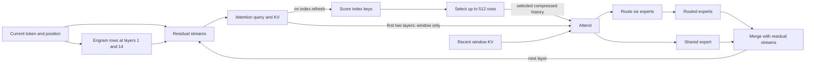

# How the upstream Metal changes improve inference

The upstream changes from `ee7e840` through [`890898cf`](https://github.com/antirez/ds4/commit/890898cf) attack several different costs, not one universal bottleneck. Single-token decode spends time submitting small GPU jobs and reading weights for one row. Long-context attention spends time scoring and sorting index keys. Prefill can instead be limited by random Engram table reads or by repeatedly streaming expert weights. Two-Mac tensor parallelism adds synchronization and load balance to those costs. Which one dominates depends on context, model format, memory, storage and execution mode.

This page explains the upstream mechanisms and the measurements recorded in their commits. The [Apple Silicon implementation guide](apple-silicon.md) describes this fork's actual owners, dispatch and eligibility. The port is complete; an upstream claim is not by itself evidence that a particular path has been exercised here. The [qualification report](../../../speed-bench/experiments/2026-11-02-upstream-catchup/README.md) separates the initial adaptation's five-pair measurement from the completion follow-up. These bundle comparisons cannot assign a saving to any single mechanism below. Upstream commit timings are reported as given, without assuming the five-pair protocol or transferability to our machine.

During prefill, many token rows traverse this graph together, letting a weight tile serve multiple rows. During decode, usually only one row advances, making dispatch, synchronization and weight traffic more visible. Engram and expert reads have different patterns: Engram retrieves small rows from large tables, whereas expert streaming fetches weights for selected experts.

## Decode: fewer waits, launches and bytes

A Metal command buffer collects GPU work for submission. Waiting for each layer to finish before encoding or submitting the next keeps dependencies simple but leaves the GPU exposed to repeated CPU and submission overhead. Upstream [queues multiple decode layers](https://github.com/antirez/ds4/commit/2a281b08), with boundaries where host work or a true dependency requires them. It also combines operations such as query and KV projections, normalization and rounding when the producer can write the required rounded result directly. Fusion saves launches and intermediate reads and writes; it must retain the model's BF16 rounding boundaries. The final vocabulary head can be encoded before the last decode drain, the wait for queued GPU work to finish ([`4fbbc4a4`](https://github.com/antirez/ds4/commit/4fbbc4a4)). An attempt to pre-encode the *next* token was later [reverted](https://github.com/antirez/ds4/commit/72ccf363), so it is not part of the final behavior.

The hyper-connection maintains four residual streams. Each sublayer collapses them into its input using previously computed weights, then computes new mixer weights for the later residual merge. Those new weights need not block the attention or feed-forward projections. [Deferred hyper-connection work](https://github.com/antirez/ds4/commit/26335c70) computes the input first and schedules the mixer and its Sinkhorn normalization, which produces residual merge weights, alongside those projections, retaining the same arithmetic. It is a dependency change, not a different model. Other changes spread the Engram gate and residual collapse over more of the GPU while retaining each thread's addition order ([`e99dc217`](https://github.com/antirez/ds4/commit/e99dc217)). The precise set of fusions that this fork actually uses is described in the [implementation guide](apple-silicon.md#scalar-work-and-command-scheduling).

The shared expert and routed experts consume the same normalized input and can run independently until their outputs are combined. On a single Mac, upstream schedules the shared expert beside the routed work when the resident MXFP4 routed and Q8 shared kernels are eligible ([`e49643ff`](https://github.com/antirez/ds4/commit/e49643ff)). This overlaps work rather than changing which experts the router selects. Streaming, quality mode, other weight formats or an unavailable concurrent encoder use the serial path; overlap is not guaranteed to reduce latency for every workload.

Some decode matrices were widened in the GGUF even though their original values were narrower. The router's BF16 values are stored in F32, and the Engram and index-query FP8 values in F16. When every value can be reconstructed exactly, [narrow copies](https://github.com/antirez/ds4/commit/7d9903b2) let decode read roughly half as many weight bytes; [wider loads and shared scale reads](https://github.com/antirez/ds4/commit/55b1e75e) reduce load overhead further. These copies cost additional memory and take startup work; if conversion fails the wider reader remains available. Quality mode in this fork keeps the wider weights. Upstream reported M3 Ultra 2K decode at 38.5 → 39.2 tokens/s and Engram projection at 849 → 658 µs per token for the first copy change, with identical logits. This is a specific result for that commit, not a prediction for SSD-limited decode.

Rotary position embedding (RoPE) applies position-dependent rotations to attention and index vectors. Every layer previously computed the same sine and cosine values for a decode position. [One table per token](https://github.com/antirez/ds4/commit/f0b4f55f) reuses those values across layers; it also allows inverse rotation and BF16 rounding in the attention output store and combines index-query rotation with FP4 quantization. Upstream reports identical results for that change. Fixed model shapes also let specialized kernels remove loop and indexing overhead ([`b66c9260`](https://github.com/antirez/ds4/commit/b66c9260)).

## Long context: score and select less expensively

The indexer compares a query with compressed keys and supplies relevance scores to top-k. The resulting row IDs identify main KV history for attention; the index scores are not the final attention weights. The first two layers use only the recent window; later layers refresh selection at specified layers and reuse existing published keys between refreshes. At short history every key can be selected, so selection can be skipped. At longer history, scoring and sorting become substantial GPU work. Candidate blocks can restrict later layers to rows in previously selected blocks ([`2d5ef0d3`](https://github.com/antirez/ds4/commit/2d5ef0d3)); this preserves the model's selection policy rather than changing final attention into the index score.

The original direct scorer reread the same 16 KiB query for each 512-byte key and used shared-memory barriers. [A four-row SIMD scorer](https://github.com/antirez/ds4/commit/345d7f44) keeps four keys in registers and reuses each query load across their dot products. Upstream reported 1 million rows in 7.93 → 2.89 ms for the score pass on its test tree; this is a kernel result, not a whole-request speedup. The commit does not identify the hardware for that number. Its kernel-level comparison matters because a one-ULP score difference might only become visible when it changes a top-k boundary. For wide prefill, an [F32 matrix-multiply scorer](https://github.com/antirez/ds4/commit/0f9b03c9) retains key fragments in registers and avoids head-loop barriers while preserving the stated operation order. On M3 Ultra, upstream reported 16K scoring at 1.31 → 0.77 s; combined with a separate wide Q8 matmul change, cold 32K prefill rose from 860 to 892 tokens/s and 64K from 853 to 898 tokens/s.

Expanded index storage holds keys in F32 arrays. A secondary BF16 view holds the same values exactly when they are representable and halves the bytes read per key; restoration rebuilds and checks that view from saved state, falling back to F32 if necessary. Packed storage and SIMD dispatch have separate eligibility rules in this fork; see [scoring on Metal](apple-silicon.md#scoring-on-metal). Selection itself uses radix selection and a shuffle-based sort, retaining only the best 512 at intermediate merges for decode so later merges sort fewer candidates ([`4ff3af60`](https://github.com/antirez/ds4/commit/4ff3af60)). In the separate non-causal block sort, upstream identified sorting as about 85% of top-k time. On M5 Max, 256 rows with 8,192 candidates and 512 selected took 973 → 754 µs including about 250 µs of fixed commit/wait overhead ([`82aa7e8e`](https://github.com/antirez/ds4/commit/82aa7e8e)). These numbers describe different paths and should not be added together.

## Prefill: avoid unnecessary rows and repeated storage work

Later decoder layers use a 128-row sliding window: one output row depends on its own input and up to 127 preceding rows. Each earlier layer expands that dependency by up to another 127 rows. Thus, to produce the final row at layer 39, layer `i` needs only its last `1 + (39 - i) * 127` decoder rows. Earlier rows can still supply compressed KV and index state; they are not globally irrelevant. The schedule also prepares the preceding raw window needed at the cut, up to 127 earlier rows in the 128-row window. Upstream [prunes the decoder suffix inside short sweeps](https://github.com/antirez/ds4/commit/565db435), keeping compressor boundaries aligned and retaining the router's original arithmetic plan. It reported Q4 MXFP4 on M3 Ultra at 2K/4K/8K appends of 406/390/484 → 479/467/576 tokens/s, with matching tested decode-logit hashes. Pruning is only valid where earlier endpoints are not also required; this fork's semantic checkpoint collection, image input, quality and other policy restrictions are explained in [the implementation guide](apple-silicon.md#unified-memory-and-streamed-weights).

When experts stream from SSD, processing two adjacent chunks as separate layer sweeps can read the same layers' weights twice. For eligible medium appends, [one layer sweep](https://github.com/antirez/ds4/commit/5382eac5) processes adjacent chunks at each layer before advancing to the next layer. It retains the 2,048-row arithmetic partitions while avoiding the second stream. The relevant capacity, length and tail conditions are in the implementation guide; this is not a claim that every append reads an expert only once or that logical reads equal physical SSD traffic.

Engram creates a different storage bottleneck: its n-gram lookups fetch small, dispersed rows across 189 GiB of tables. Upstream measured about 6,000 rows/s from an external USB SSD across the table and roughly 12 seconds waiting for Engram reads before layers 1 and 14 for a 2K prompt. [Background warming](https://github.com/antirez/ds4/commit/bdae7640) sequentially reads the tables into the OS's reclaimable page cache, so subsequent random reads can hit memory. It stops on pressure and is eligible only when the resident model, graph, tables and a 64 GiB reserve fit in physical memory; the 128 GiB machine does not meet that condition. On a 512 GB Mac with Q2 over USB, upstream reported cold 2K prefill 198 → 420 and 8K 214 → 518 tokens/s. Warming itself takes time and is not included in those rates; it does not allocate a permanently resident copy.

Decode also benefits from starting the two Engram reads before their consuming layers and joining each only when needed. The separate input buffers and reader lifetime are described in [scalar scheduling](apple-silicon.md#scalar-work-and-command-scheduling).

## Two Macs: balance work and shorten gates

Tensor parallelism divides computation between two ranks and exchanges partial results at synchronization gates: points where a rank waits for its peer, distinct from the model’s expert and Engram gates. A static division of expert IDs can leave one rank with more than its share of the six experts selected for a token. When both ranks can bind all experts, [assignment by selected-list position](https://github.com/antirez/ds4/commit/8d73a0ef) gives each rank three. This duplicates access to expert weights; if either machine needs the smaller working set, the final upstream policy keeps the experts sharded ([`c5484100`](https://github.com/antirez/ds4/commit/c5484100)). The shared expert can also be split across ranks and run alongside routed experts ([`a13b513e`](https://github.com/antirez/ds4/commit/a13b513e), [`e91c453e`](https://github.com/antirez/ds4/commit/e91c453e)).

Each rank must still wait for its peer's partials before producing the combined residual. Upstream folds gate sums into residual expansion and can release decode gates within the command buffer, avoiding separate host-mediated work ([`867465cc`](https://github.com/antirez/ds4/commit/867465cc), [`c9bfdcc9`](https://github.com/antirez/ds4/commit/c9bfdcc9)). A K slice is one rank’s portion of the matrix multiplication’s reduction dimension; the ranks combine their partial outputs. For prefill, [a two-row K-slice kernel](https://github.com/antirez/ds4/commit/5a588dbf) dequantizes a weight block once and applies it to two activation rows. Upstream reported 2 × M3 Ultra Q4 MXFP4 2K/4K/8K appends of 445/435/538 → 475/462/574 tokens/s with identical decode logits. This requires the applicable TP and kernel path, not ordinary single-Mac decode.

A Metal residency set tells the system which resources GPU work needs available. A separate synchronization stall was traced to queue residency requests, not GPU arithmetic: on two 512 GB M3 Ultras, upstream observed 2–2.6 s between command commit and execution of roughly 10 ms GPU work while handling 285 GB of model views. Detaching the already committed residency set improved its reported 8K prefill from a variable 130–460 to 697–701 tokens/s under the stated wired-memory settings ([`52780d41`](https://github.com/antirez/ds4/commit/52780d41)). The [later change](https://github.com/antirez/ds4/commit/cbb68746) makes detachment opt-in, so the earlier commit's default must not be assumed. Two-Mac timing and behavior require separate qualification on the actual machines.

## Other changes in the range

Qwen prefill can overlap reading the next chunk's per-layer embedding (PLE) data with GPU work on the current chunk; validation must precede staging, and cancellation and read failures must leave recoverable state ([`347c2e1f`](https://github.com/antirez/ds4/commit/347c2e1f), [`c97964b8`](https://github.com/antirez/ds4/commit/c97964b8)). Its Q4_K NAX prefill kernel also reuses raw quantized weight loads across work that would otherwise reread them ([`e73e516e`](https://github.com/antirez/ds4/commit/e73e516e)). These are Qwen paths, not DeepSeek speed measurements.

Finally, a server cache miss can dominate all kernel savings. Some clients replayed empty reasoning as a single space, inserting a token absent from the original sampled prefix. Prefix matching then failed and forced re-prefill. [Whitespace-only reasoning is normalized to absent](https://github.com/antirez/ds4/commit/a8ce74af), making the rendered prefix match. Upstream observed a 36K conversation re-prefill 32,818 tokens in 3.4 minutes and another roughly 200K case re-prefill 201,906 tokens in about 19 minutes before the fix. These are observed cache-miss costs, not benchmarked per-token kernel improvements.
