# Flint on Apple Silicon

Flint's native Metal backend uses a tiled graph to ingest a prompt and a resident
kernel to generate individual tokens. Both execute the same 49-layer model, but
favor different shapes: prefill has many token rows to multiply together, while
decode advances one narrow hidden state at a time. The implementation uses the
released affine INT4 checkpoint and BF16 attention state; it does not load MLX
at runtime. For the model contract see the [reference manual](reference-manual.md),
and for session ownership and the native API see [implementation](implementation.md).

## From a token to the next token

An embedding turns each token ID into a 2,048-component residual vector. At each
layer, normalization precedes attention; the attention result is added to the
residual. A second normalization feeds the feed-forward block, whose output is
also added. The first two layers have dense gated feed-forward blocks; later
layers route each token to six of 256 experts and combine their outputs with a
shared expert. Final normalization and the vocabulary projection produce 150,144
logits. Sampling selects the next token, whose forward pass appends new keys and
values. Attention reads earlier keys and values from the session as well as the
current token; causal and sliding-window bounds determine which are visible.

```mermaid
flowchart LR
    T[Token IDs] -->|INT8 embedding lookup| H[Residual rows]
    H --> N[Attention norm and Q/K/V projections]
    N -->|current query| A[Attention and output projection]
    N -->|write new BF16 K and V| KV[(Session KV)]
    KV -->|read visible K and V| A
    A -->|residual add| F[FFN normalization]
    F -->|layers 0–1| D[Dense gated FFN]
    F -->|layers 2–48| R[Route to six experts and shared expert]
    R --> X[Routed and shared gate, up and down projections]
    D -->|residual add| L[Next layer]
    X -->|weighted sum and residual add| L
    L -->|after 49 layers| O[Final norm and vocabulary projection]
    O -->|logits| S[Mask and sample]
    S -->|next token| T
```

The diagram shows the ordinary dependency chain. Prefill executes its operations
as separate graph dispatches over a chunk of rows. Decode fuses much of the chain
into a persistent dispatch, described below. In either case a selected token
must be evaluated before the following token's logits exist.

## Weights and attention state

The loader packs the checkpoint's tensors into resident weight banks. Most
projections and experts contain packed four-bit values with per-group scales and
biases: for each group of 64, the kernel reconstructs an affine value from the
integer, scale and bias while computing the product. This reduces weight traffic
at the cost of unpacking and arithmetic. The embedding is instead affine INT8;
a token lookup reconstructs its row rather than treating it as an INT4 matrix.
Normalization and router tensors have their own representations. The native
loader is specialized for this checkpoint, not a general BF16 or GGUF loader.
See [weights.zig](../../../src/models/flint/weights.zig) and the
[kernel notes](../../../src/metal/flint/README.md).

Each session stores BF16 keys and values in four banks in
`[K/V, 4 heads, capacity, 128]` layout. Four key/value heads serve 32 query
heads. Fourteen full-attention layers retain the causal prefix; 35 sliding
layers retain a 513-token ring including the current token. Full KV grows in
65,536-token banks, so a session's allocation increases in steps rather than one
token at a time. The first global bank costs 1.75 GiB per active session; the
separate local ring adds roughly 0.034 GiB, before scratch and snapshots.
A full layer uses its unrotated keys; the
sliding layers apply rotary position encoding. See
[prefill storage notes](../../../src/metal/flint/prefill/README.md) and
[Flint setup](usage.md).

Prefill assembles the previous local ring and new chunk in chronological order,
then compacts the last 513 entries back into the ring. Full attention reads a
bank directly while it fits, and assembles a contiguous temporary view across a
bank boundary. A bounded snapshot of the local ring and logits records the last prefill
base; extending a session after decode restores it and recomputes the generated
tail through prefill. The state is per session; growing it has a memory cost even
when several conversations share the same immutable weights.

## Tiled prefill

Prefill groups prompt tokens into chunks and runs embeddings, normalization,
projections, attention, routing, expert products and residual operations as a
graph. The attention kernels tile query and key rows, applying causal and
513-token window bounds analytically without allocating a dense score or mask
matrix. They include the learned attention sink in softmax. Routing sorts rows
by selected expert so each expert can process a batch. For a routed token, each
of its six experts computes gate and up projections, applies SiLU gating, then
projects down; their six outputs are weighted and combined with the separately
computed shared expert output. Deliberate BF16 rounding boundaries include
projections, Q/K normalization, expert combinations and residuals; a different
reduction order can change logits. See
[prefill.zig](../../../src/models/flint/prefill.zig) and the
[shader description](../../../src/metal/flint/prefill/README.md).

These expert projections use the packed affine weights described above. For
small batches, SIMD matrix-vector products unpack and apply their group scales
and biases without filling a large tile for only a few rows. The M5 path uses this for dense batches of at
most eight rows and routed batches of at most 768 rows (six routed rows per
token); larger batches use 64-row NAX matrix tiles. The small path accumulates
packed integer products with scale and bias in FP32; the larger path reconstructs
BF16 weight tiles before matrix multiplication. Both produce BF16 projections.
M5 attention also uses NAX tiles, based on MLX's MetalPerformancePrimitives
matrix operations. The M4 profile instead uses portable 8 × 8 SIMD-group matrix
operations with 32-row tiles, with no NAX or MetalPerformancePrimitives
dependency. That choice changes arithmetic as well as the available hardware
operations; it is not an assertion about the relative speed of physical chips.

## Resident decode and packets

A conventional single-token graph would launch many small operations and hand
intermediate results between them at every layer. Flint's narrow 2,048-wide
state permits a different schedule: a fixed grid of threadgroups remains in a
single kernel across the layers, using threadgroup storage and shared device
scratch for intermediate work. Groups take attention head and key/value roles,
then cooperate on routing and expert gate/up and down projections. Some work is
partitioned into expert teams, with a handoff between the gate/up and down
phases. The final groups normalize and project the vocabulary. The
[resident shader](../../../src/metal/flint/decode.metal) and
[decoder notes](../../../src/metal/flint/README.md) show the actual phases.

Threadgroup barriers coordinate local work; device-memory fences and atomic
phase counters implement handoffs and grid-wide synchronization between
producers and consumers. These are not a general Metal grid barrier: all groups
must be resident and able to make progress while others wait. An oversized grid
or competing GPU work can prevent that progress. The profile selector bounds the
resident grid. A per-engine mutex serializes Flint session calls, including
encoding and readback. The process GPU runtime also coordinates across engines
from command commit through completion, so their resident kernels do not run
concurrently. This ownership is process-local and cannot exclude GPU work from
other processes. This trades concurrency and portability for fewer launches and
intermediate handoffs; it depends on the chosen residency envelope.

A greedy resident entry point can advance up to eight tokens, stopping at EOS.
For supported filtered sampling, one command buffer chains scalar resident
forwards with dispatches for GPU sampling and token handoff. Each sampled token feeds
the next forward sequentially. A packet is therefore a submission and handoff
optimization, not multi-token prediction or speculative verification by a draft
model. Unsupported packet sampling settings fall back to scalar evaluation.
The native random stream differs from MLX's; see
[sampling.metal](../../../src/metal/flint/sampling.metal) and
[decode.zig](../../../src/models/flint/decode.zig).

Grammar-constrained output adds a dependency at each sample: the mask must match
the actual prefix. The CPU updates the grammar while the next GPU forward runs,
with shared-event handoffs to apply the next mask before sampling. Supported
filters can still use up to eight sequential forwards; unsupported packet
filters use constrained scalar sampling. Mask generation, synchronization and
sampling are additional work, and their cost depends on the request; the
[qualification](../../../speed-bench/experiments/constrained-packets-20261027/README.md)
contains limited measured cases, not a general overhead estimate.

Optional steering edits the BF16 residual after the ordinary attention or FFN
addition. Projection steering computes a dot product against a normalized
layer direction and subtracts the scaled component; additive steering adds a
scaled vector without that reduction. Additive directions retain their learned
magnitude, with strength divided across the selected nonzero layer rows;
projection normalizes each direction. Decode uses specialized entry points;
prefill fuses the edit into its residual operation. Projection adds local
reduction work, whereas addition does not need that reduction. These paths do
not add a separate device-wide phase or host readback, but enabled overhead
requires measurement. With no active steering, the original kernels run. See
[steering kernel notes](../../../src/metal/flint/README.md).

## Profiles and evidence

| Profile | Resident / MLP groups, 256 threads each | Prefill backend and maximum chunk |
| --- | --- | --- |
| M4 Pro | 36 / 32 | Portable SIMD, 2,048 tokens |
| M5 Pro | 36 / 32 | NAX, 4,096 tokens |
| M5 Max | 76 / 64 | NAX, 4,096 tokens |

Automatic selection recognizes these device names. An explicit smaller profile
can run on a larger supported device; a larger residency envelope or M5 NAX on
M4 is rejected. M1 Max has no supported profile and needs its own implementation
and qualification. See [profile.zig](../../../src/models/flint/profile.zig).

The [profile report](../../../speed-bench/experiments/flint-profiles-20261023/README.md)
ran all three schedules on an M5 Max with 128 GiB. Both Pro schedules passed
29 WebSocket checks and 17 answer probes there, and scalar and packet greedy
continuations matched in 12 repetitions each. M5 Pro's teacher logits matched
the frozen native Max baseline at eight tested positions; M4's SIMD path showed
small numerical differences. These tests exercise code and schedule on M5 Max;
physical M4 Pro and M5 Pro residency, memory pressure and performance remain
unqualified.

The earlier [native qualification](../../../speed-bench/experiments/flint-native-20261023/README.md)
compared the original MLX harness and native backend on the same M5 Max with
21- and 798-token prompts and 128 output tokens. It reported two warm repeats
per arm, and its default-sampling comparison included reference grammar while
the native path at that time lacked masks and used a different random stream.
It is a whole-harness observation, not an isolated kernel comparison or a
five-sample performance claim. Eight teacher-forced positions agreed on top-1,
with measured logit differences; this is not broad quality qualification.
