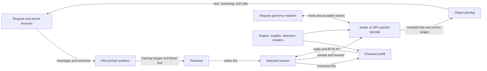

# Flint in the native runtime

Flint runs through the CLI or a client connected to the server. The built-in
`ds4-agent` does not support its tool format, and this implementation has no
vision input path.

Flint's native implementation turns a rendered conversation into token IDs, keeps
model state for each active session, and runs prefill and autoregressive decode
on Metal. The shared server owns requests, scheduling and Responses history;
Flint owns the model-specific prompt, tokenizer, weights and session arithmetic.
This page follows that boundary. The [model reference](reference-manual.md)
explains the checkpoint and upstream inference; [Apple Silicon](apple-silicon.md)
explains the execution and kernels. [Architecture](../../architecture.md)
describes the wider server.

The engine is shared by its sessions; the arrows back to the request represent
client-visible output and a later request, not server-side tool execution. The
client executes a function call and sends its result as a subsequent tool
message. The [Responses contract](../../../src/serving/RESPONSES.md) describes
history and transport independently of this model.

## Loading and ownership

[Engine.open](../../../src/models/flint/engine.zig) selects a profile from the
Metal device, loads the original Flint directory, compiles prefill and decode
pipelines and loads `tokenizer.json`. The [weight loader](../../../src/models/flint/weights.zig)
reads `flint-int4.json`, maps its safetensors shards, checks offsets and duplicate
names, and validates selected architecture and export fields in `config.json`.
It requires the expected tensors and dtypes when constructing 13 resident GPU
banks. This is an implementation-specific validation of the supported export,
not a general loader for arbitrary Flint exports or GGUF. The tokenizer checks
its format, vocabulary size and required stop tokens. Download verification and
expected files are described in [Flint on Metal](usage.md).

The engine owns those weight banks, the tokenizer, the compiled decoder and
optional steering directions. The GPU driver uses the shared runtime boundary; each
session instead owns its token history, BF16 full-attention KV banks,
sliding-attention ring, logits, scratch and prefill checkpoint. Full KV grows
in 65,536-token banks, while the local ring is bounded. The first bank is about
1.78 GiB per active session, including the 1.75 GiB global bank and roughly
0.034 GiB local ring, before scratch and checkpoint allocations. Context
is limited to 262,144 tokens. See [session allocation](../../../src/models/flint/decode.zig)
and [Flint on Metal](usage.md).

Profiles exist for M4 Pro, M5 Pro and M5 Max, with device compatibility checks
and profile-specific prefill chunk limits. Only M5 Max has been physically
qualified; exercising Pro profiles on Max does not establish their performance
or resident scheduling on Pro hardware. The [profile report](../../../speed-bench/experiments/flint-profiles-20261023/README.md)
records the tested cases.

## Rendering and continuation

The server materializes the request and any referenced history, then the
[model adapter](../../../src/server/model.zig) renders Flint messages and tool
schemas with the [native template](../../../src/models/flint/prompt.zig). It
records which ranges are template controls. The [tokenizer](../../../src/models/flint/tokenizer.zig)
encodes those ranges as special IDs and ordinary content as BPE, so a literal
`<|user|>` or `</arg_value>` in user data does not become framing. Completed
sampled tool calls can retain their raw control ranges for replay; older calls
without them are rendered from logical fields. This intentionally differs from
the reference template's sanitization of literal markers.

The server selects a conversation slot and compares the new token sequence with
its session. [Session.sync](../../../src/models/flint/engine.zig) reuses a
valid matching prefill base; otherwise it resets and prefills from the start.
After decode, extending or rewinding within that continuation restores the
saved sliding ring and logits at the last prefill position, leaves immutable
full-attention prefix rows in place, and recomputes the tail through prefill.
If the match ends before that base, the session resets. For example, after a
client receives a tool call and supplies its result, the newly rendered history
can share the original prompt base; the generated call and new observation are
then recomputed as prompt tokens before the next answer. This preserves the
runtime's distinction between prefill and decode arithmetic.

Prefill consumes the remaining IDs in profile-limited chunks, publishing KV and
last logits. The first output token is sampled from those logits; decode feeds
that token back and repeats. [Output parsing](../../../src/server/flint_output.zig)
interprets sampled control IDs and text as reasoning, answer text and typed tool
calls, including partial calls at output limits. The server streams or returns
those items and stores history when requested; a future request can rebuild its
prompt from that history even if the original RAM session is gone.

## Sampling and constraints

Flint's serving defaults are temperature 1, top-k 20, top-p 0.95 and min-p 0;
clients can override sampling. Temperature zero is greedy. The native random
stream is not MLX's random stream. Flint chooses whether to emit `<think>`;
reasoning effort and thinking-enable hints do not control it. Responses exposes
reasoning summaries by default, and `reasoning: {summary: null}` hides them.
See [request handling](../../../src/server/input.zig) and
[Flint on Metal](usage.md).

For supported filters, the decoder groups up to eight sequential forwards and
samples into a GPU packet. Each sampled token is the next forward's input; this
is same-model autoregression, not MTP draft-and-verify speculation. Unsupported
filter settings fall back to scalar evaluation and the shared sampler. Packet
eligibility also depends on EOS handling. A nonzero `ds4_reasoning_budget` is
rejected for Flint during request materialization; it does not select a scalar
fallback. See [materialization](../../../src/server/materialize.zig),
[generation](../../../src/server/generation.zig) and
[decode](../../../src/models/flint/decode.zig).

Tool and structured-output constraints compile to native XGrammar masks around
Flint's turn and tool syntax. A mutable matcher belongs to the request. For a
constrained packet, the first input has already been accepted; CPU callbacks
accept each subsequent sampled token and fill the next mask while the GPU runs
the following forward, synchronized by shared-event handoffs. EOS or failure
stops further matcher advancement; an error rolls back packet advances. The last
prediction is not accepted until it is actually fed through the model. Unsupported
packet filters use constrained scalar sampling. Schema support and forced tool
choices have explicit preflight limits in the [shared contract](../../SERVER.md#constrained-output-and-client-tools)
and [materialization](../../../src/server/materialize.zig).

## Persistence, cancellation and steering

Stored Responses ancestry is durable when a response-store directory is
configured. It stores conversation history, not Flint's GPU state. Flint's
reusable prefill checkpoint is in RAM and disappears with the session; Flint
does not currently provide model-state SSD checkpoints or suffix relocation.
The shared session save/load entry points explicitly reject Flint GPU-state
persistence. The canonical SSD path requires an eligible session payload and
its own compatibility checks; the shared API does not make Flint eligible. See
[session payload handling](../../../src/ds4.c), [KV store](../../../src/kvstore.zig) and
[Flint capabilities](usage.md).

Multiple sessions retain independent state, but Flint's engine mutex serializes
their encode, submit, wait and readback calls. Cross-engine GPU admission has a
narrower lifetime: ownership begins at command commit and ends after completion,
protecting the resident kernel's execution rather than all CPU encoding. This
coordination is process-local and cannot exclude work from other processes.
Prefill checks cancellation between chunks, and
server generation handles cancellation at its scheduling boundaries; an already
submitted GPU operation is not described as instantly interrupted. Flint's
default mixed-prefill quantum is 1,024 tokens. See
[engine lifecycle](../../../src/models/flint/engine.zig) and
[server generation](../../../src/server/generation.zig).

Optional directional steering loads one finite FP32 direction per layer into
the engine, with projection or additive mode and session-specific scales.
Prefill and decode apply the selected influence; changing a session's FFN
scale affects future work, while existing KV and its saved prefill base retain
the influence under which they were produced. See
[steering implementation](../../../src/models/flint/engine.zig) and
[qualification](../../../speed-bench/experiments/steering-20261024/README.md).
