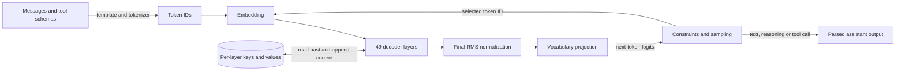

# Flint model and reference inference

Flint is a causal text model: it turns a tokenized conversation into next-token
logits, then repeatedly samples a token and updates its attention state. This
manual describes the released INT4 checkpoint and Recursive's MLX reference
engine at [`0e3150ca4262f572dee25c231d9ac7148414d2af`](https://github.com/recursive-oss/rec/tree/0e3150ca4262f572dee25c231d9ac7148414d2af).
The checkpoint configuration is pinned independently at
[`3b93f9053b530488405ae9fca51d4900d6ce21f0`](https://huggingface.co/RecursiveSI/flint-int4/blob/3b93f9053b530488405ae9fca51d4900d6ce21f0/config.json).
These are source-derived descriptions, not claims about model quality. Our
runtime's realization and its Apple Silicon execution are documented in
[implementation](implementation.md) and [Apple Silicon](apple-silicon.md).

## From tokens to logits

A chat template renders messages and optional tool definitions into text with
special control tokens. The tokenizer produces IDs; embeddings turn those IDs
into vectors. Each decoder layer reads the current vectors and its own saved
attention keys and values, adds an attention result, then adds a feed-forward
result. A final normalization and separate vocabulary projection produce logits
for the next token. Prefill processes the prompt and builds state; decode
samples from the last logits and feeds each selected token back through the same
model. The reference can reuse a compatible prompt prefix, but the cache is
inference state rather than the conversation itself.



The released configuration has 49 layers, a 2,048-wide hidden state and a
150,144-token vocabulary. Each layer uses pre-attention and pre-feed-forward
RMS normalization with residual additions. Layers 0 and 1 have a dense gated
feed-forward network of width 6,144. The remaining layers use a mixture of
experts: a router scores 256 experts per token, selects six, normalizes their
selected sigmoid scores, and combines their outputs with an always-active
shared expert. The routed and shared intermediate widths are 512 and 1,024.
The router's optional expert bias influences selection, while the mixture
weights come from the unmodified scores; missing bias tensors are initialized
to zero. The feed-forward projections use SiLU gating. See the reference
[model implementation](https://github.com/recursive-oss/rec/blob/0e3150ca4262f572dee25c231d9ac7148414d2af/engine/src/rec_mlx/model.py).

## Attention and state

Each layer has 32 query heads and four shared key/value heads, with 128
components per head. Queries and keys are normalized before attention. Causal
masking prevents a token from attending to future tokens. A learned per-head
softmax offset acts as an extra attention sink: it participates in the
normalization without contributing a value vector. This lets attention assign
some probability away from the stored tokens.

The checkpoint assigns 14 layers full attention and 35 sliding attention. Full
layers can attend across the available context and do not use rotary position
encoding; sliding layers use rotary encoding and a 513-token window including
the current token. Thus at position 1,000 a sliding layer can see the current
token and up to 512 preceding positions, while a full layer can see the whole
causal prefix. Each layer keeps its own keys and values; sliding state can be
bounded, whereas full state grows with the prefix. The configured context
limit is 262,144 tokens, including the prompt and output allowance.

The model file contains a generic mixed-quantized KV cache path, but the
released optimized engine validates and uses BF16 KV storage. Weight precision
and KV precision are separate choices; the generic model defaults alone do not
establish the optimized engine's cache format. See the
[checkpoint validation](https://github.com/recursive-oss/rec/blob/0e3150ca4262f572dee25c231d9ac7148414d2af/engine/src/rec_mlx/checkpoint.py) and
[quantized runtime](https://github.com/recursive-oss/rec/blob/0e3150ca4262f572dee25c231d9ac7148414d2af/engine/src/rec_mlx/quantized.py).

## Checkpoint representation

The released artifact is a directory of five safetensors shards with model
configuration, tokenizer files, a chat template and a manifest. Its MLX affine
quantization uses groups of 64: projections and routed experts are INT4, while
embeddings are INT8. The packed weights have per-group scales and biases for
affine reconstruction; other tensors, such as normalization and router
parameters, retain their appropriate non-INT4 representations. The loader
constructs the configured model, quantizes eligible modules with these settings,
loads all shards strictly, and rejects duplicate tensor names. The manifest
and its [pinned file list](https://github.com/recursive-oss/rec/blob/0e3150ca4262f572dee25c231d9ac7148414d2af/packaging/flint-int4-mlx.json)
identify the exact artifact; this format is not GGUF. A separate BF16 release
or another export should not be assumed interchangeable with this engine.

## Conversation, tools and reasoning

The [reference template](https://github.com/recursive-oss/rec/blob/0e3150ca4262f572dee25c231d9ac7148414d2af/engine/src/rec_mlx/chat_template.jinja)
frames system, developer, user and assistant messages with tokens such as
`<|user|>` and `<|assistant|>`. It renders tool schemas as JSON in a system
`<tools>` block. A tool call is generated in the assistant turn, for example:

```text
<|assistant|><think>I should look that up.</think><tool_call>lookup<arg_key>query</arg_key><arg_value>Flint</arg_value></tool_call><|observation|>
```

The client executes the requested function and supplies a tool message, which
the template renders as `<|observation|><tool_response>…</tool_response>`.
The reference [parser](https://github.com/recursive-oss/rec/blob/0e3150ca4262f572dee25c231d9ac7148414d2af/engine/src/rec_mlx/chat.py)
converts the tagged name and arguments to structured fields, using the supplied
schema to distinguish strings from JSON values. The template can include
`<think>…</think>` for reasoning; the model chooses whether to generate it.
Before rendering, the reference normalizes non-assistant text by removing
thinking markers and escaping role markers. Our literal-marker handling differs;
see [implementation](implementation.md).

The reference server defaults to Flint grammar, although a request can choose
`grammar: "none"`. With grammar enabled, XGrammar builds a token mask for the
whole assistant turn: optional reasoning, ordinary text, and either an ending
or a structurally constrained tool call followed by the observation marker.
Tool definitions must have object parameter schemas. Strict schemas constrain
arguments; `strict: false` relaxes those argument constraints unless the server
is configured to enforce them. The grammar uses XGrammar's GLM 4.7 structural
tag for the tool-call portion, wrapped in Flint's own turn rules; this is a
format mechanism, not evidence that the models are the same. See
[grammar construction](https://github.com/recursive-oss/rec/blob/0e3150ca4262f572dee25c231d9ac7148414d2af/engine/src/rec_mlx/grammar_builder.py)
and [mask application](https://github.com/recursive-oss/rec/blob/0e3150ca4262f572dee25c231d9ac7148414d2af/engine/src/rec_mlx/grammar.py).

## Sampling and execution boundary

The reference defaults to temperature 1, top-k 20 and top-p 0.95; temperature
zero chooses the highest logit. It also accepts a seed and presence penalty.
After prefill, the first token is sampled from the prompt logits; subsequent
forwards can run in packets of up to eight, with each sampled token feeding the
next forward. Grammar masks can constrain those samples. This is sequential
autoregressive execution grouped for efficiency, not a draft model proposing
candidates for speculative verification. The scheduler configures zero draft
tokens. See [generation](https://github.com/recursive-oss/rec/blob/0e3150ca4262f572dee25c231d9ac7148414d2af/engine/src/rec_mlx/engine.py)
and [scheduler](https://github.com/recursive-oss/rec/blob/0e3150ca4262f572dee25c231d9ac7148414d2af/engine/src/rec_mlx/scheduler.py).

The inspected checkpoint and reference path establish text input and output,
including textual tool calls; they do not establish image, audio or video
inference. The template's tool and reasoning syntax does not itself establish
that a client executes tools, nor does it establish performance or quality on
any workload. For our supported serving features and differences, see
[Flint implementation](implementation.md). The [setup guide](usage.md) covers
launching the server and reproducing the historical comparisons.
