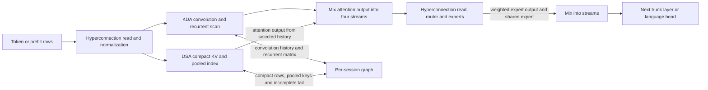

# GLM 5.3 Flash on Apple silicon

The native Metal path runs Flash as a hybrid: most trunk layers carry a fixed-size KDA recurrent summary, while every fourth layer uses a DSA sparse-attention lookup over retained token history. It also runs learned mixing over four residual streams and quantized routed experts. These different operations have different memory costs and parallelism; a single description of “attention” or a DeepSeek optimization does not explain Flash. The [model reference](reference-manual.md) owns the mathematics and checkpoint geometry, and the [implementation](implementation.md) owns session lifetime and serving behavior. A session graph is the per-session allocation of persistent state and working tensors; the engine owns the model weights. Prefill processes prompt rows in bounded, layer-major chunks, while decode advances a selected token through the layers. This page follows those rows through the GPU.

Only one of KDA or DSA runs in a given layer. For example, as a prefill chunk crosses a DSA layer, its projected latent rows are published to that session's compact history, while pooled index keys are formed from groups of four. Each query scores eligible pools, selects groups, expands their IDs into token positions and gathers those positions from the latent history for attention. The unfinished group remains separately visible. At short prefixes the same attention can cover all visible positions; beyond the selection budget it is sparse. Padding and causal visibility must be respected, including when a chunk straddles the dense-to-sparse boundary. See [row attention](../../../src/engine/glm53/attention_rows.zig) and [decode attention](../../../src/engine/glm53/attention.zig).

## Recurrent and sparse GPU work

KDA projects Q, K, V and gates, applies a causal convolution, then updates and reads a recurrent matrix for each head. As the [reference](reference-manual.md#recurrent-kda-and-sparse-dsa) explains, each head uses its own key to predict a value from the decayed matrix, corrects that prediction toward its own value, and reads the updated matrix with its own query; K/V heads are not shared across query heads. Continuation requires both the matrix and the last three convolution inputs. Decode's fused kernel uses one threadgroup per sequence and head, with SIMD groups sharing reductions and updating pieces of the matrix. Prefill separates preparation, recurrence and output into kernels. Preparation walks the chunk in token order to update convolution history; recurrence likewise walks its rows in order while retaining each matrix slice in registers before writing it back. Parallelism is across heads and matrix slices, not a parallel prefix scan over time. See [KDA orchestration](../../../src/engine/glm53/kda.zig) and [Metal kernels](../../../src/metal/glm53_kda.metal).

DSA uses absorbed multi-head latent attention: the compact latent is stored once per position, queries are projected into that latent space, and the attended latent is projected back to head values. This avoids retaining expanded per-head keys and values in compact mode. Metal stores compact latent and pooled index rows in FP16; the unfinished pooling state and KDA convolution and recurrent buffers are FP32. Optional expanded full-attention K/V is also FP16 and adds memory. Flash's DSA profile has no rotary tail, so a specialization requiring one is not applicable. [Allocation](../../../src/engine/glm53/allocation.zig) and [attention](../../../src/engine/glm53/attention.zig) show the layouts and dispatch.

The indexer's scores and top-k selection produce addresses, not attention values. Attention follows those addresses into compact history, computes causal attention and projects the result. Prefill can use a dense compact causal kernel for sufficiently large early slices; smaller early slices use a causal indexed kernel, and later slices use checked sparse gathers. Its score workspace is bounded independently of the whole chunk. Decode performs the corresponding single-position work. The [Metal GLM kernels](../../../src/metal/dsv4_misc.metal) and [row dispatcher](../../../src/engine/glm53/attention_rows.zig) show the separate scoring, selection and attention stages.

Eligible single-host Flash decode divides indexed attention into score, softmax,
latent-sum and value-projection kernels. Sharing staged cache rows across heads
exposes more parallel work without changing the generic arithmetic order. The
score kernel finishes reading the low-rank query before the latent-sum kernel
reuses that buffer; existing split-attention buffers hold scores and denominators.
The path requires a 512-wide FP16 compact cache, Q8 value weights, no rotary tail,
at most 64 heads and at least 128 selected rows with enough scratch. Other shapes
retain generic attention; `DS4_METAL_DISABLE_GLM53_DSA_EXACT` selects that fallback.

Sparse prefill can prove a valid selection prefix on the GPU before using
unchecked gathers. It removes only invalid trailing slots and preserves the
physical row stride and selection order. Interior holes retain guarded loads;
empty selections produce zero output. The specialization requires complete
eight-head groups outside tensor parallelism. `DS4_METAL_DISABLE_GLM_PREFILL_PREFIX`
restores the fully guarded kernel. This does not change the indexer's selected
positions or allow padding to become attention data.

Hyperconnection operations read four streams into each sublayer and expand its output back to them. Fused Metal operations reduce intermediate dispatches, with a reference path available through `DS4_METAL_DISABLE_HC_FUSION`; both attention and feed-forward boundaries are represented. Steering scales and residual capture act at those expansion boundaries in scalar and prefill execution, not inside the KDA recurrence or DSA indexer. See [operations](../../../src/engine/glm53/ops.zig), [scalar executor](../../../src/engine/glm53/executor.zig) and [prefill](../../../src/engine/glm53/prefill.zig).

## Experts and weight movement

The first three layers have dense feed-forward networks. Later layers route each row to eight of 288 experts and also evaluate a shared expert. Gate and up projections produce the gated intermediate; down projections produce expert outputs, which are weighted and combined. Quantized expert weights stay in their stored format for the relevant kernels. For multiple rows, the routed batch machinery can group work by expert and use tiled matrix multiplication, reusing an expert's weights across assigned rows; dispatch depends on tensor format, row count, device and available pipelines. A grouped tile is a computation strategy, not a guarantee that every row chooses the same expert. See [Flash MoE](../../../src/engine/glm53/moe.zig) and [Metal routed batch](../../../src/metal/routed_batch.zig).

With resident weights the model mapping supplies expert weights. With SSD streaming, the runtime maps the required nonexpert and expert spans and may use a bounded selected-expert cache when layout and capacity permit. The router's selected IDs drive cache lookup and loading; prefill can choose a different mapping or seed policy from decode, and the MTP block has its own mapping decision. The cache is a weight resource, not a conversation checkpoint. Mapped bytes and logical accesses do not establish physical SSD traffic. [Storage policy](../../../src/engine/glm53/storage.zig), [cache seeding](../../../src/engine/glm53/cache_seed.zig) and [MoE dispatch](../../../src/engine/glm53/moe.zig) define these choices.

When all static weights were successfully wired, full-layer SSD read-ahead
fetches only routed gate, up and down tensors; dense layers need no read worker.
The engine records completion of the whole lock operation. A partial lock or
failure preserves ordinary reads, so residency is never inferred from an attempt.

A persistent all-layer decode mapping is implemented: when eligible, the runtime installs and can reuse the mapping across decode calls. `DS4_METAL_DISABLE_STREAMING_STATIC_DECODE_MAP=1` instead selects bounded per-layer mapping. The historical bounded-SSD qualification used that fallback and a 24 GB expert cache after the global-map attempt was pressure-stopped; this is a configuration distinction, not missing native code. See the [qualification history](../../lab/journal/2026-10-24-native-models-and-steering.md) and [mapping implementation](../../../src/engine/glm53/storage.zig).

## Prefill, decode and graph capacity

Prefill processes bounded chunks layer by layer, allowing projections and expert work to operate on multiple rows while carrying the KDA and DSA state between chunks. Decode advances one token through all trunk layers. The configured graph prefill chunk is 2,048, subject to allocated and indexed-prefill limits; GLM does not accept the generic `--prefill-chunk` override. Only the final prefill chunk needs language-head logits. Short resumed suffixes can use scalar decode. [Configuration](../../../src/engine/glm53/config.zig), [chunk execution](../../../src/engine/glm53/chunk.zig) and the [model guide](../artifacts.md#glm-53-flash) describe these controls.

Each session allocates its own graph and persistent state. Capacity depends on context, layer count, compact and optional expanded caches, KDA state, chunk and index-score scratch, and optional draft state; it is not just the GGUF file size. The engine resource pool accounts for graph reservations and streaming headroom. Temporary batched views borrow allocations and do not turn the graphs into a single shared recurrent state. See [allocation](../../../src/engine/glm53/allocation.zig), [session resources](../../../src/engine/session_resources.zig) and [batch execution](../../../src/engine/glm53/session_batch.zig).

Relevant dispatch and eligibility choices include:

- Fused BF16 Q/K/V decode is enabled when its weights and configuration permit it; the M3 Ultra-specific SIMD-group selection is device-gated. Disable controls are in [config](../../../src/engine/glm53/config.zig) and [Metal primitive selection](../../../src/metal/supported_primitives.zig). Their names do not establish a benefit on M1 or M5.
- Flash prefill is enabled unless `DS4_GLM_DISABLE_FLASH_PREFILL` is set, but the dense compact path also needs a causal slice of at least 24 rows. Sparse slices use indexed attention instead.
- Native cross-session batching requires compatible session graphs and steering, compact mode, supported sizes and no SSD streaming, placement or multi-device configuration. It combines row work while each row updates its own state; unsupported cases fall back to ordered execution. The historical SSD-only qualification did not exercise resident shared-weight batch math. See [batch eligibility](../../../src/engine/glm53/session_batch.zig) and [qualification history](../../lab/journal/2026-10-24-native-models-and-steering.md).

## Verification, checkpoints and media

Optional multi-token prediction (MTP) uses its own attention cache. Metal saves KDA recurrent and convolution buffers and the unfinished DSA pool for verification; compact published rows use absolute positions. The [implementation](implementation.md#batching-and-speculation) explains acceptance, rollback and sampling restrictions; [speculation](../../../src/engine/glm53/speculation.zig) defines the buffers.

Checkpoint serialization converts Metal FP16 compact KV and index rows to FP32 wire values, while recurrence and tail state stay FP32. This representation choice does not alone establish checkpoint precision or latency under a measured workload. See [payload](../../../src/engine/glm53/payload.zig). A matching vision sidecar computes visual embedding rows that are overlaid on image spans during prefill. See [vision](../../../src/engine/glm53/vision.zig) for the computation and the [implementation](implementation.md#checkpoints-media-and-storage) for image identity and reuse rules.

## Evidence and limits

The [native runtime report](../../../speed-bench/experiments/native-runtime-20261024/README.md) records historical frozen/native regression screens, and the [model retirement report](../../../speed-bench/experiments/model-retirement-20261024/README.md) records functional qualification. Their hardware, model, settings and sample counts bound their conclusions. The historical low bounded-SSD GLM rate was left uninvestigated; the evidence does not identify its cause. Those screens are not five-sample-per-side alternating optimization comparisons, nor a basis to transfer DeepSeek results to GLM. For a new performance claim, follow the current [measurement methodology](../../lab/methodology.md), including workload, cache conditions, variation and practical quality.

## Retained full GLM 5.3

The full `glm-dsa` checkpoint retains its separate C graph; it is not Flash's
hybrid KDA/DSA graph. Its compact IQ2 SSD prefill can cross the dense/sparse seam
within one layer sweep when both portions contain multiples of 256 rows. The
attention slices choose their respective regimes and only the sparse suffix
computes explicit index scores. Partial tiles, verification pairs, TP, quality,
imatrix and partial-layer graphs keep the split. This avoids loading every layer
twice for an eligible crossing; `DS4_METAL_DISABLE_GLM_MIXED_PREFILL` restores it.

For eligible sparse prefill slices, full GLM rotates the live FP16 compact key
tails once and shares FP32 results across queries and heads. Scratch is bounded
to 16 MiB and allocation failure retains the original fused rotations; checkpoint
bytes are unchanged. Small slices, TP, concurrent encoders and unsupported RoPE
settings use the existing path. `DS4_METAL_DISABLE_GLM_PREFILL_ROPE_REUSE` selects
that reference path.

A two-row MTP verification exactly across the full-model dense/sparse seam uses
one ordinary target step and seeds the next draft. This avoids invalidating the
session when the chunker can admit only one row. Flash already supports mixed
verification and does not need that bridge. Both models' accepted-token draft
catch-up stops after publishing its KV row when its logits will be discarded.
