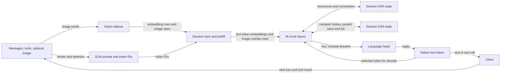

# GLM 5.3 Flash implementation

The native Flash path binds a validated GGUF to an engine and runs each request in a session with its own hybrid recurrent and attention state. A session's frontier is the processed token prefix together with the logits for its next token. Continuing a conversation therefore requires more than remembering token IDs: the KDA recurrent summary and DSA retained sparse-attention histories must describe that same prefix. The [reference manual](reference-manual.md) owns the model's mathematical contract; [Apple Silicon](apple-silicon.md) covers execution and kernels, and the [architecture overview](../../architecture.md) explains the shared server boundary.

## Load and ownership

The Flash loader checks the `glm5-next` metadata against the trained profile, including the layer-type sequence, and binds and validates required tensors and their layouts. The model mapping owns the bytes behind the tensor views for the engine's lifetime. The native configuration distinguishes Flash's KDA, DSA and hyperconnection weights from the retained full GLM `glm-dsa` implementation in C; sharing a family label or server syntax does not make their graphs interchangeable. The [metadata](../../../src/engine/glm53/metadata.zig), [weight binding](../../../src/engine/glm53/weights.zig) and [model mapping](../../../src/engine/model.zig) show these boundaries. Flash's packaged native FP8 weights are not an implemented inference path; the runnable files and vision sidecar are listed in the [model guide](../../MODELS.md#glm-53-flash).

A slot session allocates its own GLM graph after context and memory admission. Here a session graph is the allocation of persistent KDA and DSA state and working tensors used to execute that session; its frontier tracks the processed prefix and logits. The engine owns the immutable model weights and resource accounting. The pool tracks GLM graph reservations across sessions, while execution borrows a session until its backend work finishes. In particular, the shared scratch and recurrence-slot leases used by some other families should not be assumed to be GLM state ownership: GLM initialization allocates its graph per session. During a native batch, the first graph supplies temporary batch workspace and each row addresses its own session state; those temporary views are released after use. See [session resources](../../../src/engine/session_resources.zig), [allocation](../../../src/engine/glm53/allocation.zig) and [batch execution](../../../src/engine/glm53/session_batch.zig).

## A request through the model

The server resolves logical history and chooses the GLM adapter, which renders the conversation and tool syntax and tokenizes it. The client executes a returned tool call and supplies the result on a later turn. For an image, a matching vision encoder converts patches into language-width rows; the session overlays these rows at validated image placeholder spans during prefill. A span must be ordered, in bounds and cover placeholder tokens. See [model selection](../../../src/server/model.zig), [prompt rendering](../../../src/models/glm53/prompt.zig), [vision](../../../src/engine/glm53/vision.zig) and [multimodal sync](../../../src/engine/session.zig).

Sync reuses a valid frontier only when it is a prefix of the new prompt and its image identity matches. Otherwise it resets the recurrent state and rebuilds. Longer input is processed in layer-major chunks; a short resumed text suffix may use scalar decode, while image rows use the embedding overlay. Intermediate chunks update state without producing a valid sampleable checkpoint: only the final chunk computes the head logits. The prompt must leave room in the allocated context. [Session sync](../../../src/engine/glm53/session.zig) and [chunk execution](../../../src/engine/glm53/chunk.zig) implement these choices.

Each token embedding enters four residual streams. At each trunk layer the executor mixes the streams into the attention input, runs either KDA or DSA, mixes the attention result back, and does the same for the dense or expert feed-forward output. KDA updates its convolution history and recurrent matrix; DSA appends compact per-position history, completed pooled index keys and the unfinished pool used by the next token. The final head merges the streams and produces vocabulary logits. The sampler selects a token, and scalar decode consumes it to update the state and produce the next logits. Thus, after a response, a compatible next turn can reuse the live prefix and prefill only its extension. See [executor](../../../src/engine/glm53/executor.zig), [prefill](../../../src/engine/glm53/prefill.zig), [KDA](../../../src/engine/glm53/kda.zig), [attention](../../../src/engine/glm53/attention.zig) and [head](../../../src/engine/glm53/head.zig).

## Batching and speculation

Cross-session decode first validates that sessions belong to the same engine, are distinct, have valid tokens and have room. The native Flash batch combines compatible rows for projections and feed-forward work while updating each session's own recurrence and attention history. It requires compatible graph and steering configuration, compact cache, a supported dense range and bounded row count; SSD streaming, placement, expanded full-KV mode and other unsupported combinations exclude it. Otherwise a fallback encodes each session’s work in order into one backend submission; if that is unavailable, the common path evaluates sessions in order with separate execution. A failed batch invalidates its affected frontiers. The eligibility and fallback are in [session batch](../../../src/engine/session_batch.zig) and the [Flash batch](../../../src/engine/glm53/session_batch.zig).

The optional `--mtp` path uses the draft block embedded in the Flash GGUF, with its own attention cache. The target remains the commit authority. After the target selects a first token, the draft block combines that token’s embedding with the target hidden state to propose the following token. The target then evaluates two rows: the selected first token advances the target to the distribution that can check the proposal, and the proposed token advances it again if accepted. A pending deterministic proposal is checked in this two-row target pass. Before that pass the runtime saves KDA convolution and recurrent buffers and the unfinished DSA pool; published compact rows are append-only at absolute positions. Greedy verification accepts a draft matching the target argmax.

For example, if the selected first token is A and the draft proposes B, greedy verification accepts B when the target predicts B after A, committing both rows. If the target instead predicts C, it rejects B, restores the saved state and replays A; C remains the target choice. A later boundary rewind can restore that snapshot to the start or replay the first row, but this is a bounded speculative rewind, not arbitrary recurrent-state truncation. See [session speculation](../../../src/engine/glm53/session.zig), [backup](../../../src/engine/glm53/speculation.zig) and [MTP](../../../src/engine/glm53/mtp.zig).

At nonzero temperature the default opportunistic mode accepts matching greedy drafts and is more deterministic than ordinary sampling. `--mtp-exact-sampling` instead accepts the point proposal with its target probability and, on rejection, samples from the remaining target mass and evaluates the replacement. Accepted batched rows can differ numerically from scalar execution. Server packet use has further constraints: ordinary GLM session-batched serving uses target decode, and packet paths depend on generation controls and constraint policy; tool sampling-mode transitions can require rewind and reevaluation. See [speculative decoding](../../SPECULATIVE_DECODING.md) and [generation](../../../src/server/generation.zig).

## Checkpoints, media and storage

A live prefix, a saved inference checkpoint and logical response history have separate lifetimes. Flash's canonical DSV4 v2 session payload records tokens, logits, row counts, KDA convolution and recurrence, and the live DSA caches and unfinished indexer pool. Metal's FP16 KV and index rows are serialized as FP32 wire values; recurrent and tail state remain FP32. Restore validates context, shape, capacities and row counts, invalidates the frontier once it starts changing live state, and publishes it only after successful completion. A graph using absorbed latent attention stores a compact latent per position rather than expanded per-head keys and values; it can still consume redundant expanded-KV rows from an older payload. The [backend explanation](apple-silicon.md#recurrent-and-sparse-gpu-work) describes this representation. These are Flash's actual [payload rules](../../../src/engine/glm53/payload.zig); canonical storage and state formats differ by model family.

A token-prefix match alone is insufficient for images: the common session checks image identity, and an invalid image frontier needs multimodal sync rather than text-only replay. The text disk key has no image identity, so the server avoids using it to replace correctly conditioned image state. The server's logical image continuation has additional qualification limits described in the [architecture](../../architecture.md#three-kinds-of-state); see also [persistence](../../../src/server/persist.zig) and [generation](../../../src/server/generation.zig). Arbitrary rewind of Flash recurrent state requires rebuilding the retained prefix when the narrow speculative snapshot cannot serve it. DeepSeek's suffix relocation, C2 pairing and prefill carry are different mechanisms and are not Flash checkpoint features.

SSD weight streaming is separate from inference checkpoint storage. Flash admission accounts for per-session graphs, transient mapping headroom and the expert cache; the streaming path maps needed layer and output spans and applies its own expert-cache policy. It does not imply a particular physical SSD traffic or latency result. See [resource admission](../../../src/engine/session_resources.zig) and [storage policy](../../../src/engine/glm53/storage.zig).

## Steering and execution compatibility

Directional steering is configured when the session graph is initialized. Its attention and feed-forward scales apply at the respective hyperconnection residual expansion hooks in both scalar and prefill execution; captured residuals are at those same boundaries. Compatible settings are required for native session batching. This is a residual intervention, not a change to the prompt or the model's mathematical definition. See [configuration](../../../src/engine/session_resources.zig), [scalar execution](../../../src/engine/glm53/executor.zig) and [prefill](../../../src/engine/glm53/prefill.zig).
