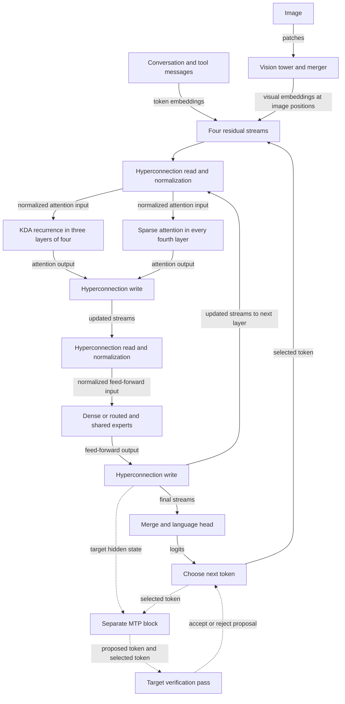

# GLM 5.3 Flash model reference

GLM 5.3 Flash is an autoregressive model whose trunk combines recurrent Kimi Delta Attention (KDA) with DeepSeek Sparse Attention (DSA), four residual streams and a mixture of experts. KDA summarizes prior tokens in recurrent state; DSA selects positions from retained history. It predicts the next token from the prefix; generation feeds each selected token back into the model. An image can also contribute visual embeddings to that prefix. The separate multi-token prediction (MTP) block can propose a token for speculative decoding, but the trunk remains the target model.

This account describes the checkpoint and inference contract represented by DwarfStar's conversion and retained inference code. It is a source-derived account, not a claim that an official GLM architecture paper specifies every detail here. The [converter](../../../gguf-tools/glm53_quantize.py) identifies the source as the [Z.ai GLM-5.3-Flash checkpoint](https://huggingface.co/zai-org/GLM-5.3-Flash); [metadata validation](../../../src/engine/glm53/metadata.zig), [weight binding](../../../src/engine/glm53/weights.zig) and the inference graph establish what this runtime accepts and computes. The separate [implementation](implementation.md) covers runtime mapping and state lifetime; [Apple Silicon](apple-silicon.md) covers kernels, memory and optimizations. The [system architecture](../../architecture.md) explains the server boundary.

The loop inside the trunk is conceptual: each layer reads the streams for either KDA or DSA, writes its attention output, then reads and writes them again for the feed-forward sublayer. The dashed path is optional speculation; the target pass checks a proposal before it is accepted.

## Checkpoint geometry and the full model

The accepted Flash GGUF profile has 46 blocks: 45 trunk blocks and one next-token prediction block. Trunk layers numbered from zero use KDA when their index modulo four is 0, 1 or 2, and DSA when it is 3. Thus there are 34 KDA and 11 DSA trunk layers. The embedding width is 4,096 and the vocabulary has 154,880 entries. The profile records a 1,048,576-token context length; that metadata value is not a promise that every deployment allocates or qualifies that context. The accepted profile and layer-type checks are in [metadata.zig](../../../src/engine/glm53/metadata.zig) and [config.zig](../../../src/engine/glm53/config.zig).

Full GLM 5.3 is a different supported checkpoint and retains the legacy `glm-dsa` engine. Its recorded geometry has 79 blocks, a 6,144-wide embedding, a rotary dimension of 64, and no hyperconnection streams; Flash has no rotary tail in its DSA profile. Full-model identity also requires `general.version=5.3` because its dimensions match the retired 5.2 geometry. These are properties of the retained [full-model shape and loader](../../../src/ds4.c), not evidence that Flash is simply a smaller set of the same layers. A full-model qualification does not cover Flash's KDA, pooled indexer, hyperconnections or MTP block; see the [qualification guidance](../../../QA_BEFORE_RELEASES.md#glm-53-flash).

## How a token moves through the trunk

A token embedding is repeated into four residual streams. Before the attention sublayer, learned hyperconnection mixing constructs a normalized input from those streams; after attention, its output is mixed back into them. A second mixing step supplies the feed-forward sublayer and incorporates its output. The final head combines the streams, normalizes the result and projects it to vocabulary logits. This gives each sublayer a learned way to read and update multiple residual paths rather than treating the layer as a single residual vector. The flow is visible in [executor.zig](../../../src/engine/glm53/executor.zig) and [head.zig](../../../src/engine/glm53/head.zig); the profile specifies four streams and 20 Sinkhorn iterations for the mixing operation.

The first three trunk layers use dense feed-forward networks. Later layers use a sigmoid router to select eight of 288 routed experts for each token, combine their weighted outputs, and add a shared expert's output. Routing chooses which expert computations to apply to the current representation; it is distinct from the DSA indexer's selection of past positions. The profile specifies normalized routing weights, one shared expert and a 2.5 weight scale. See [moe.zig](../../../src/engine/glm53/moe.zig) and [metadata.zig](../../../src/engine/glm53/metadata.zig).

## Recurrent KDA and sparse DSA

KDA carries a fixed-size summary of prior tokens within each recurrent layer instead of looking up a key and value for every earlier position. The layer projects its input to queries, keys, values and gates, applies causal convolutions, and updates a per-head matrix. Each head has its own corresponding query, key and value vectors; the key and value correct that head’s matrix and its query reads it. The implementation does not share K/V heads across query heads. In the source's delta update, the previous matrix is decayed, its prediction for the current key is compared with the current value, and a gated correction is written back. The query reads the resulting matrix; an output gate and projection produce the layer output. [kda.zig](../../../src/engine/glm53/kda.zig) shows the projections and state inputs, and the [Metal recurrence](../../../src/metal/glm53_kda.metal) shows the update.

For example, after processing token A, the recurrent matrix represents a gated summary of the prefix through A. At token B the layer decays that matrix, corrects its value prediction for B's key, then reads it with B's query. Continuing from B requires both this matrix and the causal convolution's recent Q, K and V inputs; the matrix alone is insufficient. The accepted profile uses 64 heads of dimension 128 and convolution width four, so each layer retains three previous convolution inputs per channel. A recurrent summary does not provide an independently addressable record for every past token.

DSA supplies that different capability. It projects the current query and a compact key/value latent for each token, retains the latent history, and uses an indexer to choose positions for attention. Its indexer constructs a representation of each complete group of four positions, scores those groups for the current query, and expands the best groups into individual token positions. The incomplete current group is included separately. The resulting selected positions are used to attend over the compact history. The profile uses 32 indexer heads, four-token pools and a selection budget of 2,048 tokens. See [attention.zig](../../../src/engine/glm53/attention.zig) and [attention_rows.zig](../../../src/engine/glm53/attention_rows.zig).

For example, with 2,052 visible tokens there are 513 complete groups of four. The indexer selects 512 groups, giving 2,048 individual positions for attention. At 2,051 visible tokens, the implementation uses contiguous dense position IDs for the entire prefix. Beyond that crossover it selects 2,048 positions from complete pools and additionally includes the zero to three positions in the unfinished tail. Thus 2,048 is the selection budget for complete pools, not necessarily the total attended count. The [qualification guidance](../../../QA_BEFORE_RELEASES.md#glm-53-flash) records this crossover and the requirement to mask padding. Continuation needs the compact per-position history, completed pooled index keys and the unfinished pool, in addition to KDA's state at recurrent layers. A saved prefix must represent all of these mechanisms consistently.

## Prompt, reasoning and tools

The local [prompt renderer](../../../src/models/glm53/prompt.zig) starts a fresh prompt with `[gMASK]<sop>` and renders system, user, assistant and tool observations using `<|system|>`, `<|user|>`, `<|assistant|>` and `<|observation|>`. It hoists system and developer messages after its reasoning and tool instructions. An assistant continuation begins with `<think>` when reasoning is enabled and `<think></think>` when it is disabled. The renderer maps low, medium and high reasoning options to `Reasoning Effort: High`; its other enabled options use `Max`. These statements describe this renderer's mapping, not a universal promise about every GLM service.

Tool declarations are placed in a system instruction inside `<tools>`. A call is rendered as, for example, `<tool_call>lookup<arg_key>query</arg_key><arg_value>weather</arg_value></tool_call>`. A subsequent result appears under `<|observation|>` inside `<tool_response>`. The client executes the call and returns its result; the syntax itself does not execute a tool. The renderer also decides when to preserve prior reasoning and how to escape delimiter-like text, so replaying only displayed prose may not reproduce the same prompt.

## Draft prediction and images

The embedded MTP block consumes the target's current hidden state and the next input token's embedding, normalizes and projects them together, then applies its own attention and expert layer and draft head. It has its own attention history. A draft token is a proposal: speculative generation must verify it against the target before accepting it, and rejection needs the target state to remain consistent with the accepted prefix. The [MTP source](../../../src/engine/glm53/mtp.zig) establishes this block's inputs and its separate cache; [speculative decoding](../../SPECULATIVE_DECODING.md) describes the runtime's sampling modes and restrictions. The presence of this block does not mean it is enabled by default.

The image path uses a separate matching vision encoder. Its source projects image patches, runs 24 transformer blocks, merges each 2-by-2 patch group and projects the resulting rows to the language embedding width ([vision.zig](../../../src/engine/glm53/vision.zig)). These visual embeddings occupy image positions in the language input; they are not ordinary text token embeddings. The [model guide](../../MODELS.md#glm-53-flash-1) documents the sidecar and supported PNG and JPEG entry points. Image identity matters when reusing a prefix: the [vision qualification](../../../QA_BEFORE_RELEASES.md#glm-53-vision) explicitly checks changed images and changed embeddings. This evidence establishes the implemented image path, not support for arbitrary video or audio modalities.

## Evidence and limits

The Q2 and Q4 GGUFs are converted inference artifacts; the model guide also lists a packaged native FP8 artifact, but inference for that package is not implemented. Do not infer that downloading it provides a runnable FP8 path. The [release qualification](../../../QA_BEFORE_RELEASES.md#6-full-glm-53-and-glm-53-flash) distinguishes full and Flash checks and specifies continuation fixtures and vision tests; a prescribed test is not by itself proof that a particular run passed. Check the associated recorded results for a specific claim.

The source and conversion contract expose dimensions and operations, but do not establish training data, training procedure, general benchmark performance or an independently verified official architectural specification. Quantization, backend arithmetic, prompt preparation and sampling can change results. The model-file context limit and the existence of an image encoder or draft block likewise do not establish quality at every context length, modality or execution configuration.
