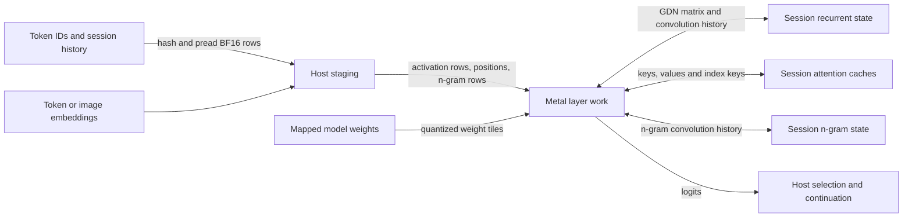

# Qwen3.8 Flash Next on Apple Silicon

The Metal backend evaluates Qwen as a sequence of layer operations over rows of activations. Prefill supplies several consecutive prompt rows at once; decode usually supplies one row, or several independent session rows when native batching is eligible. The same weights can then be reused across those rows, but each conversation must advance its own recurrent and attention state. The [model reference](reference-manual.md) explains the model's math and the [runtime implementation](implementation.md) owns the session and API contract. This page follows the data through the Apple Silicon implementation.

For a prompt chunk, the host first stages embeddings, positions and n-gram rows. Metal then traverses the trunk, updating persistent state as well as producing activations for the next layer. At the end it projects the requested rows to logits and synchronizes before returning them. Temporary activations can be leased from a shared arena; the histories in the diagram remain separate for each session. [Forward traversal](../../../src/engine/qwen4/forward.zig), [input staging](../../../src/engine/qwen4/input.zig) and [resource allocation](../../../src/engine/qwen4/resources.zig) show these boundaries.

## Two ways to carry the past

A gated delta-net (GDN) layer turns the current activation and its prior recurrent state into an output and an updated state. Projections produce query, key and value inputs and gates; a short streaming convolution consumes and advances its history. The scan then updates a fixed-size matrix in causal token order, and a gated, normalized output projection returns the layer result. The [model reference](reference-manual.md#the-trunk-and-its-state) explains how the keys, values, query and gates use that matrix. This state summarizes the past and does not grow a separate KV row for every token. Prefill may submit many rows, but the recurrence within each session still follows their order. [Attention orchestration](../../../src/engine/qwen4/attention.zig) selects a fused front end when applicable and otherwise runs convolution and preparation separately before the scan; [Metal kernels](../../../src/metal/qwen4.metal) implement these operations.

Attention layers instead retain individual keys and values, allowing a query to retrieve from earlier positions. Preparation projects and normalizes queries and keys, applies rotary positions and writes the current KV and index keys. At short positions, attention reads the causal prefix densely. At longer positions, an indexer scores four-token blocks, selects a bounded set, expands those blocks into token indices, and the attention kernel reads their KV rows and produces a gated output. Within a prefill chunk, the dense and sparse portions can differ as positions cross the threshold; causal bounds still apply to each row. The indexer's block keys and selected-token buffers are additional data movement, traded for fewer KV reads at long contexts. See [attention.zig](../../../src/engine/qwen4/attention.zig) for the split and [ops.zig](../../../src/engine/qwen4/ops.zig) for selection dispatch.

For example, if a chunk crosses the indexer budget, its early rows can use dense causal attention while later rows score and select blocks. In the neighboring GDN layers, those same rows instead update the recurrent matrix one after another. Both paths produce layer outputs for the expert sublayer, but their persistent state and rollback requirements are different.

## Expert weights and matrix work

The mixture of experts (MoE) consumes each row's mixed activation. A router selects experts and weights; selected gate and up projections form an intermediate activation, down projections return to model width, and a reduction combines the weighted routed outputs with the shared expert and residual streams. Quantization reduces the weight bytes read, but the arithmetic needs decoded values. The [Qwen Metal shader](../../../src/metal/qwen4.metal) unpacks each supported block's codes and scales into tiles for multiplication; it does not first expand the entire model into floating-point weights.

For a large prefill, the runtime builds a separate list of routed rows for each expert. A tiled matrix operation gathers those activations and uses the same decoded expert weight tile for multiple rows; gate/up and down products each have their own pass. The portable path stages half-precision operands and uses SIMD-group matrix operations with float accumulators. On a device where the Metal tensor API is available, supported IQ2_XXS, Q2_K, Q4_K and MXFP4 expert tiles default to the 64-token tensor-operation path. It uses half operands and float accumulation; accumulation order differs from the portable path. `DS4_QWEN4_MOE_MM_NAX=0` selects the portable path, while other levels select different tile widths or higher-precision/compensated activation variants. The [controller](../../../src/metal/ds4_metal.m) checks tensor API availability and weight type; the [shader](../../../src/metal/qwen4.metal) contains both implementations. The tensor path is an implemented device-dependent default, not a promise that every Apple GPU runs it.

This matrix route requires more than 64 rows, compatible dimensions and supported weight types. With fewer rows, the runtime uses per-row expert work; for more than eight rows it can compute the shared expert as a dense product. A separate grouped small-batch route applies to Q4_K gate/up and MXFP4 down weights when the shared dense path is available, unless disabled. These thresholds and fallback conditions are in [moe.zig](../../../src/engine/qwen4/moe.zig). The tradeoff is important: 512 experts spread a small batch thinly, so a large matrix tile can spend work on empty or underfilled expert groups.

For tiny decode and verifier batches, the Q4_K gate/up path divides the output rows among SIMD groups so those small workloads can run without a large matrix tile. With one or two input rows, the controller uses one output row per SIMD group: eight groups on M3 Ultra and four on M5. M5 also uses this choice for exact three-row verification. `DS4_QWEN4_NO_Q4K_MID` disables the specialization; `DS4_QWEN4_Q4K_MID_NR` and `DS4_QWEN4_Q4K_MID_NSG` override its row and group counts.

The controller also contains device-specific tuning, rather than one universal tile choice: M3 Ultra gets smaller token tiles for short low-bit prefills and more tiles for large routed batches; M5 receives additional large-batch choices. The four residual streams are mixed before each sublayer and updated with its output, as described in the [reference](reference-manual.md#the-trunk-and-its-state); M5 also defaults to prefetching the F16 weights used in that mixing. Overrides exist. Those choices are code defaults for the stated device checks, not evidence of a speedup on an unmeasured M1. See the [dispatch controller](../../../src/metal/ds4_metal.m) for the current device gates.

## Disk rows and memory

The n-gram table supplies learned features for short token histories. The host hashes current and prior IDs, reads the selected BF16 rows with `pread`, converts them to float and stages them for Metal. Requests are sorted and duplicate rows can be reused within a reader's batch; multiple readers can service a batch, but there is no persistent runtime row cache. The OS may cache file pages, so a logical read is not necessarily an SSD transfer. The layer projects these rows into keys and values, gates them against the residual, then runs a short causal convolution using a separate per-session history. [N-gram reads](../../../src/engine/qwen4/ngrams.zig) and [forward execution](../../../src/engine/qwen4/forward.zig) show the handoff.

Single-session prefill can read the next chunk's n-gram rows while Metal executes the current chunk. After staging the current rows, the session starts one worker with a copy of the resulting n-gram history. The worker only reads disk rows into its own output buffer; live history and image positions still advance on the session thread. The session joins the worker before reporting a completed frontier, so cancellation cannot leave a reader using released state. A failed read or unavailable worker falls back to synchronous staging on the next chunk. This path needs at least 256 rows of capacity, another chunk to read, and no more than 128 MiB for one output buffer. `DS4_QWEN4_NO_PLE_PREFETCH` disables it; `DS4_QWEN4_PLE_PREFETCH_TRACE` reports read and join times. See [prefetch](../../../src/engine/qwen4/prefetch.zig) and [session coordination](../../../src/engine/qwen4/session.zig).

Native batch execution overlaps a different boundary: the host stages embeddings, submits the first layer, then flushes that GPU work before reading n-gram rows at the second-layer injection point. `DS4_QWEN4_NO_NGRAM_OVERLAP` disables this flush. See [batch execution](../../../src/engine/qwen4/batch.zig). Single-session forward execution also normally flushes after the second layer, allowing the GPU to execute queued work while the host encodes later layers. Queue order is retained. Profiling mode that synchronizes each stage changes this overlap, and a flush-layer override can change the boundary.

The [artifact catalog](../artifacts.md#qwen38-flash-next) lists Q2 as 137.10 GiB on disk: 41.73 GiB main/MTP weights and 95.37 GiB BF16 n-grams. Q4K is 165.11 GiB on disk with 69.74 GiB of resident weights before runtime buffers. These are artifact/weight figures, not measured process RSS. The n-gram table is not mapped or preloaded. Context-sized KV and index caches, fixed recurrent and convolution state, logits, prefill scratch, optional MTP buffers and any vision encoder add allocations. [Memory estimation](../../../src/engine/qwen4/memory.zig) is admission accounting, not a measurement of actual resident bytes.

A compatible shared prefill arena lets sessions reuse temporary buffers at different times. Persistent KV, n-gram history and logits still belong to each session. An optional pool puts GDN matrices and convolution histories into engine-owned parent tensors with one view per session slot; it provides a batch-friendly layout without merging histories. The [resource allocator](../../../src/engine/qwen4/resources.zig) and [state pool](../../../src/engine/qwen4/state_pool.zig) define the distinction.

## Decode, batching and verification

One-token decode has little opportunity to amortize a weight read. Compatible independent sessions can instead put one row apiece into a shared batch: dense and expert operations reuse weights across rows, while row descriptors point to each session's own position and caches. For Q8 dense weights, the specialized 5–32-row path requires aligned dimensions and padded scratch; otherwise ordinary multiplication is used. The pooled GDN scan can update several slots in one dispatch; absent a usable pool, the batch path operates on individual state views. See [batch.zig](../../../src/engine/qwen4/batch.zig) and [ops.zig](../../../src/engine/qwen4/ops.zig).

Speculative decoding adds a predictor pass to propose a token, then verifies candidate rows with the full trunk. Verification can share weight work across rows, but predictor work, extra projections, state snapshots and rejected candidates cost time. Rejection restores the last accepted recurrent and convolution state; attention's later cache rows are hidden by position. Thus acceptance rate and batch shape matter as much as raw verification throughput. The [implementation](implementation.md#batching-and-speculation) covers acceptance and fallback semantics, and [MTP](../../../src/engine/qwen4/mtp.zig) and [batch execution](../../../src/engine/qwen4/batch.zig) show the work.

Vision uses a separate encoder and Metal kernels to produce language-width image rows; input staging substitutes those rows at image positions. Image-bearing and otherwise incompatible requests can fall back to ordered execution instead of the native speculative batch. Steering changes trunk combination and can also prevent native batching or a decode fusion; the ordinary path remains available. See [vision](../../../src/engine/qwen4/vision.zig), [vision shaders](../../../src/metal/qwen4_vision.metal), and [session batch eligibility](../../../src/engine/qwen4/batch_session.zig).

## What the measurements establish

The [2026-10-24 native Qwen migration](../../../speed-bench/experiments/qwen-glm-zig-20261024/qwen.md) retained the Metal kernels and compared the Q4 model against a frozen C owner. Its model-backed checks covered 2K-boundary logits, state, batched recovery, MTP and vision. Its single matched throughput runs and short ABBA screens were regression diagnostics, not five-sample performance comparisons; they do not prove a small speed change. The [native runtime report](../../../speed-bench/experiments/native-runtime-20261024/README.md) records further integration and qualification, including failed pressure-guard attempts before isolated reruns.

The older [checkpoint comparison](../../../speed-bench/qwen38-checkpoints/README.md) used an M3 Ultra, a different IQ2/Q2 model and a Q4 n-gram sidecar, with two samples per side. It is evidence for that historical setup, not the present combined BF16-table artifact or a statistically conclusive speed comparison. Device-specific dispatch and these results do not establish M1 throughput or extrapolate to different context lengths, SSD cache states, batch mixes or image workloads.
