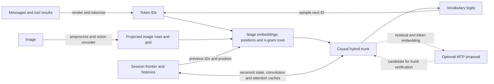

# Qwen3.8 Flash Next implementation

The Qwen runtime turns a rendered conversation into a sequence of causal state transitions. Each transition consumes a token ID, or an image embedding at an image position, and produces logits for the next token. The state belongs to the session: continuing a prefix requires its recurrent matrices, convolution and n-gram histories, attention caches, and positions together. The [model reference](reference-manual.md) explains the model operations and their evidence; [Apple Silicon](apple-silicon.md) owns the backend execution details. The [architecture overview](../../architecture.md) describes the shared engine and serving boundaries.

For example, after prefill of “the red”, the frontier records those IDs and the logits following `red`. The next selected ID is staged with its embedding and n-gram rows derived from the current and preceding IDs. Processing it advances the recurrent and convolution histories, appends attention information at the current position, and produces new logits. A proposed MTP token may be evaluated along with it, but only a verified token becomes part of that frontier. This is why changing a token in the prefix cannot be repaired by merely truncating attention KV rows.

## Model and resource ownership

`Qwen3.8 Flash Next` is the product name used here; `qwen4exp` is the GGUF architecture identifier and `qwen4` is the runtime's source namespace. The identifier alone does not make arbitrary files compatible. [Metadata loading](../../../src/engine/qwen4/metadata.zig) validates the accepted shape and configuration, and [weight binding](../../../src/engine/qwen4/weights.zig) checks the required layer tensors, including the n-gram table and, when present, the predictor. The optional predictor sits outside the trunk layer range. The synthetic mini profile is a test shape, not a separate published model.

The engine owns the model mapping, bound weights and optional vision model. A session owns its frontier, logits, position and stateful graph resources. The graph allocates persistent layer caches and temporary working buffers according to context, prefill capacity and whether MTP is requested; see [resources](../../../src/engine/qwen4/resources.zig). In resident mode with shared session prefill workspaces enabled, the engine resource pool owns an arena of temporary buffers and sessions lease compatible views. An arena too small for a new session can be replaced when it has no users; otherwise that session needs its own scratch. Sharing scratch does not merge session histories. [Session resource initialization](../../../src/engine/session_resources.zig) describes these lifetimes.

For eligible shared sessions without MTP, the optional [state pool](../../../src/engine/qwen4/state_pool.zig) packs each delta-net layer's recurrent matrix and convolution history for multiple slots into engine-owned tensors. Each session retains its own slot view; releasing the session releases the slot, while the engine retains the parent tensors. Other session allocations keep their own state. This layout is an execution convenience, not a shared conversation state.

## SSD storage and admission

`--ssd-streaming` keeps routed experts in an owned `pread` cache. Dense projections, routers, shared experts, GDN, hyper-connections, embeddings and the optional vision model remain mapped separately. The BF16 n-gram table retains its existing disk-only reader. Decode and the predictor stage only selected experts when GPU addresses are available; prefill uses expert row lists and separate gate/up and down phases. Off-slab predictor formats use compact owned staging, with a full-layer fallback on addressless devices. In-flight GPU work retains immutable address tables and buffers until completion; failed reads drain submitted work before staging is released.

[Admission](../../../src/engine/qwen4/admission.zig) budgets the smaller of seven-eighths of host RAM and Metal's working-set recommendation. It reserves static and vision weights, all live session graphs, expert staging and another 2 GiB before assigning cache slots. Staging covers the larger of two full trunk windows, two selected-predictor windows including address tables, or one full predictor fallback. The [memory estimate](../../../src/engine/qwen4/memory.zig) includes host staging, half work buffers and all three predictor rollback snapshots. A new session may be refused when its graph would overcommit the configured cache. An explicit `--prefill-chunk` always overrides the environment and clamps to context, including requests equal to or larger than context.

## Staging and forward execution

The local [prompt renderer](../../../src/models/qwen38/prompt.zig) emits ChatML boundaries, reasoning markers and the model's function and parameter tags for tools. It can include an effort instruction in the system message. The tokenizer produces IDs for the resulting text; these conventions are local serving behavior, not a guarantee about other Qwen templates. The server exposes the model's base, chat and reasoner aliases; `--nothink` controls the local reasoning prompt. Tool results return in the renderer's tool-response form. See [setup](usage.md) for invocation and aliases.

[Input staging](../../../src/engine/qwen4/input.zig) obtains each token embedding and replicates it into the residual streams. For image positions it substitutes the projected image row, while retaining the sequence's token IDs for n-gram history. It calculates three-axis rotary positions and tracks the position offset after an image grid. The separately loaded vision encoder preprocesses and encodes image patches into language-width rows; its output and grid are handed to the session as spans. The CLI accepts image reads and the server accepts image URL parts when the vision model is configured. Default image resizing and the token cap are described in [Qwen setup](usage.md#images); this path establishes image input, not other media support.

The n-gram table is part of the GGUF but stays on disk. The host hashes each ID with its recent history, respecting the EOS boundary, and reads selected BF16 rows with `pread` before submitting the corresponding work. Requests are sorted and nearby duplicate rows can be reused within a read batch; there is no persistent runtime row cache. The table and the session's short token history are distinct from attention KV and from the n-gram convolution history. See [n-gram staging](../../../src/engine/qwen4/ngrams.zig).

[Forward execution](../../../src/engine/qwen4/forward.zig) applies the n-gram injection at the configured layer, then the sequence mixer and expert sublayer for each trunk layer. Three delta-net layers alternate with one attention layer in the accepted full profile. Delta-net updates a recurrent matrix and short convolution history; attention appends keys, values and indexer information, selecting causal blocks at longer positions. Each layer mixes and updates the residual streams. The final head projects the resulting representation to vocabulary logits.

The session stores the logits corresponding to its completed frontier; sampling chooses an ID to feed back. Prefill processes chunks in causal order and publishes both tokens and matching logits after each completed chunk, including a cancellation boundary. In batched server prefill, a chunk boundary that falls inside an image span is extended to the end of that span, so the image is processed whole.

[Session synchronization](../../../src/engine/qwen4/session.zig) reuses a valid matching prefix and otherwise resets and processes the prompt again.

## Batching and speculation

Metal native session batching groups compatible decode rows so weight operations can run together while each row uses its own position, recurrent state, attention cache and n-gram history. A pooled recurrent layout can serve the batched scan; otherwise the implementation can operate on individual state views. The shared arena must fit and the participating sessions must have valid synchronized frontiers and compatible graph conditions. [Batch execution](../../../src/engine/qwen4/batch.zig) and the [session batch adapter](../../../src/engine/session_batch.zig) implement these checks. Qwen has no native mixed-prefill arena path. SSD sessions and unsupported combinations use ordered execution; each SSD session owns its scratch and streaming lifetimes. Batching can change floating-point reduction order and therefore a reply even for the same prompt.

The embedded MTP predictor is optional (`--mtp`); it proposes from trunk residuals and token embeddings, while the trunk remains the commit authority. In ordinary greedy speculation, the parent is the next token already selected from the current frontier logits. The predictor proposes a candidate to follow it. The target evaluates both together and accepts the candidate if it matches the target argmax after the parent. A deeper single-session path can also verify a second candidate. For example, the target evaluates a selected parent token and a proposed candidate in two rows. The logits after the parent verify the candidate; if accepted, the candidate row supplies the next frontier and logits. If rejected, the evaluated candidate state is discarded: a snapshot restores the state after the parent, and the parent row supplies the frontier logits. Predictor recurrence is proposal-only and does not receive directional steering. See [session speculation](../../../src/engine/qwen4/session.zig), [predictor](../../../src/engine/qwen4/mtp.zig), and the shared [speculative decoding explanation](../../serving/sampling-and-speculation.md).

The predictor's historical keys depend on its input projection, so prefill builds them without attention output, routed experts or the vocabulary head. `DS4_QWEN4_MTP_PREFILL=auto` prepares that history for SSD mode and writes a cold zero prefix for resident mode; `on` and `off` override it. Cold keys still participate in predictor softmax, so this is an approximate proposal policy. Target caches and verification are unchanged. The final trunk row is retained until its true successor is known; the next call repairs that boundary before advancing. Full predictor catch-up preserves batched router arithmetic but executes experts only for the final residual consumed by the draft head.

Default greedy draft acceptance also applies to nonzero-temperature requests and does not promise the same sampling distribution as ordinary decoding. With `--mtp-exact-sampling`, the single-session sampled path treats the draft as a point proposal, accepts it with its target probability, and on rejection samples a replacement from the remaining target distribution and replays it.

Exact sampled requests in batched serving use ordinary batched decoding; temperature-zero requests can still speculate. Native speculative batches are limited to 16 sessions and use a scheduling policy that can choose plain decoding or draft work. Images, steering and other unsupported conditions take the ordered fallback; request constraints and reasoning budget also restrict server speculation. The exact details of request eligibility live in [generation](../../../src/server/generation.zig) and [batch session](../../../src/engine/qwen4/batch_session.zig).

## Rewind, snapshots and reuse

Attention cache writes are append-only and later rows are hidden by the position on rollback. Delta-net matrices, their convolution histories and the n-gram convolution are mutable, so verifier snapshots preserve those tensors together with the pending trunk row, previous n-gram IDs, position and image rotary offset. The runtime can restore a matching verifier boundary and logits, often by swapping buffers. For an older rewind it resets recurrence and replays the retained text prefix on the next evaluation; an image rewind requires multimodal synchronization. See [snapshot](../../../src/engine/qwen4/snapshot.zig) and [session](../../../src/engine/qwen4/session.zig).

The canonical session payload uses a DSV4v2 envelope with QW8v3 model payload, with a Qwen family tag and shape checks. A disk session payload is more than a KV suffix. After accelerator synchronization, [payload serialization](../../../src/engine/qwen4/payload.zig) writes a family/shape-tagged header, token IDs and frontier logits, layer state and cache spans, the initialized predictor prefix and pending trunk row, n-gram histories and multi-axis rotary positions. It does not store image identities or embeddings, and coordinates cannot recover an image.

Restore validates the tag, shape, context and token ranges, invalidates pending drafts and rollback snapshots, and resets recurrence if tensor-body loading fails. A save requires a synchronized frontier rather than an unresolved rewind.

QW8v2 and plain checkpoints remain accepted; an MTP session replays retained tokens on first use when the older payload lacks a complete predictor prefix and pending row. Prepared and cold v3 prefixes preserve their actual cache contents. New saves use v3 even when MTP is disabled. Older runtimes cannot read those new payloads: preserve the old checkpoint or replay the durable conversation when rolling back the executable. These checks describe the local format; they do not make it a universal or model-independent canonical state cache.

Server reuse additionally checks the actual prefix and image identity. Image-conditioned state is reusable only in a live session, gated by image fingerprints; the server excludes it from disk checkpoints. Text disk checkpoints and server history keys have their own eligibility and lifecycle; see [reuse](../../../src/server/reuse.zig), [persistence](../../../src/server/persist.zig) and the [checkpoint notes](usage.md). A matching visible string alone is not sufficient to reconstruct every state. DeepSeek-specific suffix reuse is explicitly ineligible for Qwen; its server startup check requires DeepSeek V4.1. The disk-resident n-gram weights are model data, separate from saved session checkpoints.

Directional steering and activation capture apply to the trunk; steering changes the ordinary forward path, and batching requires compatible steering settings across sessions. The ordinary selector permits matching steering; speculative execution has additional restrictions. See [steering](../../../dir-steering/README.md) for controls. The [native qualification](../../development/qualification/qwen.md) lists model-backed checks for prefill, state replay, batching, MTP and vision. Those tests qualify the exercised configurations; they do not prove equivalence across all checkpoints, schedules or image tasks.
