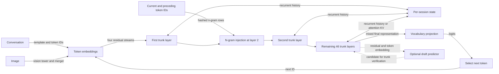

# Qwen3.8 Flash Next model reference

Qwen3.8 Flash Next is a generative model that turns a sequence of token IDs,
and optionally image-derived embeddings, into next-token logits. It combines
recurrent and attention-based sequence processing with a mixture of experts.
This manual describes the model as understood from the GGUF contract and the
inference code in this repository. It is not an independent specification of
the original training implementation. The GGUF architecture and metadata use
the name `qwen4exp`, and the engine directory uses `qwen4`; those are code and
file-format identifiers for the model called Qwen3.8 Flash Next here, not a
claim that a different Qwen4 checkpoint is compatible.

The [implementation](implementation.md) explains local ownership and execution;
[Apple Silicon](apple-silicon.md) covers its backend and optimizations. For
checkpoint selection and setup, see [Qwen setup](usage.md).

## From a conversation to a prediction

A renderer formats a conversation and a tokenizer produces IDs. Each ID selects a
learned embedding; an image span instead supplies projected visual embeddings.
The trunk transforms these representations in causal order, updating state for
the next input. Its output is projected over the vocabulary to produce logits;
a decoding policy chooses the next ID, which is fed back into the same process.
Prefill applies this process to a prompt, while decode continues from the state
at its end.



The arrows show logical dependencies, not an execution schedule. For example,
a prompt ending in “the red” supplies both the embedding of `red` and hashed
rows derived from the current and preceding IDs. Those rows enter the second
trunk layer. After the trunk returns logits, a selected token advances the
n-gram history, the recurrent layers and the attention caches together.
[Input staging](../../../src/engine/qwen4/input.zig) and
[forward execution](../../../src/engine/qwen4/forward.zig) establish this local
flow.

## The trunk and its state

The accepted full profile has 48 trunk layers and one optional next-token
predictor layer. The trunk uses a repeating sequence: three gated delta-net
layers followed by one attention layer. Each layer then applies a feed-forward
mixture of experts. This schedule follows the interval and trunk rules in
[config.zig](../../../src/engine/qwen4/config.zig) and the dimensions checked by
[metadata.zig](../../../src/engine/qwen4/metadata.zig).

A gated delta-net layer processes the sequence through a short convolution and
a gated recurrent update. Projections produce a key and value for each token;
gates control how the previous fixed-size state matrix decays and how the new
key-value information corrects it. A query reads the updated matrix to produce
the token output, which is gated before projection. The matrix summarizes
earlier tokens, with convolution history alongside it. It does not retrieve
individual past token values from an attention KV cache. The input projections,
scan, gated output and state updates are visible in
[attention.zig](../../../src/engine/qwen4/attention.zig). This distinction
matters on continuation: restoring only the attention cache cannot reconstruct
the recurrent state.

Every fourth trunk layer instead uses gated grouped-query attention (GQA):
multiple query heads share fewer key and value heads. It stores keys and values
for prior positions and computes a gated attention output. At short positions
it attends densely. Once the configured block budget is exceeded, an indexer
scores blocks of four positions, selects blocks, and attention reads the
selected causal tokens. Thus “full attention interval” names the layer schedule;
it does not mean all past tokens remain selected at long positions. The local
selection and cache operations are in
[attention.zig](../../../src/engine/qwen4/attention.zig).

The trunk carries four residual streams, called hyperconnections. Before each
sequence mixer and expert sublayer, a learned mixer combines the streams into
an input; the sublayer's result is injected back into the streams. At the end,
another mix supplies the vocabulary head. This is the role the local forward
path and its [mixing operations](../../../src/engine/qwen4/ops.zig) establish;
it should not be read as an independent claim about training benefits.

Each feed-forward sublayer routes a token to 10 of 512 experts and also uses a
shared expert. The selected expert outputs are weighted and combined with the
shared path before returning to the residual streams. The router and reduction
are implemented in [moe.zig](../../../src/engine/qwen4/moe.zig). The expert
choice is per token; it is separate from the attention indexer's choice of
past blocks.

The n-gram path adds a different source of information: short sequences of
IDs select rows from a learned table. The local hash uses the current token and
one or two preceding tokens, with multiple heads per n-gram length; an EOS
boundary cuts older history. At the second trunk layer, projected rows are
gated against the residual and passed through a short convolution. The hash
and history are in [ngrams.zig](../../../src/engine/qwen4/ngrams.zig), and the
injection is in the forward path. These table lookups complement rather than
replace the ordinary token embeddings.

The full profile uses rotary position encoding in attention, with a native
context of 262,144 tokens. Text positions advance together across its three
position axes; image positions use a grid, described below. A session also
retains the n-gram token and convolution history, delta-net state and
convolution history, and attention KV and indexer state. A continuation must
match all of these to its prefix. The local checkpoint and rewind behavior is
covered by the [implementation](implementation.md); the optional static YaRN
extension and its quality caveat are described in [setup](usage.md).

## Prompt, reasoning and tools

The local [prompt renderer](../../../src/models/qwen38/prompt.zig) uses ChatML
message boundaries such as `<|im_start|>user` and `<|im_end|>`. For a new
assistant turn it opens a `<think>` section when reasoning is enabled. With
reasoning disabled it supplies an empty `<think>\n\n</think>` section before
the answer. The renderer can add a natural-language effort instruction to the
system message; this is prompt behavior, not a change to the model weights.

Tool schemas are included in the system message. A model-generated call uses
nested function and parameter tags, for example:

```text
<tool_call>
<function=read>
<parameter=path>
notes.txt
</parameter>
</function>
</tool_call>
```

The client executes the call and returns its result in a user message wrapped
in `<tool_response>` tags. The renderer preserves sampled call text when
available and handles the continuation boundary; see its tests for exact
escaping and replay. These are the local serving format and contract, not proof
that every third-party Qwen template has identical behavior.

## Optional prediction and images

Multi-token prediction (MTP) is an additional predictor, not another trunk
output to commit unconditionally. In this implementation it combines a token
embedding with trunk residuals, runs its own attention and expert block, and
proposes a candidate. The trunk verifies candidates before they are committed;
ordinary decoding does not require this path. See
[mtp.zig](../../../src/engine/qwen4/mtp.zig) and
[speculative decoding](../../SPECULATIVE_DECODING.md) for sampling semantics.

For images, a separate Qwen3-VL encoder converts image patches into projected
embeddings at the language model's width. The local tower uses transformer
blocks followed by a spatial merger; four patches form each visual token.
Those embeddings occupy positions in the same sequence as text, with temporal,
height and width rotary coordinates. After an image span, the position offset
accounts for its grid dimensions. The encoder and position handoff are in
[vision.zig](../../../src/engine/qwen4/vision.zig),
[vision_input.zig](../../../src/engine/qwen4/vision_input.zig) and
[input.zig](../../../src/engine/qwen4/input.zig). This describes image input;
it does not establish support for other modalities.

## Profile, artifacts and evidence limits

The values below describe the locally accepted full GGUF profile, not every
possible upstream checkpoint:

- The embedding width is 2,560 and the vocabulary has 248,320 entries. GQA
  has 24 query heads and two KV heads; the indexer budget is 2,048 tokens in four-token blocks.
- The `qwen38-q2` and `qwen38-q4k` downloads package main, MTP and original
  BF16 n-gram weights in one GGUF. Their expert quantizations and sizes differ;
  the separate vision encoder is a Q8_0 mmproj. See
  [model downloads](../../MODELS.md#qwen38-flash-next) and
  [conversion](../../../gguf-tools/README.md#qwen38-flash-next).
- The synthetic mini profile is a test shape, not a smaller published model.
  Metadata and tensor checks constrain what this runtime accepts; arbitrary
  GGUFs bearing the architecture name are not necessarily compatible. See
  [metadata](../../../src/engine/qwen4/metadata.zig) and
  [weights](../../../src/engine/qwen4/weights.zig).

The conversion tools and runtime are evidence for this GGUF representation and
our interpretation of its operations, not an official upstream architecture
publication. The [quality-testing fixtures and report](../../../gguf-tools/quality-testing/README.md#7-qwen38-spark-baseline)
record comparisons with hosted continuations and their limitations; the
[release qualification](../../../QA_BEFORE_RELEASES.md#18-qwen38-flash-next)
records local tests. They do not establish universal equivalence to the original
checkpoint, nor do image encoder parity checks alone establish task quality.
Training details, an independent upstream specification and performance across
other checkpoints or workloads are outside what these local sources establish.
