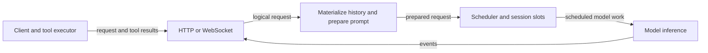

# Serving models

The server translates client protocols into model requests, schedules inference sessions, and returns output; function tools run in the client. The supported native build targets macOS Metal. CUDA and ROCm source is retained, but is not newly qualified by this manual.



## Start locally

```sh
./tools/zig-build ds4-server
./zig-out/bin/ds4-server --ctx 32768
```

The default address is `http://127.0.0.1:8000`. Use `--host 0.0.0.0` to listen
on other interfaces. Restrict access to trusted clients; for an Internet-facing
deployment, put authentication and TLS in front of the server.

`--cors` enables browser cross-origin headers. It does not change the listening
address or provide access control.

The selected build chooses the backend. The supported native build places executables in `zig-out/bin`; the examples below use `./ds4-server` as shorthand for the selected executable. Pass `-m FILE` for an explicit model.
Use `--chdir /path/to/ds4` when starting outside the project directory so
relative runtime files such as Metal kernels can be found.

## APIs

| Endpoint | Use |
| --- | --- |
| `GET /v1/models` | Loaded model information, including input/output modalities |
| `POST /v1/chat/completions` | OpenAI-style chat |
| `POST /v1/responses` | Responses-style requests and continuations |
| `POST /v1/completions` | Text completions |
| `POST /v1/messages` | Anthropic-style messages |
| `POST /v1/systemone` | Clef SystemOne decisions |
| `POST /v1/decisions` | Clef OpenAI Decisions |

The generative model names are aliases within the loaded family. The GGUF or
Flint directory passed at startup selects that engine. Add independently loaded
Clef helpers with `--decision-model DIR`, or pass a Clef directory as `--model`
for decisions-only serving. See the [Clef guide](../models/clef/usage.md). The decision endpoints
are stateless and do not stream.

```sh
curl http://127.0.0.1:8000/v1/chat/completions \
  -H 'Content-Type: application/json' \
  -d '{"model":"deepseek-v4.1-flash","messages":[{"role":"user","content":"Explain Redis streams."}],"stream":true}'
```

Chat, Responses, and Anthropic support tools and SSE streaming. Reasoning is
returned separately from visible text in each API's native form. Standard
sampling and output-budget fields are supported; explicit request parameters
take precedence over defaults.

When a Chat Completions client replays an assistant's `reasoning_content` as
whitespace only, the renderer treats that reasoning as absent. Some clients
echo a single space for a missing value; retaining it would change the prompt
and prevent reuse of an otherwise unchanged cached prefix.

The model metadata reports image input only when the loaded engine has vision
support. Loading a text checkpoint without its required vision sidecar does
not advertise that capability.

Function tools are executed by the client. Client orchestration can call the
native decision APIs directly; the server owns model inference and conversation
state. Embedded JavaScript, MCP execution and hosted decision tools were retired
after the workflow experiments; concise historical results remain in speed-bench.

The default sampling settings are temperature 1, top-p 1, and min-p 0.05.
For DeepSeek, thinking is on by default. `reasoning_effort=max` selects Think
Max only with sufficient context; otherwise it falls back to normal thinking.
`xhigh` maps to normal thinking, not Think Max. Use `think:false`, a disabled
thinking object, or a non-thinking model alias for direct answers.

## Multiple sessions

```sh
./ds4-server --ctx 4096 --batched-session 4
```

Without `--batched-session`, there is one resident session. With it, the server
preallocates independent KV states and queues requests when all slots are busy.
Choose context and slot count together: a context that fits once may not fit
four times. Idle slots can be cached before reuse; active requests are not evicted.

Where the model supports it, the slots share one prefill workspace instead of
each keeping its own, so an extra slot costs only its caches. That matters most
for resident Qwen3.8 Flash Next, whose transients are sized by the prefill chunk rather
than by the context: at the default chunk they run to several GiB per session.
Qwen SSD streaming keeps a separate workspace for each session. The startup
line reports both figures.

| Backend/model | Decode execution |
| --- | --- |
| Metal, resident V4.1 Flash | Native decoding for 2-8 sessions |
| Metal RDMA TP, V4.1 Flash | Native decoding for 3-8 sessions; ordered fallback for two |
| Metal SSD streaming, V4.1 Flash | Ordered fallback |
| Metal, GLM 5.3 | Native batching through 2051 visible tokens; ordered fallback afterward |
| Metal, resident Qwen3.8 Flash Next | Native batching of shared work; recurrent state, caches and PLE history stay per session. See [Qwen eligibility](../models/qwen38-flash-next/usage.md#reasoning-tools-and-sampling) for limits and fallback conditions |
| Metal SSD streaming, Qwen3.8 Flash Next | Ordered fallback with a separate streaming workspace for each session |
| Retained CUDA paths | Model-specific historical behavior; see the [CUDA serving account](../backends/cuda.md#larger-models-and-serving). This native serving matrix does not qualify them. |

Fallback executes the rows separately. It provides concurrency and scheduling
fairness, not the aggregate speedup of native batching. Native grouping may
change floating-point reduction order slightly. V4.1 sessions containing images
use the ordered fallback.

When no request is generating, DeepSeek V4.1 uses its configured prefill
capacity for each scheduler turn (at least 2048 tokens). Long prefills yield
to active decoders in bounded intervals, normally 128 tokens. `--mixed-prefill-quantum N` changes that interval for testing.
Session-batched serving uses ordinary target decoding, except Qwen3.8 on
Metal, where `--mtp` batches speculative decoding with resident weights and
runs ordered speculative cycles with SSD streaming. Its
`--mtp-exact-sampling` mode uses ordinary batches for nonzero-temperature
requests. DS41 constrained requests can instead take bounded exclusive
speculative turns between other sessions' model work. Other ordinary native
batches do not use MTP/DSpark while session batching is active.
For retained CUDA serving options, see
[CUDA GPUs](../backends/cuda.md#serving-and-network-tensor-parallelism).

## Images

Start with the matching language GGUF and `--vision FILE`. Use the
[DeepSeek guide](../models/deepseek/README.md), the
[Qwen image instructions](../models/qwen38-flash-next/usage.md#images), or the
[GLM encoder catalogue](../models/artifacts.md#vision) for the matching sidecar
and model-specific restrictions.

OpenAI chat and Responses accept inline PNG/JPEG data URIs. Anthropic accepts
base64 image sources. Remote URLs and server-side file paths are rejected.
Image blocks preserve their order in the request. The limit is 256 images and
a 64 MiB HTTP body.


See [Responses](responses.md) for continuation, [sampling](sampling-and-speculation.md) for constraints, and [session cache](../storage/session-cache.md) for persistence.
