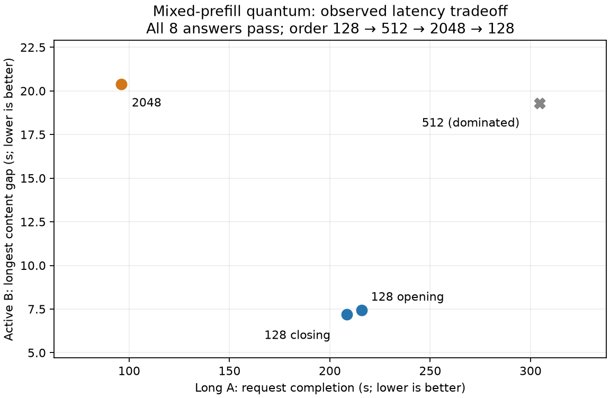

# Official DeepSeek inference sources: transferable lessons

Research snapshot 2026-10-20. These official sources are separate from
astrra.space's AMD/HIP `ds4-recipe`:

* [DeepInfer](https://github.com/deepseek-ai/DeepInfer/tree/774ce244b87cc0eb8d4b94ab9f5de2ab22049f01),
  local clone `/Volumes/Models/DeepInfer`, exact revision
  `774ce244b87cc0eb8d4b94ab9f5de2ab22049f01`.
* [deepseek-ai/deepseek-recipe](https://github.com/deepseek-ai/deepseek-recipe/tree/935817c66f5d6e64838f419692545f06787e485f),
  local clone `/Volumes/Models/deepseek-recipe`, exact revision
  `935817c66f5d6e64838f419692545f06787e485f`, release 0.2.0.

The research compared them with the pre-upgrade DS4 working sources identified
in [the full source audit](evidence/deepseek-research.md). The official GPU
cluster results are not local Metal/SSD measurements. At this initial research
snapshot, no local bounded-replay feature had been implemented.

Current follow-ups are recorded separately: [bounded decoder replay](12-bounded-decoder-replay.md)
now has an opt-in measured implementation, including 7.03% whole-workflow saving
on one unbatched HTTP tool fixture (with nine fewer search-output tokens).
[Main compressed-KV F16 storage](13-packed-compressed-kv.md) is being qualified
separately. The candidate discussion below preserves the original research
reasoning rather than describing the complete current feature surface.

## Candidate: approximate decoder bounded replay

DeepInfer retains full encoder/compressed/index publication but can rebuild the
decoder's local SWA state using a fixed final replay window. Local visibility
is clipped to `[max(replay_start,i-127), i]`; it does not secretly read earlier
raw keys. Reconstructed decoder SWA is approximate and kept out of exact prefix
storage. The reference distinguishes masked full-query and physically compact
replay. Its example keep 140 covers speculation; an initial non-speculative
local experiment could keep 128.

Primary source: [deployment Q&A, pinned](https://github.com/deepseek-ai/DeepInfer/blob/774ce244b87cc0eb8d4b94ab9f5de2ab22049f01/doc/inference_deployment_qa.md#L179-L191)
and [`environ.py`, pinned](https://github.com/deepseek-ai/DeepInfer/blob/774ce244b87cc0eb8d4b94ab9f5de2ab22049f01/deepinfer/environ.py#L188-L193).

```text
candidate long prefill:
    compute exact encoder rows and full compressed/index KV
    select final replay window with original absolute positions
    carry complete HC residual/pre/post mixture state
    run decoder with explicit raw-attention replay floor
    mark resulting session approximate before any cache/export
```

This is more than changing one suffix length or zero-filling old keys. Zero keys
would still receive attention probability, and higher decoder raw state depends
on its own layer. DS4 already has an EXACT shrinking decoder dependency suffix,
so an official “nearly halves prefill” claim does not predict a similar local
gain. Full KV/index publication, SSD layer reads and smaller-batch efficiency
remain costs. The initial port plan was to fix one model/quant, disable MTP and other
approximations, and measure a wide direct sync before changing server
scheduling. Item47 followed that direction, retaining first free outputs and
fixed-teacher ΔNLL/KL while excluding approximate state from canonical exports.

## Mixed-prefill quantum: measured completion/responsiveness tradeoff

The completed local experiment varies the EXISTING server yield quantum:
128 → 512 → 2048 → 128 rows while another session generates. Ordinary prefill
uses2048; the mixed default remains128. `--mixed-prefill-quantum` is distinct
from allocated `--prefill-chunk` capacity and approximate decoder replay. This
is a scheduling experiment, not a port of DeepInfer's asynchronous CPU/device
scheduler.

A short request B first streams the integers1–80; after its first content event,
long request A submits an8,493-token historical log and asks for `CORAL-8431`.
Native routing,64GiB expert cache, two slots, context16,384 and allocated chunk
2,048 are fixed. Each arm starts a fresh server/expert cache without a warmup;
application SSD KV caching and MTP are disabled. OS/SSD cache state carries over.

| Mixed quantum | Long A completion (s) | Active B completion (s) | B maximum content gap (s) | Answers |
| --- | ---: | ---: | ---: | --- |
|128 opening|215.83|224.39|7.44|2/2 pass|
|512|304.50|315.30|19.30|2/2 pass|
|2048|96.02|107.04|20.39|2/2 pass|
|128 closing|208.39|216.67|7.20|2/2 pass|

The128 A bracket mean is212.11s, with−3.45% closing/opening drift; mean maximum
B gap is7.32s (−3.21% drift). Quantum2048 saves54.73% of A completion time
against that mean, at a2.78× maximum B content-event gap. Quantum512 is dominated
by both128 observations on these two metrics. Every answer completed normally
with a stop; no caps or response repairs were needed.

Keep128 for interactive responsiveness. Quantum2048 is an explicit bulk-prefill
tradeoff (`--prefill-chunk 2048 --mixed-prefill-quantum 2048`), not a new default.
This ordered one-fixture screen does not establish general throughput, token
latency or broad quality. SSE content events can contain multiple characters or
tokens; the gap is the largest adjacent client-received B content gap whose right
endpoint is at/after A starts, including the straddling gap. B's cold TTFT occurs
before A and is not a scheduling benefit.



[Summary and CSV](../speed-bench/experiments/1017-upgrade-20261020/scheduler/summary.json),
[raw requests, SSE and answers](../speed-bench/experiments/1017-upgrade-20261020/scheduler/),
[driver](../speed-bench/experiments/1017-upgrade-20261020/serve_quantum.py).
The guard completed child0:830 normal samples, no adverse samples, peak wired+
compressor98.04GiB, swap growth21.94MiB. Large RAM was allowed by the guard.

The earlier attempt interrupted during512 for user-reported Homebrew security
updates remains [separate](../speed-bench/experiments/1017-upgrade-20261020/scheduler-interrupted/).
Its completed217.41s opening128 baseline and incomplete512 are excluded from
this clean bracket; the interruption was not a model-quality failure.

The named server presets use 512-row chunks; neither those nor the separate
2,048-row scheduling configuration reaches the wide≥8,192 decoder branch.
Default unbatched full sync can, and Item47 separately measured it;
keep the direct 8,192-token curve and HTTP tool-workflow result in chapter 12
separate from this scheduling experiment.

## Other lessons worth using without importing the cluster

* Official tokenization distinguishes actual special-token IDs from ordinary
  payload bytes spelling a marker. Preserve that distinction when reviewing
  rendered-history fallbacks and live-context imports.
* Rendering has semantics: user-turn joining, tool results in call order,
  mid-conversation system messages and conditional historical reasoning.
  Compare a few real requests offline before replacing a native private replay
  with a public canonical rendering.
* Trained effort and a forced token budget differ. Official V4.1 low/high/max
  render 50/75/100 and use stochastic sampling defaults; do not silently change
  temp 0 experiments while attributing a result to a runtime patch. Our budget
  remains the separate soft once-per-request intervention in chapter 05.
* DSpark confidence-limited proposals and specialized Metal top-k already exist
  locally. DeepInfer's multi-sequence marginal scheduling and DeepSelect's
  threshold/filter/compact algorithm are ideas to profile, not proof of a new
  whole-model speedup. Preserve ties and required position ordering.
* SM100/Ascend kernels, multi-GPU expert replicas, NIC/GDR swaps, distributed
  filesystems and disaggregated serving do not transplant onto one M5 Max.
  Borrow the data-movement reasoning before the hardware-specific pipeline.

The1017 model config fields inspected match the earlier architecture, but this
was not a weight/tokenizer byte comparison. Its reported shorter outputs may
benefit tasks independently of a Metal optimization. Keep model upgrade, native
packing and serving-policy experiments separate in both measurement and credit.
