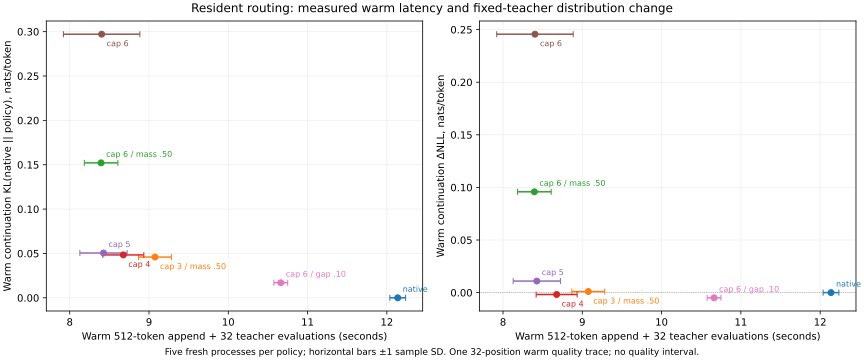

# Resident substitutions beyond three

Allowing five resident substitutions saves 7.16% on the measured warm append
and decode portion relative to the existing three-expert preset: 9.076 to
8.426 seconds, with a saving in all five pairs. The complete-process mean saving
is 1.77%. Its pooled teacher delta-NLL is +0.0446 nats/token against native
routing. Allowing six has effectively the same mean latency and substantially
more distribution drift. All 21 simple reasoning-enabled answer checks pass.
The selector now supports one through six; presets remain at three.

## Context

The earlier resident-routing experiments stopped at three of DeepSeek's six
selected experts. That was a conservative policy, not a model constraint.
The user asked to test up to six and reconsider the 50% total-mass budget.
For the weakest three original contributions, their sum is already at most
50%, apart from floating-point rounding. The budget becomes consequential when
stronger slots become eligible.

Astrra's [Cache-Prior recipe](https://tangled.org/astrra.space/ds4-recipe/blob/0316b956/06-expert-cache-and-routing.md)
uses a different control: add a residency bonus proportional to the per-layer
running score range, protect the original top `keep`, and select six again.
It then recomputes mixture weights from the chosen experts' unbonused affinities.
Its recommended setting protects three experts; its measured setting protects
two. There is no 50% mass ceiling. We have not ported that algorithm here: this
experiment retains our original mixture coefficients and asks which simpler
limits are useful before adding score-history and speculative-commit state.

## Setup

- M5 Max, 128 GiB; DeepSeek V4.1 Flash 1017,
  `DeepSeek-V4.1-Flash-1017-IQ2_XXS-Q2_K-imatrix.gguf`.
- Runtime baseline `910a6a4dff95`; candidate runtime `b1d553e1358c`.
  All policies use the same candidate binary. Existing cap-one through cap-three
  selection arithmetic is unchanged and covered by differential host tests.
  Later changes to the report and its driver do not change the measured runtime.
- A new process starts from the first 2,048 tokens of `promessi_sposi.txt`,
  evaluates 32 fixed teacher tokens, restores its saved frontier outside the
  measured windows, appends 512 prompt tokens and evaluates another 32 teacher
  tokens. The initial full sweep is an ordinary bootstrap; the warm append is
  the favorable case for resident prefill. This is one prose trajectory, not
  an agent or coding benchmark.
- Context allocation 4,096; prefill chunk 2,048; selected tile 64 and selected
  limit 1,024. Packed main/index KV and SIMD index scoring are enabled. DSpark
  is off. The expert-cache target is 48 GiB: the runtime reserves 7.12 GiB for
  prefill and uses 40.88 GiB for 4,410 dynamic experts. Planned total memory is
  59.62 GiB. Every process begins with an empty application expert cache;
  the OS file cache is not flushed.
- Five timing samples per policy, forward order on odd repetitions and reverse
  order on even repetitions. No build or competing model job runs during these
  windows. The existing pressure guard owns the serial sequence. Every sample,
  including first runs, is retained.
- Full-vocabulary logit capture uses a separate process per policy and the same
  64 teacher positions. Capturing logits deliberately disables decode timing
  in the benchmark; those processes are excluded from performance claims.
  Generated-answer checks use reasoning and are reported separately.

| Policy | Eligible weakest original slots | Per-slot mass limit | Total mass limit | Score/affinity gap |
| --- | ---: | ---: | ---: | ---: |
| Native | 0 | — | — | 0 |
| Existing preset | 3 | .25 | .50 | .90 |
| Six with old mass limits | 6 | .25 | .50 | .90 |
| Four, no mass limit | 4 | 1 | 1 | .90 |
| Five, no mass limit | 5 | 1 | 1 | .90 |
| Six, no mass limit | 6 | 1 | 1 | .90 |
| Six, close scores | 6 | 1 | 1 | .10 |

All approximate arms require corrected rank at most 64 and preserve original
GPU mixture coefficients. A gap of .10 requires a substitute affinity within
10% of the missing expert's affinity and a corrected selection-score loss no
larger than 10% of that original affinity. This is a router criterion; it does
not establish similarity between the experts' functions. Resident original
choices stay in place, so the cap is an upper bound, not a requested number of
substitutions. A total-mass setting of 1 explicitly disables that cap.

## Timing results

Values are seconds, mean ± sample standard deviation over five processes.
The warm total is the 512-token append plus 32 teacher evaluations.

| Policy | Seed prefill | Seed decode | Warm prefill | Warm decode | Warm total | Process wall |
| --- | ---: | ---: | ---: | ---: | ---: | ---: |
| Native | 15.282 ± 0.165 | 2.276 ± 0.023 | 10.627 ± 0.092 | 1.510 ± 0.026 | 12.137 ± 0.099 | 31.500 ± 0.175 |
| Existing preset | 15.433 ± 0.314 | 1.969 ± 0.017 | 7.850 ± 0.213 | 1.225 ± 0.010 | 9.076 ± 0.207 | 28.272 ± 0.435 |
| Six with old mass limits | 15.601 ± 0.126 | 1.926 ± 0.031 | 7.219 ± 0.213 | 1.177 ± 0.011 | 8.396 ± 0.212 | 27.725 ± 0.286 |
| Four, no mass limit | 15.754 ± 0.059 | 1.915 ± 0.011 | 7.483 ± 0.255 | 1.193 ± 0.006 | 8.676 ± 0.259 | 28.130 ± 0.212 |
| Five, no mass limit | 15.663 ± 0.109 | 1.890 ± 0.018 | 7.220 ± 0.271 | 1.206 ± 0.028 | 8.426 ± 0.298 | 27.772 ± 0.354 |
| Six, no mass limit | 15.618 ± 0.146 | 1.905 ± 0.026 | 7.189 ± 0.462 | 1.213 ± 0.023 | 8.403 ± 0.482 | 27.741 ± 0.548 |
| Six, close scores | 15.588 ± 0.241 | 2.119 ± 0.013 | 9.312 ± 0.061 | 1.350 ± 0.029 | 10.662 ± 0.087 | 30.133 ± 0.247 |

Cap five saves 0.649 seconds, or 7.16%, on the warm portion relative to the
existing preset. Every pair is faster, with savings of 5.10–8.48%. Cap four
saves 4.40%, also in every pair. Complete-process mean time falls only 1.77%
with cap five; the all-inference mean falls 1.89%. These scopes include an
initial full sweep that this routing policy does not accelerate.

Cap six averages just 0.28% below cap five. It is 12.24% slower in the first
pair and 1.84–4.46% faster in the other four. All samples are retained: this
does not establish a reliable additional gain from permitting the sixth slot.
Keeping the old mass limits while permitting six slots is also effectively
tied with cap five in latency, with substantially greater distribution drift.

The close-score arm trades speed for lower KL: its warm total is 17.48%
above the existing preset, but 12.15% below native routing. It remains a
distinct operating point rather than a replacement for the faster policies.

There is visible order sensitivity. Although every seed uses the native full
sweep, seed-prefill means range from 15.282 to 15.754 seconds. For the existing
preset, forward-order seed runs average 15.209 seconds and reverse-order runs
15.770 seconds. No OS-cache flush was performed, and seven-policy reversal
does not balance every policy across every sequence position. We cannot
attribute this seed difference to the resident policy. The warm saving of
cap five remains positive in both orders; no inference about long sessions
or a different expert-cache capacity follows from this screen.



Horizontal bars show timing variation, not confidence bounds. The quality
coordinates come from one teacher trajectory and have no error interval.
The six-slot points lie on the same observed latency plateau as cap five;
small differences within that plateau should not be used to declare a winner.

The routing counters repeat exactly across all five runs. The existing preset
makes 1,112 decode substitutions and 9,517 prefill substitutions; cap five makes
1,444 and 12,134; cap six makes 1,776 and 13,205. These cover 2,560 decoder
layer evaluations and 20,480 warm-prefill row/layer evaluations. Cap five
reaches five substitutions in ten prefill rows, while cap six reaches six in
two rows. Decode reaches at most four and five, respectively. This timing trace
does not reach six decoder substitutions; the separate generated-answer screen
does, in 61 layer evaluations.
Substitution counts and the runtime's nominal skipped-byte counters are not
physical SSD traffic: many prefill rows share one expert-weight load.

The timing guard completed normally. All 965 pressure observations were normal;
maximum wired plus compressed memory was 78.99 GiB. Swap grew by only 1 MiB
from approximately 25 GiB already in use before the experiment.

## Fixed-history quality

These are dependent positions from one continuation. Negative delta-NLL means
that this particular teacher text became more likely; it does not establish
better general answers. KL is measured against native routing at each matching
history. The seed uses the native full-sweep path, recorded as one resident
prefill fallback; its first frontier is identical in every arm. Subsequent
decode and selected prefill can diverge.

| Policy | All 64 ΔNLL | All 64 KL | Warm 32 ΔNLL | Warm 32 KL | Warm top-1 changes |
| --- | ---: | ---: | ---: | ---: | ---: |
| Existing preset | +.010294 | .031198 | +.001026 | .045942 | 1/32 |
| Six with old mass limits | +.093712 | .091832 | +.095813 | .152119 | 3/32 |
| Four, no mass limit | +.018651 | .035510 | −.001801 | .048338 | 1/32 |
| Five, no mass limit | +.044567 | .042147 | +.010967 | .050517 | 1/32 |
| Six, no mass limit | +.167136 | .165866 | +.245641 | .297138 | 5/32 |
| Six, close scores | +.021360 | .014901 | −.004952 | .016990 | 0/32 |

Unrestricted six has a much larger tail than the other arms: at warm position
2,582, target delta-NLL is +2.6821 and KL is 2.6205. Its mean warm delta-NLL
corresponds to about 28% higher teacher perplexity; the pooled result is about
18% higher. These are distribution changes, not task error rates. Protecting
the strongest remaining original choice may matter more than merely retaining
half of the original mass, but this sweep does not isolate the causal effect
of that choice from later routing and cache feedback.

## Generated answers and implementation checks

All 21 generated answers are exact and stop normally. Each policy gets the same
three 2K chat fixtures: a fact in the middle of the context, a recent fact, and
a later correction that must override an obsolete fact. Sampling is greedy;
high reasoning is enabled, with a 384-token ceiling. The table includes all
sampled tokens, including reasoning, so a shorter count is not an independent
performance measurement.

| Policy | Exact and stopped | Ordinary tokens | Recent-fact tokens | Corrected-fact tokens |
| --- | ---: | ---: | ---: | ---: |
| Native | 3/3 | 38 | 126 | 32 |
| Existing preset | 3/3 | 26 | 38 | 40 |
| Six with old mass limits | 3/3 | 39 | 31 | 32 |
| Four, no mass limit | 3/3 | 39 | 32 | 35 |
| Five, no mass limit | 3/3 | 26 | 28 | 32 |
| Six, no mass limit | 3/3 | 88 | 105 | 37 |
| Six, close scores | 3/3 | 38 | 124 | 34 |

These simple retrieval checks do not establish coding, tool-use or long-session
quality. Their prompt prefill uses the native full-sweep path, so they exercise
approximate decode rather than factual quality after approximate prefill. The
separate teacher continuation covers distribution changes after warm selected
prefill. A real agent-append evaluation remains the useful promotion gate.

The cap-six answer run reaches six substitutions in 61 decoder layer
evaluations. Together with the timing trace's six-slot prefill rows, this
exercises both runtime paths. The focused selectors pass, including 100,000
one/two-slot differential cases, 50,000 triple invariants, 50,000 drop-policy
cases and the new four-through-six fixtures. The latter cover unique IDs,
resident-original preservation, mass/rank/gap bounds and six normalized masses
that round above one. All three frontends build, and their help commands run.
An independent source review found no blocking issue in the enlarged plan ABI
or its consumers. Preset values are unchanged.

## Decision

Keep the new one-through-six configuration range. Cap five without mass limits
is the most promising extra-speed point in this sweep; cap four has less teacher
likelihood drift and a smaller speed gain. Six remains available for experiments,
but these samples do not establish an additional latency benefit worth its much
larger distribution change. The close-score arm provides a lower-KL option at
higher latency. Keep the existing three-expert presets until broader agent
quality is measured; no preset or `main` bookmark is promoted by this experiment.
Astrra's full Cache-Prior algorithm, including its different mixture weights
and transactionally committed score history, remains a separate comparison.

## Reproduction

Build once with `./tools/zig-build resident-route-test ds4-bench decoder-replay-bench -j4`.
Run `test-resident-route`, `test-resident-three` and `test-resident-drop` from
`zig-out/bin/`. The [serial driver](run.nu) clears inherited `DS4*` settings and
records each policy's environment beside its outputs. From the repository root:

```sh
python3 speed-bench/ideas/pressure_run.py .workspaces/resident-six/timing-guard -- \
  nu speed-bench/experiments/2026-11-02-resident-six/run.nu \
  .workspaces/resident-six/timing timing
```

Use new output/guard directories with stage `quality` or `answers` for the
separate diagnostics. Compare each quality dump with native using
[`compare_decode.py`](../steering-20261024/compare_decode.py), once at frontier
2,048 and once at 2,560. Delta-NLL and forward KL use full distributions on
identical teacher histories. `exp(delta-NLL)` is a teacher perplexity ratio,
not a task failure rate.

Raw outputs for this run remain ignored under
`.workspaces/resident-six-20261102/`. Two initial wrapper attempts failed before
loading a model because of Nushell argument types; the corrected smoke is also
kept separately and is not one of the five measured samples.

## All measured timing samples

Repetitions 1, 3 and 5 use forward policy order; 2 and 4 use reverse order.
Policy identifiers match the driver. All durations below are seconds.

| Repeat | Policy | Seed prefill | Seed decode | Warm prefill | Warm decode | Wall |
|---:|---|---:|---:|---:|---:|---:|
| 1 | native | 15.374 | 2.249 | 10.622 | 1.553 | 31.538 |
| 1 | preset3 | 15.186 | 1.984 | 7.620 | 1.240 | 27.876 |
| 1 | cap6_mass50 | 15.483 | 1.961 | 6.967 | 1.168 | 27.451 |
| 1 | cap4 | 15.826 | 1.930 | 7.205 | 1.183 | 27.992 |
| 1 | cap5 | 15.642 | 1.869 | 6.929 | 1.180 | 27.430 |
| 1 | cap6 | 15.816 | 1.936 | 7.870 | 1.231 | 28.635 |
| 1 | cap6_gap10 | 15.820 | 2.121 | 9.364 | 1.369 | 30.413 |
| 2 | native | 15.408 | 2.292 | 10.707 | 1.507 | 31.787 |
| 2 | preset3 | 15.728 | 1.975 | 8.086 | 1.229 | 28.842 |
| 2 | cap6_mass50 | 15.815 | 1.887 | 7.494 | 1.167 | 28.122 |
| 2 | cap4 | 15.737 | 1.899 | 7.813 | 1.194 | 28.424 |
| 2 | cap5 | 15.757 | 1.906 | 7.601 | 1.239 | 28.287 |
| 2 | cap6 | 15.460 | 1.908 | 7.434 | 1.243 | 27.889 |
| 2 | cap6_gap10 | 15.365 | 2.097 | 9.311 | 1.373 | 29.959 |
| 3 | native | 15.049 | 2.305 | 10.723 | 1.496 | 31.354 |
| 3 | preset3 | 15.293 | 1.960 | 8.066 | 1.211 | 28.251 |
| 3 | cap6_mass50 | 15.593 | 1.944 | 7.371 | 1.178 | 27.921 |
| 3 | cap4 | 15.770 | 1.915 | 7.652 | 1.199 | 28.263 |
| 3 | cap5 | 15.520 | 1.870 | 7.345 | 1.229 | 27.748 |
| 3 | cap6 | 15.641 | 1.882 | 6.984 | 1.207 | 27.466 |
| 3 | cap6_gap10 | 15.743 | 2.119 | 9.319 | 1.349 | 30.353 |
| 4 | native | 15.412 | 2.270 | 10.498 | 1.486 | 31.427 |
| 4 | preset3 | 15.812 | 1.945 | 7.774 | 1.225 | 28.559 |
| 4 | cap6_mass50 | 15.549 | 1.902 | 7.171 | 1.195 | 27.616 |
| 4 | cap4 | 15.665 | 1.917 | 7.477 | 1.195 | 28.067 |
| 4 | cap5 | 15.784 | 1.899 | 7.226 | 1.205 | 27.927 |
| 4 | cap6 | 15.492 | 1.924 | 6.951 | 1.199 | 27.425 |
| 4 | cap6_gap10 | 15.293 | 2.133 | 9.357 | 1.358 | 29.839 |
| 5 | native | 15.168 | 2.265 | 10.583 | 1.509 | 31.392 |
| 5 | preset3 | 15.147 | 1.983 | 7.705 | 1.222 | 27.834 |
| 5 | cap6_mass50 | 15.563 | 1.938 | 7.092 | 1.175 | 27.517 |
| 5 | cap4 | 15.773 | 1.914 | 7.270 | 1.195 | 27.902 |
| 5 | cap5 | 15.611 | 1.904 | 7.001 | 1.176 | 27.466 |
| 5 | cap6 | 15.684 | 1.876 | 6.708 | 1.187 | 27.290 |
| 5 | cap6_gap10 | 15.719 | 2.123 | 9.212 | 1.301 | 30.102 |

