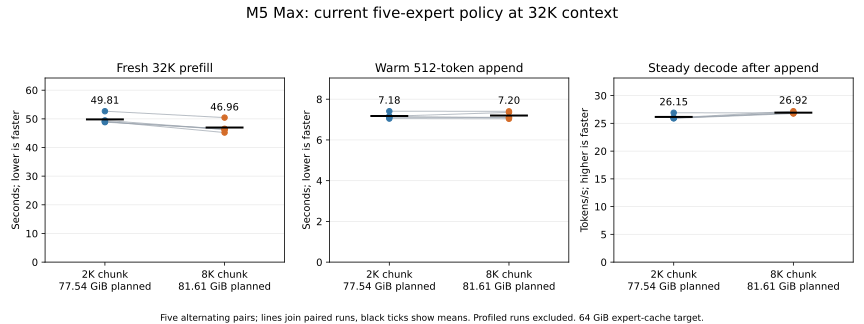
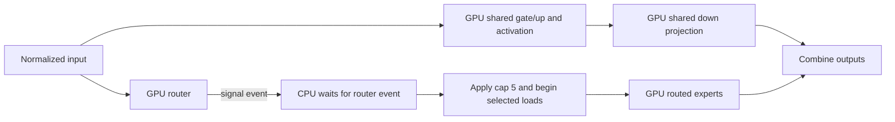

# 32K throughput and dependency profile

On the M5 Max with the adopted five-substitution policy, fresh 32K prefill
averaged **658 tokens/s with 2K chunks and 699 tokens/s with 8K chunks**.
The larger chunk reduced mean prefill time by 5.72%, winning all five pairs,
at a cost of 4.07 GiB more planned scratch space. A 512-token warm append averaged
about 71 tokens/s with either chunk size. Teacher-forced decode after that
append averaged 26.13 and 26.87 tokens/s respectively. These are phase timings
for one workload, not end-to-end agent throughput.

A separate diagnostic points to the host-mediated router boundary as a useful
next decode experiment. The profile does not measure a prospective speedup:
its router gaps include scheduling and dependencies, and instrumentation changes
execution. No runtime optimization was implemented in this slice.

## Setup and scope

The fixed baseline was `4a77c0f2`, with the installed DeepSeek V4.1 Flash 1017
IQ2_XXS/Q2_K imatrix GGUF, Metal SSD streaming, packed main and index KV, a
64 GiB expert-cache target and up to five resident expert substitutions. The
[driver](run.nu) clears inherited `DS4` settings and records the explicit
settings and arguments with each run. The one-hour slice started 2026-11-03
16:48:54 UTC; the pressure guard serialized the heavy jobs.

The prompt is the repository's `speed-bench/promessi_sposi.txt`, an Italian prose
corpus. Both chunk settings use a layer-major initial sweep, with different
internal tile widths; this is not a comparison of sixteen versus four complete
weight sweeps. The 512-token append takes the selected-expert path in 64-row
tiles, so its per-token rate is not expected to match large native prefill.
The tested 2K and 8K settings are explicit overrides; the preset's default
chunk remains 512. There is no MTP, sampling, API or checkpoint-capture overhead
in these measurements.

Each fresh process allocated 40,960 context positions and synchronized a fresh
session to 32,768 prompt tokens, measured 128 teacher-forced decode steps,
restored the frontier, appended 512 prompt tokens and measured another 128
steps. The prefill timer covers session synchronization; the generation timer
covers the decode loop. Startup, model loading, snapshot save and restoration,
and teardown are outside those phase timers. The second prefill is a warm append
to the restored frontier, after the first decode has warmed expert residency;
it is not a fresh 33K prefill. Predetermined teacher tokens avoid sampling
variation but do not measure a complete serving request. The
[benchmark](../../../src/bench.zig) defines these boundaries.

Five profile-off samples per chunk size alternated order, starting with 2K in
pairs 1, 3 and 5. The OS file cache was not flushed; process-local expert
residency starts anew for each process. Separate 8K coarse and detailed profiles
are diagnostic, not throughput samples. Logical reads do not establish
physical SSD traffic. Raw logs, settings, timing CSVs and analysis remain local
under `.workspaces/context32-profile-20261103/`.

All three guarded stages completed successfully. Pressure stayed at level 1;
pre-existing swap varied from 24.9705 to 24.9731 GiB. A preliminary driver invocation
failed before model loading because Nushell interpreted unquoted `64GB` as a
filesize; quoting it fixed the argument. That failure is retained locally and
is not a measured sample.

To reproduce from the repository root, run each stage separately and
sequentially under the guard, using fresh output directories:

```nu
./tools/zig-build ds4-bench -j4
python3 speed-bench/ideas/pressure_run.py .workspaces/context32-repro-timing nu speed-bench/experiments/2026-11-03-context32-profile/run.nu .workspaces/context32-repro-timing/results timing
python3 speed-bench/ideas/pressure_run.py .workspaces/context32-repro-coarse nu speed-bench/experiments/2026-11-03-context32-profile/run.nu .workspaces/context32-repro-coarse/results coarse
python3 speed-bench/ideas/pressure_run.py .workspaces/context32-repro-profile nu speed-bench/experiments/2026-11-03-context32-profile/run.nu .workspaces/context32-repro-profile/results profile
```

## Profile-off measurements



The table retains all five pairs. Prefill values are seconds; decode values are
128-step tokens/s including the first step. Each cell lists 2K / 8K. Seconds
are inferred from the benchmark's two-decimal TPS output, so the last digits
are approximate.

| Pair | First | Fresh 32K prefill, s | 32K decode, tok/s | Warm 512 prefill, s | 33K decode, tok/s |
| --- | --- | ---: | ---: | ---: | ---: |
| 1 | 2K | 52.666 / 50.432 | 20.65 / 21.99 | 7.148 / 7.087 | 26.88 / 26.85 |
| 2 | 8K | 49.122 / 45.210 | 22.80 / 22.44 | 7.047 / 7.037 | 25.99 / 27.16 |
| 3 | 2K | 48.831 / 46.522 | 22.81 / 22.43 | 7.110 / 7.111 | 25.95 / 26.89 |
| 4 | 8K | 48.975 / 46.342 | 22.84 / 22.81 | 7.162 / 7.354 | 25.96 / 26.71 |
| 5 | 2K | 49.446 / 46.294 | 22.90 / 22.42 | 7.411 / 7.404 | 25.87 / 26.73 |

Mean ± sample standard deviation for fresh prefill was 49.808 ± 1.614 s
versus 46.960 ± 2.009 s, or 658.42 ± 20.49 versus 698.76 ± 28.56 tokens/s.
The paired time saving ranged from 2.23 to 3.91 s; the 5.72% figure compares
the mean times. The first pair was slower on both sides. The saving appeared
in both run orders, though only two pairs started with 8K.

Warm append was 7.176 ± 0.139 versus 7.199 ± 0.168 s: no useful difference is
established here. Warm decode averaged 26.13 ± 0.42 versus 26.87 ± 0.18
tokens/s. Fresh-frontier decode averaged 22.40 versus 22.42 tokens/s because
its first step was unusually slow: 935 ± 235 versus 985 ± 95 ms. The remaining
127 steps averaged 26.52 ± 0.22 versus 26.88 ± 0.22 tokens/s. The first-step
delay is not explained by the roughly 7 ms logged pipeline creation; its cause
remains unresolved. This is the first decode evaluation, not time to first
output: the initial prefill already produces next-token logits.
Planned allocation was 77.54 versus 81.61 GiB. Both arms retained the same
56.88 GiB dynamic expert cache and 7.12 GiB prefill reserve; the difference is
scratch space, not cache capacity. The chunk comparison is not a quality evaluation, and
these results do not establish performance on other contexts or workloads.

## What the profiles show

The coarse 8K profile measured 45.9 s fresh prefill. Its layer accounting
reported 36.015 s in drains, 3.908 s seeding, 2.702 s mapping, 2.029 s Engram
and 0.139 s encoding. A drain includes completion of queued GPU work and other
waiting; it is not pure synchronization overhead. The pread workers reported
151.12 GiB of logical reads and 14.939 s of worker time, with 2.682 s exposed
join time already included in mapping. These numbers are not independent
wall-time components or physical SSD traffic.

In the detailed prefill timeline, the largest kernel categories by summed
duration were attention (9.38 s), routed IQ2/Q2 (8.93 s) and F16 matvec
(4.34 s). These sums can overlap and cannot be added to the coarse waits.
The F16 work includes compressor projections (2.63 s) and index-query
projection (1.30 s). The
[projection entry](../../../src/metal/dense_matmul_entry.zig) deliberately requests
exact row reductions even for large batches; the
[cache publication code](../../../src/engine/deepseek41/batch_attention.zig)
explains why bulk prefill and suffix replay must produce consistent keys.
A matrix-matrix kernel could reuse weights across rows more effectively, but
would change the reduction order. That is a possible approximation to measure
with quality and cache-consistency checks, not an accidental fallback to fix.

Across both coarse-profile decode frontiers, 10,171 of 10,240 layer calls
(99.33%) were fully resident after substitution. There were 69 I/O joins,
totalling 52.889 ms, or 0.207 ms per decoded token across 256 steps. This
specific warm workload therefore gives little evidence that exposed expert I/O
is the main steady decode cost; it does not generalize to colder residency.

The detailed timeline's steady 32K / 33K decode averaged 38.50 / 38.42 ms per
token from first to last device event, with 27.98 / 27.79 ms in the union of
encoder intervals and 10.22 / 10.44 ms in router-to-next-encoder gaps. There
were 101 command buffers per token. Gaps are observed intervals, not proof of
recoverable CPU synchronization overhead. Instrumentation materially alters
scheduling: detailed warm append took 16.67 s versus 7.12 s in the coarse run.
Neither its warm throughput nor its CPU gaps should be treated as representative
of profile-off latency.

## A bounded next candidate

In the default eligible streaming path, the GPU produces router IDs; the CPU
waits for them, applies the resident policy and begins selected loads before
routed expert work. The shared expert consumes the same normalized input and
can start independently of the selected IDs. The general two-layer submission
interval does not remove this router dependency.



A bounded experiment could signal a router event, encode the independent shared
gate/up work, then use the existing
[`ds4_gpu_commit_and_wait_selected_readback`](../../../src/metal/tp_control.zig)
to wait for that event while the GPU executes shared work. The main thread
would retain the current cap-five substitution, native weights and selected-load
logic before dispatching routed experts; no new worker is required. Cache
retirement, final drains and resource lifetimes must remain correct. Shared work
was roughly 4.1 ms per token in this profile, so even successful overlap would
not imply recovery of the entire 10 ms observed gap. This is a hypothesis for a
separately authorized experiment, not a measured speedup or an implementation.
The existing asynchronous expert-load flag rejects the resident policy and
cannot simply be enabled for this test.

Other upstream mechanisms have relevant eligibility limits in this same
`890898cf` port, rather than being missing ports: deferred hyper-connection and
per-token RoPE tables require non-streaming execution; concurrent shared and
routed work additionally requires resident MXFP4 routed weights, unlike this
IQ2/Q2 model. A RoPE table would also disable the M5 packed-32 attention path,
and the FFN deferred mixer cannot piggyback on the narrow BF16 router. These
tradeoffs argue against blindly toggling those paths. See the
[Apple Silicon guide](../../../docs/models/deepseek/apple-silicon.md#scalar-work-and-command-scheduling)
and [MoE dispatch](../../../src/engine/deepseek41/moe.zig).
