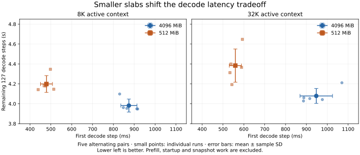

# Expert slab allocation granularity

On 2026-11-03 we compared 4,096 MiB and 512 MiB expert-cache slabs to test whether smaller Metal resources improve a 512-token append. Smaller slabs did not reliably speed up the append: the 32K append was highly variable and the 8K append was longer in all five pairs. Complete measured workload time was effectively unchanged at both context lengths. Keep the 4,096 MiB default; 512 MiB remains an available latency tradeoff because fresh decode's first step was consistently shorter, although the remaining decode window took longer.

The experiment changes only the allocation size in the existing allocator. The [preceding profile](../2026-11-03-post-rope-profile/README.md) found long gaps before routed-expert commands started on the GPU. A slab is a Metal buffer containing multiple expert slots. Each slot occupies a range inside that buffer, but the routed encoder declares the whole buffer as a resource. Smaller slabs might change later compute admission or tracking costs. Prefill has already used GPU blits to seed slots, so the first decode step is not the cache's first GPU use. The timing comparison alone does not establish the cause of the difference.

## Setup and timed scope

The one-hour experiment began at 21:37:22 Eastern. Both arms used runtime revision `ab947bef`, with documentation revision `03a16977`, on an M5 Max with 128 GiB RAM and the Flash 1017 IQ2_XXS/Q2_K checkpoint. The only changed setting was `DS4_METAL_STREAMING_EXPERT_SLAB_MB`, 4,096 versus 512. Both requested a 64 GB expert cache, packed KV and index, resident-route cap five, 8,192-token prefill chunks, route overlap, 2 ms polling and streaming RoPE. The [runner](run.nu) records the complete settings and clears inherited `DS4` variables.

Each fresh process prefills 8,192 or 32,768 tokens from `promessi_sposi.txt`, decodes 128 teacher-forced tokens, restores the prompt frontier, appends 512 tokens, then decodes 128 more. Expert residency persists through the restore; process-local caches start empty and the OS file cache was not flushed. Both contexts allocate for 40,960 tokens, so 8K represents an ordinary active context rather than a smaller allocated-memory configuration. The reported whole inference time sums those four phases and excludes startup and snapshot save/restore. The first decode-step metric starts after prefill; it excludes prefill and startup and is not request time to first token. Timing runs had profiling disabled. Five pairs alternated A/B and B/A order, with A = 4,096 and B = 512 MiB.

## Results

Times below are seconds. Append and whole-inference values are mean ± sample standard deviation over five runs per arm; decode values are means. Decode figures describe the first, fresh decode phase. The full decode duration includes the first step and remaining 127 steps. The append is the warm prefill phase after frontier restore.

| Context and metric | 4,096 MiB | 512 MiB |
| --- | ---: | ---: |
| 32K append | 9.101 ± 3.624 | 9.028 ± 2.709 |
| 32K whole inference | 69.065 ± 5.313 | 69.319 ± 5.090 |
| 32K first decode step | 0.947 | 0.559 |
| 32K remaining 127 decode steps | 4.079 | 4.383 |
| 32K full 128-step decode | 5.027 | 4.943 |
| 8K append | 7.001 ± 0.207 | 7.309 ± 0.313 |
| 8K whole inference | 36.018 ± 0.366 | 35.941 ± 0.485 |
| 8K first decode step | 0.874 | 0.479 |
| 8K remaining 127 decode steps | 3.982 | 4.199 |
| 8K full 128-step decode | 4.856 | 4.678 |

The first 32K pair has particularly long append times in both arms; all samples remain included. Subsequent pairs cluster near 7.4–8.0 s. Pair order and temporal variation limit attribution: the 32K append changes sign across pairs, while 8K consistently favors the larger slabs. The first decode step favors smaller slabs in every pair, but at 32K the remaining 127 steps offset most of that gain. These observations do not establish a general request-latency improvement.

Each cell below lists A / B, regardless of execution order. Whole inference is the sum of the measured phases, not process wall time.

| Context | Pair (first) | Append A / B (s) | Whole inference A / B (s) | First fresh decode A / B (ms) | Full fresh decode A / B (s) |
| --- | --- | ---: | ---: | ---: | ---: |
| 32K | 1 (A) | 15.581 / 13.864 | 78.539 / 77.907 | 1070 / 593 | 5.283 / 5.239 |
| 32K | 2 (B) | 7.407 / 8.010 | 67.349 / 70.064 | 977 / 589 | 5.020 / 4.954 |
| 32K | 3 (A) | 7.578 / 7.949 | 66.747 / 66.611 | 916 / 538 | 4.969 / 4.938 |
| 32K | 4 (B) | 7.401 / 7.595 | 66.516 / 66.012 | 888 / 533 | 4.948 / 4.847 |
| 32K | 5 (A) | 7.535 / 7.719 | 66.176 / 65.999 | 886 / 543 | 4.914 / 4.735 |
| 8K | 1 (A) | 6.739 / 6.837 | 35.945 / 35.125 | 830 / 476 | 4.929 / 4.655 |
| 8K | 2 (B) | 6.881 / 7.709 | 35.730 / 36.391 | 912 / 498 | 4.861 / 4.845 |
| 8K | 3 (A) | 6.965 / 7.278 | 35.646 / 35.928 | 916 / 439 | 4.863 / 4.581 |
| 8K | 4 (B) | 7.219 / 7.325 | 36.250 / 36.133 | 848 / 514 | 4.808 / 4.660 |
| 8K | 5 (A) | 7.199 / 7.395 | 36.522 / 36.127 | 864 / 468 | 4.819 / 4.648 |



The plot shows the measured first-step and remaining-step tradeoff at each context and slab size.

A separate, intrusive 32K timeline pair helps locate costs but is not a repeated latency comparison. Its append took 15.70 s and 14.63 s for 4,096 and 512 MiB respectively. For routed commands, commit-to-completion summed to 8.153 and 7.120 s; GPU execution accounted for 3.165 and 2.767 s. The conditional estimate of time before GPU start fell from 4.938 to 4.299 s, and the independently measured gaps after preceding GPU commands fell from 5.165 to 4.518 s. The number of routed commands taking more than 100 ms from commit to host-observed completion fell from 19 to zero, yet substantial prestart time remained. The host/GPU clock translation is conditional on the assumptions described in the [prior profile](../2026-11-03-post-rope-profile/README.md#interpreting-the-command-clocks). The allowed translation intervals shift these aggregate prestart estimates by roughly 64–80 ms; this is a conditional alignment bound, not the full measurement uncertainty. External activity and the driver's precise behavior remain unmeasured. Fewer large waits do not by themselves predict the whole outcome.

In the same diagnostic pair, primary kernel and grid sequences and command-buffer grouping matched for all 256 decode tokens. The first fresh token's measured envelope fell by 343 ms, largely alongside 360 ms less uncovered gap time, while the remaining 127-token envelope increased by 277 ms, largely alongside 298 ms more gaps. This was not confined to early warmup: token 100 alone added 187 ms, including about 185 ms in the router-to-routed gap. These profiler-perturbed observations do not prove that costs simply moved between steps or identify the driver mechanism. “Remaining 127” excludes only the first step; it is not a measurement of fully warmed throughput.

## Numerical and resource checks

The separate quality diagnostics compared full-vocabulary, temperature-one teacher logits on identical histories at both frontiers in each context. All 512 rows were byte-identical, with zero delta-NLL and KL and no top-one changes; all 512 post-evaluation hashes matched. This verifies these fixed histories, not general task quality or all possible executions. The diagnostic is separate from the profile-free timings.

In the separate 32K profile pair, both arms reported a 6,136-entry budget, 6,031 entries, 184,177 hits, 6,031 misses, no evictions, 55.91 GiB live and 55.95 GiB locked, with no `mlock` failures and 1.33 GiB miss `pread`. Allocations differed in geometry: 14 versus 114 slabs. Aggregate resident-route and prefill counters matched exactly. These are diagnostic counters, and logical reads do not establish physical SSD traffic.

Both timing phases completed under the pressure guard at pressure level 1, with swap unchanged at 24.944 GiB. This records system pressure and swap, not a bound on memory allocated or physical SSD traffic.

## Reproduction and evidence

With the measured runtime built, run each command sequentially under the existing admission lock and pressure guard, after checking that no other heavy model job is running:

```sh
python3 speed-bench/ideas/pressure_run.py .workspaces/expert-slabs-repro-32k-guard nu speed-bench/experiments/2026-11-03-expert-slabs/run.nu .workspaces/expert-slabs-repro-32k timing --frontier 32768
python3 speed-bench/ideas/pressure_run.py .workspaces/expert-slabs-repro-8k-guard nu speed-bench/experiments/2026-11-03-expert-slabs/run.nu .workspaces/expert-slabs-repro-8k timing --frontier 8192
```

Use `quality` in place of `timing` for the diagnostic logits and hashes; `profile` and `timeline` enable intrusive diagnostics and are not comparative latency measurements. Raw logs, arguments, settings, timing samples and quality summaries are retained locally under `.workspaces/expert-slabs-20261103/` and ignored by version control. The timings are reconstructed from the benchmark's reported throughput and token counts; rounding of those throughput values limits their precision.
