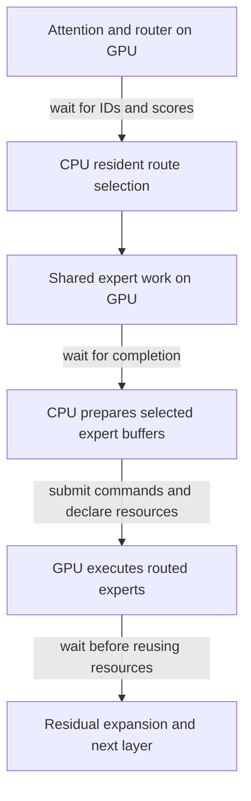

# Profiling the streaming RoPE baseline

On 2026-11-03 we profiled the adopted streaming RoPE baseline at revision `ab947bef` to choose the next bounded experiment. The strongest lead is a delay before selected routed-expert commands start on the GPU during a warm 512-token append. The detailed trace attributes approximately 6.46 s to commit-to-GPU-start, 2.672 s to routed GPU execution, and 0.072 s to GPU-end-to-host-completion across the append. Earlier work from the same engine has already finished before these routed commands. The evidence points toward submission or resource admission, but does not identify a driver operation or exclude external activity.

The next experiment should compare the existing 4,096 MiB expert slabs with 512 MiB slabs at the same actual cache capacity. This is a hypothesis test, not an implemented optimization or a speedup claim. The separate [five-pair RoPE report](../2026-11-03-stream-rope/README.md) owns the profile-free throughput measurements for the adopted baseline.

## Workload and observation

The diagnostic uses the M5 Max with 128 GiB RAM and the Flash 1017 IQ2_XXS/Q2_K checkpoint. It prefills 32,768 tokens, decodes 128 teacher-forced tokens, restores the prompt frontier, appends 512 tokens and decodes another 128. Expert residency persists across that restore. The runner retains packed KV, resident cap five, 8,192-token prefill chunks, routing overlap, 2 ms polling and streaming RoPE reuse. Fresh processes start with empty process-local expert caches; the OS file cache is not flushed. Phase times exclude startup and snapshot save/restore.

The selected-expert append processes eight tiles of 64 rows across 40 layers. The runner requests `64GB`; the log reports a 64.00 GiB target/effective budget partitioned into 7.12 GiB prefill headroom and 56.88 GiB dynamic cache, or 6,136 expert slots at 9.49 MiB each. This is a prefill reserve, not a pressure-induced clamp. All three guarded runs completed at pressure level 1; pre-existing swap stayed at 24.96 GiB without growth.

The relevant dependency chain for each layer and tile is:



These waits are internal to the coarse encode interval: the small outer drain alone does not mean the append ran asynchronously. Resident routing waits for attention and router work; with batch shared overlap off, the routed backend waits for shared work before preparing the selected cache entries. The backend then waits for routed work to complete before proceeding. See [`route_services.zig`](../../../src/engine/deepseek41/route_services.zig) and [`routed_batch.zig`](../../../src/metal/routed_batch.zig). Scalar decode's enabled overlap option does not enable batch shared overlap.

The coarse diagnostic recorded a 7.203 s append, including 6.937 s in encoding and internal waits. A host-sampled run recorded 15.454 s; approximately 90% of its main-thread samples were in Metal completion waits, while submission queue samples included a driver trap. An intrusive detailed timeline recorded a 16.672 s append. These are different diagnostic runs with different instrumentation, not a matched performance comparison. The detailed trace's encoder intervals total 6.966 s but cover a 6.458 s union because intervals overlap. Sampling and per-dispatch tracing can perturb timing.

In that detailed trace all 30 completion waits above 100 ms occur at the routed-expert boundary. The routed commands sum to 9.204 s from commit to completion, of which 2.672 s is reported GPU execution. Independently, matching their starts to GPU timeline records yields 6.648 s in gaps after preceding command buffers end; this includes CPU preparation and encoding before commit. The worst such gap is 191 ms. Thus an earlier same-engine kernel is not consuming that gap. External activity and the driver's precise admission behavior remain unmeasured.

## Why slab size is a useful probe

The streaming expert cache stores many expert slots in each Metal buffer, or slab. An expert's gate, up and down data share that buffer at different offsets. Selected-address prefill chooses individual experts, but the routed encoder declares each selected underlying buffer with Metal `useResource`: the declared resource is the whole slab, not just the expert's byte range. See [`expert_storage.zig`](../../../src/metal/expert_storage.zig) and [`routed_batch.inc.m`](../../../src/metal/routed_batch.inc.m). This distinction makes allocation granularity a plausible input to submission or residency work; CPU locking alone does not establish such a cause.

Long waits recur at separated layers, which could correspond to switching between slabs or making them available to the GPU again. This run allocated 14 slabs, but the logs do not reconstruct which slots belong to which layer: cache seeding and subsequent decode can change the allocation order. The pattern is therefore not proof that the 4 GiB slabs caused the stalls. An [older guarded-decode prototype](../ds41-ssd/README.md#69-deduplicate-slab-resource-declarations-no-gain) found no gain from deduplicating resource declarations; its different schedule and weaker sampling favor testing allocation size first.

Removing the routed completion wait is a different change. Selected-address prefill currently relies on it to protect cached slots from reuse. Any asynchronous replacement must keep slots and temporary address resources alive until GPU consumption finishes; retaining a buffer alone does not prevent the CPU from overwriting its contents.

Compare `DS4_METAL_STREAMING_EXPERT_SLAB_MB=4096` and `512` with the same actual dynamic cache capacity, model, routes and workload. The observed capacity fits below the 256-slab limit at 512 MiB. Run at least five alternating pairs with all samples retained, without a sampler or profiler during performance runs. Include the 32K fresh and warm workload and an ordinary 8K case; report total latency and variation, including clusters, rather than only the maximum stall. Verify actual admitted capacity, outputs and cache traffic, and check for a decode regression. Separate diagnostic traces can examine preparation, prestart and GPU time. Smaller slabs might redistribute or increase overhead, so this experiment must measure the total outcome.

## Independent decode opportunity

The same detailed profile identifies a separate candidate for steady decode. These are per-token sums from fresh and warm phases of one diagnostic, not repeated performance samples. Work can overlap, so rows do not add up to token latency.

| Work | Fresh decode | Warm decode |
| --- | ---: | ---: |
| Routed gate/up and down | 7.24 ms | 7.19 ms |
| Query projection and forward RoPE | 4.11 ms | 3.99 ms |
| Attention output B and expansion | 3.77 ms | 3.71 ms |
| Attention low projection | 2.87 ms | 2.80 ms |
| Shared gate/up and activation | 2.37 ms | 2.32 ms |
| Vocabulary output head | 1.24 ms | 1.21 ms |

A standalone short-Q8 query kernel could reuse the existing helper in [`dense.metal`](../../../src/metal/dense.metal) and layout used by the deferred query kernel in [`dsv41.metal`](../../../src/metal/dsv41.metal). The current 1,280-wide query matrix gives four SIMD groups an uneven five tiles of input. The helper puts one output row in one physical SIMD group while retaining the four logical partial sums. That reduces threadgroups and barriers without removing weights or arithmetic; greater register use could offset the benefit. The existing deferred-query comparison is a numerical reference, but a standalone path needs its own validation. Even a 10% reduction in the roughly 4 ms query interval would save only about 0.4 ms/token before scheduling effects. Keep this separate from the slab experiment.

The detailed trace also leaves 9.32 ms fresh and 7.92 ms warm per token uncovered between router completion and routed expert execution. This includes submission gaps and profiler overhead, not proven CPU execution time. Across 256 decode steps, the coarse run records only 33.98 ms in exposed expert-load waits. A broader scheduling change might address the handoff, but cannot assume all uncovered time is removable.

## Interpreting the command clocks

The [logger](../../../src/metal/scheduling.inc.m) prints host and GPU timestamps from different clock domains. Its offset is `O = GPU_start_ms - (H - D)`, where `H` is host monotonic time sampled after completion and `D` is commit-to-completion duration. Let `G` be GPU duration and let `C` translate GPU time into host monotonic time. A command cannot start before commit or finish after the host observes completion, giving `-O <= C <= D - G - O`.

Intersecting the nonzero-span command bounds gives approximately 79,626,902.7 ms; a 0.2 ms rounding allowance gives 79,626,902.5–79,626,902.9 ms. This conditional interval assumes a stable clock relationship and negligible skew between the logger's sequential host-clock reads. It is not an independent calibration. Applying the midpoint gives approximately 6.46 s before routed GPU start and 0.072 s after GPU end across 320 commands. The independent gaps between GPU command timestamps support the long-stall finding without this host-clock translation.

## Reproduction and evidence

With the baseline built, run the existing diagnostic stages under the admission lock and pressure guard, one heavy model process at a time:

```sh
python3 speed-bench/ideas/pressure_run.py .workspaces/post-rope-profile-repro-guard nu speed-bench/experiments/2026-11-03-stream-rope/run.nu .workspaces/post-rope-profile-repro profile --only rope
python3 speed-bench/ideas/pressure_run.py .workspaces/post-rope-timeline-repro-guard nu speed-bench/experiments/2026-11-03-stream-rope/run.nu .workspaces/post-rope-timeline-repro timeline --only rope
```

The [runner](../2026-11-03-stream-rope/run.nu) specifies the checkpoint, prompt, context sizes, cache request, routing settings and diagnostic flags; it clears inherited `DS4` settings. The local, uncommitted raw logs and analyses are under `.workspaces/post-rope-profile-20261103/{coarse,timeline,host}`. These stages reproduce the diagnostic setup, not identical timings or profile-free performance samples. No runtime behavior was changed in this profiling work.
