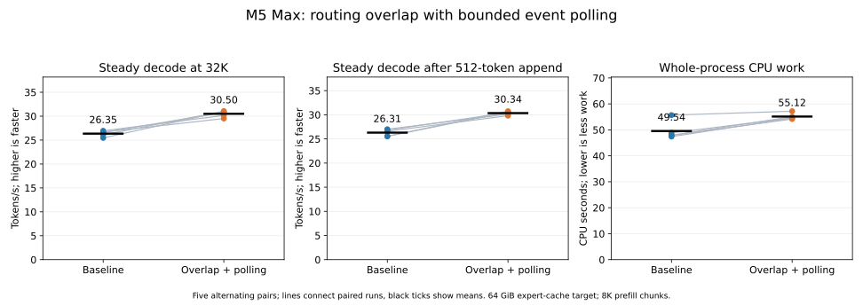

# Overlapping router readback with shared expert work

This experiment asks whether scalar decode can overlap the host's resident
expert selection with GPU work that does not depend on the router's selected
IDs. With cache-read retirement and a bounded 2 ms poll, the final candidate
reduced mean steady decode time by 13.6% at 32K and 13.3% after a warm append;
combined measured inference phases fell 2.3%. Whole-process CPU time rose
11.3%. `resident-fast` and `persistent-fast` now enable the opt-in path and polling;
the ordinary runtime default remains off. After correcting cache retirement,
the final fixed-history checks match bit-for-bit at both 64 and 16 GiB targets.

## Mechanism

In the baseline streaming path, the GPU computes the router selection, then
the host waits for the command buffer to finish, reads the IDs, applies the
resident expert policy and starts selected expert loads. Shared expert gate/up
and activation consume the normalized input independently of those IDs. The
[preceding profile](../2026-11-03-context32-profile/README.md) identified this
boundary as a hypothesis for reducing exposed decode latency, not a measured
speedup.

With `DS4_METAL_V41_ROUTE_SHARED_OVERLAP=1`, the candidate signals an event
after routing, queues shared gate/up and activation, and submits the command
buffer. The host waits for the event instead of completion of the whole buffer,
then reads the IDs, applies the same resident policy and starts selected loads
while the GPU can execute the shared work. Routed work still waits for its
selected experts. The later shared down projection and combination retain their
existing dependencies. The tested final candidate polls for up to 2 ms before
blocking, under the same 60-second overall deadline; the waiting policy lives
in [`tp_control.zig`](../../../src/metal/tp_control.zig).

This is opt-in and applies only to eligible scalar streaming decode with an
active resident route policy. It excludes asynchronous expert loading,
deferred FFN input, predictive loading and deferred oracle routing, as well as
quality-mode, imatrix, image and multi-device paths. Other paths retain their
existing scheduling. The arithmetic is unchanged. At the router event, all
earlier routed expert reads have completed because their outputs feed this
router; only independent shared work using static weights follows the event.
The caller explicitly retires those expert-cache reads while retaining the
pending command buffers, static views and newly opened empty batch. Event
readiness alone does not retire those resources. See
[`moe.zig`](../../../src/engine/deepseek41/moe.zig) and
[`tp_control.zig`](../../../src/metal/tp_control.zig).

Separate coarse profiles found zero already-completed command buffers on
return from 10,240 router waits in both the blocking and final polling variants.
That does not support the initial suspicion that the host always missed the
entire shared-work window. The counter does not timestamp individual kernels
or establish useful overlap by itself. The paired measurements establish the
final package's gain; they do not isolate polling from the retirement fix.

## Setup and reproduction

The initial one-hour slice began at 12:59:37 Eastern on 2026-11-03.
The source baseline was `e95e6d16`; both arms within each timing iteration use
the same binary, with the flag set to `0` or `1`. The blocking and final polling
iterations used different candidate builds. The M5 Max runs the installed DeepSeek
V4.1 Flash 1017 IQ2_XXS/Q2_K imatrix GGUF using Metal SSD streaming, a 64 GiB
expert-cache target, packed KV and index, and resident replacement with at
most five substitutions. The [driver](run.nu) clears inherited `DS4` settings
and records the explicit environment and arguments for each process.

The timing stage alternates five pairs at a 32,768-token frontier and after a
512-token warm append, with 128 teacher-forced decode steps at each frontier.
It uses an 8,192-token prefill chunk and 40,960 allocated positions. The
benchmark reports phase timings rather than a complete serving request; model
startup and loading are outside those phase timers. Each process starts with a
fresh process-local expert cache; the OS file cache is not deliberately flushed.
The prompt is `speed-bench/promessi_sposi.txt`, an Italian prose corpus. Expert
residency survives the KV restore before the warm append, so that case benefits
from the initial 128 decode steps. There is no MTP, sampling or API overhead.
The quality stage uses 8,192 and 8,704-token frontiers and dumps full logits.
Raw output remains local under `.workspaces/route-overlap-20261103/`.

From the repository root, build the candidate and run stages separately and
sequentially under the pressure guard, with fresh output directories. These
commands exercise the final implementation; reproducing the earlier blocking
iteration also requires its earlier binary.

```nu
./tools/zig-build ds4-bench -j4
python3 speed-bench/ideas/pressure_run.py .workspaces/route-overlap-repro-quality-guard nu speed-bench/experiments/2026-11-03-route-overlap/run.nu .workspaces/route-overlap-repro-quality quality --spin-us 2000
python3 speed-bench/ideas/pressure_run.py .workspaces/route-overlap-repro-tight-guard nu speed-bench/experiments/2026-11-03-route-overlap/run.nu .workspaces/route-overlap-repro-tight quality --cache '16GB' --spin-us 2000
python3 speed-bench/ideas/pressure_run.py .workspaces/route-overlap-repro-poll-guard nu speed-bench/experiments/2026-11-03-route-overlap/run.nu .workspaces/route-overlap-repro-poll timing --spin-us 2000
```

The driver also provides `smoke` and instrumented `profile` stages; profile
timings are diagnostic and are not comparative throughput measurements.
Its `--spin-us` and `--cache` options select the polling budget and cache
target for subsequent comparisons. The current driver records whole-process
CPU time using `/usr/bin/time`; phase timings have the narrower scope above.
Check for other heavy model jobs before starting a guarded stage.

## Blocking-event iteration

Five profile-off pairs alternated order, beginning with the baseline in pairs
1, 3 and 5. Each cell is baseline / overlap. Prefill and combined inference
times are seconds, inferred from two-decimal benchmark throughput values;
steady decode is tokens/s for the 127 steps after the first. The combined
inference time sums fresh prefill, both full 128-step decode phases and warm
append, excluding startup and snapshot save/restore.

| Pair | First | 32K prefill, s | 32K steady decode, tok/s | Warm append, s | Warm steady decode, tok/s | Combined, s |
| --- | --- | ---: | ---: | ---: | ---: | ---: |
| 1 | baseline | 45.43 / 45.87 | 26.78 / 26.90 | 7.13 / 7.73 | 26.71 / 26.79 | 63.03 / 63.99 |
| 2 | overlap | 48.09 / 49.23 | 26.97 / 26.77 | 7.75 / 7.78 | 27.15 / 27.15 | 66.27 / 67.49 |
| 3 | baseline | 47.99 / 47.07 | 26.66 / 26.95 | 7.56 / 7.54 | 26.78 / 27.74 | 66.05 / 64.87 |
| 4 | overlap | 47.13 / 46.97 | 26.56 / 27.39 | 7.61 / 7.54 | 26.80 / 27.97 | 65.21 / 64.68 |
| 5 | baseline | 46.94 / 47.02 | 26.54 / 27.37 | 7.58 / 7.60 | 26.89 / 27.51 | 64.95 / 64.77 |

Mean ± sample standard deviation was 26.70 ± 0.18 versus 27.08 ± 0.29
tokens/s for 32K steady decode and 26.87 ± 0.17 versus 27.43 ± 0.47
tokens/s for warm steady decode. The candidate lost the second 32K pair and
tied the second warm pair; its largest gains appeared in the last three pairs,
so variation and run order matter. Combined inference averaged 65.10 ± 1.29
versus 65.16 ± 1.35 s; this workload does not show an overall phase-time gain.
The first 32K decode step averaged 926 versus 909 ms and is excluded from the
steady rates. These figures describe the blocking-event iteration, not the
bounded-polling variant.

## Final polling and cache-retirement candidate



The final build used the same five-pair alternating procedure. Each cell is
baseline / overlap with 2 ms polling. Seconds are derived from rounded TPS,
and combined inference has the same scope as above.

| Pair | First | 32K prefill, s | 32K steady decode, tok/s | Warm append, s | Warm steady decode, tok/s | Combined, s |
| --- | --- | ---: | ---: | ---: | ---: | ---: |
| 1 | baseline | 46.37 / 45.97 | 26.94 / 30.16 | 7.35 / 7.78 | 27.01 / 30.14 | 64.47 / 63.20 |
| 2 | overlap | 48.81 / 48.64 | 26.61 / 30.81 | 7.07 / 7.07 | 26.83 / 30.46 | 66.35 / 64.99 |
| 3 | baseline | 48.62 / 48.59 | 26.09 / 31.04 | 7.98 / 7.08 | 25.56 / 30.74 | 67.63 / 64.87 |
| 4 | overlap | 48.71 / 48.50 | 26.67 / 29.51 | 7.07 / 7.93 | 26.59 / 29.82 | 66.25 / 65.90 |
| 5 | baseline | 48.16 / 48.67 | 25.46 / 31.00 | 7.86 / 7.08 | 25.54 / 30.56 | 66.94 / 64.95 |

Mean ± sample standard deviation for steady 32K decode was 26.35 ± 0.59
versus 30.50 ± 0.66 tokens/s; warm steady decode was 26.31 ± 0.71 versus
30.34 ± 0.37 tokens/s. The candidate won every pair at both frontiers and in
both run orders. Comparing mean times, the 127 steady steps fell 13.61% and
13.35% respectively. Fresh prefill averaged 48.13 ± 1.02 versus 48.07 ±
1.18 s; warm append was 7.47 ± 0.43 versus 7.39 ± 0.43 s. Combined
inference averaged 66.33 ± 1.18 versus 64.78 ± 0.98 s, a 2.33% reduction.
Whole-process wall time averaged 68.64 versus 67.00 s. This is one workload,
not a complete serving request or a prediction for other cache conditions.

Whole-process user plus system CPU time averaged 49.54 ± 3.47 versus 55.12 ±
1.20 s, an 11.26% increase. Mean user time rose from 3.23 to 10.33 s while
system time fell from 46.30 to 44.79 s. These totals include startup and other
work and do not isolate the poll. The timing guard completed successfully.

## Quality and checks

The initial 64 GiB blocking-event quality run compared 256 full-vocabulary
logit rows across the two frontiers: all were bit-identical and all 256
post-evaluation hashes matched. At a 16 GiB target, the initial polling
candidate produced only 13 identical rows, with mean KL of 0.0657965 and mean
delta-NLL of -0.0125815 nats per token. Conservative in-flight expert-cache
pins changed eviction choices and consequently resident substitutions. After
the explicit cache-read retirement fix, the 16 GiB polling run matched all
256 full-logit rows and all 256 post-evaluation hashes. That check used the
previous C polling implementation; the final Zig polling version also matched
all 256 rows and hashes at each cache target, 512 rows in total. This
establishes agreement for these fixed histories, not all prompts or cache
patterns.

Resident-route, three-expert and drop checks passed, as did SSD table admission.
The bounded exact-cache fixture initially failed because its invocation omitted
the required `DS4_METAL_EXACT_VIEW_CACHE_MIB=1`; it passed when rerun with that
setting. The guarded stages completed except for that initial misinvocation.
Both timing campaigns and final quality checks retained pressure level 1;
pre-existing swap stayed at 24.9731 GiB. Agent and server builds and the launcher
default/override tests pass.
