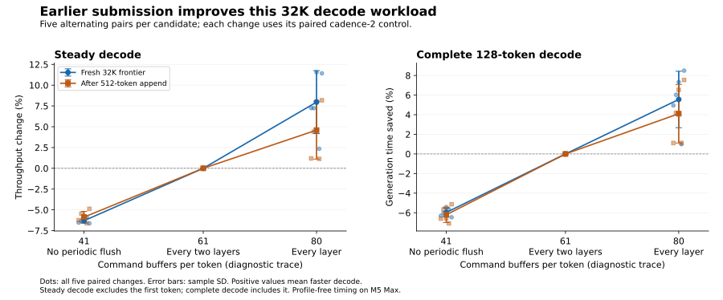

# Decode command submission cadence

Submitting after every eligible layer improved both fresh and warm decode in all five profile-free pairs at 8K and 32K. The `resident-fast` and `persistent-fast` presets adopt cadence 1; explicit values 2 and 0 remain available. Whole measured inference phases varied too much at 32K to establish a comparable overall improvement. These results cover text on one M5 Max.

## Question and mechanism

For each decode layer, the GPU computes routing selections and can run the shared expert gate and up projections while the host waits for those selections. The host then applies the resident routing policy, loads selected experts and encodes routed work. The next layer depends on that routed output. The router readback commits its command buffer and waits for the routing event; it also retires earlier expert-cache reads whose work precedes the event. The final layer and queued output head drain at the end of the token. See [`moe.zig`](../../../src/engine/deepseek41/moe.zig) and [`executor.zig`](../../../src/engine/deepseek41/executor.zig).

The queued decode path additionally submits a bounded prefix after selected layers while the CPU encodes subsequent work. These periodic flushes submit commands without waiting for completion or retiring expert pins; the router event and final drain retain their own responsibilities. The existing `DS4_METAL_V41_DECODE_FLUSH_LAYERS` setting defaults to 2, with a special submission after the first layer. Setting it to 1 submits after every eligible layer; 0 disables these periodic submissions. The setting changes submission cadence, not kernels or router synchronization. See [`command_schedule.zig`](../../../src/metal/command_schedule.zig).

The earlier F16-gather candidate's single intrusive warm profile showed an average 153.49 µs gap between router/shared work and routed work when a periodic flush submitted the latter immediately, versus 231.32 µs when it remained queued until the next layer's router commit. This suggests earlier submission may reduce a dependency gap, but the profile is not comparative speed evidence. Direct gaps after periodic-flush buffers summed to only 0.0908 ms per token. The hypothesis is earlier submission of routed work, not savings from eliminating buffers. The observed default was 61 command buffers per token: 40 router, 20 periodic and one final. Source-based counts predicted 80 at cadence 1 and 41 at cadence 0; subsequent diagnostic traces confirmed both counts.

## Setup

The runtime baseline was `cc3b5bbc`, including the adopted F16 gather; the driver was `6d287876`. All arms use the same binary on an M5 Max with 128 GiB memory and `DeepSeek-V4.1-Flash-1017-IQ2_XXS-Q2_K-imatrix.gguf` with SSD streaming. The only varied setting is flush cadence: baseline 2 and candidates 1 and 0. Common settings include packed FP4 main and index KV, short Q8 query, streaming RoPE table, shared route overlap with a 2,000 µs poll, route cap 5 and gap 0.90, 4 GiB expert slabs, a requested 64 GB cache budget and 8,192-token prefill chunks.

The [driver](run.nu) clears inherited DS4 settings and uses the same Promessi Sposi teacher-forced workload for each arm. The profile-free timing procedure alternates five pairs at each tested frontier, with a fresh 8,192- or 32,768-token frontier and 128 decode steps, followed by KV restore, a 512-token warm append and 128 more decode steps. The expert cache survives restore; the OS cache is not flushed. Steady decode excludes the first step; complete decode includes it. Inference phase times exclude model loading and snapshot save and restore. All completed guarded runs succeeded at pressure level 1; swap ranged from 24.9442 to 24.9464 GiB, growing about 2.2 MiB during diagnostics. Raw arguments, environment and results remain locally under `.workspaces/overnight-decode-20261104/flush-cadence/`.

The cadence 1 timing comparison used:

```sh
python3 speed-bench/ideas/pressure_run.py .workspaces/overnight-decode-20261104/flush-cadence/timing1-32k-guard -- nu speed-bench/experiments/2026-11-04-decode-pass/run.nu .workspaces/overnight-decode-20261104/flush-cadence/timing1-32k timing --flag DS4_METAL_V41_DECODE_FLUSH_LAYERS --control 2 --candidate 1
```

Guard conditions are recorded with the local results.

## Quality

At cadence 1 versus 2, the 8,192- and 32,768-token frontiers, an unaligned 8,193-token frontier and an 8K run requesting a 16 GB expert-cache budget each yielded 256 byte-identical full-vocabulary teacher-logit rows and 256 matching post-evaluation hashes, including the warm append: 1,024 of each in total. At cadence 0 versus 2, the 8K check also matched all 256 rows and hashes. Mean delta-NLL and KL were zero, with no top-1 mismatches. These fixed-history diagnostics do not establish parity for other contexts or sampled tasks.

## Timing and decision



The plot shows each paired percentage change and its mean and sample SD; command-buffer counts come from diagnostic traces.

At 32K, cadence 2 versus 1 gave fresh steady decode of 31.120 ± 0.643 versus 33.582 ± 0.763 tokens/s and warm steady decode of 31.314 ± 0.521 versus 32.738 ± 0.560 tokens/s (mean ± sample SD). Complete 128-step fresh decode took 4.979 ± 0.087 versus 4.701 ± 0.107 s; warm decode took 4.094 ± 0.069 versus 3.924 ± 0.060 s. First steps averaged 896.2 ± 19.6 versus 917.6 ± 25.8 ms fresh and 37.3 ± 2.3 versus 43.9 ± 18.1 ms warm; one candidate warm first step took 76.2 ms.

Fresh prefill took 48.742 ± 1.980 versus 49.038 ± 0.695 s and the 512-token warm append took 7.415 ± 0.475 versus 7.290 ± 0.348 s. Total measured inference phases took 65.230 ± 2.413 versus 64.954 ± 0.874 s. Paired phase-total changes had both signs; the fresh prefill difference in the first pair was particularly large. The decode advantage appears with either run order, although its magnitude varies. Times in seconds are derived from throughput rounded to two decimal places.

| Pair (first arm) | Fresh steady, 2 / 1 tokens/s | Warm steady, 2 / 1 tokens/s | Full fresh decode, 2 / 1 s | Full warm decode, 2 / 1 s | Phase total, 2 / 1 s |
|---|---:|---:|---:|---:|---:|
| 1 (2) | 31.63 / 33.92 | 31.93 / 32.31 | 4.900 / 4.658 | 4.013 / 3.968 | 61.331 / 63.628 |
| 2 (1) | 31.65 / 33.94 | 31.38 / 32.76 | 4.917 / 4.621 | 4.083 / 3.912 | 65.447 / 65.660 |
| 3 (2) | 30.47 / 33.99 | 30.79 / 33.27 | 5.037 / 4.668 | 4.165 / 3.893 | 66.324 / 64.733 |
| 4 (1) | 31.48 / 32.22 | 31.69 / 32.05 | 4.938 / 4.889 | 4.044 / 3.999 | 65.198 / 65.819 |
| 5 (2) | 30.37 / 33.84 | 30.78 / 33.30 | 5.102 / 4.668 | 4.163 / 3.848 | 67.847 / 64.928 |

In a separate 32K comparison, cadence 2 versus 0 gave fresh steady decode of 30.640 ± 0.261 versus 28.708 ± 0.160 tokens/s and warm steady decode of 30.996 ± 0.184 versus 29.176 ± 0.208 tokens/s. All five pairs favored cadence 2 in both phases. Full fresh decode took 5.030 ± 0.033 versus 5.331 ± 0.017 s and warm decode 4.136 ± 0.023 versus 4.393 ± 0.032 s. First steps took 885.3 ± 7.4 versus 906.8 ± 11.1 ms fresh and 38.8 ± 3.0 versus 39.3 ± 1.0 ms warm. Fresh prefill took 48.622 ± 0.229 versus 48.472 ± 0.322 s, warm append 7.825 ± 0.100 versus 7.778 ± 0.023 s, and total inference phases 65.613 ± 0.357 versus 65.974 ± 0.358 s. The separate cadence 2 batch was slower than the earlier cadence 2 batch; the two comparisons retain their own paired controls.

| Pair (first arm) | Fresh steady, 2 / 0 tokens/s | Warm steady, 2 / 0 tokens/s | Full fresh decode, 2 / 0 s | Full warm decode, 2 / 0 s | Phase total, 2 / 0 s |
|---|---:|---:|---:|---:|---:|
| 1 (2) | 30.92 / 28.90 | 31.24 / 29.29 | 4.996 / 5.311 | 4.105 / 4.376 | 65.383 / 65.472 |
| 2 (0) | 30.75 / 28.80 | 31.07 / 29.37 | 5.014 / 5.316 | 4.130 / 4.364 | 65.224 / 65.742 |
| 3 (2) | 30.45 / 28.58 | 31.03 / 29.12 | 5.063 / 5.338 | 4.129 / 4.400 | 65.575 / 66.351 |
| 4 (0) | 30.29 / 28.51 | 30.88 / 28.84 | 5.067 / 5.353 | 4.150 / 4.444 | 66.151 / 66.140 |
| 5 (2) | 30.79 / 28.75 | 30.76 / 29.26 | 5.012 / 5.336 | 4.165 / 4.379 | 65.732 / 66.164 |

At 8K, cadence 2 versus 1 gave fresh steady decode of 31.794 ± 0.409 versus 33.736 ± 0.944 tokens/s and warm steady decode of 31.790 ± 0.096 versus 33.466 ± 0.625 tokens/s. All five pairs favored cadence 1 in both phases. Full fresh decode took 4.880 ± 0.060 versus 4.614 ± 0.094 s and warm decode 4.035 ± 0.016 versus 3.837 ± 0.058 s. First steps averaged 884.8 ± 25.1 versus 847.9 ± 22.2 ms fresh and 40.5 ± 10.3 versus 41.1 ± 13.8 ms warm. Fresh prefill took 19.702 ± 0.225 versus 19.552 ± 0.182 s, warm append 7.084 ± 0.324 versus 7.147 ± 0.341 s, and total inference phases 35.701 ± 0.435 versus 35.150 ± 0.444 s. One pair favored cadence 2 in total phase time.

| Pair (first arm) | Fresh steady, 2 / 1 tokens/s | Warm steady, 2 / 1 tokens/s | Full fresh decode, 2 / 1 s | Full warm decode, 2 / 1 s | Phase total, 2 / 1 s |
|---|---:|---:|---:|---:|---:|
| 1 (2) | 31.37 / 33.38 | 31.78 / 33.50 | 4.904 / 4.656 | 4.054 / 3.825 | 36.347 / 35.278 |
| 2 (1) | 31.68 / 33.27 | 31.76 / 33.36 | 4.919 / 4.644 | 4.034 / 3.842 | 35.622 / 35.292 |
| 3 (2) | 31.48 / 34.80 | 31.65 / 34.47 | 4.944 / 4.490 | 4.048 / 3.750 | 35.880 / 34.400 |
| 4 (1) | 32.13 / 32.60 | 31.88 / 32.77 | 4.819 / 4.730 | 4.021 / 3.908 | 35.223 / 35.583 |
| 5 (2) | 32.31 / 34.63 | 31.88 / 33.23 | 4.812 / 4.552 | 4.019 / 3.859 | 35.435 / 35.194 |

The presets adopt cadence 1 for the consistent decode improvement and exact tested logits. Ordinary runtime and `context-fast` defaults remain unchanged. Launcher tests passed. The latency conclusion rests on the profile-free pairs.

## Profile diagnostic

One intrusive 32K timeline pair confirmed 61 versus 80 command buffers per token for cadence 2 versus 1, with encoder count unchanged at 892.055. In warm decode, uncovered router-to-routed gaps summed to 7.775 versus 6.341 ms per token; encoder union was 27.820 versus 27.829 ms and the measured token envelope 35.753 versus 34.232 ms. Fresh gaps were 7.712 versus 6.600 ms, encoder union 28.069 versus 27.841 ms and envelope 35.839 versus 34.582 ms. A separate cadence 0 profile counted 41 command buffers and 892.055 encoders per token in both phases. These diagnostics support the earlier-submission hypothesis but instrumentation affects execution; they are not comparative latency samples.

The small-cache diagnostic exercised eviction and misses: the cadence 1 run reported 4,682 evictions, 4,574 reuse scans and 1,827 mixed selected sets out of 10,240. The requested 16 GB budget produced an actual admitted expert payload target of 8.88 GiB, or 958 entries. This provides a bounded lifetime check under cache turnover, not a performance comparison or proof for every cache configuration.
