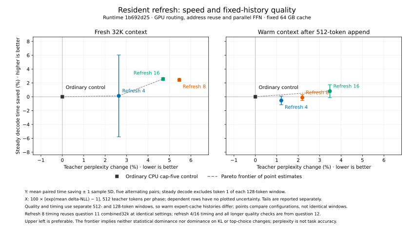

# Resident-routing refresh interval

Interval 16 is the point selected for recorded-agent and fresh coding
qualification. Its measured decode gains come with teacher-distribution drift;
it remains an explicit opt-in, with no preset or installed-binary promotion.
The experiment ran within the November 4, 2026, 16:33–17:33 Eastern slice,
asking which refresh interval offers a useful speed–quality tradeoff for later
practical task and package qualification.

The [preceding experiment](../2026-11-04-resident-parallel/README.md) found
that concurrently executing the shared and routed feed-forward branches
improved decode in its attribution comparisons. Its combined GPU route improved
fresh decode against ordinary routing but was approximately neutral after a
warm append at 32K. That route remains an opt-in approximation.

## Comparison

Ordinary CPU resident routing allows up to five substitutions, with a 0.90
score gap, rank limit 64 and native slot weights. The candidate runs ordinary
routing periodically to refresh the expert cache; between those refresh steps,
the GPU selects only among resident experts under a more permissive policy.
The interval is the number of positions between ordinary routing steps. Shorter
intervals invoke the ordinary policy and refresh the cache more often. The
comparison therefore changes both routing decisions and cache refresh frequency;
it does not isolate either effect.

All arms use runtime revision `1b692d25` without runtime code changes. The
candidate enables GPU resident routing, address reuse and concurrent execution
of the shared and routed feed-forward branches, varying only refresh intervals
4, 8 and 16. The tracked [interval 4](refresh-4-settings.json),
[interval 8](refresh-8-settings.json) and [interval 16](refresh-16-settings.json)
settings fix those options. The baseline uses ordinary CPU routing with the same
remaining settings. The machine is an M5 Max with 128 GiB memory, using
`DeepSeek-V4.1-Flash-1017-IQ2_XXS-Q2_K-imatrix.gguf`, SSD streaming, a 64 GB
expert cache, 4 GiB slabs and 8,192-token prefill chunks.

At 32K, five profile-free pairs per interval alternate execution order. Each run
prefills 32,768 tokens, decodes 128 teacher tokens, restores the key-value cache,
appends 512 tokens and decodes another 128 teacher tokens. “Fresh” means after
the initial prefill; “warm” means after restore and the append. The expert cache
survives restore; the OS cache is not flushed. Phase times exclude model loading
and snapshot save and restore. Steady decode excludes the first token; complete
decode includes it. Interval 8 reuses the five-pair combined comparison from
the preceding experiment, performed with the same runtime and settings; the
other intervals have their own paired ordinary controls. Thus each interval is
paired with its own ordinary measurements, while comparisons between intervals
are not directly paired. Comparing the recorded
candidate environments confirms that the interval-8 quality run adds only
`DS4_BENCH_DECODE_LOGITS_HASH=1` to the reused timing settings. Raw evidence is local
under `.workspaces/hillclimb-20261104/12-resident-refresh/`; the reused timing is
under `.workspaces/hillclimb-20261104/11-resident-parallel/combined32k/`.

Quality uses full-vocabulary, temperature-one logits on identical teacher
histories, with 512 tokens each after the 32,768-token fresh frontier and after
the 512-token append. Delta negative log likelihood (delta-NLL) is candidate
minus ordinary likelihood loss for the teacher token, in nats per token. A
positive value means the candidate assigns the teacher token lower likelihood.
Kullback–Leibler divergence, KL(ordinary || candidate), describes the change in
the full probability distribution in nats. The teacher perplexity change is
`exp(mean delta-NLL) - 1`; it is not an accuracy or task failure rate. Top-choice
changes compare the highest-probability token on these fixed histories. None
of these metrics measures usefulness on diverging sampled tasks. At 32K, quality
runs decode 512 teacher tokens per phase, while timing runs decode 128; their windows
and warm expert-cache histories after restore differ. The plot compares
configurations across those windows, not identical token histories. A frontier
based on perplexity and time does not imply dominance in KL or top-choice changes.

To reproduce a 32K quality pair for interval 16, choose fresh output paths and
run the maintained driver under the pressure guard. Replace `16` in both the
settings filename and output names to test another interval. Use `timing` in
place of `quality` and omit `--tokens 512` for the five-pair timing procedure.

```sh
python3 speed-bench/ideas/pressure_run.py .workspaces/refresh16-quality-guard -- nu speed-bench/experiments/2026-11-04-decode-pass/run.nu .workspaces/refresh16-quality quality --flag DS4_METAL_V41_RESIDENT_GPU --frontier 32768 --tokens 512 --extra-settings speed-bench/experiments/2026-11-04-resident-refresh/refresh-16-settings.json
```

## Findings

### Quality at 32K

Values are from 512 rows per phase;
p95, p99 and maximum describe token-level tails.

| Phase | Mean delta-NLL | Delta-NLL p95 / p99 / max | Mean KL | KL p95 / p99 / max | Top-choice changes | Teacher perplexity change |
| --- | ---: | --- | ---: | --- | ---: | ---: |
| 4, fresh | 0.0260 | 0.4550 / 1.0410 / 2.4883 | 0.0351 | 0.1541 / 0.3606 / 0.6297 | 32 / 512 | +2.63% |
| 4, warm | 0.0120 | 0.2447 / 0.7403 / 4.5132 | 0.0304 | 0.0769 / 0.5096 / 4.4876 | 17 / 512 | +1.21% |
| 8, fresh | 0.0532 | 0.6014 / 1.1268 / 3.2607 | 0.0447 | 0.1733 / 0.4704 / 1.3248 | 40 / 512 | +5.46% |
| 8, warm | 0.0217 | 0.3191 / 1.0311 / 4.3544 | 0.0365 | 0.1001 / 0.6121 / 4.3292 | 26 / 512 | +2.19% |
| 16, fresh | 0.0460 | 0.6225 / 1.4160 / 3.2198 | 0.0512 | 0.2371 / 0.4714 / 1.2955 | 43 / 512 | +4.70% |
| 16, warm | 0.0342 | 0.3693 / 1.1903 / 4.9864 | 0.0429 | 0.1358 / 0.6582 / 4.9596 | 27 / 512 | +3.48% |

On these histories, mean KL rises with the interval in both phases. Mean
delta-NLL rises from interval 4 to 8, but fresh delta-NLL is lower at 16 than
at 8; it is not monotonic. All 1,024 ordinary-control full-vocabulary rows
match byte for byte across the three checks. The largest warm KL for each
interval occurs at the same teacher row, position
33,552. Ordinary NLL is 0.0025 nats there; candidate NLL is 4.5156, 4.3569
and 4.9888 for intervals 4, 8 and 16, respectively. These logits predict the
teacher token before evaluating it. This tail does not by itself establish a
practical task failure.

### Interval 16 quality at 8K

The longer follow-up uses 512 teacher tokens per phase at the 8,192-token
fresh frontier and after a 512-token append. These are fixed-history teacher
measurements, with the same meanings and limits as the 32K quality table.

| Phase | Mean delta-NLL | Delta-NLL p95 / p99 / max | Mean KL | KL p95 / p99 / max | Top-choice changes | Teacher perplexity change |
| --- | ---: | --- | ---: | --- | ---: | ---: |
| Fresh | 0.0284 | 0.3835 / 1.1995 / 4.5167 | 0.0407 | 0.1426 / 0.3486 / 3.3143 | 28 / 512 | +2.88% |
| Warm | 0.0197 | 0.3815 / 0.9067 / 2.6103 | 0.0350 | 0.1682 / 0.4092 / 0.9287 | 26 / 512 | +1.99% |

### Timing at 32K

The plot compares teacher perplexity change with steady decode time at 32K,
using the paired ordinary controls and showing timing variation. As described
above, quality and timing use different decode windows. At 32K, interval 4 has
a noisy, near-neutral
fresh steady decode comparison and a small warm slowdown. Intervals 8 and 16
reduce mean fresh steady decode time by about 2.5% in their respective paired
comparisons; their warm effects are smaller. These measurements do not establish
a general whole-workload gain, and the intervals have separate ordinary controls.



Regenerate the plot with the retained raw summaries and Matplotlib:

```sh
.workspaces/bench-plots-venv/bin/python speed-bench/experiments/2026-11-04-resident-refresh/plot.py .workspaces/hillclimb-20261104
```

#### Interval 4

Values are mean ± sample SD. Phase seconds are derived from throughput rounded to two decimal places.

| Measure | Ordinary | Interval 4 |
| --- | --- | --- |
| Fresh prefill, tokens/s | 662.524 ± 12.936 | 663.254 ± 13.279 |
| Fresh prefill, s | 49.474 ± 0.945 | 49.421 ± 0.982 |
| Warm append, tokens/s | 65.050 ± 0.708 | 64.246 ± 3.111 |
| Warm append, s | 7.872 ± 0.085 | 7.985 ± 0.407 |
| Fresh steady decode, tokens/s | 34.386 ± 0.606 | 34.508 ± 1.711 |
| Warm steady decode, tokens/s | 33.100 ± 0.365 | 32.922 ± 0.191 |
| Fresh first token, ms | 835.603 ± 22.570 | 891.275 ± 55.821 |
| Warm first token, ms | 34.254 ± 0.692 | 35.474 ± 1.868 |
| Complete fresh decode, s | 4.530 ± 0.085 | 4.580 ± 0.193 |
| Complete warm decode, s | 3.871 ± 0.042 | 3.894 ± 0.021 |
| Inference phases, s | 65.747 ± 0.980 | 65.879 ± 1.330 |
| Wall, s | 67.934 ± 1.000 | 68.061 ± 1.305 |

All samples are in pair order, ordinary then interval 4; ordinary ran first in pairs 1, 3 and 5.

| Measure | Ordinary | Interval 4 |
| --- | --- | --- |
| Fresh prefill, tokens/s | 685.040, 659.520, 659.430, 656.440, 652.190 | 679.920, 675.370, 653.650, 652.140, 655.190 |
| Fresh prefill, s | 47.834, 49.685, 49.691, 49.918, 50.243 | 48.194, 48.519, 50.131, 50.247, 50.013 |
| Warm append, tokens/s | 65.980, 65.590, 64.850, 64.440, 64.390 | 65.420, 67.190, 64.960, 64.700, 58.960 |
| Warm append, s | 7.760, 7.806, 7.895, 7.945, 7.952 | 7.826, 7.620, 7.882, 7.913, 8.684 |
| Fresh steady decode, tokens/s | 33.320, 34.780, 34.490, 34.620, 34.720 | 34.830, 35.370, 35.430, 35.430, 31.480 |
| Warm steady decode, tokens/s | 33.740, 33.060, 32.910, 32.870, 32.920 | 33.230, 32.860, 32.750, 32.800, 32.970 |
| Fresh first token, ms | 862.099, 818.438, 858.180, 816.321, 822.975 | 953.633, 888.783, 813.915, 934.892, 865.153 |
| Warm first token, ms | 33.169, 34.832, 33.966, 34.593, 34.708 | 38.777, 34.796, 34.433, 34.327, 35.037 |
| Complete fresh decode, s | 4.673, 4.469, 4.541, 4.485, 4.482 | 4.601, 4.480, 4.399, 4.520, 4.900 |
| Complete warm decode, s | 3.797, 3.876, 3.893, 3.899, 3.892 | 3.861, 3.899, 3.913, 3.907, 3.887 |
| Inference phases, s | 64.064, 65.836, 66.020, 66.247, 66.568 | 64.483, 64.518, 66.324, 66.587, 67.484 |
| Wall, s | 66.218, 68.001, 68.256, 68.417, 68.778 | 66.762, 66.664, 68.507, 68.715, 69.657 |

Fresh steady decode time changed −4.34%, −1.67%, −2.65%, −2.29% and
+10.29% in pair order, averaging −0.13% ± 5.91%. Warm steady time changed
+1.53%, +0.61%, +0.49%, +0.21% and −0.15%, averaging +0.54% ± 0.63%.
The first four fresh pairs favor the candidate; the final candidate is an
outlier at 31.48 tokens/s, versus 34.83–35.43 in the other candidate runs.
Its warm append also took 8.684 s, versus 7.620–7.913 s in the other candidate
runs. Candidate logs contain no error. A process snapshot taken after the run
shows Spotlight activity, but does not establish what caused the outlier; it
is retained. For fresh steady time, ordinary-first changes were −4.34%,
−2.65% and +10.29%; candidate-first changes were −1.67% and −2.29%.
The small order groups and outlier do not establish an order effect.


#### Interval 8

Interval 8 reuses the preceding experiment’s five-pair comparison of ordinary
CPU routing and the combined GPU route. Values are mean ± sample SD.

| Measure | Ordinary route | Combined route |
| --- | --- | --- |
| Fresh prefill, s | 49.772 ± 0.481 | 49.613 ± 0.593 |
| Warm append, s | 7.760 ± 0.289 | 7.847 ± 0.117 |
| Fresh steady decode, tokens/s | 34.688 ± 0.049 | 35.554 ± 0.098 |
| Warm steady decode, tokens/s | 32.978 ± 0.222 | 32.940 ± 0.163 |
| Fresh first token, ms | 812.572 ± 17.348 | 836.115 ± 44.646 |
| Warm first token, ms | 41.315 ± 11.882 | 33.968 ± 0.226 |
| Complete fresh decode, s | 4.474 ± 0.015 | 4.408 ± 0.044 |
| Complete warm decode, s | 3.893 ± 0.031 | 3.889 ± 0.019 |
| Inference phases, s | 65.899 ± 0.799 | 65.757 ± 0.725 |
| Wall, s | 68.071 ± 0.804 | 67.897 ± 0.765 |

All samples follow in pair order, with the ordinary values in the first column
and combined values in the second. Ordinary ran first in pairs 1, 3 and 5;
the candidate ran first in pairs 2 and 4.

| Measure | Ordinary route | Combined route |
| --- | --- | --- |
| Fresh prefill, s | 48.968, 49.730, 49.906, 50.082, 50.176 | 48.680, 49.405, 49.836, 50.178, 49.966 |
| Warm append, s | 7.244, 7.861, 7.883, 7.911, 7.901 | 7.668, 7.793, 7.955, 7.889, 7.928 |
| Fresh steady decode, tokens/s | 34.650, 34.740, 34.640, 34.740, 34.670 | 35.380, 35.610, 35.580, 35.600, 35.600 |
| Warm steady decode, tokens/s | 33.370, 32.890, 32.860, 32.840, 32.930 | 33.180, 33.020, 32.860, 32.880, 32.760 |
| Fresh first token, ms | 793.556, 803.426, 811.001, 839.969, 814.906 | 823.117, 814.432, 818.677, 808.920, 915.427 |
| Warm first token, ms | 35.926, 37.783, 62.458, 34.324, 36.086 | 33.628, 33.845, 34.115, 34.089, 34.163 |
| Complete fresh decode, s | 4.458, 4.460, 4.477, 4.496, 4.479 | 4.412, 4.381, 4.388, 4.376, 4.483 |
| Complete warm decode, s | 3.843, 3.899, 3.928, 3.901, 3.893 | 3.861, 3.880, 3.899, 3.896, 3.911 |
| Inference phases, s | 64.513, 65.950, 66.193, 66.390, 66.449 | 64.622, 65.459, 66.078, 66.339, 66.288 |
| Wall, s | 66.680, 68.117, 68.358, 68.565, 68.637 | 66.690, 67.607, 68.211, 68.498, 68.481 |

Every fresh steady decode pair favored the combined route, a roughly 2.5%
gain in mean throughput. Warm steady decode was close and the warm regression
in the prior experiment did not recur in this set. Inference and wall times
do not demonstrate a whole-workload gain. Warm steady time changes were +0.573%, 0.000% and +0.519% in ordinary-first
pairs, versus −0.394% and −0.122% in candidate-first pairs. This small order
split does not establish a cause. One ordinary-route warm first token
was 62.458 ms; that outlier is retained separately from steady decode.


#### Interval 16

Values are mean ± sample SD; phase seconds are derived from throughput rounded to two decimal places.

| Measure | Ordinary | Interval 16 |
| --- | --- | --- |
| Fresh prefill, tokens/s | 657.172 ± 3.580 | 661.180 ± 7.825 |
| Fresh prefill, s | 49.863 ± 0.271 | 49.565 ± 0.582 |
| Warm append, tokens/s | 66.102 ± 2.357 | 65.614 ± 1.285 |
| Warm append, s | 7.753 ± 0.265 | 7.806 ± 0.151 |
| Fresh steady decode, tokens/s | 34.736 ± 0.075 | 35.650 ± 0.100 |
| Warm steady decode, tokens/s | 32.758 ± 0.269 | 33.026 ± 0.231 |
| Fresh first token, ms | 831.609 ± 31.677 | 860.848 ± 29.774 |
| Warm first token, ms | 44.146 ± 20.524 | 34.170 ± 0.146 |
| Complete fresh decode, s | 4.488 ± 0.031 | 4.424 ± 0.022 |
| Complete warm decode, s | 3.922 ± 0.043 | 3.880 ± 0.027 |
| Inference phases, s | 66.026 ± 0.561 | 65.674 ± 0.719 |
| Wall, s | 68.209 ± 0.568 | 67.875 ± 0.726 |

All samples are in pair order, ordinary then interval 16; ordinary ran first in pairs 1, 3 and 5.

| Measure | Ordinary | Interval 16 |
| --- | --- | --- |
| Fresh prefill, tokens/s | 662.410, 658.870, 653.750, 654.180, 656.650 | 673.240, 664.990, 655.230, 656.650, 655.790 |
| Fresh prefill, s | 49.468, 49.734, 50.123, 50.090, 49.902 | 48.672, 49.276, 50.010, 49.902, 49.967 |
| Warm append, tokens/s | 70.270, 64.640, 65.570, 64.840, 65.190 | 67.410, 66.550, 64.800, 64.650, 64.660 |
| Warm append, s | 7.286, 7.921, 7.808, 7.896, 7.854 | 7.595, 7.693, 7.901, 7.920, 7.918 |
| Fresh steady decode, tokens/s | 34.740, 34.700, 34.790, 34.820, 34.630 | 35.780, 35.540, 35.670, 35.700, 35.560 |
| Warm steady decode, tokens/s | 33.170, 32.840, 32.460, 32.710, 32.610 | 32.910, 33.330, 32.770, 33.200, 32.920 |
| Fresh first token, ms | 785.839, 811.458, 851.810, 859.920, 849.018 | 908.112, 840.481, 840.825, 872.785, 842.035 |
| Warm first token, ms | 34.614, 34.859, 35.861, 34.547, 80.849 | 34.245, 34.343, 34.012, 34.024, 34.228 |
| Complete fresh decode, s | 4.441, 4.471, 4.502, 4.507, 4.517 | 4.458, 4.414, 4.402, 4.431, 4.414 |
| Complete warm decode, s | 3.864, 3.902, 3.948, 3.918, 3.976 | 3.894, 3.845, 3.908, 3.859, 3.892 |
| Inference phases, s | 65.059, 66.028, 66.382, 66.412, 66.249 | 64.620, 65.228, 66.221, 66.111, 66.191 |
| Wall, s | 67.223, 68.244, 68.566, 68.592, 68.421 | 66.732, 67.571, 68.407, 68.261, 68.403 |

Fresh steady decode time fell in all five pairs, by 2.56% ± 0.21% on
average; warm steady time fell by 0.81% ± 0.93%, favoring the candidate in
four pairs. Fresh changes were −2.907%, −2.467% and −2.615% when ordinary
ran first, versus −2.364% and −2.465% when the candidate ran first. Warm
changes were +0.790%, −0.946% and −0.942% in ordinary-first pairs, versus
−1.470% and −1.476% in candidate-first pairs. These small groups do not
establish a causal order effect. Mean inference phase time changed from
66.026 to 65.674 s; fresh prefill differs even though the candidate route is
inactive there, so this is not evidence of a general whole-workload gain.

### Interval 16 timing at 8K

This follow-up uses five alternating pairs and 512 teacher decode tokens per
phase, rather than 128 as in the 32K timing. Values are mean ± sample SD;
phase seconds are derived from throughput rounded to two decimal places.

| Measure | Ordinary | Interval 16 |
| --- | --- | --- |
| Fresh prefill, tokens/s | 411.778 ± 12.503 | 411.852 ± 7.628 |
| Fresh prefill, s | 19.908 ± 0.582 | 19.896 ± 0.364 |
| Warm append, tokens/s | 67.708 ± 5.507 | 67.048 ± 4.813 |
| Warm append, s | 7.598 ± 0.558 | 7.665 ± 0.505 |
| Fresh steady decode, tokens/s | 32.852 ± 1.625 | 34.132 ± 1.507 |
| Warm steady decode, tokens/s | 31.986 ± 1.815 | 32.162 ± 1.050 |
| Fresh first token, ms | 825.133 ± 11.291 | 874.117 ± 90.592 |
| Warm first token, ms | 34.452 ± 0.876 | 38.959 ± 12.492 |
| Complete fresh decode, s | 16.407 ± 0.723 | 15.867 ± 0.570 |
| Complete warm decode, s | 16.047 ± 0.845 | 15.941 ± 0.505 |
| Inference phases, s | 59.961 ± 2.705 | 59.369 ± 1.796 |
| Wall, s | 62.036 ± 2.702 | 61.479 ± 1.765 |

All samples are in pair order, ordinary then interval 16; ordinary ran first in pairs 1, 3 and 5.

| Measure | Ordinary | Interval 16 |
| --- | --- | --- |
| Fresh prefill, tokens/s | 433.990, 407.770, 404.690, 407.600, 404.840 | 416.140, 423.320, 406.430, 406.490, 406.880 |
| Fresh prefill, s | 18.876, 20.090, 20.243, 20.098, 20.235 | 19.686, 19.352, 20.156, 20.153, 20.134 |
| Warm append, tokens/s | 77.540, 65.620, 64.700, 65.250, 65.430 | 75.560, 66.050, 65.010, 64.460, 64.160 |
| Warm append, s | 6.603, 7.802, 7.913, 7.847, 7.825 | 6.776, 7.752, 7.876, 7.943, 7.980 |
| Fresh steady decode, tokens/s | 35.750, 32.310, 32.050, 32.180, 31.970 | 36.610, 34.540, 33.210, 33.160, 33.140 |
| Warm steady decode, tokens/s | 35.230, 31.250, 31.180, 31.230, 31.040 | 34.010, 32.020, 31.650, 31.570, 31.560 |
| Fresh first token, ms | 824.021, 837.045, 808.029, 833.501, 823.069 | 1016.415, 828.613, 817.316, 797.191, 911.052 |
| Warm first token, ms | 33.009, 34.273, 34.864, 35.220, 34.892 | 32.294, 33.658, 33.806, 33.761, 61.277 |
| Complete fresh decode, s | 15.117, 16.656, 16.748, 16.710, 16.803 | 14.975, 15.619, 16.208, 16.208, 16.327 |
| Complete warm decode, s | 14.537, 16.389, 16.421, 16.394, 16.495 | 15.054, 15.995, 16.182, 16.218, 16.254 |
| Inference phases, s | 55.133, 60.937, 61.325, 61.050, 61.359 | 56.491, 58.718, 60.421, 60.522, 60.694 |
| Wall, s | 57.214, 62.966, 63.429, 63.157, 63.412 | 58.638, 60.869, 62.491, 62.598, 62.798 |

Fresh steady decode time fell in all five pairs, averaging 3.76% ± 1.58%.
Warm steady time changed −0.61% ± 2.39%: the first candidate was 3.59%
slower and the later four were faster. Fresh paired changes were −2.349%,
−3.493% and −3.530% with ordinary first, and −6.456% and −2.955% with the
candidate first. Warm changes were +3.587%, −1.485% and −1.648% with ordinary
first, and −2.405% and −1.077% with the candidate first. The small groups and
the first-pair variation do not establish an order effect. Inference phase
time averaged 59.961 ± 2.705 s for ordinary and 59.369 ± 1.796 s for the
candidate; the first pair favored ordinary and both arms drifted. This does
not establish a general task or whole-workload gain.

### Guard and limitations

All seven new jobs completed under the pressure guard with exit code 0,
pressure level 1, no bad samples and swap between 28.8372 and 28.8528 GiB.
A bounded process check observed no competing model, and `pmset` recorded no
warning. These observations do not establish the cause of the interval-4 timing
outlier or the 8K variation. The 32K and 8K teacher checks do not establish practical task quality
or predict other contexts.

## Decision

Interval 16 was selected for the longer 8K follow-up: its 32K fresh and warm
steady decode comparisons favor the candidate in most pairs, while its teacher
quality drift remains measurable. Its lower fresh mean delta-NLL than interval 8
does not mean it dominates interval 8 on all quality measures: mean KL and
top-choice changes are higher. The follow-up used 512 teacher tokens per phase
in both quality and five alternating timing pairs, testing a longer window than
the 128-token 32K timings and matching the warm cache history across those 8K
checks. Those results support carrying interval 16 into recorded-agent and
fresh coding qualification, where practical task behavior can be assessed. The
route remains an explicit runtime opt-in; this selection does not adopt a preset
or replace installed binaries.
