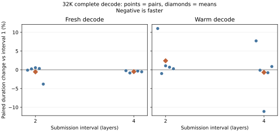

# GPU-resident decode submission cadence

Select interval 4 for the experimental GPU-resident package. Across 8K and
32K, nine of ten fresh complete-decode pairs favored it, with small savings;
warm results were mixed. The 512 fixed-history predictions and post-step
hashes tested at interval 4 matched exactly. The [selected settings](candidate-settings.json)
change only the submission interval from the previous experimental package.
CPU-routing presets and installed binaries are unchanged.

This experiment compares the existing every-layer submission
setting with intervals of two and four layers in the experimental GPU-resident
routing package. The earlier every-layer choice was measured with CPU routing;
GPU-resident routing removes most host handoffs and may change the balance
between submission overhead and keeping the GPU busy.

## Setup

The November 5, 00:02–01:02 Eastern slice uses an M5 Max and DeepSeek V4.1
Flash IQ2_XXS/Q2_K-imatrix with SSD streaming and a 64 GB expert cache. Runtime
revision `909faab5` at checkout `bdcf85a5` supplies the same `ds4-bench` binary
for all arms (SHA-256
`a8fad44806932fad5e041693b7001b913e147751e08e1790a58b3b067f7fb5e9`).
The [package settings](../2026-11-04-package-requalification/candidate-settings.json)
are fixed, including GPU resident routing, refresh interval 16, parallel shared
and routed experts, packing and prefill selectors. Only
`DS4_METAL_V41_DECODE_FLUSH_LAYERS` changes from 1 to 2 or 4. These results
concern the experimental package, not the ordinary CPU-routing fast presets.

The first layer is always submitted. On ordinary GPU-resident tokens, the 40
layers therefore produce 40, 21 and 11 command buffers respectively at
intervals 1, 2 and 4. Every sixteenth position returns to CPU routing, whose
required waits still force submissions. Fewer submissions could reduce host
work but also delay GPU execution; the count alone cannot establish a latency
improvement. The [decode executor](../../../src/engine/deepseek41/executor.zig)
submits without waiting; the [command scheduler](../../../src/metal/command_schedule.zig)
keeps the expert pins until a later completion proof or final drain. CPU-routing
refreshes and resident-cache fallback can force additional waits. Parallel FFN
barriers remain in place within each layer.

The quality probe uses identical teacher histories from `promessi_sposi.txt`,
128 steps at each of the 8192 and 8704 token frontiers, with full-vocabulary
logits and post-evaluation hashes. Against interval 1, interval 2 matched all
256 logit rows byte for byte and all 256 post-step hashes. This describes the
sampled histories, not all possible execution paths or the underlying GPU
routing package's quality relative to CPU routing. At interval 4, a separate
probe at frontiers 32768 and 33280 likewise matched all 256 full-vocabulary
rows and all 256 post-evaluation hashes against interval 1. A second interval-4
probe at 8192 and 8704 matched another 256 rows and hashes, making 512 each.
No new autonomous-task test was run for this cadence change.

## Interval 2 at 32K

Five profile-free pairs alternate baseline-first and candidate-first. Each run
prefills 32768 tokens, teacher-decodes 128, restores KV, appends 512 tokens and
decodes another 128. The expert cache survives restore; the OS cache was not
flushed. The complete decode seconds below are derived from rounded throughput;
steady throughput excludes only the first token. Loading and snapshot operations
are outside phase timing.

| Pair (first arm) | Interval | Fresh first ms | Fresh decode s | Fresh steady tokens/s | Warm first ms | Warm decode s | Warm steady tokens/s |
| --- | ---: | ---: | ---: | ---: | ---: | ---: | ---: |
| 1 (1) | 1 | 830.4 | 4.346 | 36.12 | 33.0 | 3.535 | 36.26 |
| 1 (1) | 2 | 813.1 | 4.342 | 35.99 | 35.6 | 3.924 | 32.66 |
| 2 (2) | 2 | 864.0 | 4.372 | 36.21 | 34.4 | 3.899 | 32.86 |
| 2 (2) | 1 | 853.1 | 4.361 | 36.20 | 34.2 | 3.938 | 32.53 |
| 3 (1) | 1 | 808.8 | 4.307 | 36.31 | 34.3 | 3.941 | 32.51 |
| 3 (1) | 2 | 820.1 | 4.330 | 36.18 | 35.2 | 3.983 | 32.17 |
| 4 (2) | 2 | 851.2 | 4.370 | 36.09 | 35.0 | 3.989 | 32.12 |
| 4 (2) | 1 | 847.2 | 4.355 | 36.21 | 36.9 | 3.962 | 32.36 |
| 5 (1) | 1 | 797.8 | 4.498 | 34.33 | 33.8 | 3.960 | 32.34 |
| 5 (1) | 2 | 821.6 | 4.326 | 36.25 | 35.5 | 3.971 | 32.27 |

Fresh steady means were 35.834 versus 36.144 tokens/s (sample SD 0.843
versus 0.104); three pairs slightly favored interval 1, and a slow fifth
baseline accounts for most of the apparent mean gain. Warm steady means were
33.200 versus 32.416 tokens/s (SD 1.713 versus 0.326); four pairs favored
interval 1, but the first baseline was unusually fast. These comparisons do
not establish a reliable speed change. Initial prefill and the 512-token append
also varied, particularly in the first pair; they are not evidence that the
decode-only selector changed prefill. The guard stayed at pressure level 1;
swap rose modestly during the run.

## Interval 4 at 32K

The same five-pair procedure compared intervals 1 and 4:

| Pair (first arm) | Interval | Fresh first ms | Fresh decode s | Fresh steady tokens/s | Warm first ms | Warm decode s | Warm steady tokens/s |
| --- | ---: | ---: | ---: | ---: | ---: | ---: | ---: |
| 1 (1) | 1 | 867.6 | 4.384 | 36.13 | 32.6 | 3.564 | 35.95 |
| 1 (1) | 4 | 848.0 | 4.373 | 36.03 | 34.3 | 3.839 | 33.38 |
| 2 (4) | 4 | 822.4 | 4.333 | 36.18 | 35.5 | 3.886 | 32.99 |
| 2 (4) | 1 | 847.2 | 4.370 | 36.06 | 69.8 | 3.891 | 33.24 |
| 3 (1) | 1 | 827.6 | 4.390 | 35.66 | 439.5 | 4.291 | 32.98 |
| 3 (1) | 4 | 842.7 | 4.367 | 36.03 | 34.5 | 3.814 | 33.61 |
| 4 (4) | 4 | 831.6 | 4.339 | 36.22 | 33.9 | 3.838 | 33.39 |
| 4 (4) | 1 | 837.5 | 4.354 | 36.11 | 33.6 | 3.868 | 33.12 |
| 5 (1) | 1 | 816.4 | 4.335 | 36.10 | 33.8 | 3.934 | 32.57 |
| 5 (1) | 4 | 798.6 | 4.311 | 36.15 | 35.3 | 3.968 | 32.30 |

Fresh complete decode averaged 4.366 ± 0.022 versus 4.345 ± 0.025 seconds
(sample SD), with all five pairs favoring interval 4. Fresh steady throughput
averaged 36.012 ± 0.198 versus 36.122 ± 0.088 tokens/s, with four of five
pairs favoring interval 4. The warm result was mixed. Its first baseline had an
unusually fast 35.95 tokens/s steady rate; its third baseline append took
15.006 seconds and its first warm decode token took 439.452 ms. These samples
remain in the comparison. The resulting whole-inference mean difference cannot
be attributed to submission cadence from these data.



Each point is one paired percentage duration change in the complete 128-token
decode, including the first token; diamonds show means of paired percentages. Negative is faster. Intervals 2 and 4 have
separate baseline batches. All samples are shown, without a significance claim.

## Interval 4 at 8K

The same procedure starts at 8192 tokens and tests an ordinary shorter context.

| Pair (first arm) | Interval | Fresh first ms | Fresh decode s | Fresh steady tokens/s | Warm first ms | Warm decode s | Warm steady tokens/s |
| --- | ---: | ---: | ---: | ---: | ---: | ---: | ---: |
| 1 (1) | 1 | 835.0 | 4.373 | 35.89 | 31.3 | 3.442 | 37.24 |
| 1 (1) | 4 | 822.7 | 4.248 | 37.08 | 32.9 | 3.492 | 36.71 |
| 2 (4) | 4 | 839.8 | 4.264 | 37.09 | 34.5 | 3.868 | 33.13 |
| 2 (4) | 1 | 840.0 | 4.271 | 37.02 | 33.8 | 4.112 | 31.15 |
| 3 (1) | 1 | 905.6 | 4.415 | 36.19 | 350.8 | 4.004 | 34.76 |
| 3 (1) | 4 | 839.7 | 4.288 | 36.82 | 35.2 | 4.010 | 31.95 |
| 4 (4) | 4 | 842.6 | 4.272 | 37.03 | 34.9 | 3.971 | 32.26 |
| 4 (4) | 1 | 865.4 | 4.294 | 37.05 | 33.5 | 3.908 | 32.78 |
| 5 (1) | 1 | 816.7 | 4.234 | 37.16 | 33.4 | 3.899 | 32.85 |
| 5 (1) | 4 | 815.6 | 4.255 | 36.93 | 34.9 | 3.895 | 32.90 |

Fresh complete decode averaged 4.317 ± 0.075 versus 4.266 ± 0.016 seconds
(sample SD), with four of five pairs favoring interval 4. Fresh steady
throughput averaged 36.662 ± 0.580 versus 36.990 ± 0.114 tokens/s, with
three of five pairs favoring interval 4. Warm results
were mixed; the third baseline append took 13.541 seconds and its first warm
token took 350.765 ms. This retained outlier limits interpretation of phase
totals and does not establish a cadence-caused saving.

## Submission diagnostic

A separate instrumented timeline confirms 40 versus 11 command buffers on all
30 ordinary tokens at each frontier. First and refresh tokens used 80 versus
51. The timeline changes encoder grouping and logging, so its host spans cannot
establish a reduction in native host work. Fresh ordinary begin-to-final-commit
spans averaged 5.483 versus 6.977 ms, followed by 22.723 versus 22.107 ms to
completion; warm spans were 5.213 versus 5.763 ms and 22.793 versus 23.533 ms.
These perturbed timings describe the trace, not the profile-free latency results.
A complementary native-grouping diagnostic used one instrumented pair.
Fresh ordinary begin-to-final-commit spans were 2.933 versus 2.997 ms and
final waits 24.803 versus 24.990 ms; warm spans were 2.697 versus 4.193 ms
and waits 24.710 versus 25.347 ms. These are perturbed host spans, including
intermediate waits, and do not demonstrate reduced native host cost or an
unlocked bottleneck. Fewer command buffers alone does not establish either.

All eight guarded jobs completed successfully at pressure level 1, without
adverse samples. Recorded swap ranged from 28.892 to 28.990 GiB, initially
rising modestly and then stable or slightly falling. Raw logs,
arguments, environment snapshots and the binary manifest are retained locally
under `.workspaces/hillclimb-20261104/21-gpu-submit-cadence/`.

## Reproduce

With the measured binary and model available, the interval-4 32K comparison
uses the existing driver under the pressure guard (choose unused output paths):

```sh
python3 speed-bench/ideas/pressure_run.py .workspaces/submit-guard -- \
  nu speed-bench/experiments/2026-11-04-decode-pass/run.nu \
  .workspaces/submit-timing timing \
  --flag DS4_METAL_V41_DECODE_FLUSH_LAYERS --control 1 --candidate 4 \
  --frontier 32768 --tokens 128 --samples 5 \
  --extra-settings speed-bench/experiments/2026-11-04-package-requalification/candidate-settings.json
```

Use `--frontier 8192` for the shorter context and `--candidate 2` for the
other cadence. The raw local directory contains the exact per-run arguments,
environments, timing CSVs, quality summaries, guard records and diagnostic
profiles. Results are specific to the recorded binary, model and package.
