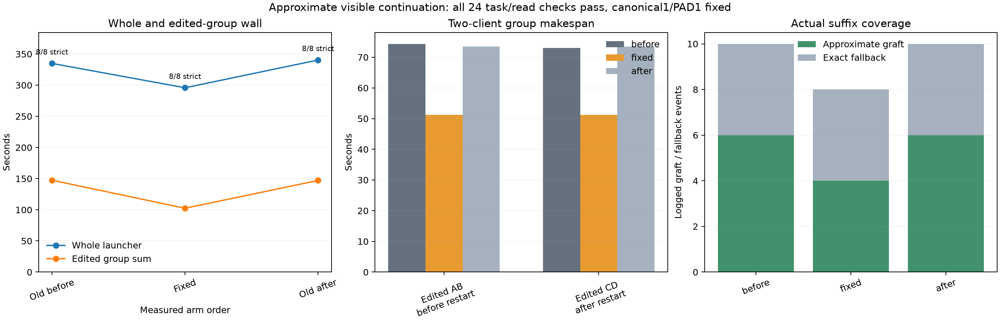

# Approximate visible continuation

Keeping the verified visible continuation of an approximate live graph reduced whole launcher wall by **12.38%** and edited-group wall by **30.40%** against this experiment's old-binary bracket mean. All **24/24 task grades and actual file reads passed**, including all 12 edited fact answers; no output cap was hit.

| Arm | Whole launcher, s | Edited AB, s | Edited CD after restart, s | Strict / reads | Primary / completion grafts | Approximate visible continuations |
| --- | ---: | ---: | ---: | --- | --- | ---: |
| Old before | 334.893 | 74.363 | 73.058 | 8/8 / 8/8 | 4 / 2 | 0 |
| Fixed | 295.812 | 51.252 | 51.222 | 8/8 / 8/8 | 4 / 0 | 4 |
| Old after | 340.360 | 73.542 | 73.519 | 8/8 / 8/8 | 4 / 2 | 0 |

The old whole-wall bracket drift was +1.63%; edited-group drift was −0.24%. Its public replies, function argument strings and every response's usage repeated exactly after excluding generated item/call IDs. The fixed arm retained the same warm outputs and usage. Edited first calls also matched; only D's final JSON spacing changed, with identical correct facts. All requests used effort `none` and reported zero reasoning tokens. Generated token IDs and private replay were not exported; this establishes public byte and usage-count repeat, rather than hidden-state identity.



All arms made four primary grafts from **native SSD sources** (`source_approximate=0`). Each reused 1,034 tokens with 95 fresh tokens; A/C used source `660:1694`, B/D `658:1692`, both moved to `308:1342`. A/C selected no prefix pad, B/D selected one. Their logged primary graft costs remained approximately 17s. Old B/D then grafted again on the tool-result request, with 214 fresh tokens and roughly 21s logged cost. The fix instead logged four `visible-prefix` continuations with `approximate=1`, retaining 1,530 tokens and appending only 25–26. It removed those two completion grafts. Group log slices are counted once; empty individual-row log arrays intentionally avoid concurrent double counting.

The change relaxes only the Responses-visible branch for an approximate graph, retaining its same-profile/frontier and complete visible-prefix proof. Canonical native warming and the canonical bypass of call-ID, memory-text and legacy disk-text tiers stay unchanged; see [source audit](source-audit.md). This preserves the actual padded checkpoint rather than reconstructing it from public text.

Logical disk chunk-read operations fell from 499 in each control to 329; slot eviction logs fell from six to four. All arms had four initial exact fallbacks, zero endpoint evictions and zero hot reads. These counters measure cache operations, not physical SSD traffic. Working sets and final SSD ownership differ; warm-group wall increased from the old mean 183.825s to 186.559s. The edited benefit therefore includes its measured warm cost in the whole result.

The workload uses four histories, two resident slots and two clients in flight, then a restart before edited CD. Group makespan measures elapsed completion, while individual queue-inclusive durations include waiting: their sums were 656.890/577.756/666.145s and must not be treated as elapsed wall or parallel GPU throughput. Whole launcher wall includes both server startups, client phases and shutdowns. This is one edit per history; repeated source movement was qualified separately. Compare only these brackets: earlier runs had materially different graft costs. No additive speed, paired NLL or broad quality/default claim follows from this small generated-history workload.

Settings: canonical1/PAD1, suffix64, hot0/SSD4096MiB, GAP0, Q2 cache64GiB, batch2, context8192, chunk512, tile64/limit1024, temperature0, same visible files and separate cache/store namespaces. Old runtime `00da420b`, fixed `91c9cf21`; exact binaries, revisions and build/test commands are in [build.json](build.json), model commands in `guard-{before,fixed,after}/command.json`, and raw HTTP/server records in each arm. All three guards completed with child returncode0: 938 pressure samples, all level1, stable 0.012998GiB swap, peak wired+compressor85.142GiB, no bad-pressure streak.

Reproduce analysis:

```sh
.workspaces/bench-plots-venv/bin/python -B speed-bench/experiments/approximate-continuation-hour25-20261004/analyze.py --input speed-bench/experiments/approximate-continuation-hour25-20261004 --output speed-bench/experiments/approximate-continuation-hour25-20261004/analysis --plot
```

[JSON/CSV evidence](analysis/results.json) retains independent grades, complete role usage, public-output comparisons, source geometry and cache counters. The measured target succeeded: preserve all four bound visible continuations and avoid repeated grafting. Keep the runtime behavior opt-in pending broader changed-prefix and conversation qualification.
