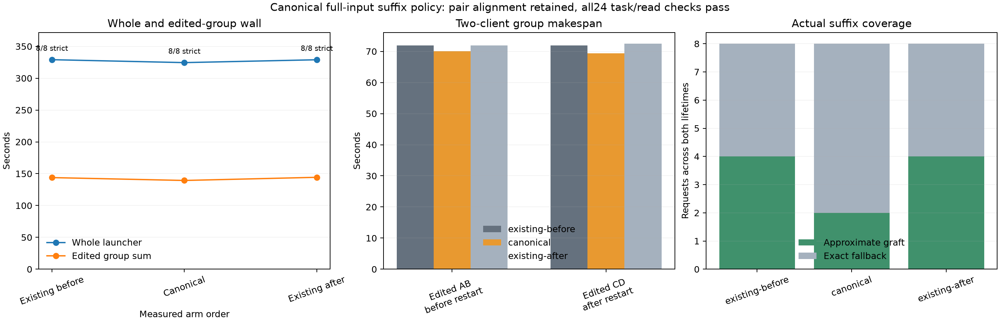

# Canonical full-input suffix materialization, Item23

Canonical rendering produced longer valid grafts for A/C but lost B/D coverage. All 24 steps passed strict answer and actual fresh-read checks, with no caps. Whole launcher wall was **1.38% lower** than the existing-policy bracket mean; edited group wall was **3.28% lower**. This is a small workload-specific result, not a default-promotion or general replay-accuracy claim.

| Arm, measured order | Warm AB (s) | Warm CD (s) | Edited AB (s) | Edited CD after restart (s) | Whole launcher (s) | Edited grafts | Grades/reads |
|---|---:|---:|---:|---:|---:|---:|---:|
| Existing before | 90.916 | 90.430 | 71.899 | 71.965 | 329.076 | 4/4 | 8/8 |
| Canonical | 90.437 | 90.581 | 70.038 | 69.333 | 324.493 | 2/4 | 8/8 |
| Existing after | 89.701 | 90.625 | 71.874 | 72.461 | 328.966 | 4/4 | 8/8 |

The controls' whole wall drift was −0.03348%; their eight public final texts and input/cached/output token totals matched exactly. Canonical warm groups changed +0.14% and +0.06% against the control means; edited AB changed −2.57%, and restarted CD −3.99%. The edited pair sum was 139.371 seconds versus 144.100 seconds for the control mean. Total client-phase wall changed −1.40%. Summed individual queue-inclusive latency instead rose from a control mean of 632.580 to 640.373 seconds: overlapping client waits and group makespan are distinct measures. No parallel GPU or fair-throughput claim follows.

Canonical emitted the same public answers as the controls except for C-edited JSON spacing; all facts, codes and strict parsed answers matched. Every arm performed eight correctly isolated file reads and logged four actual slot evictions. The token histories changed even where public text did not: canonical's warm request totals were one token longer, and later cached/fresh spans differed. The original requests, replies and usage remain preserved, without retries.

| Family | Existing source → destination | Existing reused / total fresh | Canonical source → destination | Canonical outcome |
|---|---|---:|---|---|
| A/C | `660:1073` → `308:721` | 413 / 716 | `660:1694` → `308:1342` | 1,034 reused / 95 fresh |
| B/D | `1164:1691` → `814:1341` | 527 / 95 | Full endpoint anchor has odd shift | Exact fallback |

The successful canonical A/C grafts leave 31 fresh staging tokens plus the configured 64 final tail; their destination end 1342 precedes the incoming latest-user start 1345. All successful grafts used pre-RoPE, `source_ssd=1` and `source_approximate=0`, with one edit per history. The candidate had two approximate grafts and six no-aligned-source fallbacks including four warm requests; each control had four grafts and four warm fallbacks. Earlier repeated-move qualification is separate.

A small model-free inspection of the completed cache confirms the parity tradeoff, rather than inferring it from prompt lengths. Matching each native warm endpoint's last 64 token IDs inside its edited prompt gives A/C `1694 → 1342`, shift 352. Backward extension starts at 659/307; trimming one token makes both starts even at 660/308 and yields the logged 1,034 reused tokens. B/D gives `1692 → 1341`, shift 351, with starts 658/307 and a 1,034-token raw match. That anchor cannot satisfy both-even start alignment. The actual B/D outcome was no-aligned-source fallback; the pair guard was retained. [geometry.json](analysis/geometry.json) records session profiles, manifest keys, token-chunk SHA1s and these measured coordinates. Only little-endian manifest metadata and small token-ID chunks were read and checked for size/SHA1; no tokenizer, model, KV, pre-RoPE or logits were opened.

| Arm / server lifetime | SSD-owned MiB at close | Endpoints / chunks | Logical disk-path chunk reads |
|---|---:|---:|---:|
| Existing before / before restart | 565.630 | 50 / 2,170 | 173 |
| Existing before / after restart | 691.155 | 56 / 2,639 | 173 |
| Canonical / before restart | 464.769 | 43 / 1,770 | 86 |
| Canonical / after restart | 590.322 | 52 / 2,239 | 87 |
| Existing after / before restart | 545.788 | 48 / 2,097 | 172 |
| Existing after / after restart | 671.313 | 54 / 2,566 | 173 |

Hot bytes/reads, pinned endpoints and endpoint evictions were zero throughout. Metadata was 0.376–0.523 MiB. The lower candidate read count accompanies fewer grafts and a different working set; it is not a normalized physical SSD-I/O reduction. OS page caching may serve the disk path. Exact byte fields and route lines are in [analysis/results.json](analysis/results.json), with per-step and per-group CSVs.



The only policy change was `DS4_SERVER_CONTEXT_SUFFIX_CANONICAL=0/1/0`. The opt-in candidate bypasses sampled-ID visible-history, tool-call-ID and memory-text splice tiers and legacy text snapshot splicing for scoped full-input text Responses suffix clients, while retaining exact token-prefix reuse. Incremental tool-only, `previous_response_id` and Conversation continuations keep their existing behavior. The unchanged Item19 driver used stable instructions/tools, identical advertised paths, two clients on two slots, fresh cache/store per arm, and one restart between edited AB and CD. Fixed settings were suffix tail64, hot0/SSD4096 MiB, Q2/cache64/ctx8192/chunk512, GAP0, effort none and temperature0.

Runtime `7adb0d85736bc820e828fb2aa56372813c45b957`, server SHA and focused build/test commands are in [build.json](build.json). Whole launcher wall includes warmup, startup, restart and shutdown; group wall measures the actual concurrent task pair. No paired NLL/KL or full native-state identity is assigned to the differing token histories, and gains are not additive with other experiments. All three guards completed with child exit0. Across 950 samples, pressure stayed level 1, swap remained 0.012998 GiB, peak wired plus compressor was 84.987747 GiB, and consecutive-bad counts stayed zero.

Reproduce CPU analysis:

```sh
.workspaces/bench-plots-venv/bin/python -B \
  speed-bench/experiments/canonical-suffix-hour23-20261004/analyze.py \
  --input speed-bench/experiments/canonical-suffix-hour23-20261004 \
  --output speed-bench/experiments/canonical-suffix-hour23-20261004/analysis --plot
```

Keep canonical materialization opt-in. It changes which family satisfies pair alignment rather than resolving alignment universally; the measured whole-task saving is modest and coverage fell from four edited grafts to two.
