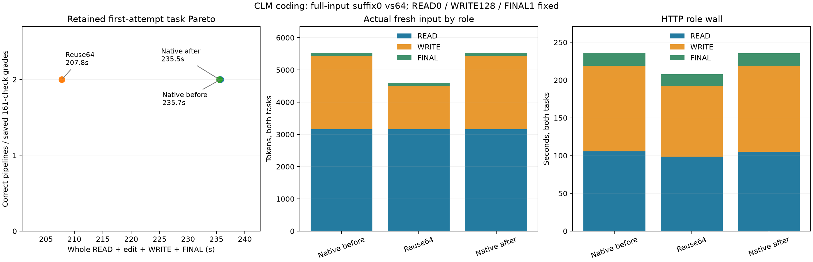

# CLM edit on actual coding tasks

The suffix64 configuration reduced whole task-pair wall by **11.81%** and whole launcher wall by **11.58%** against stable native brackets. All six actual READ → WRITE → FINAL pipelines completed without caps, and every saved first implementation passed the frozen **161/161 checks**. Native-before's original grading failures remain recorded separately.

| Arm | Ledger / LRU task wall, s | Task pair, s | Whole launcher, s | Actual pipelines | Saved first-code checks | Original driver passes |
| --- | --- | ---: | ---: | --- | --- | --- |
| Native before | 119.267 / 116.473 | 235.740 | 240.171 | 2/2 | 161 + 161 | 0/2: grader path error |
| Reuse64 | 108.359 / 99.435 | 207.793 | 212.456 | 2/2 | 161 + 161 | 2/2 |
| Native after | 118.498 / 117.025 | 235.524 | 240.378 | 2/2 | 161 + 161 | 2/2 |

Ledger improved 8.85% and LRU 14.83% against their native means. Native task-pair drift was −0.09%, launcher drift +0.09%. Whole task wall includes the actual file read, authored context edit, first file write and final response; it excludes startup/shutdown and external grading. Whole launcher includes both server lifetimes, client/grade overhead and shutdowns.



| Both-task role cost | Native mean, s | Reuse, s | Native / reuse thinking | Native / reuse fresh input |
| --- | ---: | ---: | --- | --- |
| READ | 105.350 | 98.541 | 88 / 116 | 3164 / 3164 |
| WRITE | 113.400 | 93.799 | 256 / 256 | 2273 / 1345 |
| FINAL | 16.876 | 15.447 | 1 / 1 | 85 / 85 |

This measures the **suffix configuration package**, rather than isolating relocation cost. READ already diverged before any graft: ledger reasoning26→76 and LRU62→40, although READ payloads and public read calls matched. In batched mode, suffix-enabled [server_session_sync](../../../src/ds4_server.c) splits the final sync at `N−fresh` before finishing the tail; suffix-off does not. This verified prefill-boundary difference is a possible explanation for READ divergence, not a demonstrated causal/logit result. READ contributes to the measured whole-task difference and prevents assigning all savings to grafting. Native brackets repeated both first-code bytes, final texts, public outputs and every role's usage exactly after excluding generated item/call IDs. Reuse changed both implementations and final wording; their first code stayed correct. Source and edited user-context bytes matched all arms. Hidden replay/token IDs were not exported, so no private identity or paired generated-history NLL claim is made.

After the successful actual read, the caller replaced two explicitly obsolete note blocks with archive markers, retained the coding contract and read result, then appended the new WRITE instruction. The two actual pre-RoPE grafts were:

| Task | Source → destination | Reused | Suffix fresh / graft fresh | Latest user starts | Prefix pad | Logged graft, s |
| --- | --- | ---: | --- | ---: | ---: | ---: |
| Ledger | `1118:1591` → `436:909` | 473 | 299 / 235 | 1006 | 0 | 22.140 |
| LRU | `1118:1573` → `436:891` | 455 | 174 / 110 | 987 | 0 | 19.368 |

Both sources were suffix-native SSD states (`source_approximate=0`, `source_ssd=1`) ending at the **pre-READ prompt**, before its generated read call and actual config output. The current read result and later WRITE user instruction remain outside the grafted interval. Reported WRITE fresh-input counts735/610 include the436-token destination prefix plus299/174 suffix tokens; they are distinct from the suffix-only “fresh” log field. Both FINAL calls logged a live visible-prefix continuation of the approximate checkpoint, fresh43/42, with no second graft. Ledger completed before restart; LRU performed its own READ/source capture after restart. This does not qualify restoring a pending source across restart.

The first arm's grader ran with `cwd=PRACTICAL` but received a relative saved-code path, yielding FileNotFoundError and child3. ROOT changed only the grader argument to its absolute path before the later arms. Original HTTP responses, first code, raw failed grades and returncodes remain untouched; saved `regrade.stdout` shows161 passes for each original implementation, without a model retry or repair. Analysis reads those retained regrades and verifies saved code equals the actual first write's content and the read output equals the frozen config. It does not rerun tests.

All arms logged three forced closures (both WRITE128 calls and ledger FINAL1), zero deferrals; LRU FINAL naturally used zero thinking tokens. READ budget0 retained high reasoning. Every HTTP response completed and no global2048 output cap was hit; EOS was not independently observed. Reuse had170 logical disk chunk-read operations versus zero native; these are cache reads, not physical SSD traffic. Source warming and resulting cache ownership differ.

Fixed settings: full-input/storefalse/stable task instructions and tools, high reasoning with READ0/WRITE128/FINAL1, temperature0, GAP0/no routing substitutions, canonical1/PAD1, hot0/SSD4096MiB, Q2 cache64GiB, batch2/context8192/chunk512, tile64/limit1024; only suffix0 versus64 changed. These are two reused practical tasks with an authored obsolete-note deletion, not a broad independent quality family. The result warrants broader CLM qualification while remaining opt-in; it is not additive with earlier gains.

Runtime `91c9cf21`, exact server SHA, settings and the grader fix are in [build.json](build.json). All670 guard samples were level1 with no bad-pressure streak; peak wired+compressor84.427GiB. The first guard returned child3 for the retained grader error, later guards child0; none was pressure-killed. Swap stayed0.012998GiB in the first two arms, increasing to0.017637GiB in native-after (about4.75MiB growth).

```sh
.workspaces/bench-plots-venv/bin/python -B speed-bench/experiments/clm-coding-hour27-20261004/analyze.py --input speed-bench/experiments/clm-coding-hour27-20261004 --output speed-bench/experiments/clm-coding-hour27-20261004/analysis --plot
```

[JSON/CSV evidence](analysis/results.json) keeps original driver grades, saved-code qualification, role usage, controls, source geometry, closures, cache counters and guard records. Raw HTTP/server outputs and commands remain under the three arms and `guard-*`.
