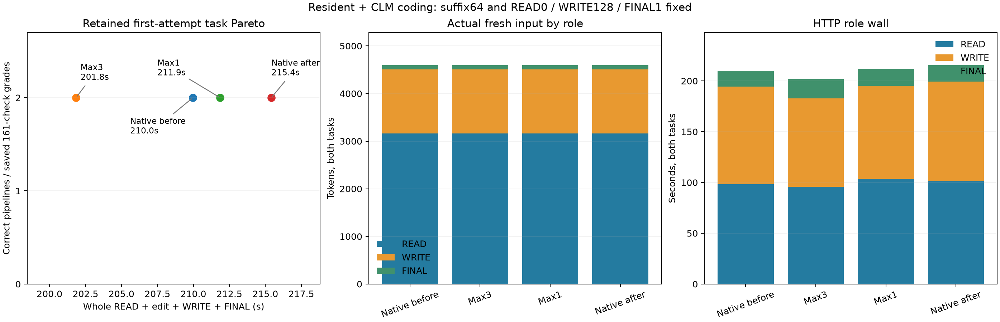

# Resident routing on CLM coding

Max3 reduced the task-pair wall **5.10%** against the native bracket mean and **3.87%** against the faster control. All eight actual pipelines completed without caps and all saved first codes passed **161/161 checks**. The benefit was concentrated in ledger; LRU became slightly slower. Max1 showed no useful whole-pair improvement.

| Arm, measured order | Ledger / LRU wall, s | Task pair, s | Whole launcher, s | Pair vs native mean / faster control | Qualified / raw driver passes |
| --- | --- | ---: | ---: | --- | --- |
| Native before | 109.029 / 100.936 | 209.965 | 214.381 | −1.28% / 0% | 2/2 / 2/2 |
| Max3 | 99.059 / 102.787 | 201.846 | 206.634 | −5.10% / −3.87% | 2/2 / 1/2: omitted `iter` |
| Max1 follow-up | 105.147 / 106.710 | 211.856 | 216.569 | −0.39% / +0.90% | 2/2 / 2/2 |
| Native after | 113.407 / 102.015 | 215.422 | 219.867 | +1.28% / +2.60% | 2/2 / 2/2 |

Native task wall drifted +2.60%, launcher +2.56%; native first-code bytes, final texts, public reply outputs and every role's usage repeated exactly after excluding generated item/call IDs. Max3 launcher improvement was 4.83% against the mean, 3.61% against faster native-before. Its ledger improved 10.93% while LRU regressed 1.29% against case means. Max1's LRU regressed 5.16%. The bounded Max1 point was selected at 20:13 after inspecting Max3; it is not a new independent task family.



| Both-task role wall, s | Native mean | Max3 | Max1 | Native / Max3 / Max1 thinking |
| --- | ---: | ---: | ---: | --- |
| READ | 99.987 | 95.878 | 103.649 | 116 / 106 / 96 |
| WRITE | 96.752 | 87.028 | 91.626 | 256 / 243 / 256 |
| FINAL | 15.949 | 18.935 | 16.576 | 1 / 1 / 1 |

Routing changes generated histories before grafting: READ thinking ledger 76→28/35 and LRU 40→78/61 for Max3/Max1, despite identical READ payloads and public read calls. Max3's ledger first implementation remained byte-identical; LRU changed to an ordered-dict implementation. Max1 changed both implementations. All changed codes passed; final summaries also changed. Max3 LRU naturally finished WRITE thinking at 115, below 128, then emitted a longer 219-token FINAL versus native 91. Such output changes are part of the practical result, rather than isolated kernel timing. There is no paired NLL, hidden-state identity or additive speed claim.

All arms used their own cache namespaces and routing profiles through source warmup, context edit and restart. All four made the same two pre-RoPE grafts from suffix-native sources (`source_approximate=0`, SSD selected): ledger `1118:1591` → `436:909`, reused 473/fresh 299/latest-user 1006; LRU `1118:1573` → `436:891`, reused 455/fresh 174/latest-user 987. Actual prefix pad was 0 for both despite PAD1 being enabled. Source endpoints precede generated READ calls/config output; current actual read results and the new WRITE instruction stay fresh. Every arm retained two approximate visible-prefix FINAL continuations, fresh 43/42. READ/WRITE/FINAL fresh-input totals were identical 3164/1345/85. Ledger completes before restart, then LRU warms its own source: no pending-source SSD recovery claim.

| Actual route counters | Max3 | Max1 |
| --- | ---: | ---: |
| Layer calls / substitutions | 59,280 / 26,680 | 53,800 / 7,840 |
| Double / triple layers | 3,836 / 336 | 0 / 0 |
| Native misses | 37,400 | 27,768 |
| Counter-estimated skipped tensor bytes, decimalGB | 265.554 | 78.034 |

Native coefficient preservation was requested/reported for every substitution; drops 0. Counters measure logical tensor work, not physical SSD traffic. Each arm recorded 170 logical disk chunk reads, no hot reads or endpoint evictions. Cache ownership differed with sampled code. Forced closures were 3/2/3/3 by arm, deferrals 0: both WRITE128 closures fired except Max3 LRU, and ledger FINAL1 fired throughout. All HTTP statuses completed/no 2048 cap; EOS was not independently observed.

The original Max3 LRU grade failed with `NameError: iter`, although the task permits builtins and the existing AST accepted `next(iter(cache))`. ROOT appended only `iter` to the existing execution scope; 161 gold checks and saved first code stayed unchanged. Original raw failure/child3 is retained. Saved `regrade-iter.stdout` qualifies native-before and Max3's first codes; later original grades use the corrected scope. Analysis never reruns a model or grader, and verifies each saved first code equals its actual write content and actual read output equals the frozen config.

Fixed: suffix64/canonical1/PAD1, full-input/storefalse/stable instructions+tools, high READ0/WRITE128/FINAL1, temperature0/global2048, GAP0 baseline versus replace/GAP0.90/mass0.25/rank64/total-mass0.50/native-weights1/max3 or1; Q2 cache64GiB, hot0/SSD4096MiB, batch2/context8192/chunk512/tile64-limit1024. Task wall includes actual READ/edit/WRITE/FINAL, excludes grading/startup; launcher includes both lifetimes and grading overhead. These reused two tasks support an opt-in package screen, not a broad quality/default claim.

Runtime `91c9cf21`, exact SHA/settings, method decision and grader correction are in [build.json](build.json). All 830 pressure samples were level 1, max bad streak 0, peak wired+compressor 86.592GiB. Only Max3 returned child3 for its retained grader omission; other children 0, no pressure kill. Swap increased 0.017637→0.018125GiB during Max1 (0.5MiB), then stayed stable.

```sh
.workspaces/bench-plots-venv/bin/python -B speed-bench/experiments/clm-resident-package-hour28-20261004/analyze.py --input speed-bench/experiments/clm-resident-package-hour28-20261004 --output speed-bench/experiments/clm-resident-package-hour28-20261004/analysis --plot
```

[JSON/CSV evidence](analysis/results.json) retains raw and corrected grades, role usage, controls, own-policy source settings, geometry, routing/cache counters and guards. Keep Max3 opt-in for broader task confirmation; Max1 did not improve this pair beyond control drift.
