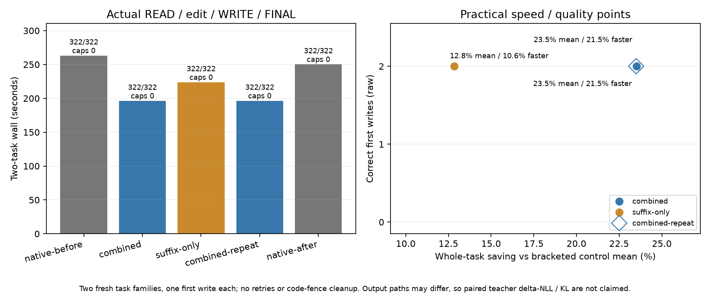

# Item 40: combined settings on fresh coding tasks

**Decision:** enable warm-prefill routing and even right shifts in the existing opt-in **server `persistent-fast`** preset. The measured combination saved **23.52%** of whole-task time against the bracketed native mean, and **21.54%** against the faster native control. Its repeat saved **23.49% / 21.51%**. All ten raw first implementations passed their 161 checks. The proposed 20% saving target was met on these two fresh families, including against the faster control; this is not a general accuracy or throughput guarantee.

Budget: 2026-10-08 **21:43:16–22:43:16 UTC**, including preparation, execution and analysis. The five latency arms finished at **22:08:22 UTC**. No unrelated analysis or plotting ran during them. These percentages do not combine earlier experiments' gains.

## Whole-task results

Order: native-before → combined → suffix-only → combined-repeat → native-after. Each arm starts a fresh server for each task, with separate empty state-cache/response-store directories. Both candidates are bracketed by the same two controls. The repeated combined run uses the same two tasks and is not an additional independent quality sample.

| Arm | Two-task wall, seconds | Saving vs native mean | Saving vs faster native | Raw first writes | Caps |
|---|---:|---:|---:|---:|---:|
| Native-before | 263.221396 | — | — | 2/2; 322/322 checks | 0 |
| Combined | 196.352824 | **23.5201%** | **21.5387%** | 2/2; 322/322 checks | 0 |
| Suffix-only | 223.755637 | 12.8467% | 10.5888% | 2/2; 322/322 checks | 0 |
| Combined repeat | 196.428156 | **23.4908%** | **21.5086%** | 2/2; 322/322 checks | 0 |
| Native-after | 250.254493 | — | — | 2/2; 322/322 checks | 0 |

Native mean: **256.737944 seconds**; faster native: **250.254493 seconds**. Control drift was **−4.9262%**, so the faster-control comparison matters. Combined used **12.2468% less time than suffix-only** in the observed arms. The combined repeat changed total time by **+0.0384%**. Native-before/after had byte-identical first code and identical per-role usage for both tasks. The combined repeat retained its generated-path token counts and routing counters.

The clock covers **READ → context edit → WRITE → FINAL**, including actual reads/writes and context editing. It excludes server startup/shutdown and external code grading. Original and edited contexts were byte-identical across arms. Each task made exactly one actual READ and one WRITE, completed its FINAL, preserved config, and stayed below the 2,048 output-token cap. There were no retries or code-fence cleanup.

| Task | Native-before / after, seconds | Combined, seconds | Combined saving mean / faster | Suffix-only, seconds | Suffix-only saving mean / faster |
|---|---:|---:|---:|---:|---:|
| Interval groups | 132.334369 / 124.358049 | 98.206379 | **23.4832% / 21.0293%** | 112.632470 | 12.2432% / 9.4289% |
| Dependency layers | 130.887027 / 125.896443 | 98.146445 | **23.5570% / 22.0419%** | 111.123168 | 13.4499% / 11.7345% |



The plot shows discrete configurations, not a continuous parameter sweep. Correct first writes saturate at 2/2 here; this does not estimate population accuracy. The hollow diamond is the same-task combined repeat, nearly coincident with the primary point.

## Fresh qualifications

The families were frozen before any model attempt in commit **`ae9f36eb`**. They differ from earlier join/window/ledger/LRU/dedupe/bucket tasks:

- **Interval groups:** arbitrary-order intervals, inclusive gap boundary, transitive connectivity using the maximum end, original-index provenance, duplicates, negative endpoints, exact arithmetic and nonmutation. Its discussion is faithfully compacted **3,902 → 975 bytes**.
- **Dependency layers:** simultaneous rounds, configured input/lex order, exact empty/Unicode IDs, duplicate/missing dependencies, cycles/self-dependencies and nonmutation. Its planning summary expands **1,016 → 4,477 bytes**.

The coding contracts and actual config read remain available after both edits. Each family's 161 cases include explicit boundaries and seeded examples, with seeds **20261008401 / 20261008402**. Gold preparation checked interval sweep against all-pairs connectivity and dependency rounds against recursive depth, plus hand checks/reference nonmutation. Private grading files were not supplied to the model. This establishes practical quality on two fresh algorithms, not a broad coding benchmark or a persistent agent's lifetime behavior.

Requests replay full actual history through `/v1/responses`, preserving returned response items and tool outputs, stable system/tools and a per-task `prompt_cache_key`; this does not depend on `ds4-agent` or `previous_response_id`. Temperature 0, high effort, and fixed reasoning budgets **READ 0 / WRITE 128 / FINAL 1** apply to every arm. No seed claim is made; the latest User instruction is freshly computed after each edit.

## Settings and observed execution

All arms used the same server binary: runtime revision **`4cfff6cb8c09`**, SHA256 **`97e94d3d47a3e9b1c2db14e048e17eef8628b4672725893d1879dda666c40325`**. Model: `gguf/DeepSeek-V4.1-Flash-Q2.gguf`; machine: Apple M5 Max, 128 GiB. Common options: SSD expert streaming, **64GB** expert cache, context **8192**, prefill chunk **512**, two batched-session slots, selected tile **64** and limit **1024**. State cache is **hot 0 MB / SSD 4096 MB**, deliberately forcing suffix sources to SSD. Native controls retain ordinary exact live/prefix caching.

| Setting | Native | Suffix-only | Combined / repeat |
|---|---:|---:|---:|
| Resident decoder / selected-prefill gaps | 0 / 0 | 0 / 0 | .90 / .90 |
| Maximum substitutions | Disabled | Disabled | 3 |
| Maximum mass / total mass | — | — | .25 / .50 |
| Maximum rank / policy | — | — | 64 / replace |
| Resident-route native-weights flag | 0 | 0 | 1 |
| Suffix reuse / right shifts | 0 / 0 | 1 / 1 | 1 / 1 |
| Requested fresh tail | 64, inactive | 64 | 64 |
| Canonical suffix / parity padding | 1 / 1, inactive | 1 / 1 | 1 / 1 |

These bounded substitutions are the rules tested in [Item 37](../recipe-prefill-hour37-20261008/README.md), not the recipe's bonus-and-reweighting router. Initial selected prefill tails can also use the resident rule. Candidate capture, padding and import costs are included in task time.

Both combined arms and suffix-only imported the same SSD-backed immutable pre-RoPE spans:

| Task | Source → destination range | Shift, destination minus source | Imported | Actual fresh / graft-fresh | Latest User start |
|---|---|---:|---:|---:|---:|
| Interval groups | `1142:1644 → 624:1126` | **−518**, left | 502 | 240 / 176 | 1222 |
| Dependency layers | `632:1154 → 1262:1784` | **+630**, right | 522 | 254 / 190 | 1880 |

All six grafts logged `source_ssd=1`, `pre_rope=1`, `source_approximate=0`, and kept the latest User outside the imported range. **`source_approximate=0` only excludes an earlier suffix graft**. Combined source activations were already resident-routed; they are not native/exact because this flag is zero. Cached activations retain their original prefix's influence. Requested tail64 expands to 240/254 actual fresh tokens to protect the latest User and boundary.

Combined executed **23,164 decoder** and **54,912 selected-prefill substitutions**, with identical repeat counters. Disabled routing arms do not emit these enabled-feature footers. [routing.csv](analysis/routing.csv) preserves per-case counters.

| Arm | Output tokens, both tasks | Reasoning tokens, both tasks |
|---|---:|---:|
| Native-before / after | 1303 | 310 |
| Combined / repeat | 1215 | 320 |
| Suffix-only | 1308 | 310 |

Generated code/reasoning/final paths differ. Whole-task speed includes that practical effect, rather than measuring same-token throughput. **No teacher ΔNLL/KL is claimed for this item.** Separate paired measurements in [Item 37](../recipe-prefill-hour37-20261008/README.md), [Item 38](../recipe-compaction-hour38-20261008/README.md), and [Item 39](../recipe-rightshift-hour39-20261008/README.md) describe individual techniques, not a summed or verified combined distributional drift.

All **five guards / 1,112 samples** completed with child exit 0, normal pressure and no adverse samples. Peak wired plus compressed memory: **91.0542 GiB**. Maximum per-arm swap growth: **0.50 MiB**. High memory use was expected. This does not diagnose the earlier watchdog panic.

## Opt-in package decision

After the wrapper update, use:

```sh
./ds4-local --server persistent-fast --model gguf/DeepSeek-V4.1-Flash-Q2.gguf
```

Wrapper commit **`a01c86dd`** adds **`DS4_METAL_V41_RESIDENT_PREFILL_GAP=.90`** and **`DS4_SERVER_CONTEXT_SUFFIX_RIGHT=1`** to the server `persistent-fast` preset's existing resident-decoder/suffix settings. Explicit environment values override defaults, including **0** to disable either feature. Ordinary defaults, the agent-side preset and the existing thinking policy remain unchanged. This experiment fixed its own thinking budgets independently; it does not measure every default preset option.

## Evidence and reproduction

[preflight.json](preflight.json) records binary/source/caller/fixture hashes and independent gold checks. [practical/](practical/), [run.py](run.py) and [launch.py](launch.py) contain fixed methods/golds. Each `code-*` directory records commands/environment, launcher/startup times, HTTP payloads/responses, raw first code, grades and logs; corresponding `guard-*` directories contain command, pressure samples and completion. Cache artifacts remain under `.workspaces/combined-fresh-20261008/`, outside `/tmp`.

To rerun a guarded arm, use new output/cache/store directories:

```sh
python3 -B speed-bench/ideas/pressure_run.py \
  speed-bench/experiments/combined-fresh-hour40-20261008/guard-rerun-combined -- \
  python3 -B speed-bench/experiments/combined-fresh-hour40-20261008/launch.py \
    --arm combined \
    --output speed-bench/experiments/combined-fresh-hour40-20261008/code-rerun-combined \
    --cache .workspaces/combined-fresh-20261008/cache-rerun-combined \
    --store .workspaces/combined-fresh-20261008/store-rerun-combined \
    --visible .workspaces/combined-fresh-20261008/visible
```

After timing, collect the five fixed named arms and plot:

```sh
.workspaces/bench-plots-venv/bin/python -B \
  speed-bench/experiments/combined-fresh-hour40-20261008/analysis.py --plot
```

[results.json](analysis/results.json) preserves full task records and comparisons; [tasks.csv](analysis/tasks.csv), [roles.csv](analysis/roles.csv), [grafts.csv](analysis/grafts.csv), [routing.csv](analysis/routing.csv) and [pressure.csv](analysis/pressure.csv) expose smaller tables. Plots are available as [PNG](analysis/combined-pareto.png) and [SVG](analysis/combined-pareto.svg).
