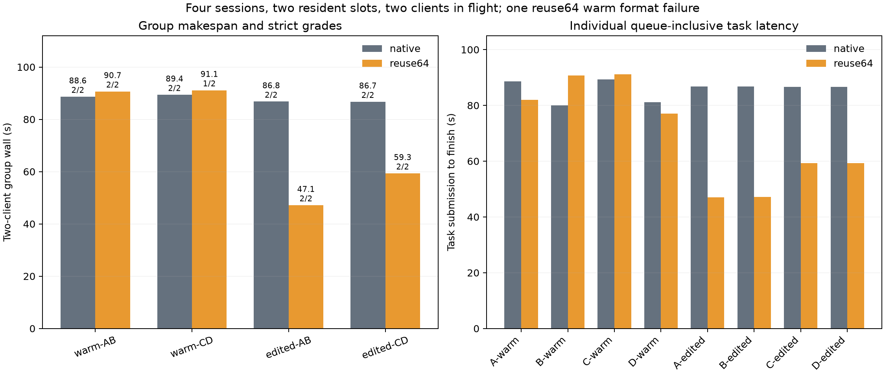

# Four concurrent session identities

**Reuse64 reduced the four edited steps' combined group makespan by 38.64%, with all four fact answers correct in each arm.** Whole launcher wall fell 17.63%, while strict grades were 7/8 for reuse versus 8/8 native. The candidate's C warm response added correct inventory numbers after READY and failed the requested format; this occurred before any graft.

| Group | Native makespan, s / strict passes | Reuse64 makespan, s / strict passes | Candidate route |
|---|---|---|---|
| Warm A/B | 88.632 / 2/2 | 90.664 / 2/2 | 2 exact fallbacks |
| Warm C/D | 89.359 / 2/2 | 91.122 / 1/2 | 2 exact fallbacks |
| Edited A/B | 86.777 / 2/2 | 47.135 / 2/2 | 2 SSD grafts |
| Edited C/D after restart | 86.699 / 2/2 | 59.316 / 2/2 | 2 SSD grafts |



| Scope | Native, s | Reuse64, s |
|---|---:|---:|
| Edited group makespan sum | 173.476 | 106.450 |
| All four group makespans | 351.468 | 288.236 |
| Whole launcher, including startup/restart/shutdown | 355.069 | 292.487 |
| Sum of eight individual queue-inclusive latencies | 686.098 | 553.705 |

The two clients are in flight together; group makespan is elapsed completion time, not the sum of their latencies. Individual values include HTTP/server waiting and edits where applicable. Waiting is not separately measured. Two resident slots do not imply parallel GPU execution; this screen does not establish general GPU throughput.

All sixteen steps across the arms made their required fresh file read; all eight edited answers match independently computed totals and session-specific current archive codes. C/D retrieve newly updated codes after restart. There were no caps. Native has 8/8 strict passes; candidate has 7/8. Independent grading agrees with stored grades. Candidate warm groups were 2.13% slower. C's extra warm text changes its subsequent history, and warm output divergence predates grafting: neither the failure nor every downstream timing difference is attributed solely to approximation.

Logs, counted once per group, show all four candidate grafts with `source_ssd=1` and `source_approximate=0`. This screen has one edit per history; earlier repeated-move qualification is separate. A/B graft after warm C/D; C/D graft after process restart. Each warm group has two `no-aligned-source` fallbacks. Both arms actually log four slot evictions: two in warm C/D and two in edited A/B. Source geometry differs: each edited group has one 413-token and one 527-token graft; candidate C's longer warm output adds 40 fresh tokens. These are persisted-cache sources, without a cold physical-SSD claim.

Settings: unchanged runtime `bc6896ae` ([build/SHA](build.json)), four full-input identities, two simultaneous client tasks, two resident server slots, fresh tail 64 versus native, hot cache 0/SSD 4096 MB, Q2/cache64/ctx8192/chunk512, GAP0, temperature 0/no thinking. Stable tools/instructions and explicit fresh reads are shared. No retries or output repairs. One run per arm, reuse then native; no bracketed reliability or additive speed claim.

```sh
.workspaces/bench-plots-venv/bin/python -B speed-bench/experiments/concurrent-sessions-hour19-20261004/analyze.py --native speed-bench/experiments/concurrent-sessions-hour19-20261004/native --reuse speed-bench/experiments/concurrent-sessions-hour19-20261004/reuse64 --output speed-bench/experiments/concurrent-sessions-hour19-20261004/analysis --plot
```

Both guards completed normally, all 627 samples level 1, stable swap 0.012998 GiB and zero bad streak. Peak wired+compressor was 84.328 GiB. [Candidate child code 3](guard-reuse64/result.json) reflects the retained strict warm failure, not a pressure kill; [native child code 0](guard-native/result.json). [Step CSV](analysis/steps.csv), [group CSV](analysis/groups.csv), [JSON with route/source records](analysis/results.json), [SVG](analysis/concurrency-tradeoff.svg) and the two raw arm directories retain all results. Approximation remains opt-in.
