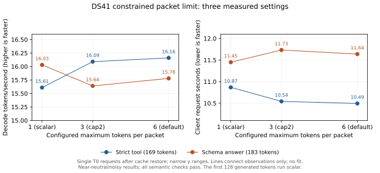

# Constrained decode packets, 2026-10-27

The fixed control is the qualified scalar grammar integration at source
`13ecfcd39cd9`. This experiment restores Flint's sequential GPU decode packets
while advancing the CPU grammar between tokens, then DS41's grammar-aware
DSpark draft verification. The grammar mask must describe each token's actual
prefix; sharing one mask across a packet is incorrect.

## First matched Flint results

All three arms use the same installed INT4 checkpoint, 8,192-token context,
4,096-token prefill chunks and default Flint kernel profile. The candidate arms
use the same binary, with `DS4_MTP_SPEC_DISABLE=1` only in the disabled arm.
Reasoning remains enabled. The user-owned reference server stayed loaded;
health checks before and after the campaign were idle. These are matched local
observations, not isolated speed claims.

| T0 case | Generated tokens, including reasoning | Fixed scalar: decode tok/s / server seconds | Candidate disabled | Candidate enabled, two repeats |
|---|---:|---:|---:|---:|
| Ordinary JSON, no constraint | 785 | 222.73 / 3.591 | 209.40 / 3.816 | 219.92 / 3.637; 241.91 / 3.308 |
| Strict function call | 74 | 216.29 / 0.502 | 220.78 / 0.497 | 234.05 / 0.478; 231.29 / 0.482 |
| JSON Schema answer | 887 | 216.21 / 4.150 | 218.55 / 4.106 | 230.26 / 3.899; 229.94 / 3.905 |

The schema case is about 6% faster end to end than the fixed control, and about
5% faster than the disabled candidate. The ordinary case varies substantially
with run order, so it does not support a general speedup claim. Baseline and
disabled have one measured repeat; enabled has two. Warmups are excluded from
the timing table.

All T0 cases produce the requested logical JSON, with identical generated token
counts across arms. Baseline passes 6/7 semantic checks, disabled 7/7 and enabled
11/11, including warmups and the T1 strict-tool probe. The baseline T1 request
chooses the schema-valid string `"x"` instead of the requested integer `1`.
That is a task-quality failure, not a schema violation or runtime failure.
T1 is unseeded because this Responses implementation does not honor `seed`;
these few samples cannot establish a quality difference between arms.

The enabled trace contains **399 packets with more than one token**, up to eight
tokens each, including the additional streaming request. The streaming check
passes: five argument deltas concatenate to the final call arguments, retain
one item ID, and have one arguments-done and one response-completed event. All
three server owners shut down cleanly.

Binary SHA256:

- Fixed scalar: `e349f24be2cf6da1fea8e88f076c5728ca63ab8aad2d5d8e8adc483ad835cb86`.
- First candidate arms: `b20c13ccb8455f342472f871a9ae49f3c6bf2668e6a8304362994dc53932de0f`.

Local evidence is under `.workspaces/constrained-packets-20261027/`:
`baseline-flint/summary.json`, `disabled-flint/summary.json` and
`enabled-flint/summary.json`. Each arm retains HTTP JSON, trace, stderr, actual
argv/environment and the binary hash. Raw results stay ignored.

## First matched DS41 results

All arms load the installed 1017 IQ2_XXS/Q2_K checkpoint plus the DSpark MXFP4
support head, with the same 32GB expert cache and the settings below. The table
contains the first measured T0 repeat after warmup. SSD prompt-state hits make
prefill about 28–37ms for these repeated requests; warmup prefill is excluded.

| T0 case | Generated tokens, including reasoning | Fixed scalar: decode tok/s / server seconds | Candidate disabled, max 1 | Candidate cap2, max 3 | Candidate default, max 6 |
|---|---:|---:|---:|---:|---:|
| Ordinary JSON, no constraint | 260 | 13.10 / 19.875 | 15.89 / 16.389 | 16.46 / 15.820 | 14.20 / 18.340 |
| Strict function call | 169 | 15.63 / 10.846 | 15.61 / 10.864 | 16.09 / 10.539 | 16.16 / 10.490 |
| JSON Schema answer | 183 | 14.92 / 12.297 | 16.03 / 11.449 | 15.64 / 11.732 | 15.78 / 11.632 |

This is mixed and near neutral for constrained requests: the strict call takes
about 3.4% less total time than the disabled candidate, while the schema answer
takes about 1.6% more. Ordinary decode also varies across arms. These samples
do not demonstrate a broad DS41 speed win.

The cap2 setting verifies at most two drafts after the first token, and its
trace confirms blocks up to three. It passes 7/7 semantic checks and shuts down
cleanly, but shows no clear benefit over the default full packet. The default
setting remains unchanged. The plot shows the three candidate configurations
as measured points, with no fit or optimality claim. It uses client wall time;
the table uses server time, a few milliseconds lower.



Regenerate from the ignored local summaries with:

```nu
(.workspaces/bench-plots-venv/bin/python
    speed-bench/experiments/constrained-packets-20261027/plot_ds41_tradeoff.py)
```

The three original arms pass 7/7 semantic checks and shut down cleanly. T0
logical output and generated lengths match. T1 strict-tool lengths differ—143 tokens in the
baseline, 448 disabled and 137 enabled—so their whole-request times are not a
speed comparison. The enabled stream passes with 27 argument deltas matching
the final call arguments exactly.

The enabled trace proves 105 blocks with more than one returned token, up to
six tokens per block, including warmups and streaming. Warmup strict/schema
requests have 35/43 multi-token blocks; their cache-restored T0 repetitions have
7/11. The repeated constrained requests each first execute 128 scalar blocks:

| Default enabled request | Returned block-size histogram |
|---|---|
| T0 strict tool, 169 generated tokens | 1×128; 6×7 |
| T0 schema answer, 183 generated tokens | 1×128; 2×2; 4×1; 6×8 |
| T1 strict tool, 137 generated tokens | 1×128; 4×1; 6×1 |

Returned counts may include a terminal token that is subsequently excluded
from the published completion. Target-only SSD snapshots omit DSpark draft
features and warm the 128-row window through ordinary decode, limiting the
opportunity in these short cached continuations. This exposes a concrete
cache/MTP tradeoff: prompt reuse saves prefill but temporarily loses draft
readiness. The empty `dspark_stats` arrays are a reporting limitation:
native session cleanup returns before the legacy shutdown printer. They do not
mean drafting was inactive. The exact-sampling follow-up enables existing
per-cycle `DS4_DSPARK_SPEC_LOG` evidence instead.

The DS41 candidate binary SHA256 is
`6e0bc7a19c6ca3c3d7b3a408a6d54052950c2d03ab1d3eb198ec0e87622835f2`.
Local evidence: `baseline-deepseek/summary.json`,
`disabled-deepseek/summary.json`, `enabled-deepseek/summary.json` and
`cap2-deepseek/summary.json` under the same workspace.

The first exact-mode run (`exact-deepseek/summary.json`) passes all four semantic
checks and shuts down cleanly. Its fresh-prefill T0 strict/schema requests
exercise blocks up to six, but its T1 strict request restores the prompt cache
and produces only 122 tokens: every returned block has size one. Therefore this
run **does not qualify positive-temperature exact p/q acceptance/correction**.
A separate fresh-prefill T1 probe closes that gap. It reuses the saved strict
request with `prompt_cache_options:{mode:"explicit"}` and no boundary marks,
plus `--mtp-exact-sampling` and native cycle logging. It passes semantic checks
with 119 output tokens, including 32 reasoning tokens, with zero cached or
cache-written input tokens. Its 22 real verification cycles return blocks of
four to six; logs show five proposed drafts with two to five accepted, and a
final four-of-four cycle. Both partial and full acceptance execute, qualifying
the masked exact p/q acceptance/correction path at positive temperature. The
server shuts down cleanly and the guard exits 0. Evidence:
`exact-fresh/result.json` and `exact-fresh-guard/result.json`. This is execution
and task qualification, not statistical distribution validation or a latency
comparison.

## Fixed requests and reproduction

The maintained [qualify.nu](qualify.nu) driver talks to an already-running
server. It uses standard JSON parsing and assertions, records failures without
discarding later requests, and saves usage plus client wall time. Its cases are:

1. Ordinary exact JSON, without tools or an output constraint.
2. One strict `echo` call, testing `$defs`/`$ref`, a mixed integer/string enum,
   nullable values and `additionalProperties:false`.
3. The same value as a strict JSON Schema answer.

The literal field includes `</think>`, `</｜DSML｜ parameter>`, `</arg_value>`,
`&lt;` and `café`. It must remain ordinary data. T0 uses temperature 0, top_p 1,
top_k 0; T1 uses temperature 1, top_p 0.95, top_k 20. Flint min_p is 0; DeepSeek
min_p is 0.05. DeepSeek explicitly requests high reasoning with a detailed
summary. No reasoning budget or disabled-thinking mode is used.

Run one server under the existing pressure guard. For example, from the repo
root in Nushell, start the enabled Flint candidate with these explicit args:

```nu
let out = '.workspaces/constrained-packets-20261027/manual-flint'
mkdir $out
with-env {
    DS4_SERVER_RESPONSE_STORE_DIR: ($out | path join responses | path expand)
    DS4_LOCK_FILE: ($out | path join server.lock | path expand)
    DS4_SERVER_CONTEXT_SUFFIX_REUSE: '0'
    DS4_SERVER_BATCH_LOG: '1'
    DS4_SERVER_DECODE_COALESCE_US: '2000'
} {
    (python3 speed-bench/ideas/pressure_run.py ($out | path join guard) --
        .workspaces/constrained-packets-20261027/build/bin/ds4-server
        --model .workspaces/flint-downloader-live/flint-int4
        --host 127.0.0.1 --port 11501 --ctx 8192 --mtp-draft 1
        --tokens 1024 --prefill-chunk 4096 --trace ($out | path join trace.log))
}
```

In another terminal, discover the reported model ID and run the requests:

```nu
let base = 'http://127.0.0.1:11501'
let model = (http get $'($base)/v1/models').data.0.id
(nu speed-bench/experiments/constrained-packets-20261027/qualify.nu
    $base $model .workspaces/constrained-packets-20261027/manual-flint/http
    --family flint --repeats 2 --stream)
```

Use fresh output/state directories for each arm. The disabled arm adds
`DS4_MTP_SPEC_DISABLE:'1'` to the environment. The baseline arm substitutes
`.workspaces/constrained-packets-20261027/baseline/ds4-server` and leaves that
variable unset. Do not inherit unrelated `DS4*`/`PT_*` tuning variables.
`--dry-run` writes the six request definitions without network or model work.

For DeepSeek, retain the same three arms and driver, with `--family deepseek`.
Use these model/server settings consistently:

```text
--model gguf/DeepSeek-V4.1-Flash-1017-IQ2_XXS-Q2_K-imatrix.gguf
--ctx 8192 --tokens 128 --prefill-chunk 512
--ssd-streaming --ssd-streaming-cache-experts 32GB --mixed-prefill-quantum 512
--mtp-model gguf/DeepSeek-V4.1-Flash-1017-DSpark-MXFP4.gguf
--dspark --dspark-confidence 0 --mtp-draft 6
```

Set `DS4_DSPARK_STATS=1`, `DS4_V41_DECODER_REPLAY_ROWS=0`,
`DS4_V41_COMPRESSED_KV_F16=0`, `DS4_METAL_V41_RESIDENT_ROUTE_GAP=0`,
`DS4_METAL_V41_RESIDENT_PREFILL_GAP=0` and
`DS4_METAL_V41_RESIDENT_ROUTE_NATIVE_WEIGHTS=0`. The matched owner also sets
`DS4_STATE_CACHE_DIR` to a fresh directory, hot budget 0MB and SSD budget 512MB.
Initial comparisons omit `--batched-session`. The optional exact-sampling
qualification adds `--mtp-exact-sampling`; this is a correctness probe, not a
matched exact-mode latency campaign.
`--no-warmup` can bound that additional probe. Set `DS4_DSPARK_SPEC_LOG=1` to
retain existing native proposed/accepted cycle lines. A smaller bounded point
sets `DS4_DSPARK_VERIFY_CAP=2`, allowing at most two verified drafts plus the
first token. Record this as a separate configuration from the default full
six-token packet.

Reference patterns: [Flint's masked packet loop](https://github.com/recursive-oss/rec/blob/0e3150c/engine/src/rec_mlx/kernels/masked_sampling.py)
and [DeepInfer's per-position masks and speculative verification](https://github.com/deepseek-ai/DeepInfer/blob/5537415/deepinfer/model_executor/layers/sampler.py#L352-L437).
Our implementations use the existing native Zig/Metal runtime and XGrammar
bridge; neither reference's Python runtime is linked.

## Qualification boundaries

Configured packet capacity does not prove execution. Require actual
`constrained block: tokens=N` traces with N>1. For DS41 also require nonzero
native proposed/accepted cycle counts when cycle logging is enabled. Legacy
shutdown stats are unavailable on the native session cleanup path. All three
draft feature stages must be ready over the preceding window; old target-only
SSD snapshots intentionally warm through ordinary decode before drafting.

The pinned native matcher retains unlimited accepted-token history. A focused
fixture accepts 40 tokens plus the terminal suffix and EOS, rolls back 18 steps,
and checks that the mask returns to the saved frontier before replaying. This
passes as part of the 12/12 native grammar fixtures (`grammar-rollback.log`),
protecting packet rollback beyond the server's 17-token buffer. GPU synthetic
fixtures additionally cover masked sampling, EOS, callback failure, packet
rollback and callback/forward overlap.

The fresh Flint candidate WebSocket run separately passes 29/29 protocol checks
and 17/17 task-quality checks, including the official SDK, concurrent sessions,
tool-result continuation, disconnect/cancellation, long-context cache reuse and
response/conversation recovery after process restart. Both server lifetimes
shut down cleanly and the pressure guard completes with child status 0. Evidence:
`flint-ws/result.json` and `flint-ws-guard/result.json`. This lifecycle result is
separate from the HTTP timing matrix.

The focused DS41 lifecycle run also passes with clean shutdown and guard exit 0:
two high-reasoning WebSocket sessions run concurrently with distinct strict
schemas; a continuation retrieves its own marker from a schema that permits
either session's marker, without a constant forcing the answer. Closing a
victim after its first reasoning delta leaves the survivor and a later retry
working. The run records 78 constrained blocks up to six tokens. Evidence:
`concurrent-ds41/result.json` and `concurrent-ds41-guard/result.json`. These are
the DS41 packet-isolation/cancellation checks, not a claim that every Flint SDK
scenario was repeated on DS41.

The final full `nu tests/verify.nu -j6` run passes, and final Debug checks pass
12/12 grammar fixtures, 2/2 token-constraint walks and the server suite.
Evidence: `full-host-verification.log` and `debug-final-host.log` under the
workspace. The selected constrained-packet checkpoint is complete. Remaining
limitations are measured DS41 speed variation, target-only SSD draft warmup,
and the small number of stochastic quality samples; cap2 does not justify a
default change.
