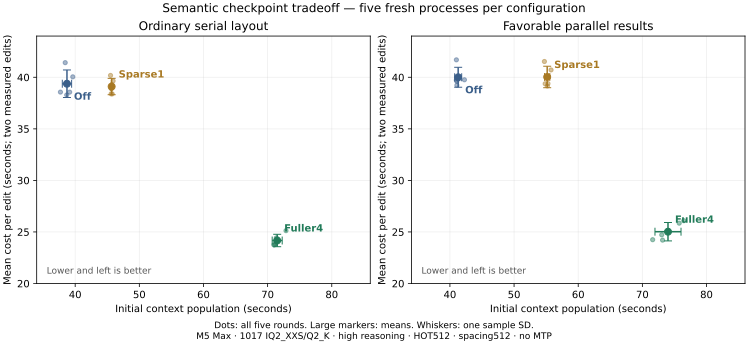

# Semantic checkpoint Pareto: five rounds per setting

2026-10-28, frozen `d5b8e8a33df7aa91cc3e23c18aff6677e876ad88`, M5 Max.
**Fuller4 makes the two repeated edits 38.0% faster across both workflows,
but initial population is 81.8% slower. Initial plus two edits is 2.14% slower.**
All 90 replies complete and answer correctly. Sparse1 does not provide a
material repeated-edit gain despite importing the same C spans.

Decision: enable fuller4/spacing512/ongoing reuse in **server `persistent-fast`
only**, with a default 512 MiB hot tier and explicit overrides honored. The
separate final-binary retention check passes 18/18 replies and reuses the original
RAM-only C on all 16 edits. Engine defaults, the agent and other presets receive
no new boundary defaults. The measured comparative horizon remains **two edits**;
retention is a functional check, not an eight-edit performance comparison.

## Fixed comparison

15 fresh server processes: five rounds each off / fuller4 / sparse1 in actual
`ABS, SBA, ABS, SBA, ABS` order (`A=off`, `B=fuller4`, `S=sparse1`). Each process
runs ordinary serial and favorable parallel-result workflows under separate
cache keys, with an initial request and two edits each. Each context is cold;
the second workflow shares warm model weights. No sample is discarded.
The interrupted rows72/eight-edit calibration is excluded entirely.

1017 IQ2_XXS/Q2_K, context32768, configured prefill8192, batched2 with ordinary
coordinator quantum2048, 32GB expert budget, HOT512 MiB / SSD4096 MiB,
main/index FP4, native routes, temperature0, min_p0.05, high reasoning, no MTP.
Suffix reuse, padding/right shifts and fresh tail64 are fixed. The bundle
changes automatic boundaries and ongoing-user reuse; sparse1 limits boundaries
to one, fuller4 to four, both with explicit spacing512. Fuller4 actually selects
three ends per initial workflow here. This is not a spacing or scheduler sweep.
Startup is retained separately, approximately 0.511 s in every arm, and excluded
from HTTP totals.



The practical choices are cheap population with off, or more population work
for faster repeated edits with fuller4. Sparse1's small ordinary edit-time
difference is within observed variation; its favorable mean is worse on both
axes. The plot does not establish a precise frontier for other context shapes.

## Measured time and variation

Seconds, mean ± sample SD [minimum–maximum]. Combined sums both workflows
within each round: it still has five paired samples, not ten independent ones.
Two-edit columns sum both edited requests; whole includes initial population.

| Workflow | Setting | Initial | Two edits | Whole |
|---|---|---:|---:|---:|
| Ordinary | Off | 38.719 ±0.726 [37.702–39.626] | 78.751 ±2.671 [76.569–82.840] | 117.470 ±2.870 [114.833–121.287] |
| Ordinary | Sparse1 | 45.684 ±0.160 [45.511–45.913] | 78.207 ±1.585 [76.772–80.362] | 123.891 ±1.575 [122.398–125.872] |
| Ordinary | Fuller4 | 71.491 ±0.781 [70.966–72.863] | 48.343 ±1.207 [47.499–50.250] | 119.834 ±1.960 [118.465–123.113] |
| Favorable | Off | 41.286 ±0.547 [40.995–42.262] | 80.004 ±1.936 [78.461–83.386] | 121.290 ±1.912 [119.548–124.393] |
| Favorable | Sparse1 | 55.163 ±0.408 [54.730–55.765] | 80.065 ±2.081 [78.310–83.064] | 135.228 ±2.090 [133.497–137.795] |
| Favorable | Fuller4 | 73.995 ±2.031 [71.605–76.458] | 50.047 ±1.784 [48.414–52.180] | 124.042 ±3.771 [120.101–128.638] |
| Combined | Off | 80.005 ±0.924 [78.709–80.943] | 158.755 ±2.870 [155.586–162.275] | 238.761 ±2.357 [235.813–241.717] |
| Combined | Sparse1 | 100.847 ±0.354 [100.450–101.382] | 158.272 ±3.002 [155.081–162.363] | 259.119 ±3.052 [255.992–263.006] |
| Combined | Fuller4 | 145.486 ±2.692 [142.571–149.321] | 98.390 ±2.940 [95.914–102.430] | 243.876 ±5.592 [238.567–251.751] |

Changes below compare means; positive means slower. Parentheses show the
forward/reverse order groups (three/two rounds), without claiming that those
small subgroups isolate an order effect.

| Workflow | Setting | Initial change (forward / reverse) | Two-edit change (forward / reverse) | Whole change (forward / reverse) |
|---|---|---:|---:|---:|
| Ordinary | Fuller4 | +84.64% (+86.61 / +81.74) | −38.61% (−38.69 / −38.50) | +2.01% (+2.31 / +1.57) |
| Favorable | Fuller4 | +79.22% (+80.87 / +76.80) | −37.44% (−37.82 / −36.88) | +2.27% (+2.28 / +2.26) |
| Combined | Fuller4 | +81.85% (+83.64 / +79.19) | −38.02% (−38.25 / −37.69) | +2.14% (+2.29 / +1.92) |
| Ordinary | Sparse1 | +17.99% (+18.86 / +16.71) | −0.69% (−0.27 / −1.33) | +5.47% (+5.99 / +4.68) |
| Favorable | Sparse1 | +33.61% (+33.94 / +33.13) | +0.08% (−0.29 / +0.63) | +11.49% (+11.27 / +11.82) |
| Combined | Sparse1 | +26.05% (+26.64 / +25.18) | −0.30% (−0.28 / −0.34) | +8.53% (+8.68 / +8.30) |

Fuller4 improves the edited pair in all five rounds for both workflows.
Combined paired edit changes are −36.19, −36.89, −37.61, −38.50, −40.89%
(paired median −37.61%, SD 1.82 percentage points). Whole paired changes are
+5.24, +3.18, +2.33, +0.65, −0.66% (median +2.33%, SD 2.28 points): four rounds
slower, one faster. Whole per-case changes are ordinary
+7.21, +0.40, +2.21, +2.79, −2.25%; favorable
+3.41, +5.94, +2.44, −1.38, +0.94%.
Sparse1 combined whole is slower in all five, +8.02–8.81%.

All five initial / two-edit / whole samples, in round order, seconds:

| Workflow / setting | Initial | Two edits | Whole |
|---|---|---|---|
| Ordinary / off | 37.702,39.626,39.140,38.681,38.447 | 77.132,80.089,77.125,76.569,82.840 | 114.833,119.715,116.265,115.251,121.287 |
| Ordinary / sparse1 | 45.511,45.616,45.605,45.775,45.913 | 80.362,77.809,76.793,76.772,79.298 | 125.872,123.425,122.398,122.547,125.212 |
| Ordinary / fuller4 | 72.863,71.352,71.215,70.966,71.060 | 50.250,48.841,47.623,47.499,47.500 | 123.113,120.193,118.838,118.465,118.560 |
| Favorable / off | 41.007,41.080,41.086,42.262,40.995 | 83.386,79.221,78.461,79.519,79.435 | 124.393,120.301,119.548,121.781,120.430 |
| Favorable / sparse1 | 55.287,55.765,54.845,55.187,54.730 | 78.776,81.426,78.748,78.310,83.064 | 134.063,137.192,133.594,133.497,137.795 |
| Favorable / fuller4 | 76.458,75.742,73.019,71.605,73.151 | 52.180,51.703,49.443,48.496,48.414 | 128.638,127.445,122.462,120.101,121.565 |

## Actual reuse, capture and storage

Geometry is identical across all five rounds and both edits:

| Workflow / setting | Imported C tokens | Source → destination | Exact prefix anchor | Source |
|---|---:|---|---:|---|
| Ordinary / off | 1066 | `982:2048`→`428:1494` | none | Durable ordinary endpoint |
| Ordinary / sparse1 or fuller4 | 1265 | `982:2247`→`428:1693` | sparse: none; fuller:390 | RAM-only C, ongoing task |
| Favorable / off | 0 | no aligned source | none | Ordinary recomputation |
| Favorable / sparse1 or fuller4 | 1830 | `1042:2872`→`488:2318` | sparse: none; fuller:451 | RAM-only C, ongoing task |

All 20 edited fuller4 requests choose a RAM-only source; all 20 sparse requests
do too. The difference is retaining the early exact anchor: fuller4 records
four prefix hits per process (two at390, two at451), sparse none. Import counts
alone would miss that difference. API cached_tokens reports the imported span,
not all prefix restoration or total avoided forward work.

Fuller4's initial ends are390,985,2247 (ordinary) and451,1045,2872 (favorable).
Sparse keeps only C. Additional short forward segments dominate the measured
population cost: for example, fuller4 round1 ordinary reaches390 at17.43 s,
985 at34.13 s,2247 at50.58 s and3608 at67.24 s. The source and these timings
implicate segmented model execution; they are not an SSD bandwidth profile.
The direct six-transient capture plus publication cost totals only 0.257 s
per process on average. Preserving useful anchors pays off later, so merely
reducing the count to one is not a good optimization here.

Process totals below combine both workflows, all three requests each.
Capture/publication columns give mean ± sample SD in milliseconds. Page peaks
and final file sizes are identical in all five processes per setting.

| Setting | Captures (transient) | Capture ms | Publication ms | Peak hot pages | SSD pages + manifests / final logical files |
|---|---:|---:|---:|---:|---:|
| Off | 17 (0) | 71.2 ±2.0 | 842.9 ±53.7 | 245.82 MiB | 246.01 MiB /1619 files |
| Sparse1 | 14 (2) | 59.8 ±2.5 | 883.8 ±86.0 | 208.27 MiB | 182.17 MiB /1216 files |
| Fuller4 | 18 (6) | 76.2 ±2.1 | 1000.8 ±110.5 | 257.07 MiB | 182.17 MiB /1216 files |

All captures succeed. These are bounded cache-page counters and logical file
sizes, not total process RAM, physical SSD allocation or IO bytes. RAM-only
pages are not durably published at the semantic stop. Ordinary final endpoints
remain durable. Lower SSD use also reflects fewer ordinary intermediate
publications when the evaluated graph already passes their scheduling stops.
The `source_ssd` flag means endpoint durability; a durable source may be read
from RAM. This small campaign stays below the 512 MiB hot budget and does not
demonstrate survival under eviction. The separate retention diagnostic below
checks eight successive edits without making a comparative speed claim.

## Final-binary retention and preset scope

A separate functional run on installed `zig-out/bin/ds4-server`, source
`9b826389c9e22c508a895610994145fd2b9529cd`, retains the
same original C through eight edits in each workflow: ordinary 9/9 replies,
favorable 9/9 replies, all 16 edited imports `source_ssd=0` and
`source_approximate=0`, with no capture errors. Diagnostic labels differ from
the timing cohort, so its geometry is ordinary 1266 tokens
(`978:2244`→`424:1690`), favorable 1829 (`1040:2869`→`486:2315`). This establishes
original-source retention through this sequence, not arbitrary cache pressure,
indefinite retention or an eight-edit comparative speed result. Evidence:
`.workspaces/context-compaction-20261028/retention-eight/` and
`retention-eight.log`.

Final source adds two admission guards after the frozen timing revision:
reasoning-enabled is hashed alongside numeric effort, so medium and disabled
thinking cannot share a task identity; successful prefix padding shifts the
control-admission end before another checkpoint is tagged. Final CPU
qualification passes 14 serving cases and 4 policy tests. All five installed
executables build and pass their help checks. The timing cohort uses high
reasoning and no actual padding throughout, so neither guarded transition is
part of that comparison.

Final live guard checks also pass. The padded-controls case answers both
CEDAR then corrected LARCH correctly, with an actual `prefix_pad=1` graft
(`692:1358`→`426:1092`,666 imported tokens). A medium→high transition keeps
thinking on in both requests, answers2/2 correctly and logs cached0 /
`no-aligned-source` for the changed high request. The none/medium collision
is tested by the CPU renderer only; no model generation disables reasoning.
These are functional checks, not comparative timing samples. Evidence is
`retention-eight/{padded-controls,reasoning-transition}/` plus the shared log.

All owned model jobs stop cleanly, guard child0. Final cache summary reports
`pinned_endpoints=0`, hot bytes536,007,540 ≤536,870,912 (512 MiB), and9 endpoint
evictions. Those are aggregate counters including the later guard checks;
they do not identify a per-C eviction timeline or explain any individual hit.

Only **server** `persistent-fast` (including its `persistent-packed` alias)
adds these defaults: boundaries1, ongoing1, limit4, spacing512, HOT512 MiB.
Explicit `0`, limit/spacing and hot-budget overrides are honored; four fake
binary wrapper checks pass. Agent presets, server `context-fast`/
`resident-fast` and ordinary engine defaults receive no new boundary defaults.

The wrapper retains its existing 64GB expert target, resident substitutions,
context8192 and prefill512 defaults. **It was not the benchmark arm.** The
measurement above uses native routes,32GB, context32768 and configured8192
prefill (effective ordinary coordinator quantum2048). Pass
`--prefill-chunk 8192` to select that tested configured chunk; doing so alone
does not reproduce the other benchmark settings. No chunk default changed.

## Quality and calculated amortization

Each setting passes 30/30 replies; all 90 responses are `completed` and answer
`CODE=CEDAR-4826`. Reasoning remains enabled. Output-token triples
(initial,edit1,edit2) are stable across all five rounds:

| Workflow | Off | Sparse1 | Fuller4 |
|---|---|---|---|
| Ordinary | 29,29,29 | 29,29,28 | 28,29,29 |
| Favorable | 30,39,39 | 30,39,39 | 30,36,39 |

The final answer is eight tokens; the other output tokens are reasoning.
This is practical fact-answer quality, not identical reasoning/token IDs or a
fixed-teacher delta-NLL/KL measurement. Separate changed/deleted fact and actual
instruction tests, archive retrieval and restart checks are in the
[qualification report](README.md#completed-live-quality-qualification).

**Calculated only:** extending the mean of the two observed edits at a constant
cost yields the following eight-edit horizon. It assumes the source and early
anchor remain available and that future edits have the same shape; it does not
replace the separate retention diagnostic or five measured eight-edit pairs.

| Workflow | Off initial+8 edits | Fuller4 calculated | Calculated change | Break-even edited requests |
|---|---:|---:|---:|---:|
| Ordinary | 353.723 s | 264.861 s | −25.12% | 2.16 |
| Favorable | 361.303 s | 274.184 s | −24.11% | 2.18 |
| Combined | 715.027 s | 539.045 s | −24.61% | 2.17 |

Thus the first integer benefit would be the **third edit / fourth total request**
under those assumptions. Sparse1's calculated combined eight-edit cost remains
2.64% worse. Keep off for short-lived/no-edit work; fuller4 is the promising
point selected for server `persistent-fast`. Ordinary defaults stay unchanged;
the scoped package accepts the measured population tradeoff for repeated edits.

## Reproduction and evidence

Run command/settings and all process lifetimes are preserved in
`.workspaces/context-compaction-20261028/pareto-fast/{manifest,execution-order}.json`.
Per-request requests/responses/results and per-process command, stderr and traces
are retained there; the pressure guard ends with child exit0. The preceding
stopped calibration remains under `pareto/` and is not analyzed here.

```nu
python3 speed-bench/experiments/context-boundaries-20261028/analyze.py .workspaces/context-compaction-20261028/pareto-fast/ordinary --processes .workspaces/context-compaction-20261028/pareto-fast/processes --include-sparse
python3 speed-bench/experiments/context-boundaries-20261028/analyze.py .workspaces/context-compaction-20261028/pareto-fast/favorable --processes .workspaces/context-compaction-20261028/pareto-fast/processes --include-sparse
.workspaces/bench-plots-venv/bin/python speed-bench/experiments/context-boundaries-20261028/report.py .workspaces/context-compaction-20261028/pareto-fast --plot speed-bench/experiments/context-boundaries-20261028/pareto.svg
```

`report.py` combines those standard summaries, retains all values/order groups
in local `aggregate-summary.json`, and uses Matplotlib only for the figure.
No raw logs, response dumps, snapshots or generated summary JSON belong in
source control. See [README](README.md) for the actual campaign command.
