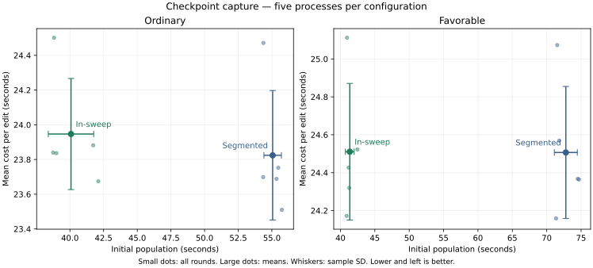

# Capturing semantic checkpoints inside prefill

2026-10-28, source `28c98fd7411e30eeb095d3382da59c685b53f5ef`, M5 Max, 128 GiB.
**In-sweep capture reduces initial context population by 36.3% and measured
initial-plus-two-edit time by 20.6% across both workflows. All 60 replies pass.**
Repeated-edit time is unchanged within observed variation.

Five fresh processes per arm run in `AB, BA, AB, BA, AB` order. Both arms use
the same frozen binary, `anchors` selection, boundaries/ongoing reuse, high
reasoning, native expert routing, packed main/index KV and no MTP. Only
`DS4_SERVER_CONTEXT_CAPTURE_IN_SWEEP=0/1` changes. Identical layer/PREAD
profiling is enabled in both arms. Settings remain context 32768, configured
prefill chunk 8192, outer quantum 2048, a 32 GB expert budget, a 512 MiB hot
cache, a 4096 MiB SSD cache, temperature 0, min_p 0.05, 24 rows and two edits.
See [reproduction](README.md),
[the separate selection comparison](SELECTION.md) and
[native correctness qualification](QUALIFICATION.md).

## Absolute time and variation

Times are seconds, shown as mean ± sample SD [minimum–maximum]. Initial is the
complete first HTTP request before any edit, including generation. Two edits
sums the next two requests; whole includes all three. Combined sums both
workflows within each round and still has five paired samples.

| Workflow | Capture | Initial | Two edits | Whole |
|---|---|---:|---:|---:|
| Ordinary | Segmented | 55.056 ± 0.649 [54.355–55.740] | 47.648 ± 0.746 [47.020–48.943] | 102.705 ± 0.583 [101.752–103.314] |
| Ordinary | In-sweep | 40.079 ± 1.685 [38.751–42.106] | 47.893 ± 0.640 [47.349–49.003] | 87.972 ± 1.469 [86.430–89.492] |
| Favorable | Segmented | 72.783 ± 1.669 [71.361–74.689] | 49.013 ± 0.697 [48.318–50.146] | 121.796 ± 1.576 [119.679–123.417] |
| Favorable | In-sweep | 41.358 ± 0.638 [40.897–42.463] | 49.021 ± 0.721 [48.344–50.224] | 90.379 ± 0.940 [89.240–91.508] |
| Combined | Segmented | 127.839 ± 1.681 [125.887–130.161] | 96.661 ± 0.970 [95.338–97.678] | 224.500 ± 1.865 [222.440–226.563] |
| Combined | In-sweep | 81.437 ± 2.046 [79.720–84.191] | 96.914 ± 0.533 [96.318–97.573] | 178.352 ± 2.269 [176.355–181.000] |

Ordinary initial time falls 27.20%, and its whole time falls 14.34%.
Favorable initial and whole times fall 43.18% and 25.79%, respectively.
Combined saves 46.402 s during initial population and 46.149 s over the complete
measured horizon. All five whole-time pairs improve in both workflows.

Paired whole changes, round order:

- Ordinary: −15.63, −16.34, −13.69, −12.95, −13.10%; paired SD 1.55 percentage points.
- Favorable: −25.56, −27.04, −26.66, −23.81, −25.85%; paired SD 1.25 points.
- Combined: −21.00, −22.16, −20.75, −18.79, −20.05%; paired SD 1.24 points.

The combined two-edit mean changes +0.26% (+0.253 s), with mixed paired changes
of +0.01, −1.39, −0.20, +2.34, +0.60% and paired SD 1.37 points. Ordinary edits
change +0.51%; favorable +0.02%. These small differences are consistent with
normal run variation; they do not establish an edit-time regression or gain.

All measured samples, seconds:

| Workflow / capture | Initial | Two edits | Whole |
|---|---|---|---|
| Ordinary / segmented | 55.343, 54.372, 54.355, 55.740, 55.473 | 47.377, 48.943, 47.397, 47.020, 47.505 | 102.720, 103.314, 101.752, 102.761, 102.977 |
| Ordinary / in-sweep | 38.986, 38.751, 38.823, 42.106, 41.728 | 47.673, 47.679, 49.003, 47.349, 47.764 | 86.659, 86.430, 87.826, 89.455, 89.492 |
| Favorable / segmented | 71.818, 74.514, 71.532, 71.361, 74.689 | 49.138, 48.735, 50.146, 48.318, 48.728 | 120.956, 123.249, 121.678, 119.679, 123.417 |
| Favorable / in-sweep | 41.187, 41.286, 40.897, 40.959, 42.463 | 48.854, 48.639, 48.344, 50.224, 49.045 | 90.041, 89.925, 89.240, 91.183, 91.508 |
| Combined / segmented | 127.161, 128.886, 125.887, 127.102, 130.161 | 96.515, 97.678, 97.543, 95.338, 96.233 | 223.676, 226.563, 223.430, 222.440, 226.394 |
| Combined / in-sweep | 80.174, 80.037, 79.720, 83.065, 84.191 | 96.527, 96.318, 97.346, 97.573, 96.808 | 176.701, 176.355, 177.066, 180.637, 181.000 |

## Why it improves

The profiles confirm fewer expensive streamed layer sweeps. Across both
workflows and their edits, large sweeps fall from 11 to 8 and logical PREAD volume
falls from 1662.32 to 1208.96 GiB (−27.27%). All five processes per arm have
those same counts. A large sweep has a first layer-0 chunk of at least 256 rows in this
fixed configuration. Small selected-cache tiles are counted separately.

| Per process, both workflows/all requests | Segmented | In-sweep |
|---|---:|---:|
| Large layer sweeps | 11 | 8 |
| Small layer sweeps | 68 | 78 |
| All profiled layer sweeps | 79 | 86 |
| Layer-0 rows processed | 13,642 | 13,642 |
| PREAD preparation jobs | 440 | 320 |
| Logical PREAD GiB | 1662.32 | 1208.96 |
| PREAD join wait, seconds ± SD | 75.928 ± 1.113 | 51.512 ± 1.925 |
| Layer map, seconds ± SD | 76.310 ± 1.107 | 51.836 ± 1.907 |
| Layer drain, seconds ± SD | 94.011 ± 0.189 | 72.272 ± 0.374 |
| Layer encode, seconds ± SD | 26.518 ± 0.335 | 29.312 ± 0.386 |

Ordinary initial population uses three large sweeps with segmented capture,
versus two in-sweep. Favorable initial population uses four versus two.
The latter exposes a 78-token remainder after the 4096-token scheduling end;
the existing selected-cache path handles it as ten small tiles. Thus total
sweep count rises even while costly full-weight preparation falls. Repeated
edits retain the same four large sweeps across both workflows in either arm.

PREAD GiB are logical API bytes, rounded to two decimal GiB per log record;
they can hit the operating system file cache. They are **not physical SSD
traffic**. Join waits, worker durations, maps and GPU drains describe an
overlapping pipeline; do not add them to reconstruct wall time. The profiles
support the staging/batching explanation without claiming a physical SSD
bandwidth measurement.

## Reuse, cache cost and quality

Geometry is unchanged in all five rounds and both edited requests:

| Workflow | Exact prefix anchor | Imported source → destination | Imported tokens |
|---|---:|---|---:|
| Ordinary | 390 | `982:2247` → `428:1693` | 1265 |
| Favorable | 451 | `1042:2872` → `488:2318` | 1830 |

Every edited request imports the original RAM-only C source, with
`source_ssd=0`, `source_approximate=0` and `ongoing_user=1`. Prefix restore
hits at 390/390/451/451 appear in every process. Both arms answer 30/30 correctly
and complete every response. Answer text matches; reasoning tokens need not
match. These fact-answer probes are separate from the teacher metrics in
[QUALIFICATION.md](QUALIFICATION.md).

| Per process, both workflows/all requests | Segmented | In-sweep |
|---|---:|---:|
| Captures / transient captures | 16 / 4 | 19 / 4 |
| Capture failures | 0 | 0 |
| Inline captures included in forward time | 0 | 4 |
| Separately timed capture, ms ± SD | 67.216 ± 1.339 | 57.526 ± 1.160 |
| Cache publication, ms ± SD | 862.373 ± 50.155 | 1037.151 ± 12.214 |
| Observed peak logical hot pages | 231.794 MiB | 270.226 MiB |
| Final SSD pages/manifests | 182.168 MiB / 1216 files | 220.652 MiB / 1463 files |

Normal coordinator endpoints remain available during collection, adding three
durable publications here. This costs 38.433 MiB of peak hot pages and
38.484 MiB of SSD pages/manifests. Capture observations stay below the
512 MiB hot-cache budget in all processes. `capture_ms=-1`
marks the four inline captures: their work is included in forward/HTTP time,
so the smaller separately timed total does not mean those copies are free.
Cache counters are not whole-process RAM or physical SSD allocation. This
campaign does not establish source survival under eviction.

## Evidence and decision

Exact commands, source, frozen shaders, all requests/responses, timing samples
and profiles remain local under
`.workspaces/checkpoint-capture-20261028/collection-five/`; the unchanged guard
is recorded in `collection-guard/` and exits with status 0. All 1951 pressure
samples are normal; swap remains essentially unchanged at 23.005 GiB. No sample
is dropped.
Startup is retained separately and excluded from HTTP totals: the first
segmented process takes 3.576 s, the other nine approximately 0.511 s. Context
keys are cold and distinct; the second workflow shares warm model weights. No OS
file-cache flush was performed.

Decision: enable `anchors` and in-sweep capture in **server `persistent-fast`
only**, honoring explicit overrides. Ordinary runtime defaults remain unchanged.
This decision uses the measured initial-plus-two-edit horizon and the separate
native qualification. Longer retention and changed-fact checks are separate QA;
no unmeasured long-run speed or cache-pressure guarantee is claimed here.
