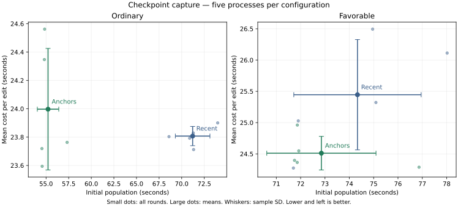

# Selecting prefix and suffix anchors

2026-10-28, source `6b7cec74`, M5 Max. Five alternating pairs per side, same binary; high reasoning, native expert routes, no MTP. Both arms enable semantic checkpoints and ongoing reuse. Only `DS4_SERVER_CONTEXT_BOUNDARY_POLICY=recent` / `anchors` changes. Fixed settings and reproduction are in [README.md](README.md).

**Keeping the first and last endpoints reduces ordinary setup by 22.5% and combined initial-plus-two-edit time by 7.8%. All 60 replies pass.** The favorable layout retains an extra ordinary coordinator split, so its setup change is small and mixed. The collector is a separate experiment.

Seconds, mean ± sample SD. Two edits sums both edited requests; whole includes setup. Combined sums the two workflows within each round and still has five paired samples.

| Workflow | Policy | Initial | Two edits | Whole |
|---|---|---:|---:|---:|
| ordinary | Recent | 71.210 ±1.914 | 47.615 ±0.136 | 118.825 ±1.986 |
| ordinary | Anchors | 55.216 ±1.186 | 47.994 ±0.858 | 103.210 ±1.321 |
| favorable | Recent | 74.335 ±2.617 | 50.892 ±1.762 | 125.227 ±4.131 |
| favorable | Anchors | 72.852 ±2.244 | 49.023 ±0.537 | 121.875 ±2.054 |
| combined | Recent | 145.546 ±3.833 | 98.506 ±1.855 | 244.052 ±5.648 |
| combined | Anchors | 128.069 ±2.346 | 97.017 ±0.694 | 225.086 ±2.595 |

All five combined whole-time changes are −5.78, −7.94, −10.40, −8.25, −6.34% (paired SD1.81 percentage points). Ordinary whole improves in all five pairs; favorable whole changes are +0.64, −3.69, −4.81, −4.13, −1.12%. Its small mixed result does not establish a regression. Ordinary repeated edits change +0.8%, within observed variation; prefix and suffix reuse remain available.

The recent set contains ordinary390/985/2247 and favorable451/1045/2872. Anchors keeps390/2247 and451/2872. These are outputs of the bounded spacing policy, not hardcoded positions. Exact prefix anchors390/451 and RAM suffix imports1265/1830 remain identical across all rounds. The ordinary initial prefill loses one full-weight sweep. In the favorable layout, dropping1045 exposes the 2048 scheduling split at2499, so it does not remove a full sweep. This inference uses the actual forward progress sequence; this first comparison did not enable detailed weight-read profiling.

Peak logical hot cache pages fall from269,552,695 to243,053,295 bytes (257.07→231.79MiB); final SSD pages/manifests stay191,017,114 bytes (182.17MiB). Per process there are18→16 captures and6→4 transient captures, with zero failures in either arm. These counters are not whole-process RAM or physical SSD traffic.

All measured samples, seconds:

| Workflow / policy | Initial | Two edits | Whole |
|---|---|---|---|
| ordinary / recent | 68.593,71.281,73.980,70.879,71.317 | 47.606,47.658,47.800,47.584,47.424 | 116.199,118.939,121.780,118.464,118.740 |
| ordinary / anchors | 54.567,54.841,54.539,54.811,57.324 | 47.188,49.124,47.438,48.694,47.525 | 101.755,103.965,101.977,103.505,104.849 |
| favorable / recent | 71.702,78.020,74.959,75.093,71.903 | 48.548,52.224,52.988,50.643,50.056 | 120.251,130.244,127.947,125.737,121.958 |
| favorable / anchors | 71.923,76.866,71.865,71.749,71.860 | 49.097,48.575,49.922,48.794,48.728 | 121.020,125.440,121.787,120.543,120.588 |
| combined / recent | 140.296,149.302,148.939,145.972,143.219 | 96.154,99.882,100.788,98.228,97.479 | 236.450,249.183,249.727,244.200,240.699 |
| combined / anchors | 126.491,131.707,126.404,126.559,129.184 | 96.284,97.698,97.360,97.488,96.253 | 222.775,229.405,223.764,224.048,225.437 |

Raw requests, responses, exact commands, all timings and unchanged guard logs remain local under `.workspaces/checkpoint-capture-20261028/selection-five/` and `selection-guard/`. Guard exits0; pressure stayed normal. Swap grew from21.62 to23.01GiB with substantial reclaimable file cache; no sample is discarded. The two cases use distinct cold context keys; the second shares warm model weights. No OS file-cache flush was performed. Startup is retained separately and excluded from HTTP totals.

Decision: keep the anchors option for the collector comparison. Select defaults after that complete qualification; this report alone does not claim in-sweep capture works or improves latency.
