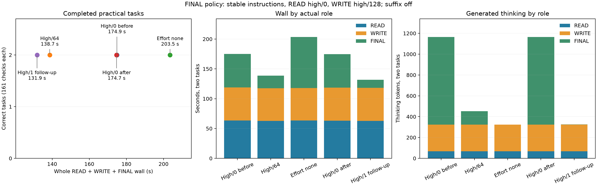

# FINAL thinking policy, Item20

Keeping high effort and limiting FINAL thinking preserved prefix reuse and reduced whole-task wall on these two coding tasks. High/64 saved **20.65%**; the later high/1 follow-up saved **24.55%** against the native bracket mean. All ten first attempts passed the pipeline and all 161 independent code checks per task, with no global output cap hits. This is a two-task caller-policy result, not a general accuracy guarantee.

| FINAL policy | Ledger wall (s) | LRU wall (s) | Pair wall (s) | Change vs native mean | FINAL thinking, ledger/LRU | Pipeline/code |
|---|---:|---:|---:|---:|---:|---:|
| High/0 before | 108.797 | 66.076 | 174.873 | +0.06% | 777 / 64 | 2/2 |
| High/64 | 73.618 | 65.062 | 138.680 | −20.65% | 64 / 64 | 2/2 |
| Effort none | 106.136 | 97.366 | 203.503 | +16.44% | 0 / 0 | 2/2 |
| High/0 after | 109.291 | 65.386 | 174.677 | −0.06% | 777 / 64 | 2/2 |
| High/1 follow-up | 69.144 | 62.724 | 131.868 | −24.55% | 1 / 1 | 2/2 |

High/1 was chosen after observing the effort-none cost, on the same tasks; it is not an independent confirmation cohort. Its pair wall was 4.91% below high/64. The effect varies by task: high/64 saved 32.49% on ledger and 1.02% on LRU; high/1 saved 36.59% and 4.57% respectively.

| Policy | READ wall (s) | WRITE wall (s) | FINAL wall (s) | FINAL cached/fresh input | Actual forced closes, WRITE/FINAL |
|---|---:|---:|---:|---:|---:|
| High/0 bracket mean | 63.361 | 55.250 | 56.161 | 3,086 / 87 | 2 / 0 per arm |
| High/64 | 62.768 | 54.609 | 21.299 | 3,086 / 87 | 2 / 2 |
| Effort none | 63.297 | 54.676 | 85.526 | 0 / 2,795 | 2 / 0 |
| High/1 follow-up | 62.904 | 55.359 | 13.601 | 3,086 / 87 | 2 / 2 |

READ thinking was 40/28 and WRITE thinking was 128/128 in every arm. All logged deferral counts were zero. The high-effort FINAL requests appended only 44/43 fresh tokens; effort none instead performed fresh prefill of 1,485/1,310 tokens. Thus zero FINAL thinking did not produce the fastest task here. The measurements include this observed prompt/cache change, rather than isolating decode-token cost alone.

First-code bytes, emitted READ/WRITE content, private reasoning, raw DSML and READ/WRITE usage were identical across all five policies. Server-generated response/call IDs were excluded from emitted-content comparisons. The native brackets also matched FINAL emitted content, private reasoning, code, grades and every role's usage; pair wall changed −0.11245% from before to after. High/64's LRU FINAL matched native byte for byte. High/1's ledger FINAL matched high/64 byte for byte; its LRU text differed. Effort-none finals differed on both tasks. All final summaries accurately described their implementations; none claimed to have executed the private tests. Actual texts and lengths remain in [results.csv](analysis/results.csv).



The caller used stable `task.system` instructions and tools on every request, actual READ → first WRITE → FINAL, stored `previous_response_id` private history, temperature 0, and a shared 2,048 output-token cap per task. READ was high/0 and WRITE high/128 throughout. Only FINAL policy changed. No seed was sent because this server ignores it. Every arm had fresh server cache/store; suffix approximation was off, GAP0, Q2/cache64/ctx8192/chunk512. Runtime was `bc6896aeee2aceba4b4b64e9e8330986da8a60b0`; server SHA and caller revisions are in [build.json](build.json). Whole-task wall includes real read/write and all three HTTP requests, excluding startup and external grading. Divergent FINAL histories have no paired NLL/KL claim, and savings are not additive with earlier experiments.

The request-local budget is a soft, once-per-request forced close. Nonzero values disable MTP throughout that request; zero retains thinking and speculation. Unsafe DSML/last-slot deferrals or later reopening can exceed the requested value, although none occurred here. Public reasoning usage counts generated non-control thinking; output usage includes forced closure and excludes EOS. Completed status does not independently establish an observed EOS.

Both guards completed with child exit 0. Across 808 samples, pressure stayed level 1, swap remained 0.012998 GiB, maximum wired plus compressor was 84.260483 GiB, and consecutive-bad counts stayed zero. Original four-arm raw records and the follow-up remain separate in `http/` and `http-lowpoint/`.

Reproduce analysis without opening a model:

```sh
.workspaces/bench-plots-venv/bin/python -B \
  speed-bench/experiments/final-thinking-hour20-20261004/analyze.py \
  --input speed-bench/experiments/final-thinking-hour20-20261004/http \
  --lowpoint speed-bench/experiments/final-thinking-hour20-20261004/http-lowpoint \
  --output speed-bench/experiments/final-thinking-hour20-20261004/analysis --plot
```

For these completed-write summaries, keep high effort and use an opt-in low FINAL budget. Confirm it on new tasks requiring substantive final reasoning before promoting a broader caller default.
