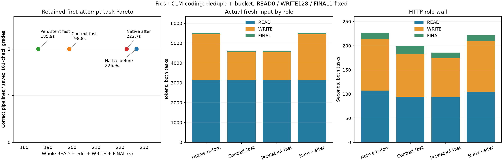

# Fresh CLM coding: deduplication and token bucket

**Context-fast reduced task wall 11.57%; persistent-fast reduced it 17.31%**, against the native bracket mean. All eight retained first codes passed **161/161 checks**, with zero failed or unresolved checks. All eight actual READ→WRITE→FINAL pipelines completed with one read and one write each, unchanged config and no caps. These are two fresh task contracts, not eight independent task families.

| Explicit configuration | Task pair (s) | Launcher (s) | Task change vs native mean / faster control | Passed / failed checks | Complete pipelines / caps |
|---|---:|---:|---:|---:|---:|
| native-before | 226.859 | 231.630 | 0.92% / 1.86% | 322 / 0 | 2 / 0 |
| context-fast | 198.786 | 203.281 | -11.57% / -10.74% | 322 / 0 | 2 / 0 |
| persistent-fast | 185.878 | 190.622 | -17.31% / -16.54% | 322 / 0 | 2 / 0 |
| native-after | 222.709 | 227.142 | -0.92% / 0.00% | 322 / 0 | 2 / 0 |

Native closing/opening drift was **−1.83% task wall / −1.94% launcher**. Native first code, all public outputs/final text, role usage and input requests repeated exactly. Both fast configurations generated different code and summaries from native; all first codes passed the frozen checks. Their public READ calls and original/edited source text match native, while READ thinking already differs before the graft: dedupe/bucket native **40/25**, context-fast **20/19**, persistent-fast **38/33**. This is a measured configuration package; savings are not all attributable to relocation.

| Arm | READ / WRITE / FINAL wall (s) | Thinking by role | Fresh input by role |
|---|---|---|---|
| native-before | 107.378 / 105.642 / 13.834 | 65 / 256 / 0 | 3139 / 2300 / 85 |
| context-fast | 94.596 / 88.265 / 15.921 | 39 / 256 / 0 | 3139 / 1397 / 85 |
| persistent-fast | 94.052 / 80.037 / 11.786 | 71 / 256 / 0 | 3139 / 1397 / 85 |
| native-after | 104.101 / 104.839 / 13.765 | 65 / 256 / 0 | 3139 / 2300 / 85 |

Each WRITE reached thinking128 and forced one close; each FINAL naturally used thinking0 despite budget1. Thus every arm logged two forced closures and zero deferrals. There were no global caps. Task wall includes actual config read, context edit, first write and final response; launcher also includes server lifetime overhead and external grading.

Both fast arms selected the same geometry from their own-policy warmed **suffix-native** SSD/pre-RoPE sources (`source_approximate=0`, no padding). Dedupe: **1118:1563 → 436:881**, 445 reused, 260 fresh, latest user starts978. Bucket: **1118:1576 → 436:894**, 458 reused, 265 fresh, latest user starts990. Both grafts end before the incoming user; current config/tool output is freshly supplied. Each fast arm then used two approximate visible-prefix FINAL continuations (`ids=1`), with 43/42 fresh tokens. Suffix-native describes source cache status; persistent-fast source warming itself uses its resident policy.

**Actual routing:** persistent-fast recorded 46,480 routed layers, 22,019 substitutions/skipped loads, 31,850 native misses, 3,307 double and 291 triple layers, zero drops. Native coefficient counters requested1 and recorded 10,319/11,700 substitutions in the two lifetimes. Other arms had routing disabled. This is logical routing evidence, not measured physical SSD traffic. Fast arms each logged 164 logical cache disk-read operations; no hot reads, pins or endpoint evictions. Final owned SSD cache was 203.709 MiB for fast arms and 115.142 MiB for native, below 4096 MiB.

**Pressure:** all four guards completed child0, 826 samples all level1, no consecutive bad samples. Swap stayed **0.021787109375 GiB**; peak wired plus compressor **85.741 GiB**.

**Method:** runtime `91c9cf212d2e6a35ae558d1c96f37607becbde3f`; [build.json](build.json) retains server SHA, frozen fixture hashes and settings. READ high/budget0, WRITE high/128, FINAL high/1; temperature0, globalcap2048, Q2/cache64, two slots, context8192/chunk512, tile64/limit1024, canonical1/PAD1, hot0/SSD4096. Native uses suffix0/GAP0; context-fast suffix64/GAP0; persistent-fast suffix64 plus replace/GAP.90/mass.25/rank64/maxsubs3/totalmass.50/nativeweights1. Names select equivalent **explicit flags**, not execution of the `ds4-local` wrapper. Keep experimental profiles opt-in: two additional task contracts support useful speed/quality evidence, without proving general accuracy, an additive gain, private-state identity or paired NLL on divergent histories.



Analysis command:

```sh
.workspaces/bench-plots-venv/bin/python -B speed-bench/experiments/fresh-clm-coding-hour32-20261004/analyze.py --input speed-bench/experiments/fresh-clm-coding-hour32-20261004 --output speed-bench/experiments/fresh-clm-coding-hour32-20261004/analysis --plot
```

[Full results](analysis/results.json), [task grades and roles](analysis/tasks.csv), [graft geometry](analysis/grafts.csv), [routing](analysis/routes.csv).
