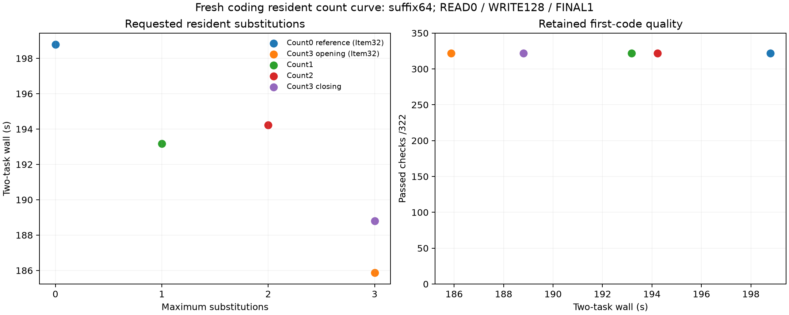

# Fresh coding resident substitution count curve

**Count3 was fastest in both its opening and closing measurements.** All six new first codes passed **161/161 checks**, with six complete READ→WRITE→FINAL pipelines, actual config reads/first writes, zero failed or unresolved checks and no caps. The four retained Item32 reference codes also passed; they are reused evidence, not new attempts.

| Maximum substitutions | Evidence | Task pair (s) | Launcher (s) | Change vs retained count0 task wall | Passed / failed / unresolved |
|---:|---|---:|---:|---:|---:|
| 0 | count0-reference | 198.786 | 203.281 | 0.00% | 322 / 0 / 0 |
| 3 | subs3-before | 185.878 | 190.622 | -6.49% | 322 / 0 / 0 |
| 1 | subs1 | 193.174 | 197.576 | -2.82% | 322 / 0 / 0 |
| 2 | subs2 | 194.227 | 198.158 | -2.29% | 322 / 0 / 0 |
| 3 | subs3-after | 188.800 | 193.393 | -5.02% | 322 / 0 / 0 |

Count0 is **Item32 context-fast**, not a fresh independent count0 control. Opening count3 is **Item32 persistent-fast**; new measurement order was count1→count2→closing count3. Count3 drift was **+1.57% task / +1.45% launcher**. Count1/count2 differ by only **1.053 seconds (0.55%)**, less than the count3 bracket drift, so this run does not establish their ranking. Both count3 observations are faster than either count1/count2. Continue with count3 as the fastest tested opt-in profile on these contracts; no broader accuracy guarantee.

Opening and closing count3 reproduced first code, all public tool calls/final text, every role usage and every numerical routing counter exactly. Count0 first code matches count3 but summaries/thinking differ; count1 code differs on both tasks, count2 differs on dedupe only. All READ requests/public READ calls and frozen source/edited text match; generated READ thinking differs before the graft. This is a configuration cost comparison across generated histories.

| Arm | READ / WRITE / FINAL wall (s) | Thinking by role | Routed layers | Substitutions / skipped loads | Native misses | Double / triple layers | Drops |
|---|---|---|---:|---:|---:|---:|---:|
| count0-reference | 94.596 / 88.265 / 15.921 | 39 / 256 / 0 | 0 | 0 / 0 | 0 | 0 / 0 | 0 |
| subs3-before | 94.052 / 80.037 / 11.786 | 71 / 256 / 0 | 46480 | 22019 / 22019 | 31850 | 3307 / 291 | 0 |
| subs1 | 94.285 / 85.313 / 13.572 | 50 / 256 / 0 | 45760 | 6978 / 6978 | 25786 | 0 / 0 | 0 |
| subs2 | 98.431 / 82.036 / 13.756 | 68 / 256 / 0 | 47560 | 14627 / 14627 | 28887 | 1335 / 0 | 0 |
| subs3-after | 96.984 / 79.799 / 12.013 | 71 / 256 / 0 | 46480 | 22019 / 22019 | 31850 | 3307 / 291 | 0 |

Each arm logged two WRITE forced closes at thinking128, zero deferrals, and FINAL naturally ended at thinking0 despite budget1. Native coefficient counters requested1 for every nonzero-count arm; actual substitutions were count1 **3288/3690**, count2 **7355/7272**, and opening/closing count3 **10319/11700** per task. No drop-policy contribution removal occurred.

All five configurations selected two suffix-native SSD/pre-RoPE sources from their own policy caches: dedupe **1118:1563→436:881**, reused445/fresh260/latest-user978; bucket **1118:1576→436:894**, reused458/fresh265/latest-user990. Both grafts end before the current user; padding0 and source_approximate0. Each arm then used two approximate visible-prefix FINAL continuations, fresh43/42. Reused/fresh input totals remain READ3139, WRITE1397, FINAL85 for every arm; generated code/summary lengths can differ.

Each arm uses a separate cache directory and identical route settings across its two lifetimes. The observed count3 cache-profile hash repeats **a5344dab32c9490536d1ca5ecf1859d13982c11b**; count1 **413c59a1ce28b4fbfb4d8f210c8591b1486e1d6a**, count2 **c5943ee6ec647347efe157db00f84689670bfe13**. Full hashes/settings are retained in [results.json](analysis/results.json). Every arm logged 164 logical disk chunk-read operations, zero hot reads/pins/endpoint evictions; owned SSD at final shutdown was about 203.71–203.76 MiB, below4096 MiB. Logical skip/read counters are not physical SSD traffic.

**Pressure:** the three new guards completed child0; **570 samples**, all level1, no consecutive bad samples, swap steady **0.021787109375 GiB**, peak wired plus compressor **84.918 GiB**. Retained Item32 guard records are included separately in the analysis.

**Method:** runtime `91c9cf212d2e6a35ae558d1c96f37607becbde3f`; [build.json](build.json) pins server/spec/gold hashes. Frozen dedupe/token-bucket161-check contracts and unchanged Item32 caller; actual read/one first write, two obsolete notes removed, no retry. Suffix64, canonical1/PAD1, READ high0/WRITE high128/FINAL high1, globalcap2048, temperature0, Q2/cache64, two slots, ctx8192/chunk512, tile64/limit1024, hot0/SSD4096. Count1/2/3 vary only maximum substitutions within replace/GAP.90/mass.25/rank64/totalmass.50/nativeweights1; source warming uses that same policy. No paired NLL, equal generated-history assumption, additive gain, general quality or isolated routing-latency claim.



```sh
.workspaces/bench-plots-venv/bin/python -B speed-bench/experiments/fresh-resident-curve-hour33-20261004/analyze.py --input speed-bench/experiments/fresh-resident-curve-hour33-20261004 --output speed-bench/experiments/fresh-resident-curve-hour33-20261004/analysis --plot
```

[Results](analysis/results.json), [task/role/check counts](analysis/tasks.csv), [routes](analysis/routes.csv), [grafts](analysis/grafts.csv).
