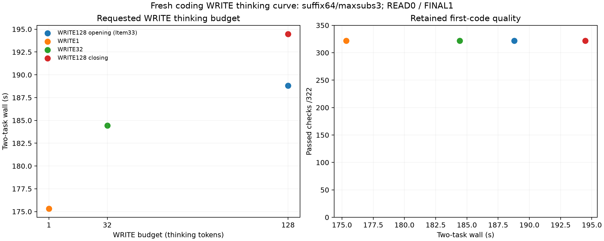

# Fresh coding post-read WRITE thinking budget

**WRITE1 reduced task wall 8.51% versus the128 bracket mean (7.13% versus the faster control)** on the frozen dedupe/token-bucket tasks. All six new first codes passed **161/161 checks**, all six actual READ→WRITE→FINAL pipelines completed without caps, and every retained first-failure record is null. The opening128 pair is retained Item33 evidence, not a new attempt.

| WRITE budget | Evidence | Task pair (s) | Launcher (s) | Task change vs128 mean / faster control | Passed / failed / unresolved checks |
|---:|---|---:|---:|---:|---:|
| 128 | write128-before | 188.800 | 193.393 | -1.48% / 0.00% | 322 / 0 / 0 |
| 1 | write1 | 175.331 | 179.515 | -8.51% / -7.13% | 322 / 0 / 0 |
| 32 | write32 | 184.431 | 188.845 | -3.76% / -2.31% | 322 / 0 / 0 |
| 128 | write128-after | 194.473 | 198.760 | 1.48% / 3.00% | 322 / 0 / 0 |

Closing128 drift was **+3.00% task / +2.77% launcher**. WRITE32’s 3.76% mean saving (2.31% versus faster128) is small relative to that drift. WRITE1 is useful scoped evidence for these post-read implementations; it does **not** justify a general WRITE1 default or suppressing the earlier READ’s thinking.

| Arm | READ / WRITE / FINAL wall (s) | Thinking by role | Forced closes / deferrals | Output tokens |
|---|---|---|---:|---:|
| write128-before | 96.984 / 79.799 / 12.013 | 71 / 256 / 0 | 2 / 0 | 1162 |
| write1 | 93.738 / 68.164 / 13.425 | 71 / 2 / 0 | 2 / 0 | 929 |
| write32 | 100.666 / 72.310 / 11.451 | 71 / 64 / 0 | 2 / 0 | 953 |
| write128-after | 100.348 / 81.862 / 12.259 | 71 / 256 / 0 | 2 / 0 | 1162 |

The per-request logs confirm actual WRITE thinking **1/32/128** on each task, with one forced close and zero deferrals each. READ remains high/budget0 and uses **38/33** thinking tokens; FINAL remains high/budget1 but naturally uses0. READ requests, public function calls and full READ usage match the opening128 exactly for every arm. The saved public READ responses contain only the function call; hidden reasoning text/token IDs are not exported here, so this is not a private-trace identity claim.

Opening/closing128 reproduce first code, all public outputs/final text, full role usage and numerical routing counters exactly. WRITE1/32 dedupe code differs from128; their bucket code is byte-identical to128. Summaries and generated histories differ; all first code checks pass without repair. Original and edited prompt text/config are unchanged, and each actual read/write is independently checked by the existing analyzer.

All arms use the same warm route/cache profile **a5344dab32c9490536d1ca5ecf1859d13982c11b**, with separate cache namespaces. Two suffix-native SSD/pre-RoPE grafts per arm: dedupe **1118:1563→436:881**, reused445/fresh260/latest-user978; bucket **1118:1576→436:894**, reused458/fresh265/latest-user990. Destinations end before the new user, source_approximate0/PAD0. Two approximate visible-prefix FINAL continuations follow, fresh43/42. Total fresh input by role is unchanged: READ3139/WRITE1397/FINAL85.

| Budget | Routed layers | Substitutions / skipped loads | Native misses | Double / triple layers | Drops |
|---:|---:|---:|---:|---:|---:|
| 128 | 46480 | 22019 / 22019 | 31850 | 3307 / 291 | 0 |
| 1 | 37160 | 16956 / 16956 | 24521 | 2500 / 205 | 0 |
| 32 | 38120 | 17606 / 17606 | 25414 | 2583 / 215 | 0 |
| 128 | 46480 | 22019 / 22019 | 31850 | 3307 / 291 | 0 |

Each arm logged164 logical cache disk-read operations; no hot reads, pins or endpoint evictions. Final owned SSD cache is about202–204 MiB, below4096 MiB. Routing/skipped-load and cache-read counters are logical operations, not measured physical SSD traffic.

**Pressure:** all three new guards completed child0; **549 samples**, all level1, no consecutive bad samples, steady swap **0.021787109375 GiB**; peak wired plus compressor **84.502 GiB**. Retained opening128 pressure is included separately.

**Method:** [method.md](method.md), [build.json](build.json) and launch records retain settings/commands/frozen fixture hashes; runtime `91c9cf212d2e6a35ae558d1c96f37607becbde3f`. The copied caller changes only the post-read WRITE budget; stable instructions/tools, storefalse/full-input replay, READhigh0/FINALhigh1, temperature0/globalcap2048, suffix64/canonical1/PAD1 and strong resident maxsubs3 remain fixed. Each arm uses Q2/cache64, two slots, ctx8192/chunk512, tile64/limit1024 and hot0/SSD4096. No model/grader retry, paired NLL on divergent histories, additive speed claim or broad quality guarantee.



```sh
.workspaces/bench-plots-venv/bin/python -B speed-bench/experiments/fresh-thinking-curve-hour35-20261004/analyze.py --input speed-bench/experiments/fresh-thinking-curve-hour35-20261004 --output speed-bench/experiments/fresh-thinking-curve-hour35-20261004/analysis --plot
```

[Results](analysis/results.json), [task/check/first-failure records](analysis/tasks.csv), [reasoning](analysis/reasoning.csv), [graft geometry](analysis/grafts.csv), [routing](analysis/routes.csv).
