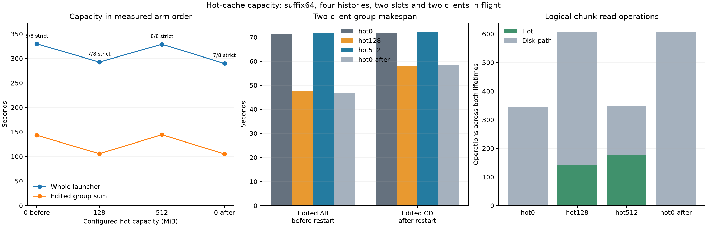

# Host hot-cache capacity, Item21

The hot cache stores and serves state chunks within its configured byte limit, but **this run does not establish a latency gain or justify a default promotion**. Hot128 looked faster than the opening hot0 arm; the closing hot0 control was slightly faster still. Hot512 served all 173 pre-restart chunk reads from RAM yet its edited A/B group took about 72 seconds, matching the slower opening hot0 result. The working sets and warm outputs differ, so a bracket mean would only be diagnostic.

| Arm, measured order | Whole launcher (s) | Edited AB before restart (s) | Edited CD after restart (s) | Edited sum (s) | Strict grade | Fresh reads | Caps |
|---|---:|---:|---:|---:|---:|---:|---:|
| Hot0 before | 329.590 | 71.472 | 71.799 | 143.271 | 8/8 | 8/8 | 0 |
| Hot128 | 292.609 | 47.829 | 57.970 | 105.799 | 7/8 | 8/8 | 0 |
| Hot512 | 328.745 | 71.970 | 72.337 | 144.307 | 8/8 | 8/8 | 0 |
| Hot0 after | 289.777 | 46.822 | 58.508 | 105.330 | 7/8 | 8/8 | 0 |

The closing hot0 arm was added after early timing drift was observed. Relative to opening hot0, hot128's launcher wall was 11.22% lower and edited group sum 26.15% lower; relative to closing hot0, they were **0.98% and 0.45% higher**. The hot0 controls themselves differed by −12.08% whole wall and −26.48% edited sum. These are observed comparisons, not an identified capacity benefit.

All sixteen edited fact answers were correct, all 32 actual reads used the right session's advertised file, and the independently recomputed grades agree with the driver. C-warm in hot128 and closing hot0 returned READY plus correct inventory numbers, adding 40 output tokens and failing the strict READY-only grade. Both failures occurred before any approximate graft. All eight public texts and input/cached/output token totals match between hot128 and closing hot0; they also match between opening hot0 and hot512. The two pairs differ at C-warm and in later C/D history and output. This is not evidence that hot capacity caused the format failure.

| Arm / server lifetime | Owned hot MiB at close | SSD-owned MiB at close | Endpoints / chunks | Hot / disk-path chunk reads |
|---|---:|---:|---:|---:|
| Hot0 / before restart | 0 | 545.788 | 48 / 2,097 | 0 / 172 |
| Hot0 / after restart | 0 | 671.313 | 54 / 2,566 | 0 / 173 |
| Hot128 / before restart | 127.869 | 652.810 | 62 / 2,568 | 73 / 227 |
| Hot128 / after restart | 126.811 | 779.142 | 68 / 3,040 | 67 / 241 |
| Hot512 / before restart | 511.951 | 565.630 | 50 / 2,170 | 173 / 0 |
| Hot512 / after restart | 166.407 | 691.155 | 56 / 2,639 | 2 / 171 |
| Hot0 after / before restart | 0 | 653.087 | 62 / 2,571 | 0 / 300 |
| Hot0 after / after restart | 0 | 779.419 | 68 / 3,043 | 0 / 308 |

Owned hot bytes were below the configured 0/128/512 MiB cap at every shutdown; pinned endpoints and endpoint evictions were zero. Metadata was 0.434–0.608 MiB. The counters are **logical chunk read operations**, not bytes or physical SSD traffic. Their denominators differ: opening hot0 has 345 total operations, hot128 and closing hot0 each have 608, and hot512 has 346. RAM entries disappear on restart; the hot512 second lifetime's 2 hot / 171 disk-path reads contrast with 173 / 0 before restart. The OS page cache may serve disk-path reads, so this is not a physical cold-SSD experiment.

Each arm had four approximate grafts, all `source_ssd=1`, `source_approximate=0`, from native sources with one edit per history. That source flag identifies persisted state selection even when its chunk payloads are hot. Every arm had four no-aligned-source warm fallbacks and four actual slot-eviction log lines. The two reusable geometries were 527 tokens with 95 fresh and 413 tokens with 716 fresh; C's longer warm history raised one restarted fresh span to 756 in hot128 and closing hot0. Route lines, per-step queue-inclusive latency and all cache fields are retained in [analysis/results.json](analysis/results.json) and CSVs. Earlier repeated-move qualification is separate.



The sole planned setting change was host hot capacity, with suffix fresh tail64 and SSD4096 MiB fixed. The unchanged Item19 driver used four full-input identities, two resident slots, two simultaneous clients, warm AB → warm CD → edited AB → restart → edited CD, the same absolute tool paths, fresh cache/store per arm, Q2/cache64/ctx8192/chunk512, GAP0 and effort none/temperature0. Whole launcher wall includes startup, both client phases, shutdown and restart; group makespan is elapsed time, whereas summing individual queue-inclusive latencies double-counts overlapping waits. No parallel GPU or general throughput claim follows. No paired NLL/KL is assigned to differing generated histories.

Runtime `fe5d6e2670e7d154bf97234df01d1ee8db4a51e8` only added a shutdown log of existing cache statistics after owners stopped; settings, server SHA and build/test commands are in [build.json](build.json). All four pressure guards completed. Hot128 and closing hot0 child exit3 reflect their preserved strict format failure, not a pressure kill. Across 1,201 samples, pressure stayed level1, swap stayed 0.012998 GiB, peak wired plus compressor was 86.992996 GiB, and consecutive-bad counts stayed zero. All raw requests, replies, server logs, phase commands and guard records remain in their arm directories.

Reproduce CPU analysis:

```sh
.workspaces/bench-plots-venv/bin/python -B \
  speed-bench/experiments/hot-cache-hour21-20261004/analyze.py \
  --input speed-bench/experiments/hot-cache-hour21-20261004 \
  --output speed-bench/experiments/hot-cache-hour21-20261004/analysis --plot
```

Keep the hot-cache setting opt-in. A later speed decision needs a repeated, matching working set with stable arm controls; these measurements already establish useful residency and bounded ownership without establishing faster task completion.
