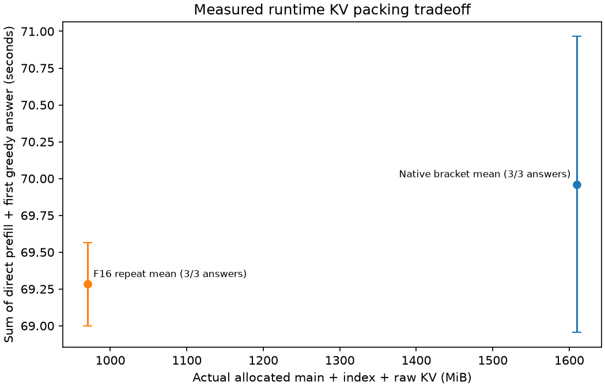

# Item48: F16 storage for existing quantized compressed KV

2026-10-20, source base `af29fceda929141b9e0c6601f00da6ab9142a95b`.
**Main-cache allocation halves with identical measured model outputs and an
exact canonical round trip. Latency is unresolved; no speed gain is established.** The bracket changes only
`DS4_V41_COMPRESSED_KV_F16`: 0,1,1,0. All arms use one changed binary, SHA256
`ca69c3da50df6be3049782ac3e8d5a999cb598f17c3d67583f42d8e8ce8faa06`.
No current preset is changed.

## Mechanism and observed allocated capacity

The native main compressed cache already stores values after the FP4/E4M3
quantizer and its BF16 boundary. This candidate keeps those values in F16
instead of F32, uses typed attention readers, and expands selected rows into
F32 scratch for scalar attention. It does not change weight quantization or
create a native bitpacked FP4 wire format. Index caches, raw rings and pending
compression-pair fields retain their ordinary layout.

| Allocated tensor capacity, context 262,144 | Native F32 | F16 candidate |
|---|---:|---:|
| Main compressed KV |1,342,185,472 B|671,092,736 B|
| Index KV |335,546,368 B|335,546,368 B|
| Raw rings |10,485,760 B|10,485,760 B|

The main tensor allocation halves, saving 671,092,736 bytes (640.004 MiB).
These are logged **tensor-capacity bytes**, not RSS or measured physical memory
pressure. Expert-cache budget stays 64 GiB and is not enlarged using the saved
bytes. Whole-session/process memory includes other buffers and does not halve.
Canonical snapshots retain the F32 format, so canonical disk bytes also do not
halve. Packed sessions currently reject original-backed suffix capture/reuse.
The three reported KV capacities sum to 1,610.010→970.006 MiB (39.75% less);
scratch and other session buffers are outside that sum. At context 8,192 the
main-only formula saves 20.004 MiB rather than the 640.004 MiB saved at 262,144.

The focused GPU primitive test passed quantizer, offset storage-conversion and
sparse-gather comparisons. It did not establish attention or whole-model
identity. Typed attention can round arithmetic differently even when every
stored value is exactly representable. The model experiments below measure
that question independently.

## Fixed full-model bracket

Apple M5 Max/128 GiB, verified 1017 IQ2_XXS/Q2_K checkpoint. Context capacity is
262,144, each live prompt is exactly 8,192 tokens, requested prefill chunk 8,192,
expert-cache target 64 GiB. Native routing, no MTP, decoder replay 0; one guarded
model job at a time. This is an allocated-capacity stress shape with an 8k live
prefix, not a full 262k-token attention/quality measurement.

The existing [Item47 runner](../decoder-replay-hour47-20261020/run.py) runs its
`compressed-kv` variant with order 0,1,1,0 and the same
[direct C probe](../../decoder_replay_bench.c). Each arm covers ordinary,
favorable and changed-register fixtures with the same prompt vectors and
fixed teacher answers including EOS. The
[paired analyzer](../decoder-replay-hour47-20261020/analyze.py) pairs common
teacher histories and separately grades the independent first greedy answers.
Its practical scope is direct `greedy_sync_ms + greedy_ms`, excluding model
open, teacher work and analysis. Keep native bracket drift and all first
answers/stops; do not infer speed or equality from the allocation alone.

## Canonical cross-layout check

The narrow [round-trip helper](../../kv_pack_roundtrip_bench.c) uses one engine,
context 16,384, chunk 8,192, native routing, replay 0 and a fixed 64 GiB expert-cache
budget. It builds a harmless 8,192-token prefix, evaluates one known teacher
token and saves canonical A at the odd 8,193 frontier. This includes a raw ring
and unfinished compression pairs.

It loads A into a fresh F16 session and saves B, requiring byte-exact A/B, then
evaluates the next same teacher token and compares freshly computed logits
with the native reference. A new F32 session loads B and saves C, requiring
byte-exact B/C and another fresh-token comparison. The A/B/C snapshots remain
in memory, at most two concurrently; large KV artifacts are not published.
Loaded snapshot logits are not a fresh-computation quality check. Timing from
this compatibility helper is not the performance bracket.

## Measured model quality and timing

All four arms' 22 common teacher rows, including EOS, had identical full-vocabulary
logits. Every logit buffer has SHA256
`8f7e546e53717189d429fed0d1931d549ac8f391d83504830f50076a2385ffa3`;
mean/worst ΔNLL and KL were 0, and argmaxes did not change. All 12 independent
first greedy answers stopped and exactly matched their expected register code.
This proves equality on these three fixtures/22 shared teacher positions, not
arbitrary future prompts or a full 262k-token live context.

| ABBA arm | Main-cache storage | Sum of three prefill + first-answer times |
|---|---|---:|
| Native opening |F32|68.955283 s|
| Candidate 1 |F16|68.997398 s|
| Candidate 2 |F16|69.567117 s|
| Native closing |F32|70.964805 s|

Native mean 69.960044 s versus candidate mean 69.282258 s is a 0.969% saving
against the native mean, but the candidate mean is 0.474% slower than the faster
native control. Native opening→closing drift is +2.914%. The repeat-range plot
retains that variability. **Treat latency as unresolved/neutral; this bracket
does not establish a speed gain.** The demonstrated benefit is lower allocated
KV capacity at unchanged measured outputs. Expert slots remain fixed.



[Paired measurements](analysis/summary.json), [bracket statistics](analysis/bracket.json)
and the [vector plot](analysis/tradeoff.svg) retain the repeat ranges.

## Canonical compatibility result

The cross-layout helper passed at the odd 8,193-token frontier. Canonical A, B
and C were each **63,479,352 bytes**. F32→F16 A/B and F16→F32 B/C were byte-exact.
After one common fresh token at 8,194, all 129,280 computed logits were finite
and byte-identical in both transitions. Allocation logs confirm actual
F32→F16→F32 sessions. This evaluates cache reads after restore; it does not grade
the logits loaded from the snapshot itself.

This qualifies that particular odd-frontier canonical round trip, including
raw ring and pending compression state. It is not an SSD cache lifecycle,
HTTP server, coding or agent-workflow qualification.

## Checks and evidence

Focused quantizer/offset-storage/sparse-gather GPU checks, builds and the
model-free server/agent suites passed. The full default Metal suite fails at
quantization mode 3/index 5428, actual 11.25 versus oracle 7.5, before reaching
the new packed case. An extracted `af29fced` parent build using the same flags,
support objects and unchanged shaders fails at the identical assertion. This
confirms baseline parity; **the default broad GPU suite is not passing**. Both
failures and the exact baseline revision/build records are retained. No
quantizer/default change was made to hide or fix that separate failure.
The diagnostic `DS4_METAL_MATH_SAFE=1 ./tests/test_deepseek41_metal` passed the
full suite, including the new packed case, consistent with the fast-division
rounding-boundary diagnosis. Defaults and all timed model runs retain fast
math; no runtime fix or oracle change was made.

[Check results and commands](evidence/checks/checks.json),
[default failure](evidence/checks/full-gpu-tests.log),
[parent reproduction](evidence/checks/baseline-gpu/revision.json) and
[safe-math diagnostic](evidence/checks/safe-math-gpu-tests.log) preserve that
boundary. The [canonical summary](evidence/roundtrip/summary.json) records the
cross-layout byte and fresh-logit comparisons.

All six pressure guards remained normal. The curve's 542 samples peaked at
105.193 GiB wired plus compressed memory, with 3.38 MiB maximum swap growth;
the round trip's 22 samples had no swap growth. The
[pressure summary](evidence/checks/pressure-summary.json) retains each guard's
status, including the expected nonzero child exits from the two default GPU
test failures.

Bounded evidence includes execution metadata, tokens/rows/timings, first
answers, logs, paired summaries/CSV, pressure summaries, focused GPU/build/unit
logs and the cross-layout summary. Source base, binary SHA and exact commands
identify the implementation accompanying this report; no duplicate source
patches are needed. Raw logits, binaries and in-memory canonical snapshots
stay outside publication. Layout:

```text
analysis/             paired summary, bracket statistics, row CSV and plots
evidence/curve/       first output/timing/token/command records per ABBA arm
evidence/roundtrip/   odd-frontier JSON summary and logs
evidence/checks/      build/unit/focused GPU logs and checks.json
```

[Portable method and boundaries](../../../recipes/13-packed-compressed-kv.md).
This builds on antirez/ds4's existing quantizer/typed cache readers; it is a
local storage adaptation, separate from official DeepInfer cache formats and
native MXFP4 expert/Engram dictionary pilots. Presets remain unchanged.
