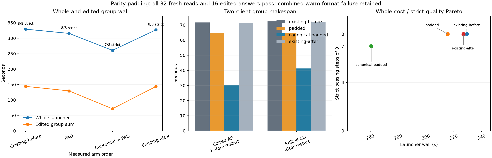

# Optional parity padding, Item24

PAD alone reduced whole launcher wall **3.83%** and edited group wall **9.97%** against the two existing-policy controls, with all strict grades passing. The bounded canonical-plus-PAD follow-up reduced whole wall **20.56%** and edited group wall **50.26%**, with one preserved warm-format failure. All 32 actual isolated reads and all sixteen edited fact answers passed, with no caps. The follow-up changes canonical materialization while keeping PAD enabled; it is a separate point chosen after the successful primary screen.

| Arm, measured order | Warm AB (s) | Warm CD (s) | Edited AB (s) | Edited CD after restart (s) | Whole launcher (s) | Strict grade |
|---|---:|---:|---:|---:|---:|---:|
| Existing before, canonical 0/PAD 0 | 90.765 | 90.615 | 71.692 | 72.367 | 329.374 | 8/8 |
| PAD, canonical 0/PAD 1 | 90.749 | 90.650 | 64.847 | 64.561 | 315.587 | 8/8 |
| Canonical + PAD, canonical 1/PAD 1 | 91.385 | 93.255 | 30.211 | 41.292 | 260.671 | 7/8 |
| Existing after, canonical 0/PAD 0 | 89.238 | 90.315 | 71.534 | 71.897 | 326.913 | 8/8 |

The control mean was 328.143594 seconds whole and 143.745285 seconds edited. Existing after/before drift was −0.74697% whole and −0.43571% edited; all eight control public texts and input/cached/output token totals matched exactly. PAD's edited AB/CD changes were −9.45%/−10.50%; combined changes were −57.81%/−42.75%. Canonical-plus-PAD was 17.40% lower whole and 44.75% lower edited than PAD alone. These observed savings are not additive with earlier experiments and do not establish a broader default.

The combined C-warm answer contained the correct inventory numbers and READY plus extra prose, failing the unchanged READY-only grade before any graft. Its output usage was 134 versus 95 tokens: read-call output 102 versus 93 and final 32 versus 2, totaling 39 extra output tokens. Its later source and edited context therefore differ. The failure cannot be assigned to a newline graft that had not happened yet. PAD alone changed only A/C edited JSON spacing, retaining correct parsed answers; combined edited public answers matched the controls. All independently recomputed grades agree with the driver, including the failure.

| Selected grafts | Source → destination | Reused / total fresh | Actual prefix_pad |
|---|---|---:|---:|
| Existing A/C primary | `660:1073` → `308:721` | 413 / 716 | 0 |
| Existing B/D primary | `1164:1691` → `814:1341` | 527 / 95 | 0 |
| PAD A/C primary | `1166:1693` → `816:1343` | 527 / 95 | 1 |
| PAD B/D primary | `1164:1691` → `814:1341` | 527 / 95 | 0 |
| Combined A primary | `660:1694` → `308:1342` | 1,034 / 95 | 0 |
| Combined C primary, longer warm history | `660:1703` → `308:1351` | 1,043 / 125 | 0 |
| Combined B/D primary | `658:1692` → `308:1342` | 1,034 / 95 | 1 |
| Combined B/D tool-result continuation | `658:1692` → `308:1342` | 1,034 / 214 | 1 |

Count actual logs rather than assuming four grafts per arm. Each control and PAD alone had four primary grafts and four warm no-aligned-source fallbacks. The combined arm had **six grafts**: four primary and two additional B/D tool-result continuations, plus four warm fallbacks. Canonical materialization bypassed the existing approximate visible continuation, so those B/D completion requests performed another graft from their original native warm sources. All eighteen logged grafts across the four arms have `source_ssd=1`, `source_approximate=0` and pre-RoPE enabled. PAD was selected on two grafts in the primary candidate and four in the combined candidate. Actual slot-eviction counts were 4/4/6/4.

PAD selection changes the actual model input by one validated newline after the first historical USER boundary, only when it yields a strictly longer eligible even-aligned graft than the best plain candidate; ties retain plain input. Pair alignment remains required and the latest user/query stays fresh. Usage confirms the change: PAD A's two edited requests had 1,438/1,557 input tokens versus control 1,437/1,556; C had 1,438/1,556 versus 1,437/1,555. B/D and all warm requests were unchanged in the primary PAD comparison. Combined B/D first edited requests had 1,437 input tokens versus 1,436 in the current controls; their continuation input of 1,556 includes the pad and changed canonical rendering (controls had 1,554). The public submitted replay stays unchanged. `grafts.csv` retains every selected coordinate, pad value, source kind, fresh count and logged graft time.

The combined candidate's extra continuations and changed working set increased logical disk-path chunk reads to 900, versus345/357/345 for existing-before/PAD/existing-after. These counters are operations, not physical SSD bytes. Hot bytes/reads, pinned endpoints and endpoint evictions were zero. Close-time endpoint counts were 48→54 for controls and PAD, and 59→66 combined; SSD-owned bytes and metadata are recorded per lifetime in [analysis/results.json](analysis/results.json). The OS page cache may serve disk-path reads. The stronger latency result therefore does not imply lower physical SSD traffic.



The unchanged Item19 driver used four full-input histories, stable tools/instructions and identical advertised paths, two clients on two resident slots, fresh cache/store per arm, and a restart between edited AB and CD. Fixed settings were suffix tail64, hot0/SSD4096 MiB, Q2/cache64/ctx8192/chunk512, GAP0, effort none and temperature0. The primary comparison held canonical 0 while changing PAD 0→1; the follow-up held PAD 1 while changing canonical 0→1. Runtime `00da420b1995663540d3b617537e87b18abda402`, server SHA, source/build checks, follow-up decision time and exact settings are in [build.json](build.json).

Whole launcher wall includes warmup, startup, restart and shutdown. Edited group makespan is elapsed pair time; summing queue-inclusive individual latencies double-counts overlapping waits. No parallel GPU, paired NLL/KL on divergent histories, native state identity or general accuracy claim follows. Padding and canonical rendering remain opt-in approximations. Original raw requests, replies and the warm failure are preserved without retries or fixture repair.

All four guards completed. Combined child exit 3 records its strict warm-format failure, not a pressure kill; the others exited 0. Across 1,191 samples pressure stayed level 1, swap remained 0.012998 GiB, peak wired plus compressor was 84.744980 GiB, and consecutive-bad counts stayed zero.

Reproduce CPU analysis:

```sh
.workspaces/bench-plots-venv/bin/python -B \
  speed-bench/experiments/parity-suffix-hour24-20261004/analyze.py \
  --input speed-bench/experiments/parity-suffix-hour24-20261004 \
  --output speed-bench/experiments/parity-suffix-hour24-20261004/analysis --plot
```

The combined policy is a useful next qualification candidate: it retained all edited facts and delivered the largest measured saving here, while the strict warm-format failure and extra continuation grafts remain concrete quality and cost boundaries to test on fresh histories.
