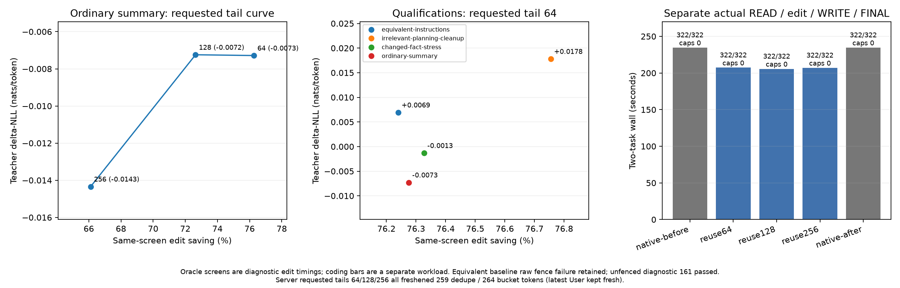

# Item38: faithful compaction, suffix reuse, and coding quality

One-hour item, 2026-10-08 16:26:32–17:26:32 UTC. Runtime revision
`9c6918f0ae2e`, following Item37 `b9613ff5`. All five server arms and six
standalone screens completed within the item budget.

The completed server block saves **11.66–12.38% of whole-task time** on two
ordinary coding tasks after replacing an authored working discussion with a
faithful summary. All ten first implementations pass their respective
161-case graders, with no retries, incomplete replies, or output caps.
This is a separate measurement from Item37 resident-prefill routing: routing
substitution is disabled throughout. These gains must not be added to earlier
workload savings.

## Frozen experiment

Use one heavy model job at a time under `speed-bench/ideas/pressure_run.py`.
Keep runtime, task, tool contract, reasoning budgets, actual config, and
context edit fixed. Change only suffix reuse and requested fresh-tail length.
Retain failures and capped generations; neither identical code nor identical
logits is an acceptance requirement.

Both paths use `gguf/DeepSeek-V4.1-Flash-Q2.gguf`, Metal, SSD expert streaming
with a 64GB expert cache, context8192, prefill chunk512, selected tile64 and
limit1024. Both resident-routing gap settings and native-weight routing are
zero. Exact commands and resolved environments are in each arm's
`execution.json` and the corresponding guard `command.json`.

### Whole server workflow

`run.py` uses `/v1/responses` with full input replay, stable system/tools,
actual response items and actual tool outputs. It executes READ, then replaces
the marked authored discussion with its settled summary, executes the first
WRITE, then receives FINAL. The algorithm contract and config/tool result
remain outside the replaced block. A fresh User message explicitly requests
implementation after the successful read. It preserves returned public
reasoning; it does not use `previous_response_id`.

There are two tasks: time-window deduplication and an integer token bucket.
Each arm gets its own server/cache/store. Requests use temperature0, high
reasoning effort, READ/WRITE/FINAL budgets0/128/1, and a shared total output cap
of2048. Grading happens after the first implementation, with no repair turn.
Timed scope is the complete READ/edit/WRITE/FINAL workflow including actual
read/write, excluding server startup and external grading.

Suffix arms request canonical source capture and padding. State-cache hot
capacity is0MB and SSD capacity4096MB; the logs confirm `source_ssd=1`,
`pre_rope=1`, and an initially exact source (`source_approximate=0`). Native
controls disable suffix reuse. Both paths perform the same discussion edit.

### Standalone teacher and greedy screens

`oracle.c` reuses the Item14 snapshot/graft mechanics. Its fixed partitions
are synthetic: A256 + old B1024 + retained C1536 becomes A256 + new B256 +
the same C1536. Old/new lengths are2816/2048, source/destination suffix starts
1280/512, and the left shift is768tokens. Fresh tails64/128/256 leave
1472/1408/1280 reused tokens. Varied archived review text fills the chosen
lengths; it is not an organically accumulated agent transcript. Padding A/B
does not duplicate the current contract or config.

C begins with the complete current algorithm contract, actual config and
coding constraints. It ends with an assistant-ready message, a short **new
User message**, and a THINK_NONE assistant prefix. The complete latest User
query is fresh for every point. Actual old/new rendered contexts and token
arrays are saved, so this property can be inspected rather than assumed.
The equivalent-instructions family edits a system prefix; other families
edit older user context.

The immutable source retains pre-RoPE originals. Fresh and reused endpoints
score the same frozen teacher token sequence, then separately produce greedy
plain Python code. Teacher and greedy caps are512tokens. No teacher padding
is added solely to reach512; actual teacher length is reported. Full-vocabulary
logits are compared in memory; raw dumping is off unless `--raw` is requested.

| Family | Practical task | Edit | Teacher origin |
| --- | --- | --- | --- |
| ordinary-summary | dedupe | Condense earlier implementation discussion while preserving decisions | Actual Item37 first code,545bytes |
| equivalent-instructions | bucket | Condense equivalent coding instructions in system context | Actual Item37 first code,769bytes |
| irrelevant-planning-cleanup | dedupe | Archive completed meeting/catering/slide planning unrelated to the task | Same unmodified dedupe teacher |
| changed-fact-stress | dedupe | Correct stale earlier last-seen advice to last-accepted behavior | Same unmodified dedupe teacher |

Teachers are byte-for-byte copies of Item37 `code-native-before/http/<case>/<case>/first-solution.py`.
Each `fixtures/<family>/fixture.json` records the source path and SHA256.
The standalone contract is the algorithm portion of Item32's `spec.prompt`,
before its tool protocol; actual `spec.config` and coding constraints are
retained. The server workflow keeps the full tool protocol. Both paths use
the existing Item32 practical grader, rather than testing teacher-code parity.

ΔNLL is `reuse_nll - fresh_nll` on the fixed teacher, in nats/token. KL is
`KL(fresh || reuse)` on each full-vocabulary distribution, then averaged.
`exp(mean ΔNLL)` is the teacher perplexity ratio, not a task-failure rate.
`rows.csv` also records TV, argmax flips and byte equality. A negative ΔNLL
means this teacher received slightly higher probability under reuse; it does
not establish general quality improvement. The source still reflects its
original prefix even when relocation uses immutable pre-RoPE values.

## Completed server block

Order: native-before, reuse64, reuse128, reuse256, native-after. Each row sums
the two task wall times. Savings use the mean of the two native controls.

| Arm | Dedupe seconds | Bucket seconds | Total seconds | Whole-task saving | First-code grading |
| --- | ---: | ---: | ---: | ---: | --- |
| native-before |116.5769|118.1154|234.6923|baseline|161/161 each |
| reuse64 |101.5609|105.7558|207.3167|11.66%|161/161 each |
| reuse128 |101.1888|104.4502|205.6390|12.38%|161/161 each |
| reuse256 |101.4255|105.6113|207.0368|11.78%|161/161 each |
| native-after |116.5547|118.1185|234.6732|baseline|161/161 each |

The controls differ by0.0081%; their first code and per-role usage match for
both tasks. Edited input contexts match across arms. All ten workflows
complete with exactly one actual read and one actual write, zero caps, and
unchanged config.

The server's latest-User protection dominates this requested-tail sweep:
every reuse arm imports441/453tokens for dedupe/bucket and recomputes259/264
tokens in total. Destination graft endpoints precede the latest User start.
Requested64/128/256 changes how fresh work is split between the graft and
following sync, not the total fresh coverage on these tasks. Therefore this
is not evidence that128 is a generally optimal quality/speed point; it is the
fastest measured arm in this block.

## Completed standalone screens

| Family | Fresh tail | Teacher rows | ΔNLL nats/token | Mean KL | Fresh/reuse edit seconds | Fresh/reuse grading |
| --- | ---: | ---: | ---: | ---: | ---: | --- |
| ordinary-summary |64|137|−0.00728447|0.00226546|46.4794 /11.0268|161/161,161/161 |
| ordinary-summary |128|137|−0.00724263|0.00305626|46.8825 /12.8278|161/161,161/161 |
| ordinary-summary |256|137|−0.01433972|0.00352470|47.0886 /15.9569|161/161,161/161 |
| equivalent-instructions |64|174|+0.00693041|0.00504237|47.0013 /11.1675|raw format failure,161/161 |
| irrelevant-planning-cleanup |64|137|+0.01781056|0.01042215|47.6981 /11.0874|161/161,161/161 |
| changed-fact-stress |64|137|−0.00130633|0.00361822|47.7449 /11.3026|161/161,161/161 |

For summary64, edit-only time falls76.28%. Source setup took83.889s and
capture5.095ms; these are separate from the edit timer. The teacher perplexity
ratio is0.992742 (−0.73%), TV0.006813, with one argmax flip over137rows and
zero byte-identical rows. Both greedy codes stop normally under512tokens and
pass161/161. Edit-only savings must not be substituted for whole-task savings.

All six reused greedy outputs stop normally and pass161/161. Five raw fresh
outputs also pass161/161. The equivalent-instructions fresh output includes
one enclosing Markdown fence despite the plain-Python request, so its raw
grader reports a SyntaxError and remains a format failure in the table.
Removing only that fence diagnostically yields161/161, without another model
turn; `screen-equivalent64/fresh-unfenced-grade.json` records this separate
result. The original first output and raw failure remain intact. No greedy
output reaches its512-token cap.

The stress family preserves the full correct contract and actual config in C
while correcting an earlier conflicting rule. It is a milder stale-advice
case, not a test of removing or replacing an authoritative retained fact.
Its success does not supersede earlier changed-fact worst-case measurements.
The nominally favorable planning cleanup has the largest measured positive
ΔNLL here; scenario labels are hypotheses rather than guaranteed quality
rankings.

All completed guards report pressure level1, zero adverse samples and child
returncode0. Wired+compressor peaks range87.8–89.7GiB; maximum measured swap
growth is2.88MiB. Large RAM use alone did not stop these runs.



The same plot is available as [SVG](analysis/compaction-pareto.svg). It keeps
standalone edit-only measurements separate from server whole-task time.

The proposed **20% teacher-perplexity increase ceiling** corresponds to
ΔNLL≤ln(1.2)=0.1823nats/token. All screens are below it; the worst measured
increase is1.80% (favorable cleanup). This is a teacher likelihood criterion,
not a 20% task-failure allowance. The proposed **20% whole-task speed saving
target is unmet**: the best measured arm saves12.38%.

Keep the current opt-in `context-fast` setting with requested tail64; do not
promote reuse to the ordinary default from this small suite. Tail128 is the
fastest server arm in this block, with the same actual graft coverage as64
and256, not a demonstrated quality optimum. The standalone summary curve
shows increasingly expensive fresh work as the tail grows, while all three
points satisfy the measured quality ceiling.

## Commands and artifacts

Representative reruns from the repository root are below. Use new output,
cache and store names: these callers intentionally fail if an output already
exists. The recorded guard command files are the exact executed commands.

```sh
PY=/opt/homebrew/Cellar/python@3.14/3.14.8/Frameworks/Python.framework/Versions/3.14/Resources/Python.app/Contents/MacOS/Python
EXP=speed-bench/experiments/recipe-compaction-hour38-20261008

"$PY" -B speed-bench/ideas/pressure_run.py "$EXP/guard-rerun-reuse128" -- \
  "$PY" -B "$EXP/launch.py" --arm context-fast --server ds4-server \
  --output "$EXP/rerun-reuse128" \
  --cache .workspaces/recipe-20261008/compaction-rerun128-cache \
  --store .workspaces/recipe-20261008/compaction-rerun128-store \
  --visible .workspaces/recipe-20261008/compaction-visible --fresh-tail 128

"$PY" -B speed-bench/ideas/pressure_run.py "$EXP/guard-rerun-summary64" -- \
  "$PY" -B "$EXP/screen.py" \
  --oracle .workspaces/recipe-20261008/compaction-oracle \
  --case ordinary-summary --fresh-tail 64 --output "$EXP/rerun-summary64"
```

`launch.py` and `screen.py` sanitize DS4/PT environment variables, resolve
Metal shader paths, and save the final environment. Native controls use
`--arm native-before` or `native-after` with fresh output/cache/store paths.
Other screens change `--case` and/or `--fresh-tail`.

Compile the oracle against the same current core objects as the server,
keeping its metric code free of `-ffast-math`:

```sh
cc -O3 -g -mcpu=native -Wall -Wextra -std=c11 -I. \
  -c speed-bench/experiments/recipe-compaction-hour38-20261008/oracle.c \
  -o .workspaces/recipe-20261008/compaction-oracle.o
cc -O3 -g -mcpu=native -o .workspaces/recipe-20261008/compaction-oracle \
  .workspaces/recipe-20261008/compaction-oracle.o ds4.o ds4_image.o \
  ds4_distributed.o ds4_tp.o ds4_ssd.o ds4_metal.o ds4_layer_pack.o ds4_engram.o \
  -lm -pthread -framework Foundation -framework Metal
```

Useful evidence:

- `analysis/results.json` and exported CSVs aggregate the measurements.
- `code-*/http/<case>/<case>/` retains requests/responses, before/after edit
  text, tool calls, first code and grading; server stderr records each graft.
- `screen-*/` retains execution settings, actual rendered contexts,
  `tokens.json`, tokenwise `rows.csv`, summary, free greedy code and grades.
- `guard-*/` retains the pressure trace, command and child/guard outcome.

The completed evidence supports faithful ordinary compaction on these two
tasks and the stated favorable/stress screens. It does not qualify arbitrary
prefix replacement, authoritative fact removal, long-running repeated edits,
multiple-source imports, right shifts, or broader coding success rates.
