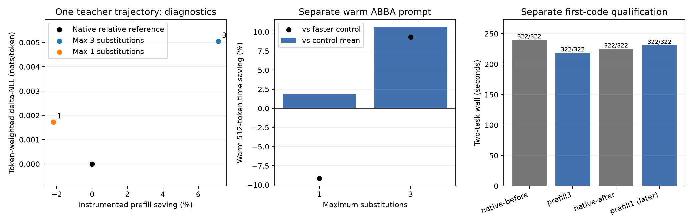

# Warm-prefill resident experts

**Up to three substitutions reduced the measured 512-token append time 10.64% against its ABBA control mean (9.32% against the faster control).** Two coding tasks completed with all first implementations passing 161 checks each. Their task pair saved 5.98% against the native bracket mean, or 2.86% against the faster control. Native task timing drift was 6.22%; the smaller whole-task benefit needs that qualification. The working 20% speed target was not met. This remains a useful opt-in contributor, rather than a default-promotion result.

Runtime revision: `9c6918f0`. Frozen binaries and large vector dumps stay under `.workspaces/recipe-20261008/`; small results and commands stay here. The experiment began 2026-10-08 at 15:22 UTC; final model timing finished 16:21:21 UTC. The extended reporting deadline is 16:32 UTC, with approval pauses tracked by root.

Actual build command, successful with exit0:

```sh
make -j2 ds4-bench ds4-server tests/test_resident_route > .workspaces/recipe-20261008/build-prefill.log 2>&1
./tests/test_resident_route
```

The focused resident-route test passed. SHA256 provenance:

- Server: `247e2f2fa76a32647ce6ac6c14a2a36b645e4776a3a45bc53ca2fba3b948f5ee`.
- Bench: `826d6f2ea7ad6ed9c941ac6602a0e1f7c3278c5add1d71e5993db64b3b9cbabd`.
- Runtime source: `c9005f02042a0d49958809ac63ef1cf264a1dcf06acf4d9d8911e9707072b202`.
- Opening native server: `3164ce823a9bcbef6ca19209cf27f7cf992aa0e8954c943c73d134e571dcd6c9`.

The quality executables link the same `replay_quality.c` frontend and unchanged other core objects, with preserved native `ds4.o`/`ds4_metal.o` from parent `fa806900` versus candidate objects. Their exact executable and replay hashes are in the raw quality manifests.

## Intervention and scope

`DS4_METAL_V41_RESIDENT_PREFILL_GAP=.90` extends the existing simple resident selector into selected-cache prefill calls. It freezes the resident mask for all layers at each call's start, retains native routing coefficients, and can replace eligible nonresident selected IDs with resident IDs. Guards are mass .25, rank64, total substituted mass .50 and replace policy; this screen varies maximum substitutions 1 or 3. Decoder resident routing and suffix grafting are disabled throughout. This is a local adaptation of the recipe's cache-aware prefill idea, **not an implementation of the recipe's algorithm**.

The candidate is **not confined to the final warm append**. It also changes selected-tail calls within the initial 2048-token prefill. Strong warm runs logged 16 calls and 40,960 row-layers, covering 1,024 selected-prefill tokens across initial and appended work. Full layer sweeps and unsupported paths remain native. Distribution measurements therefore cover the complete candidate path and its accumulated effects.

Fixed settings: Q2 model `gguf/DeepSeek-V4.1-Flash-Q2.gguf`, SSD streaming, expert-cache target64GB, context8192, chunk512, selected tile64/limit1024. Native decoder GAP0/nativeweights0. No thinking-mode change is included in the runtime intervention.

## Separate-process prefill ABBA

Each process evaluates a frozen 2048-token prefix, then a 512-token append to context2560, with no generated continuation. The runner freezes the bench executable and Metal sources and records actual frontier vectors. Differences are retained as measurements rather than used to reject an approximation.

| Maximum substitutions | Control initial / candidate initial (s) | Control append / candidate append (s) | Append change mean / faster control | Control append drift |
|---:|---:|---:|---:|---:|
| 3 | 64.191 / 64.023 | 12.306 / 10.997 | −10.64% / −9.32% | −2.87% |
| 1 | 62.187 / 62.751 | 13.390 / 13.144 | −1.84% / +9.15% | +22.39% |

Times are reconstructed as `prefill_tokens / prefill_tps` from CSV throughput rounded to two decimal places. They are approximate inference times, not launch wall times or guaranteed OS-cold SSD measurements. Initial prefill changed −0.26% at limit3; this is small and is not an established initial-prefill gain.

Limit1 has a large timing change within its ABBA block: append throughput in order was control42.52, candidate43.79, candidate35.08, control34.74 tokens/second. Native and candidate frontier outputs still repeat within their respective arms. Its 1.84% mean saving sits inside 22.39% native timing drift, and it is 9.15% slower than the faster control. No firm limit1 latency benefit follows; all four measurements are retained and the cause of the slower regime is unresolved.

At limit3, both native frontier distributions repeat exactly, and both candidate observations reproduce their descriptive differences. Initial/warm KL versus native is 0.00000530 / 0.00001238 nats; TV is 0.00001050 / 0.00003020. Top1 agrees at both frontiers. Maximum individual logit differences are 2.537 / 4.419. These two frontier measurements alone are not a general quality guarantee.

The strong candidate logged 17,994 logical substitutions and 179,099,320,320 planned skipped expert bytes per warm run. These counters describe routed demand and planned avoided loads. They are **not observed physical SSD traffic**. Instrumented quality I/O, when available, is retained separately from the quiet latency comparison.

## Actual first-attempt coding

The unchanged fresh32 caller uses frozen deduplication and token-bucket contracts. Each attempt performs an actual configuration READ, removes two obsolete notes, makes one first WRITE, then FINAL. Requirements and actual tool results are retained. READ high/budget0, WRITE high/128, FINAL high/1, temperature0 and global output cap2048 remain fixed. There is no model retry, code repair or regrading of altered code.

| Arm | Task pair (s) | Launcher (s) | Passed / failed checks | Complete pipelines / caps |
|---|---:|---:|---:|---:|
| Native before | 239.884 | 248.024 | 322 / 0 | 2 / 0 |
| Prefill limit3 | 218.534 | 225.427 | 322 / 0 | 2 / 0 |
| Native after | 224.975 | 229.088 | 322 / 0 | 2 / 0 |
| Prefill limit1, later | 230.752 | 237.832 | 322 / 0 | 2 / 0 |

All eight first codes pass 161/161 checks; every configuration is unchanged, with one read and one write per task and no caps. These are **two previously qualified task contracts**, rather than eight independent task families or a broad accuracy bound.

Native opening/closing first-code bytes, every role's public usage and public tool arguments/results/final text repeat exactly after excluding IDs and timings. Candidate dedupe code differs; its bucket code is byte-identical to native. Both candidate public exchanges differ. Output changes are allowed and measured. This is whole-task evidence across generated histories, not paired ΔNLL on those different histories.

Limit1 was measured after the existing native bracket, with no fresh closing control. Both its first codes and public exchanges differ from native while passing every check. Its task time is 0.72% below the earlier native mean but 2.57% above the faster earlier control; this later unbracketed observation establishes no firm latency benefit. The reused native observations are not extra independent repeats.

Task wall includes actual tool work and context editing, but excludes startup and external grading. Launcher wall includes both. Candidate launcher saving is 5.50% against the mean / 1.60% against the faster control; launcher control drift is −7.63%. Each percentage has its own comparison and is not additive with earlier suffix or decoder-routing gains.

## Evolving-trajectory quality screen

The instrumented teacher screen uses **one actual evolving tool trajectory**, with three scored decode blocks of 72, 74 and 197 tokens: 343 teacher rows total. These are dependent phases within one trajectory, not three independent tasks. The helper's phase bootstrap does not establish a general quality confidence interval. Instrumented quality timing is not a quiet latency result.

| Maximum substitutions | Token-weighted ΔNLL (nats/token) | Mean KL | Mean TV | Top1 flips / teacher rows | Maximum KL |
|---:|---:|---:|---:|---:|---:|
| 3 | +0.0050431 | 0.0022595 | 0.0046055 | 4 / 343 | 0.472265 |
| 1 | +0.0017226 | 0.0008339 | 0.0034760 | 1 / 343 | 0.058335 |

Limit3's off mode and repeated native baseline reproduce all343 reference rows exactly. Its three phase-mean ΔNLL values are +0.0156486, +0.0074210 and +0.0002738; their unweighted mean +0.0077811 differs from the primary token-weighted +0.0050431. The worst target is phase002/step0/token5718: target NLL0.391566→1.502574, ΔNLL+1.111008, KL0.472265 and a top1 flip. A small average does not imply every token changes little.

On that same trajectory, instrumented summed prefill is 61.329seconds at limit3 versus 66.038seconds across baseline/off/repeat controls (−7.13%). This diagnostic observation is plotted against that trajectory's weighted ΔNLL. It is separate from the quiet warm ABBA and actual coding measurements.

Limit1's off and repeated baseline also reproduce all343 reference rows exactly. Its phase-mean ΔNLL values are −0.0018268, +0.0060770 and +0.0013841; the unweighted phase mean is +0.0018781. Its worst target is phase004/step5/token4688: NLL0.343025→0.541672, ΔNLL+0.198647, without a top1 flip at that target. Limit1's largest KL occurs elsewhere. Its instrumented prefill is 69.602seconds versus68.110seconds across **its own** off/repeat controls (+2.19%); the earlier reused reference's timing is excluded.

The instrumented native cache footer reports243.77GiB logical miss `pread` versus130.23GiB for limit3, with hits371,277→383,525 and misses34,803→22,555. The strong candidate logged23 prefill calls,23,888 substitutions and237,763,952,640 planned skipped bytes; decoder substitutions stayed0. Limit1 reports201.63GiB logical miss `pread`,375,823 hits and30,257 misses. These are cumulative logical cache/read counters, rather than physical device traffic, and should not be equated with the per-row planned skipped-byte estimate.

## Pressure and decision

All eight guards finished child0. Their2,095 samples were normal; peak wired plus compressed memory was93.061GiB. Largest within-job swap growth was0.50MiB, rather than zero. No pressure stop or adverse sample occurred.

Keep limit3 as the measured opt-in candidate: it has the clearest warm-append saving and both task contracts work. Limit1 changes the teacher distribution less but earns no clear timing win in these runs. Neither met the20% speed target. The sparse qualification and retained worst-target changes warrant broader task measurements before default promotion; output disagreement itself is not a rejection criterion.

## Reproduction and artifacts

Root launches every model command through `speed-bench/ideas/pressure_run.py`. The saved guard `command.json` files contain exact commands; each bench/server execution retains its argv and environment. Raw warm measurements are `.workspaces/recipe-20261008/warm-subs3/` and `warm-subs1/`; quality vectors and frozen executables are in `quality-subs3/` and `quality-subs1/`.

Run the small analysis at any point; unfinished arms are reported as pending. Plot only after all latency measurements finish:

```sh
python3 -B speed-bench/experiments/recipe-prefill-hour37-20261008/analyze.py
.workspaces/bench-plots-venv/bin/python -B speed-bench/experiments/recipe-prefill-hour37-20261008/analyze.py --plot
```

[Results](analysis/results.json), [prefill phases](analysis/warm.csv), [task checks](analysis/tasks.csv), [role costs](analysis/roles.csv), [teacher quality](analysis/quality.csv), [teacher phases](analysis/quality-phases.csv), [logical route counters](analysis/routes.csv).



The plot uses three separate panels: same-trajectory diagnostic prefill/weighted ΔNLL, quiet warm ABBA savings, and actual coding task wall/check counts. It does not mix different workloads into a paired quality/latency curve or infer a general task-success rate.
