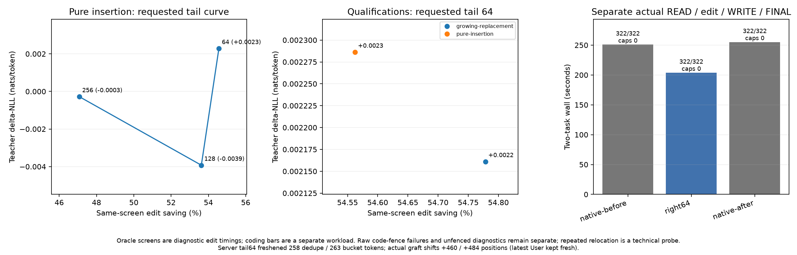

# Item39: rightward suffix relocation

One-hour item ending 2026-10-08 18:20 UTC. Right-shift runtime
`4cfff6cb`; frozen left-only control runtime `9c6918f0ae2e`.
`build-and-revisions.json` records revisions, binary/source hashes and checks.
All three server arms, four coding screens and the repeated-source diagnostic
completed within the item budget.

The completed Responses workflow takes **203.6927s** with rightward reuse,
versus native controls of 250.8486/254.9999s: **19.46% faster than their mean**
and 18.80% faster than the faster control. All six first implementations pass
their respective 161-case graders, with no retries or output caps. This is a
new rightward-expansion workload, not an additional percentage to add to
Item38 compaction or resident-routing savings.

## Implemented scope and opt-in use

The existing single-source, single-span suffix graft now supports **even
right shifts** when the source has immutable pre-RoPE originals and the live
session has pre-RoPE capture enabled. The API remains
`ds4_session_reuse_suffix_relocated`. Left shifts remain supported. This does
not implement multiple-source assembly, several imported spans in one edit,
odd displacement, or a general cache scheduler.

Server matching uses `DS4_SERVER_CONTEXT_SUFFIX_RIGHT=1`. It defaults off;
existing named profiles are not promoted to rightward reuse by this item.
The experiment selects the existing suffix, canonical full-input and parity
padding settings alongside the rightward gate:

```sh
DS4_SERVER_CONTEXT_SUFFIX_REUSE=1
DS4_SERVER_CONTEXT_SUFFIX_CANONICAL=1
DS4_SERVER_CONTEXT_SUFFIX_PAD=1
DS4_SERVER_CONTEXT_SUFFIX_FRESH_TAIL=64
DS4_SERVER_CONTEXT_SUFFIX_RIGHT=1
```

These are process environment settings, used alongside the existing
`context-fast` profile/settings. The actual launchers below set them directly
and record resolved values. Server suffix sources require immutable pre-RoPE
originals; canonical full-input and parity padding are the settings selected
here, rather than prerequisites for right shifts. Approximate archived
sources are also admissible: immutable originals do not imply native or
canonical provenance.

An older cache without originals cannot serve a server suffix import in
either direction and must be recomputed. The low-level API still accepts
original-free legacy LEFT relocation for native sources when live pre-RoPE
mode is disabled. The negative probe below verifies that a rightward request
missing originals fails before mutating serialized session state.

Right-enabled private context keys hash
`<native-profile>:right-v1:suffix:<client-key>`, versus the previous
`<native-profile>:suffix:<client-key>`. Right-enabled warm sources are
therefore scoped separately from old suffix checkpoints; shared exact native
prefixes keep their existing namespace.

The source cache is never updated by relocation: each import starts from the
same saved originals. This removes accumulated rotation/requantization drift,
while retaining conditioning from the original prefix. Approximate outputs
are measured; exact output or logit reproduction is not a success gate.

## Frozen practical workflow

`run.py` uses `/v1/responses` full input replay with stable system/tools and
the actual returned response items and tool outputs. It executes an actual
config READ, expands earlier authored planning discussion, makes the first
actual WRITE, then receives FINAL. The algorithm contract and config/tool
result remain outside the edited block. A fresh User message requests the
implementation after reading config. No `previous_response_id` is used.

Both tasks are the existing dedupe and integer token-bucket contracts, with
their existing Item32 graders. Requests use temperature 0, high reasoning
effort, READ/WRITE/FINAL budgets 0/128/1, and a total output cap of 2048. No
repair turn is allowed. Time includes READ/edit/WRITE/FINAL and actual file
operations, excluding server startup and grading.

All arms use `DeepSeek-V4.1-Flash-Q2.gguf`, Metal, SSD expert streaming with
a 64GB expert cache, context 8192, prefill chunk 512, selected tile 64/limit 1024,
and resident routing disabled. Each arm has its own server/cache/store.
State-cache hot capacity is 0MB and SSD capacity 4096MB. Controls run the
frozen left-only server with suffix caching enabled but rightward matching
unavailable; the new runtime adds the rightward path for the same edit.

| Arm | Dedupe seconds | Bucket seconds | Total seconds | First-code grading |
| --- | ---: | ---: | ---: | --- |
| native-before |123.2584|127.5902|250.8486|161/161 each |
| right64 |101.1106|102.5820|203.6927|161/161 each |
| native-after |121.5443|133.4556|254.9999|161/161 each |

Controls differ by about 1.65%, so both mean-control and faster-control
comparisons are stated. Reuse saves 49.2316s against the mean control. The
20% whole-task saving target is narrowly unmet by this first block.

The logged grafts are real SSD imports (`source_ssd=1`, `pre_rope=1`, exact
source provenance). Dedupe imports 444 tokens, moves 604:1048 to 1064:1508
(+460 positions), and recomputes 258 tokens; padding adds one prefix token.
Bucket imports 458 tokens, moves 614:1072 to 1098:1556 (+484 positions), and
recomputes 263 tokens without padding. Both destination endpoints precede the
latest User start (1603/1650), so the full latest User message is fresh.

## Completed coding-quality screens

The standalone caller reuses Item38's snapshot, full-vocabulary teacher
metrics and separate greedy-code paths. Fixed partitions are synthetic:
A256 + old B256 + retained C1536 becomes A256 + new B1024 + the same C1536.
Source/destination lengths are 2048/2816; suffix starts 512/1280; displacement
is +768. Tails 64/128/256 leave 1472/1408/1280 imported tokens.

`pure-insertion` copies the tokenized/padded old B verbatim and appends an
unrelated completed planning discussion. `growing-replacement` expands short
system coding policy into equivalent detailed review. Varied archived prose
fills the fixed partitions; no task contract/config is copied into A/B
padding. C retains the full current contract and actual config, then ends
with an assistant-ready message, a **new User message** and THINK_NONE
assistant prefix. That entire new User message is fresh at every point.

Teachers are the same unmodified correct Item37 first code used in Item38:
dedupe 137 tokens/545 bytes and bucket 174 tokens/769 bytes. Fixture JSON records
their source paths and SHA256. Teacher and greedy caps are 512 tokens, without
artificial teacher padding. First raw greedy outputs go through the existing
161-case grader; formatting failures, incorrect code and caps remain visible.
Raw full-vocabulary dumping is off by default.

| Family | Fresh tail | Teacher rows | ΔNLL nats/token | KL | Native/reuse edit seconds | Raw grading |
| --- | ---: | ---: | ---: | ---: | ---: | --- |
| pure-insertion |64|137|+0.00228620|0.00320387|70.8751 /32.2039|fresh/reuse fence failures |
| pure-insertion |128|137|−0.00392526|0.00813701|70.4965 /32.6956|fresh fence failure; reuse161/161 |
| pure-insertion |256|137|−0.00027720|0.00357698|70.6567 /37.3957|fresh/reuse fence failures |
| growing-replacement |64|174|+0.00216112|0.00228330|70.8226 /32.0272|fresh/reuse161/161 |

All four coding screens complete below their 512-token greedy caps. Five
of the eight raw outputs contain one enclosing Python Markdown fence despite
the plain-Python request, so their raw grading reports SyntaxError and they
remain **format-compliance failures**. The plain reuse128 output and both
growing-replacement outputs directly pass 161/161. Extracting only the sole
enclosing fence from each of the
other five outputs yields 161/161 for every function, without another model
turn. The original outputs, raw grades, and separate
`{fresh,reuse}-unfenced-grade.json` diagnostics are retained. These results
support all eight functional algorithms, with five requiring diagnostic
extraction; they do not turn the five raw failures into format qualification.
The actual server workflow above is unaffected: all six first server writes
directly pass 161/161.

ΔNLL is reuse minus native teacher NLL; KL is `KL(native || reuse)`, averaged
over identical teacher tokens. `exp(mean ΔNLL)` is the teacher perplexity
ratio, not a coding-failure rate. The 20% perplexity ceiling corresponds to
ΔNLL≤ln(1.2)=0.1823nats/token. All four points satisfy that ceiling:
their teacher perplexity changes are +0.229%,−0.392%,−0.028% for tails 64/128/256.
Growth64 changes teacher perplexity by +0.216% and saves 54.78% of edit time.
These measurements are separate from the whole-task workflow. Tail64 has
the lowest measured insertion edit time here;128 improves this teacher's
likelihood slightly while KL grows. Neither statistic by itself determines
the practical choice.



The same plot is available as [SVG](analysis/rightshift-pareto.svg). It keeps
whole-task measurements, standalone edit curves and the technical repeated
relocation diagnostic distinct.

## Repeated relocation diagnostic

`repeat.c` captures **one** source at 1024:1537 (513 tokens), then imports it
right 66, left 128 and right 514 into separately rebuilt current prefixes.
All three moves complete. Source state is 20,854,328 bytes and pre-RoPE masters
are 1,662,989 bytes. Their FNV hashes remain unchanged after all six native/reuse
arms. A source copy with originals deliberately removed rejects the first
right shift; before/after serialized session bytes match exactly.

| Physical displacement | Destination span | Native/reuse edit seconds | Four-token mean ΔNLL | Mean KL |
| --- | --- | ---: | ---: | ---: |
| +66 |1090:1603|42.4775 /31.5109|+0.00001018|0.00000844 |
| −128 |896:1409|37.9786 /29.1215|−0.00001772|0.00000860 |
| +514 |1538:2051|59.1346 /47.2551|+0.00001379|0.00000827 |

The CSV's `shift` convention is source minus destination, the opposite sign
to the physical displacement shown above. There are zero argmax flips across
the 12 teacher rows; each individual ΔNLL magnitude is at most 0.0000533.

This is a technical stability/bounds diagnostic, **not broad coding quality**.
The four-token teacher is `CODE=3141` after a changed-prefix access-code fact.
Question text is recomputed in a 128-token fresh tail but does **not** begin a
new User role. Therefore it does not test the server's latest-User policy.
It also does not quantify a long persistent-agent trajectory or repeated
recapture of already approximate state. Saved immutable-source hashes test
mechanical provenance; small NLL/KL on four tokens does not settle general
stale-conditioning quality.

## Commands and evidence

One heavy job at a time under the retained pressure guard. Use new output,
cache and store names for reruns; callers fail if outputs already exist.
Recorded `guard-*/command.json` and per-arm `execution.json` are the exact
executed commands and environments.

```sh
PY=/opt/homebrew/Cellar/python@3.14/3.14.8/Frameworks/Python.framework/Versions/3.14/Resources/Python.app/Contents/MacOS/Python
EXP=speed-bench/experiments/recipe-rightshift-hour39-20261008

"$PY" -B speed-bench/ideas/pressure_run.py "$EXP/guard-rerun-right64" -- \
  "$PY" -B "$EXP/launch.py" --arm context-right \
  --output "$EXP/rerun-right64" \
  --cache .workspaces/recipe-20261008/right-rerun-cache \
  --store .workspaces/recipe-20261008/right-rerun-store \
  --visible .workspaces/recipe-20261008/right-visible --fresh-tail 64

"$PY" -B speed-bench/ideas/pressure_run.py "$EXP/guard-rerun-pure64" -- \
  "$PY" -B "$EXP/screen.py" \
  --oracle .workspaces/recipe-20261008/rightshift-oracle \
  --case pure-insertion --fresh-tail 64 --output "$EXP/rerun-pure64" \
  --runtime-revision 4cfff6cb

"$PY" -B speed-bench/ideas/pressure_run.py "$EXP/guard-rerun-repeat" -- \
  "$PY" -B "$EXP/run_repeat.py" \
  --binary .workspaces/recipe-20261008/right-repeat \
  --output "$EXP/rerun-repeat" --runtime-revision 4cfff6cb
```

Native arms use `--arm native-before`/`native-after`; the launcher selects the
frozen `.workspaces/recipe-20261008/right-native-server`. Coding screens vary
`--case` and `--fresh-tail`. Launchers clear inherited DS4/PT settings,
resolve shader paths and disable resident substitution. Repeat raw-logit
files stay in the workspace; the retained small CSV/token/hash evidence is
under `repeat3/`.

`make -j2 ds4-server ds4_test`, the server suite, and the matcher/layout checks
pass; their command records and logs are retained. `analysis/results.json`
and CSVs aggregate practical timing, grafts and pressure. `screen-*/` keeps
actual old/new rendered contexts, token arrays, per-token metrics, generated
code and grading. All eight guards complete with child returncode 0, pressure
level 1 and zero adverse samples. Peak wired+compressor ranges 88.6–90.4GiB;
maximum measured swap growth is 0.81MiB. Large RAM use alone is not a failure.

Keep rightward relocation off by default and available as an explicit
addition to the existing `context-fast` settings with requested tail 64.
The [main README](../../../README.md) documents the launch command. This item
does not promote a named profile or establish a universal tail length, nor
does it qualify arbitrary changed facts or multiple-source assembly. The
teacher-perplexity ceiling passes in this suite; the 20% whole-task saving
target remains narrowly unmet, with 19.46% against mean controls and 18.80%
against the faster control.
