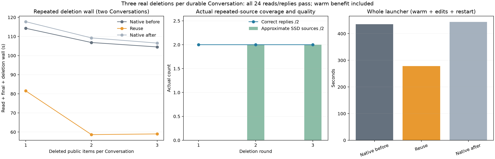

# Repeated durable Conversation edits

Suffix reuse completed three real public item deletions per Conversation across restart, including **four grafts from already approximate SSD sources**. All **24 replies and actual reads passed**, all 18 deletions removed only the selected item, and no cap was hit. Whole launcher wall fell **36.66%**, including a measured warm exact-cache benefit; edited wall including deletions fell **39.56%** against native bracket means.

| Arm | Warm A+B, s | Edit1 A+B, s | Edit2 after restart, s | Edit3, s | Client phases / whole launcher, s | Correct / reads / deletions |
| --- | ---: | ---: | ---: | ---: | --- | --- |
| Native before | 105.994 | 114.277 | 106.832 | 104.527 | 431.648 / 435.671 | 8/8 / 8/8 / 6 |
| Reuse | 75.296 | 81.530 | 58.663 | 59.018 | 274.526 / 278.559 | 8/8 / 8/8 / 6 |
| Native after | 106.196 | 117.737 | 109.248 | 106.551 | 439.752 / 443.889 | 8/8 / 8/8 / 6 |
| Reuse vs native mean | −29.03% | −29.72% | −45.70% | −44.08% | −36.99% / −36.66% | All pass |

Edits include DELETE and before/after public snapshots. Native launcher drift was +1.89%; edited-wall drift +2.43%, warm +0.19%. Native public outputs, final texts and complete response usage repeated exactly after excluding generated item/call IDs. Reuse produced byte-identical public outputs and the same output-token counts at every step; input/cached counts differ with relocation and padding. This does not establish hidden-state or token-ID identity.



The whole saving includes Bwarm's internal **1,316-token exact restore**, before any graft: 21.473s versus native 52.770/52.790s. Public `cached_tokens` remained 0 on that first warm request in every arm; the internal hit comes from its server log. A was warmed first in the shared per-arm cache, allowing reuse of their shared instruction/history prefix. Therefore 36.66% is a configuration-package result, not pure relocation speed.

| Actual reuse graft | Source → destination | Reused | Suffix fresh / graft fresh | Latest user starts | Pad | Source approximate | Logged seconds |
| --- | --- | ---: | --- | ---: | ---: | ---: | ---: |
| A edit1 | `616:1380` → `286:1050` | 764 | 729 / 665 | 1684 | 1 | 0 | 31.534 |
| B edit1 | `616:1380` → `286:1050` | 764 | 729 / 665 | 1684 | 1 | 0 | 32.617 |
| A edit2 | `618:1779` → `286:1447` | 1161 | 236 / 172 | 1588 | 0 | 1 | 20.686 |
| B edit2 | `618:1779` → `286:1447` | 1161 | 234 / 170 | 1586 | 0 | 1 | 21.130 |
| A edit3 | `616:1683` → `286:1353` | 1067 | 236 / 172 | 1494 | 1 | 1 | 21.021 |
| B edit3 | `616:1681` → `286:1351` | 1065 | 234 / 170 | 1490 | 1 | 1 | 21.245 |

All six logged `pre_rope=1` and `source_ssd=1`. The first two sources were suffix-native; the four later sources were already approximate. Round2 restores the prior approximate source after restart; round3 moves a subsequent approximate source within the running lifetime. Every destination endpoint remained before the incoming latest-user boundary. All six tool-result follow-ups retained a visible-prefix approximate continuation (`ids=0`, Conversation references), with only 25–26 fresh tokens; no second graft occurred on those follow-ups. Native controls made no suffix grafts and used ordinary visible-prefix continuations. The reuse warm calls logged two initial source misses plus the one exact restore.

A's retained inventory remained 313/BEACON-46. B retained 231 while its **actual fresh archive reads advanced ORBIT-57→58→59**; all arms returned the current code, despite earlier answers remaining in history. Analysis independently computes totals from fixed facts, checks captured read JSON and session-specific paths, and confirms each public after-snapshot equals its before-snapshot with exactly one selected ID removed and version +1. No fixture, grader or model retry was used.

Owned SSD data at shutdown was 169.533→336.292MiB in both native controls, versus 295.278→562.370MiB with reuse. Persistent endpoints were 8→16 versus 20→32; endpoint evictions, pinned endpoints and hot reads were 0. Reuse recorded 232/370 logical disk chunk-read operations per lifetime (602 total), native 0. These counters and selected SSD source flags do not measure physical SSD bytes or OS-cold reads. Useful approximate sources survived the real server restart; broader repeated edits or stress facts remain untested.

The caller uses two Conversations **sequentially**, eight read/answer turns per arm, three DELETE operations per Conversation, and restarts after edit1. Round wall sums both turns and deletion/snapshot overhead; phase wall includes creation and bookkeeping; launcher includes both startups and shutdowns. There is no concurrent GPU-throughput, paired NLL or additive speed claim. Fixed: runtime `91c9cf21`, GAP0, hot0/SSD4096MiB, Q2 cache64GiB, two resident slots/context8192/chunk512/tile64-limit1024, temperature0/effort-none/cap128, PAD1; only suffix off/on/off changes. Canonical1 full-input behavior does not apply to Conversation references. Exact SHA/settings are in [build.json](build.json).

All three guards returned child 0: 1116 pressure samples, all level 1, stable 0.018125GiB swap, peak wired+compressor 84.464GiB, no bad-pressure streak. HTTP completion and no cap were observed; EOS was not independently exposed.

```sh
.workspaces/bench-plots-venv/bin/python -B speed-bench/experiments/repeated-conversations-hour30-20261004/analyze.py --input speed-bench/experiments/repeated-conversations-hour30-20261004 --output speed-bench/experiments/repeated-conversations-hour30-20261004/analysis --plot
```

[JSON/CSV evidence](analysis/results.json) retains independent grades, all deletion records, exact public controls, per-round/phase timing, source geometry, continuations, cache and pressure records. This screen qualifies a short repeated approximate-source chain with fresh changing facts, while keeping reuse opt-in.
