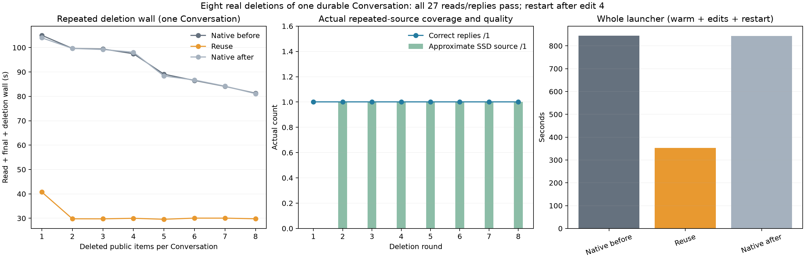

# Eight deletions of one persistent Conversation

Suffix reuse reduced whole launcher wall **58.24%** and edited read/final/deletion wall **66.33%** against the native bracket mean. All **27 replies and actual reads**, plus **24 public item deletions**, passed; no output caps. The initial warm turn stayed near 97 seconds in all arms, so this run has no second-Conversation warm exact-cache advantage.

| Arm | Warm (s) | Eight edits including deletion (s) | Before-restart client phase (s) | After-restart client phase (s) | Whole launcher (s) |
|---|---:|---:|---:|---:|---:|
| native-before | 97.328 | 742.558 | 498.936 | 340.965 | 844.318 |
| reuse | 97.793 | 249.790 | 228.090 | 119.512 | 352.273 |
| native-after | 97.616 | 741.242 | 498.561 | 340.315 | 842.995 |

Native closing/opening drift was −0.157% whole, −0.177% edited and +0.296% warm. Both controls reproduced every public tool call/final text and full usage exactly (excluding generated IDs). Reuse reproduced all public outputs, final text and output-token counts; its cached/input accounting differs, including one padding token on odd-numbered edits. Each actual archive read returned the new code **ORBIT-57 → ORBIT-64**, while the active total remained **31×8−17 = 231**. Snapshot comparisons prove each successful deletion removed exactly its selected public item and incremented the version once.

| Deletion | Native mean wall (s) | Reuse wall (s) | Change | Selected source → destination | Latest user starts | Pad | Source approximate |
|---:|---:|---:|---:|---|---:|---:|---:|
| 1 | 104.515 | 40.738 | -61.02% | 616:3035 → 286:2705 | 3339 | 1 | 0 |
| 2 | 99.651 | 29.784 | -70.11% | 618:3434 → 286:3102 | 3241 | 0 | 1 |
| 3 | 99.318 | 29.765 | -70.03% | 616:3336 → 286:3006 | 3145 | 1 | 1 |
| 4 | 97.778 | 29.994 | -69.32% | 618:3240 → 286:2908 | 3047 | 0 | 1 |
| 5 | 88.718 | 29.594 | -66.64% | 616:3142 → 286:2812 | 2951 | 1 | 1 |
| 6 | 86.607 | 30.065 | -65.29% | 618:3046 → 286:2714 | 2853 | 0 | 1 |
| 7 | 84.126 | 30.057 | -64.27% | 616:2948 → 286:2618 | 2757 | 1 | 1 |
| 8 | 81.188 | 29.794 | -63.30% | 618:2852 → 286:2520 | 2659 | 0 | 1 |

Restart occurred after deletion 4. All eight selected sources were SSD-backed and pre-RoPE; the first was native, seven were already approximate. Deletion 5 selected an approximate SSD source after restart. The source endpoints for deletions 2–8 equal the preceding first request’s input length, but the trace does not establish eight unique source objects or uniquely identify every direct chain link. Every destination ends before the incoming latest user; source/destination starts are even. Reused lengths were **2419, 2816, 2720, 2622, 2526, 2428, 2332, 2234** tokens. Logged fresh work was 729 on edit 1 and 234 thereafter (graft fresh 665/170, plus the 64-token tail).

There were eight approximate visible-prefix continuations, each `ids=0` with 25 new prompt tokens. The only suffix fallback was the initial warm `no-aligned-source`; no edit fell back. This verifies selected-source reuse over repeated edits and restart, rather than assuming coverage from the requested setting.

| Owned cache at shutdown | Before restart | After restart | Logical disk reads across both lifetimes |
|---|---|---|---:|
| native-before | 299.413 MiB / 15 endpoints | 519.949 MiB / 27 endpoints | 0 |
| reuse | 409.030 MiB / 22 endpoints | 678.064 MiB / 34 endpoints | 1060 |
| native-after | 299.413 MiB / 15 endpoints | 519.949 MiB / 27 endpoints | 0 |

All owned SSD caches stayed below the 4096 MiB cap; hot bytes, hot reads, pinned endpoints and endpoint evictions were zero. The 1,060 candidate disk reads are logical chunk operations, not physical SSD traffic or proof of an OS-cold read.

**Pressure:** all three guards completed with child 0; 1,963 samples, all level 1, no consecutive bad samples. Native-before swap rose 3.75 MiB (0.018125→0.021787109375 GiB); candidate and closing control stayed at the latter value. Peak wired plus compressor was 87.791 GiB.

**Method/scope:** runtime `91c9cf212d2e6a35ae558d1c96f37607becbde3f`; exact server SHA and commands are retained in [build.json](build.json) and arm launch records. Q2/cache64, two slots, context8192/chunk512, tile64/limit1024, GAP0, hot0/SSD4096, temperature0/no thinking, cap128. Canonical/PAD1 and the same Conversation fixture are fixed; suffix is off/on/off, reuse tail64. Whole launcher includes warm, edits, restart/startup/shutdown. This is one shrinking history with fresh external facts; the curve is deletion count, not independent task families. No private-state identity, NLL, isolated relocation, additive gain or general quality claim. Keep the feature opt-in and use broader tasks to test accumulation of semantic errors.



Analysis command:

```sh
.workspaces/bench-plots-venv/bin/python -B speed-bench/experiments/repeated-conversations-hour31-20261004/analyze.py --input speed-bench/experiments/repeated-conversations-hour31-20261004 --output speed-bench/experiments/repeated-conversations-hour31-20261004/analysis --plot
```

[Full metrics](analysis/results.json), [deletion records](analysis/deletions.csv), [actual graft geometry](analysis/grafts.csv), [continuations](analysis/visible-continuations.csv), [cache shutdowns](analysis/cache-shutdowns.csv).
