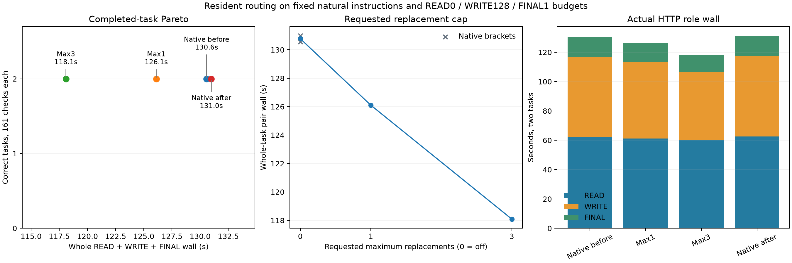

# Resident routing with caller budgets, Item22

On these two first-attempt coding tasks, allowing up to three resident replacements reduced whole-task wall **9.70%** against the native bracket mean; allowing one reduced it **3.58%**. All eight tasks completed the actual READ → WRITE → FINAL pipeline and passed all 161 independent code checks, with no global output caps. The natural instruction protocol and READ0 / WRITE128 / FINAL1 high-effort budgets were already present in both controls, so these gains describe the added resident policy.

| Arm, measured order | Ledger wall (s) | LRU wall (s) | Pair wall (s) | Change vs native mean | Pipeline/code | Output / thinking tokens |
|---|---:|---:|---:|---:|---:|---:|
| Native before | 68.796 | 61.771 | 130.567 | −0.16% | 2/2 | 1,294 / 326 |
| Maximum 3 | 62.181 | 55.908 | 118.089 | −9.70% | 2/2 | 1,292 / 325 |
| Maximum 1 | 66.782 | 59.323 | 126.105 | −3.58% | 2/2 | 1,272 / 312 |
| Native after | 69.937 | 61.056 | 130.993 | +0.16% | 2/2 | 1,294 / 326 |

The native pair mean was 130.780191 seconds; after/before drift was +0.32612%. Native first code, final text, emitted content/private reasoning/raw DSML for every role, and all per-role token usage were byte-exact, excluding generated server IDs. Maximum3 saved 10.36% on ledger and 8.96% on LRU; maximum1 saved 3.73% and 3.40% respectively.

| Policy | READ wall (s) | WRITE wall (s) | FINAL wall (s) | Thinking READ / WRITE / FINAL |
|---|---:|---:|---:|---:|
| Native bracket mean | 62.202 | 54.911 | 13.664 | 68 / 256 / 2 |
| Maximum3 | 60.366 | 46.203 | 11.517 | 67 / 256 / 2 |
| Maximum1 | 61.275 | 52.026 | 12.800 | 54 / 256 / 2 |

Every arm logged two forced WRITE closes at 128 and two FINAL closes at 1, with no deferrals. READ was unlimited high effort. All arms reused their exact prefixes on WRITE and FINAL: the pair had 228 fresh WRITE input tokens and 87 fresh FINAL input tokens. Actual cached spans differ slightly with the generated histories.

| Actual route counters | Maximum1 | Maximum3 |
|---|---:|---:|
| Routed layer calls | 50,880 | 51,680 |
| Substitutions / skipped loads | 7,566 | 21,856 |
| Original native misses | 26,092 | 30,898 |
| Layers with two / three replacements | 0 / 0 | 2,956 / 275 |
| Mean removed mass | 0.111372 | 0.120534 |
| Mean score gap / affinity ratio | 0.056531 / 0.954810 | 0.109304 / 0.893204 |
| Mean replacement rank | 7.305 | 7.622 |

The native-weight log confirms that every substitution used that requested mode; drops were zero. Logged skipped payload bytes were 75,306,516,480 and 217,538,887,680, respectively. These are route accounting for unissued selected loads, not independently measured physical SSD traffic. The counts describe different generated histories and are not normalized estimates of a kernel's speed.

Candidate histories changed. Both ledger first-code files differed from native but passed all checks: maximum3 changed the winner lookup form, while maximum1 stored winning indices instead of tuples. LRU code was byte-identical across all four arms. Maximum3's ledger FINAL text/private emission also matched native; its LRU FINAL and both maximum1 finals differed. All final summaries accurately described the first implementations without claiming to have run the private tests. The actual texts, role costs, usage and comparisons are in [analysis/results.json](analysis/results.json) and [results.csv](analysis/results.csv).



The candidate settings were GAP 0.90, maximum mass 0.25, rank 64, total mass 0.50, replace policy and native weights, with requested maximum substitutions 1 or 3; native controls used GAP 0. All arms had suffix approximation off, hot 0/SSD 1024 MiB, a fresh cache/store, one resident session, Q2/cache64/ctx8192/chunk512, stable instructions and tools, temperature 0 and a 2,048 output-token cap shared across each task's requests. The unchanged Item20 driver performed one actual read and first write per task, without retries. No seed was sent because the server ignores it. Runtime and server SHA are in [build.json](build.json); this reused `fe5d6e2670e7d154bf97234df01d1ee8db4a51e8` with no runtime change or rebuild.

Whole-task wall includes the actual read/write and all three HTTP requests, excluding startup and external grading. These are reused ledger/LRU tasks, not a new independent task family. Divergent histories have no paired NLL/KL claim, and savings are not additive with earlier protocol/budget results. The request-local soft budget disables MTP when nonzero; zero keeps speculation. Completed status does not independently establish an observed EOS, and output usage excludes EOS.

The guard completed with child exit0. All 498 pressure samples were level1, swap remained 0.012998 GiB, peak wired plus compressor was 83.906082 GiB, and the maximum consecutive-bad count was zero. Original requests, replies, implementations, grader results, execution settings, stderr counters and guard records remain preserved.

Reproduce CPU analysis:

```sh
.workspaces/bench-plots-venv/bin/python -B \
  speed-bench/experiments/resident-combined-hour22-20261004/analyze.py \
  --input speed-bench/experiments/resident-combined-hour22-20261004/http \
  --output speed-bench/experiments/resident-combined-hour22-20261004/analysis --plot
```

Maximum3 is the strongest measured setting here. Keep resident routing opt-in and confirm it on a fresh task family and longer persistent histories before promoting a broader default.
